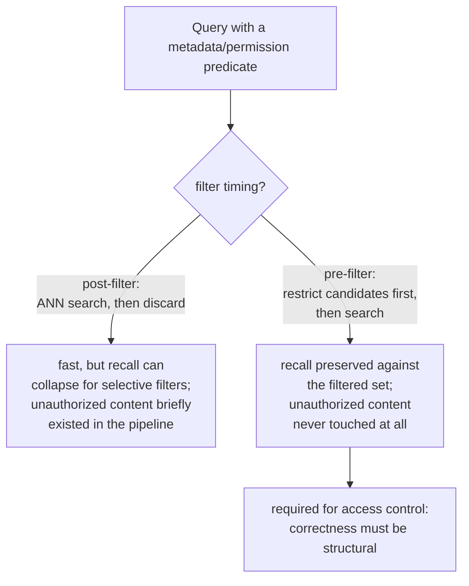

# Lição 15. Filtragem por metadados e recuperação ciente de permissões

**Ligação com a missão:** O procedimento de diagnóstico da lição 11 trata "contexto errado recuperado" como um problema de relevância: o chunking, o embedding, o índice, a ponderação híbrida ou o reranking erraram algo. Uma falha de permissão produz o sintoma idêntico, um chunk que não deveria estar na resposta, por um motivo completamente diferente: o chunk era perfeitamente relevante, foi recuperado corretamente, e o usuário simplesmente nunca teve permissão para vê-lo. Esta lição cobre o mecanismo que precisa impedir isso antes mesmo de o procedimento da lição 11 ter a chance de rodar.
**Fonte principal:** [Artigo científico: "Policy-aware Vector Search: A Vision for Fine Grained Access Control in Vector Databases", Yalamarthi e Pappachan, 2026](https://arxiv.org/abs/2606.19803)
**Pré-requisitos:** [Lição 5](0005-pgvector-specifics.md), [Lição 11](0011-diagnosing-the-pipeline.md)

## Aquecimento

1. ▢ O que o pgvector permite combinar que uma operação de busca vetorial pura sozinha não consegue?

Verificação

Predicados SQL comuns e os próprios recursos relacionais do Postgres (transações, row-level security, joins) junto com a busca por similaridade vetorial, na mesma consulta, em vez de precisar de um sistema separado para tudo o que não seja busca pura de vizinho mais próximo.

2. ▢ Uma única consulta que falha pode falhar por um motivo pontual que não reflete um problema sistêmico do pipeline. Por que diagnosticar sobre um pequeno conjunto de consultas que sabidamente falham evita essa armadilha?

Verificação

Medir a qualidade da recuperação sobre um conjunto representativo de falhas conhecidas revela onde ocorre a maior queda agregada, apontando uma etapa que está perdendo informação de forma sistemática, em vez de reagir a qualquer falha isolada que alguém por acaso notou.

## Saiba isto

### A filtragem por metadados restringe o conjunto de candidatos a mais do que apenas o "mais próximo"

Chunks reais carregam atributos estruturados além de seu texto: um tipo de documento, um departamento, uma data, um dono, uma tag de sensibilidade. A **filtragem por metadados** permite que uma consulta restrinja a recuperação aos chunks que satisfazem um predicado sobre esses atributos ("apenas relatórios do 3º trimestre", "apenas documentos que a equipe deste usuário possui"), além da similaridade por vizinho mais próximo, em vez de buscar no corpus inteiro apenas por similaridade e torcer para que o subconjunto certo por acaso fique bem ranqueado.

### Onde o filtro roda em relação à busca ANN muda tanto o recall quanto a correção

Um filtro de metadados pode rodar em um de dois lugares em relação à busca vetorial. A **pós-filtragem** executa primeiro a busca ANN, sobre o índice inteiro, e descarta depois os resultados que não passam no predicado; é rápida, mas um índice aproximado só varre um orçamento limitado de candidatos presumindo que a maior parte do que encontrar vai sobreviver, então um predicado seletivo pode descartar a maior parte do que voltou, deixando muito menos que o número de resultados solicitado e derrubando o recall em silêncio. A **pré-filtragem** restringe o conjunto de candidatos apenas aos chunks que satisfazem o predicado *antes* de a busca ANN rodar, preservando o recall contra esse conjunto filtrado, não importa quão seletivo seja o predicado, ao custo de não explorar plenamente um índice construído para buscar eficientemente em todo o espaço vetorial.

### O controle de acesso é o único filtro em que errar a ordem é um incidente de segurança, não de qualidade

Um filtro de metadados comum (intervalo de datas, tipo de documento) que falha feio significa apenas relevância pior, um inconveniente. Um **filtro de permissão**, que restringe os resultados ao que o usuário solicitante de fato está autorizado a ver, é diferente em natureza: com a pós-filtragem, o chunk não permitido ainda foi recuperado e existiu no pipeline antes de ser descartado, ou seja, já foi tocado, e qualquer bug nessa etapa de descarte é uma divulgação direta de conteúdo que o usuário nunca deveria ter recebido. É exatamente por isso que o controle de acesso exige especificamente a **pré-filtragem** (ou uma estratégia de imposição que se comporte de forma equivalente): a correção de *nunca trazer à tona* conteúdo não autorizado precisa ser estrutural, e não uma etapa de limpeza aplicada depois a resultados que já o incluíam.

### Uma falha de permissão é silenciosa de um jeito que as outras falhas da lição 11 não são

Todo modo de falha que a lição 11 diagnostica (uma passagem mal dividida em chunks, um embedding descasado, um índice mal ajustado) produz uma resposta visivelmente errada ou ausente, algo que um usuário ou um revisor consegue notar e rastrear até uma etapa. Uma falha de permissão produz uma resposta perfeitamente fluente, plausível e bem formada, construída a partir de conteúdo que o usuário nunca teve autorização para ver, e nada na saída parece quebrado. Ninguém percebe até que alguém por acaso reconheça conteúdo ao qual não deveria ter tido acesso, e é precisamente por isso que essa classe de bug precisa ser prevenida de forma estrutural, por construção, e não pega depois ao notar um sintoma do jeito que o procedimento de diagnóstico da lição 11 pega uma falha de relevância.

## Prática

1. ▢ Uma equipe aplica um filtro de metadados para "documentos deste trimestre" usando pós-filtragem e nota menos resultados que o esperado em um intervalo de datas estreito. Qual é a causa provável?

Dica

Considere o que o orçamento de candidatos do índice ANN presumiu sobre quantos resultados sobreviveriam ao filtro.

Verificação

O índice ANN varreu seu orçamento limitado habitual de candidatos presumindo que a maior parte dos resultados sobreviveria ao filtro, mas um intervalo de datas estreito e seletivo descartou a maioria deles depois do fato, deixando muito menos resultados que o solicitado; é o problema de recall da pós-filtragem aparecendo exatamente como previsto para um predicado seletivo.

2. ▢ Por que a pós-filtragem é especificamente inaceitável para um filtro de permissão, mesmo que possa ser um trade-off aceitável para um filtro de metadados comum como o tipo de documento?

Verificação

Com a pós-filtragem, um chunk que o usuário não tem autorização para ver ainda foi recuperado e existiu no pipeline antes de ser descartado; qualquer bug nessa etapa de descarte divulga diretamente conteúdo não autorizado. Um filtro de metadados comum que falha feio custa apenas qualidade de relevância, e não uma garantia de segurança, então o mesmo trade-off que é apenas inconveniente para um é um incidente genuíno para o outro.

3. ▢ Por que não se pode contar com o procedimento de diagnóstico da lição 11 para pegar uma falha de permissão do jeito que ele pega uma falha de chunking ou de embedding?

Verificação

As falhas da lição 11 produzem todas uma resposta visivelmente errada ou ausente que um revisor consegue notar e rastrear até uma etapa. Uma falha de permissão produz uma resposta fluente e bem formada construída a partir de conteúdo não autorizado, sem que nada na saída pareça quebrado; ninguém percebe até que alguém por acaso reconheça conteúdo ao qual não deveria ter tido acesso, então ela precisa ser prevenida de forma estrutural, e não pega pelo sintoma.

4. ▢ Por que o pgvector, como o vector store padronizado deste workspace, é particularmente adequado para impor o controle de acesso corretamente?

Verificação

Porque ele permite combinar a busca por similaridade vetorial diretamente com predicados SQL comuns e com os próprios recursos relacionais do Postgres, como row-level security, em um único sistema, em vez de tratar a filtragem e o controle de acesso como uma preocupação separada e acoplada depois, como fazem alguns bancos de dados vetoriais criados para esse fim.

5. ▢ Qual afirmação descreve corretamente a relação entre pré-filtragem, pós-filtragem e controle de acesso especificamente?

    - a) A pré-filtragem e a pós-filtragem produzem recall e garantias de segurança idênticos, diferindo apenas na conveniência de implementação
    - b) A pós-filtragem corre o risco de derrubar o recall sob um predicado seletivo e, para filtros de permissão especificamente, expõe conteúdo não autorizado ao pipeline antes de descartá-lo; a pré-filtragem preserva o recall contra o conjunto filtrado e nunca deixa conteúdo não autorizado entrar no pipeline, e é por isso que o controle de acesso a exige especificamente
    - c) Um filtro de metadados comum (como o tipo de documento) e um filtro de permissão têm as mesmas consequências se qualquer um falhar
    - d) O procedimento de diagnóstico da lição 11 já cobre falhas de permissão, já que elas produzem o mesmo sintoma de "contexto errado"

Verificação

**b)** Essa é a distinção precisa que esta lição estabelece. (a) é falsa: a pós-filtragem pode prejudicar gravemente o recall para predicados seletivos e, especificamente para controle de acesso, recupera brevemente conteúdo que não deveria. (c) é falsa: a falha de um filtro de permissão é um incidente de segurança, e não apenas uma regressão de qualidade, ao contrário da maioria dos filtros de metadados comuns. (d) é falsa: o procedimento da lição 11 foi construído para falhas de relevância visivelmente erradas, e não para uma resposta silenciosamente bem formada construída a partir de conteúdo não autorizado.

## Prática no mundo real

- [ ] Para um sistema RAG ao qual você tem acesso, verifique se ele aplica algum filtro de metadados e, se aplica, se eles rodam antes ou depois da busca vetorial.
- [ ] Se o sistema tem qualquer requisito de controle de acesso ou de permissão, verifique especificamente se conteúdo não autorizado poderia ser recuperado (mesmo que temporariamente, antes de ser descartado) na implementação atual.
- [ ] Amanhã: leia por inteiro a comparação de estratégias de imposição na fonte principal e anote o que seus achados preliminares dizem sobre o custo de latência de garantir uma imposição correta em comparação com uma baseline sem filtro.

## Para ir além

- [Artigo científico: "Policy-aware Vector Search: A Vision for Fine Grained Access Control in Vector Databases", Yalamarthi e Pappachan, 2026](https://arxiv.org/abs/2606.19803)
- [Repositório: pgvector, pgvector](https://github.com/pgvector/pgvector)
- [Recursos](../RESOURCES.md)

---

Não ficou claro? Releia a fonte principal no topo, já que esta lição a comprime e é na compressão que o entendimento escapa. Consulte o [glossário](../GLOSSARY.md) para qualquer termo que pareceu escorregadio.

Se o problema é a lição em si, e não o material, isso é um defeito: [abra uma issue](https://github.com/TokenCemetery/teach/issues).
