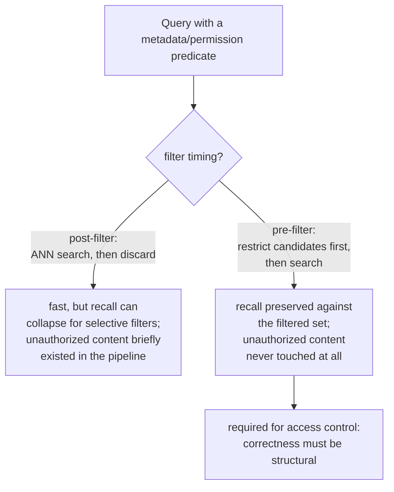

# Урок 15. Фильтрация по метаданным и поиск с учётом прав доступа

**Связь с целью курса:** Процедура диагностики из урока 11 рассматривает «найден неверный контекст» как проблему релевантности: что-то неверно сделали чанкинг, эмбеддинг, индекс, веса гибридного поиска или реранкинг. Сбой прав доступа даёт тот же симптом, чанк, которого не должно было быть в ответе, по совершенно другой причине: чанк был вполне релевантен, найден верно, а пользователю просто никогда не разрешалось его видеть. Этот урок о механизме, который обязан предотвратить это раньше, чем процедура урока 11 вообще получит шанс запуститься.
**Первоисточник:** [Научная статья: "Policy-aware Vector Search: A Vision for Fine Grained Access Control in Vector Databases", Yalamarthi and Pappachan, 2026](https://arxiv.org/abs/2606.19803)
**Предварительные требования:** [Урок 5](0005-pgvector-specifics.md), [Урок 11](0011-diagnosing-the-pipeline.md)

## Разминка

1. ▢ Что pgvector позволяет сочетать такого, чего одна операция векторного поиска не может?

Проверка

Обычные предикаты SQL и собственные реляционные возможности Postgres (транзакции, защита на уровне строк, соединения) вместе с поиском по векторному сходству, в одном запросе, вместо того чтобы нуждаться в отдельной системе для всего, что не является чистым поиском ближайших соседей.

2. ▢ Один сбойный запрос может сбоить по единичной причине, не отражающей системной проблемы конвейера. Почему диагностика по небольшому набору заведомо сбойных запросов избегает этой ловушки?

Проверка

Измерение качества поиска по репрезентативному набору известных сбоев показывает, где происходит наибольшее суммарное падение, указывая на этап, который систематически теряет информацию, а не реакцию на тот единственный сбой, который кто-то случайно заметил.

## Что нужно знать

### Фильтрация по метаданным ограничивает множество кандидатов не только словом «ближайшие»

У настоящих чанков есть структурированные атрибуты помимо текста: тип документа, отдел, дата, владелец, тег чувствительности. **Фильтрация по метаданным** позволяет запросу ограничить поиск чанками, удовлетворяющими предикату над этими атрибутами («только отчёты за третий квартал», «только документы, которыми владеет команда этого пользователя»), в дополнение к сходству по ближайшим соседям, вместо поиска по всему корпусу только по сходству в надежде, что нужное подмножество случайно окажется высоко.

### Где фильтр выполняется относительно ANN-поиска, меняет и полноту, и корректность

Фильтр по метаданным может выполняться в одном из двух мест относительно векторного поиска. **Постфильтрация (post-filtering)** сначала выполняет ANN-поиск по всему индексу, а результаты, не прошедшие предикат, отбрасывает потом; это быстро, но приближённый индекс просматривает лишь ограниченный бюджет кандидатов в предположении, что большая часть найденного выживет, поэтому избирательный предикат может отбросить большую часть вернувшегося, оставив намного меньше запрошенного числа результатов и тихо обрушив полноту. **Предфильтрация (pre-filtering)** ограничивает множество кандидатов только чанками, удовлетворяющими предикату, *до* запуска ANN-поиска вообще, сохраняя полноту относительно этого отфильтрованного множества независимо от избирательности предиката, ценой того, что индекс, построенный для эффективного поиска по всему векторному пространству, используется не полностью.

### Контроль доступа это единственный фильтр, где неверный порядок это инцидент безопасности, а не качества

Обычный фильтр по метаданным (диапазон дат, тип документа), сработавший плохо, означает лишь худшую релевантность, то есть неудобство. **Фильтр по правам доступа (permission filter)**, ограничивающий результаты тем, что запрашивающему пользователю на самом деле разрешено видеть, иной по природе: при постфильтрации недопустимый чанк всё равно был найден и существовал в конвейере, прежде чем был отброшен, то есть к нему уже прикасались, и любая ошибка на шаге отбрасывания это прямое раскрытие содержимого, которое пользователь вообще не должен был получить. Именно поэтому контролю доступа нужна именно **предфильтрация** (или стратегия принудительного применения, ведущая себя эквивалентно): корректность того, что неавторизованное содержимое *никогда не выводится*, должна быть структурной, а не шагом уборки, применяемым постфактум к результатам, которые его уже включали.

### Сбой прав доступа тихий так, как другие сбои урока 11 не бывают

Каждый вид сбоя, который диагностирует урок 11 (плохо порезанный пассаж, несоответствующий эмбеддинг, недонастроенный индекс), даёт заметно неверный или отсутствующий ответ, то, что пользователь или ревьюер может заметить и проследить до этапа. Сбой прав доступа даёт совершенно беглый, правдоподобный, безупречно оформленный ответ, построенный на содержимом, которое пользователю никогда не было разрешено видеть, и ничто в выводе не выглядит сломанным. Никто не замечает, пока кто-нибудь случайно не узнает содержимое, к которому не должен был иметь доступа, и именно поэтому этот класс ошибок нужно предотвращать структурно, по построению, а не ловить позже, замечая симптом, как процедура диагностики урока 11 ловит сбой релевантности.

## Практика

1. ▢ Команда применяет фильтр по метаданным «документы за этот квартал» с постфильтрацией и замечает, что результатов меньше ожидаемого на узком диапазоне дат. Какова вероятная причина?

Подсказка

Подумайте, что бюджет кандидатов ANN-индекса предполагал о том, сколько результатов переживёт фильтр.

Проверка

ANN-индекс просмотрел свой обычный ограниченный бюджет кандидатов в предположении, что большая часть результатов переживёт фильтр, но узкий, избирательный диапазон дат отбросил большинство из них постфактум, оставив намного меньше запрошенного числа результатов; это проблема полноты постфильтрации, проявившаяся ровно так, как предсказано для избирательного предиката.

2. ▢ Почему постфильтрация особенно неприемлема для фильтра по правам доступа, хотя может быть приемлемым компромиссом для обычного фильтра по метаданным вроде типа документа?

Проверка

При постфильтрации чанк, который пользователю не разрешено видеть, всё равно был найден и существовал в конвейере, прежде чем был отброшен; любая ошибка на шаге отбрасывания прямо раскрывает неавторизованное содержимое. Обычный фильтр по метаданным, сработавший плохо, стоит лишь качества релевантности, а не гарантии безопасности, поэтому тот же компромисс, который лишь неудобен для одного, для другого настоящий инцидент.

3. ▢ Почему на процедуру диагностики урока 11 нельзя полагаться, чтобы поймать сбой прав доступа так же, как она ловит сбой чанкинга или эмбеддинга?

Проверка

Сбои урока 11 все дают заметно неверный или отсутствующий ответ, который ревьюер может заметить и проследить до этапа. Сбой прав доступа даёт беглый, безупречно оформленный ответ, построенный на неавторизованном содержимом, и ничто в выводе не выглядит сломанным; никто не замечает, пока кто-нибудь случайно не узнает содержимое, к которому не должен был иметь доступа, поэтому его нужно предотвращать структурно, а не ловить по симптому.

4. ▢ Почему pgvector, как стандартизированное в этой рабочей области векторное хранилище, особенно хорошо подходит для корректного принудительного применения контроля доступа?

Проверка

Потому что он позволяет сочетать поиск по векторному сходству прямо с обычными предикатами SQL и собственными реляционными возможностями Postgres, например защитой на уровне строк, в одной системе, а не считать фильтрацию и контроль доступа отдельной, приставленной сбоку заботой, как это делают некоторые специализированные векторные базы данных.

5. ▢ Какое утверждение верно описывает отношение между предфильтрацией, постфильтрацией и контролем доступа в частности?

    - a) Предфильтрация и постфильтрация дают одинаковые гарантии полноты и безопасности, различаясь лишь удобством реализации
    - b) Постфильтрация рискует обвалом полноты при избирательном предикате и, для фильтров по правам доступа в частности, выставляет неавторизованное содержимое конвейеру перед отбрасыванием; предфильтрация сохраняет полноту относительно отфильтрованного множества и вовсе не пускает неавторизованное содержимое в конвейер, поэтому контролю доступа нужна именно она
    - c) Обычный фильтр по метаданным (вроде типа документа) и фильтр по правам доступа несут одинаковые последствия, если любой из них сработает неверно
    - d) Процедура диагностики урока 11 уже охватывает сбои прав доступа, поскольку они дают тот же симптом «неверный контекст»

Проверка

**b)** Это точное различие, которое устанавливает этот урок. (a) неверно: постфильтрация может сильно ударить по полноте при избирательных предикатах, а именно для контроля доступа ненадолго находит то, чего не должна. (c) неверно: сбой фильтра по правам доступа это инцидент безопасности, а не просто падение качества, в отличие от большинства обычных фильтров по метаданным. (d) неверно: процедура урока 11 построена для заметно неверных сбоев релевантности, а не для тихо безупречного ответа, построенного на неавторизованном содержимом.

## Практика в реальной работе

- [ ] Для RAG-системы, к которой у вас есть доступ, проверьте, применяет ли она какие-либо фильтры по метаданным и, если да, выполняются ли они до или после векторного поиска.
- [ ] Если у системы есть какое-либо требование к контролю доступа или правам, проверьте именно то, мог ли неавторизованный контент когда-либо быть найден (даже временно, до отбрасывания) в её текущей реализации.
- [ ] Завтра: прочитайте целиком сравнение стратегий принудительного применения в первоисточнике и отметьте, что его предварительные выводы говорят о цене в задержке гарантии корректного применения по сравнению с базовой линией без фильтра.

## Что почитать дальше

- [Научная статья: "Policy-aware Vector Search: A Vision for Fine Grained Access Control in Vector Databases", Yalamarthi and Pappachan, 2026](https://arxiv.org/abs/2606.19803)
- [Репозиторий: pgvector, pgvector](https://github.com/pgvector/pgvector)
- [Ресурсы](../RESOURCES.md)

---

Не доходит? Перечитайте первоисточник в начале: этот урок его сжимает, а при сжатии понимание как раз и теряется. Загляните в [глоссарий](../GLOSSARY.md), если какой-то термин показался скользким.

Если неясен сам урок, а не материал, это дефект: [откройте issue](https://github.com/TokenCemetery/teach/issues).
