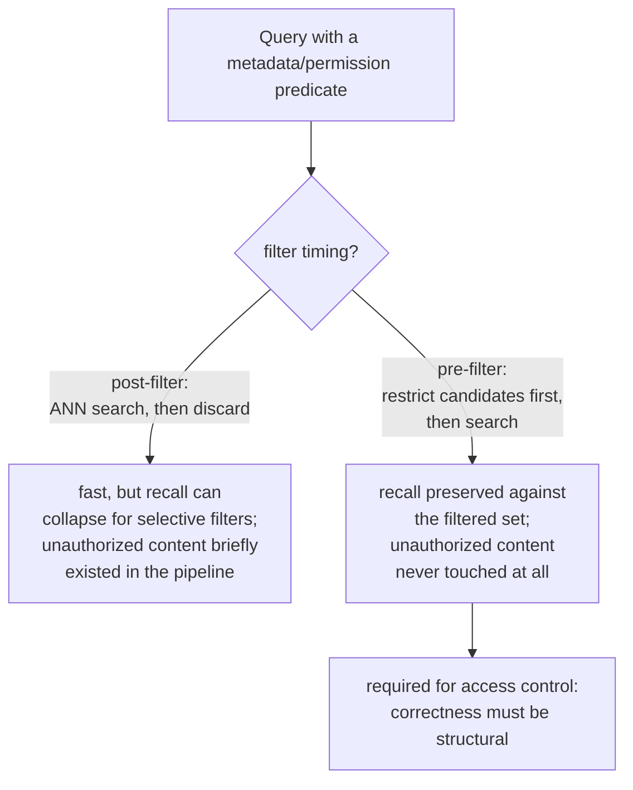

# 第 15 课：元数据过滤与权限感知检索

**使命关联:** 第 11 课的诊断流程把“检索到了错误的上下文”当作相关性问题：分块、嵌入、索引、混合权重或重排序出了差错。权限失败会产生完全相同的症状，也就是一个本不该出现在答案里的文本块，但原因截然不同：这个文本块完全相关，检索也正确，只是用户从来就不被允许看到它。本课讲的是必须防止这种情况的机制，而且要在第 11 课的流程还没有机会运行之前就起作用。
**主要来源:** [论文：“Policy-aware Vector Search: A Vision for Fine Grained Access Control in Vector Databases”，Yalamarthi 和 Pappachan，2026](https://arxiv.org/abs/2606.19803)
**前置知识:** [第 5 课](0005-pgvector-specifics.md)、[第 11 课](0011-diagnosing-the-pipeline.md)

## 热身

1. ▢ pgvector 能让你组合起来使用什么，是单纯的向量搜索操作本身做不到的？

检查

普通的 SQL 谓词和 Postgres 自身的关系型特性（事务、行级安全、连接），可以与向量相似度搜索一起，在同一个查询里使用，而不必为任何不属于纯最近邻搜索的需求另外准备一套系统。

2. ▢ 单个失败的查询可能因为偶发的原因而失败，并不反映系统性的流水线问题。为什么在一小批已知失败的查询上做诊断，能避开这个陷阱？

检查

在一批有代表性的已知失败案例上测量检索质量，可以看出总体上最大的落差出现在哪里，指出是哪个阶段在系统性地丢失信息，而不是对恰好被某个人注意到的单个失败做出反应。

## 要点

### 元数据过滤把候选集限制在“最近”之外的更多条件上

真实的文本块除了文本之外，还带有结构化的属性：文档类型、部门、日期、所有者、敏感度标签。**元数据过滤**让查询在最近邻相似度之外，还可以把检索限制在满足这些属性谓词的文本块上（“只要第三季度的报告”，“只要这位用户所在团队拥有的文档”），而不是只按相似度搜索整个语料库，指望合适的子集恰好排得靠前。

### 过滤相对 ANN 搜索在何处运行，同时改变召回率和正确性

元数据过滤相对于向量搜索，可以在两个位置之一运行。**后过滤**先对整个索引运行 ANN 搜索，之后再丢弃不满足谓词的结果；这很快，但近似索引只扫描有限的候选预算，且假定它找到的大部分结果都能留下来，所以选择性强的谓词可能把返回的大部分结果都丢掉，剩下的结果远少于请求的数量，悄悄地毁掉召回率。**预过滤**则在 ANN 搜索根本开始之前，*先*把候选集限制为只含满足谓词的文本块，无论谓词的选择性多强，都能针对这个过滤后的集合保住召回率，代价是没能充分利用一个本来为高效搜索整个向量空间而建的索引。

### 访问控制是唯一一种顺序搞错就是安全事件、而不只是质量问题的过滤

普通的元数据过滤（日期范围、文档类型）出了大问题，只意味着相关性变差，是个麻烦而已。**权限过滤**则是另一种性质：它把结果限制在发出请求的用户实际被授权查看的范围内；用后过滤时，不被允许的文本块仍然被检索了出来，并在被丢弃之前存在于流水线中，也就是说它已经被触碰过，而丢弃这一步中的任何缺陷，都直接就是向用户披露了他根本不该收到的内容。这正是访问控制尤其需要**预过滤**（或行为等价的执行策略）的原因：*绝不呈现*未授权内容的正确性必须是结构性的，而不是对已经包含了它的结果事后施加的一步清理。

### 权限失败是悄无声息的，这一点与第 11 课的其他失败不同

第 11 课诊断的每一种失败模式（分块糟糕的段落、不匹配的嵌入、调优不足的索引），产生的都是明显错误或缺失的答案，用户或评审者能注意到，并追溯到某个阶段。权限失败产生的则是一个完全流畅、合理、格式完好的答案，其依据是用户从未被授权查看的内容，输出看上去没有任何问题。直到有人恰好认出他本不该有权访问的内容，才会被察觉，这恰恰是这一类缺陷必须靠结构来预防、靠构造来保证，而不能像第 11 课的诊断流程抓相关性失败那样，事后靠注意到症状来发现的原因。

## 练习

1. ▢ 某团队用后过滤来应用“本季度的文档”这个元数据过滤，并注意到在较窄的日期范围上，结果比预期的少。可能的原因是什么？

提示

想一想，ANN 索引的候选预算假定有多少结果能通过过滤留下来。

检查

ANN 索引按照平常有限的候选预算做了扫描，假定大部分结果都能通过过滤留下来，但一个窄的、选择性强的日期范围事后把大部分结果都丢掉了，剩下的结果远少于请求的数量；这正是后过滤的召回率问题，针对选择性强的谓词，恰如预测地出现了。

2. ▢ 为什么后过滤对权限过滤来说尤其不可接受，尽管对于文档类型这样的普通元数据过滤，它可能是可以接受的权衡？

检查

用后过滤时，用户没有被授权查看的文本块仍然被检索了出来，并在被丢弃之前存在于流水线中；丢弃这一步中的任何缺陷，都会直接泄露未授权的内容。普通的元数据过滤出了大问题，只损失相关性质量，不涉及安全保证，所以同一个权衡，对一方只是麻烦，对另一方则是真正的事故。

3. ▢ 为什么不能指望第 11 课的诊断流程，像抓分块或嵌入失败那样抓到权限失败？

检查

第 11 课的失败都会产生明显错误或缺失的答案，评审者能注意到并追溯到某个阶段。权限失败产生的是一个流畅、格式完好、依据却是未授权内容的答案，输出看上去没有任何问题；直到有人恰好认出他本不该有权访问的内容，才会被察觉，所以必须靠结构来预防，而不是靠症状来发现。

4. ▢ 为什么 pgvector 作为本工作区统一采用的向量存储，尤其适合正确地执行访问控制？

检查

因为它让向量相似度搜索，可以与普通的 SQL 谓词以及 Postgres 自身的关系型特性（如行级安全）直接结合在同一个系统里，而不是像某些专用向量数据库那样，把过滤和访问控制当作另外外挂的一个问题。

5. ▢ 下列哪项说法正确地描述了预过滤、后过滤与访问控制三者之间的关系？

    - a) 预过滤和后过滤产生相同的召回率和安全保证，区别只在于实现上是否方便
    - b) 后过滤在选择性强的谓词下有召回率骤降的风险，对权限过滤来说，还会在丢弃之前就让未授权内容暴露给流水线；预过滤针对过滤后的集合保住召回率，并且根本不会让未授权内容进入流水线，所以访问控制尤其需要它
    - c) 普通的元数据过滤（如文档类型）和权限过滤，一旦失败，后果相同
    - d) 第 11 课的诊断流程已经涵盖了权限失败，因为它们产生同样的“错误上下文”症状

检查

**b)** 这正是本课确立的精确区分。（a）错误：后过滤对选择性强的谓词可能严重损害召回率，而且尤其对访问控制来说，会短暂地检索到本不该检索的内容。（c）错误：权限过滤的失败是安全事件，而不只是质量退化，这与大多数普通元数据过滤不同。（d）错误：第 11 课的流程是为明显错误的相关性失败而设计的，而不是针对依据未授权内容、却悄悄格式完好的答案。

## 实战练习

- [ ] 针对你能访问的某个 RAG 系统，检查它是否应用了任何元数据过滤，如果有，它们是在向量搜索之前还是之后运行。
- [ ] 如果该系统有任何访问控制或权限方面的要求，要特别检查在其当前实现下，未授权内容是否可能被检索到（哪怕是暂时的，在被丢弃之前）。
- [ ] 明天：通读主要来源中对各种执行策略的比较，并记下它的初步发现，对于保证正确执行相比不过滤的基线所付出的延迟代价，是怎么说的。

## 延伸阅读

- [论文：“Policy-aware Vector Search: A Vision for Fine Grained Access Control in Vector Databases”，Yalamarthi 和 Pappachan，2026](https://arxiv.org/abs/2606.19803)
- [仓库：pgvector，pgvector](https://github.com/pgvector/pgvector)
- [资源](../RESOURCES.md)

---

没学明白？请重读顶部的主要来源，因为本课是对它的压缩，而理解正是在压缩中流失的。如果有哪个术语觉得含糊，可以查看[术语表](../GLOSSARY.md)。

如果问题出在课程本身，而不是学习材料，那就是一个缺陷：[提交 issue](https://github.com/TokenCemetery/teach/issues)。
