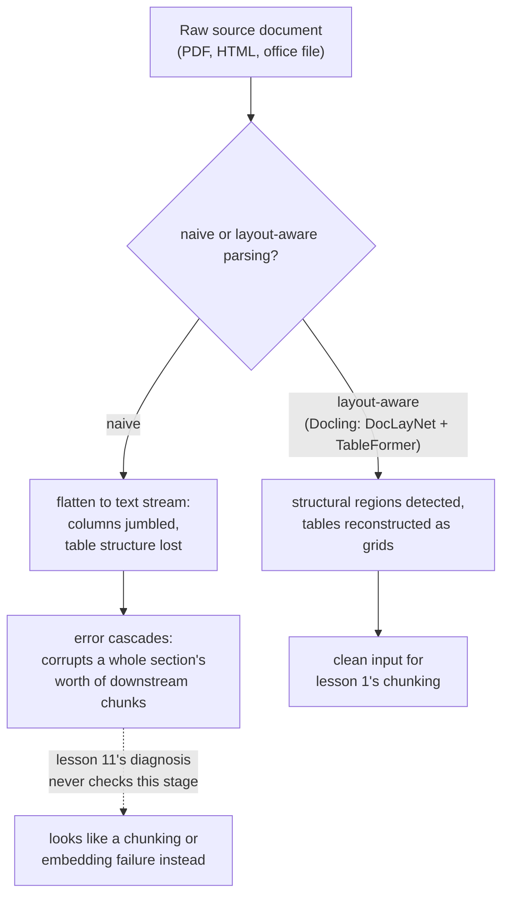

# Lección 16. El pipeline de ingesta

**Vínculo con la misión:** La lección 1 llamó al chunking "la primera decisión del pipeline, la que heredan todas las etapas posteriores". Eso solo era cierto una vez que un documento ya existe como texto limpio y estructurado. Los corpus reales llegan como PDF, HTML y documentos de ofimática, y convertirlos en texto con el que el chunking pueda trabajar de verdad es una etapa real que este espacio de trabajo nunca nombró, una cuyos errores corrompen todo lo que viene después de una forma que el procedimiento de diagnóstico de la lección 11 nunca se construyó para detectar.
**Fuente principal:** [Paper: "Docling Technical Report", Auer et al., 2024](https://arxiv.org/abs/2408.09869)
**Requisitos previos:** [Lección 1](0001-chunking.md), [Lección 11](0011-diagnosing-the-pipeline.md)

## Calentamiento

1. ▢ ¿Por qué un síntoma como "se recuperó contexto erróneo" necesita un diagnóstico etapa por etapa en lugar de arreglarse adivinando una causa probable?

Comprobación

El fallo podría estar en cualquiera de varias etapas (chunking, embedding, indexación, ponderación híbrida, reranking), y cambiar varias a la vez desperdicia esfuerzo sin revelar cuál estaba realmente rota; lo que encuentra la causa es comprobar cada etapa en un orden que aísle el fallo.

2. ▢ ¿Por qué un chunk demasiado grande, que mezcla varios temas, diluye su propio embedding?

Comprobación

Un modelo de embeddings produce un vector para todo el contenido de un chunk; un chunk que abarca varios temas sin relación recibe un embedding que es un promedio de todos ellos, no una representación precisa de ninguno, lo que dificulta que una consulta sobre solo uno de esos temas coincida bien con él.

## Qué debes saber

### La ingesta es la etapa anterior a la primera etapa

La **ingesta** consiste en convertir un documento fuente real, un PDF, una página HTML, un archivo de Word o de PowerPoint, en el texto limpio y estructurado sobre el que realmente opera el chunking (lección 1). La lección 1 trató el chunking como punto de partida del pipeline porque asumía que ese texto limpio ya existía; la ingesta es de donde sale en realidad, y es una etapa genuina del pipeline, con su propia forma de salir mal, no un detalle de preprocesamiento que quede por debajo de la atención del pipeline.

### La extracción ingenua aplana exactamente la estructura que da su significado a un documento

La forma más simple de extraer texto de un PDF saca cada carácter en el orden en que la representación interna del archivo casualmente los almacena, y descarta el diseño, la estructura de columnas y la distinción entre un encabezado, un párrafo de cuerpo y una celda de tabla. Esto funciona de forma aceptable en un documento simple de una sola columna, pero un diseño de varias columnas puede entremezclar el texto de dos columnas sin relación en un flujo revuelto e incoherente, y las filas y columnas de una tabla, aplanadas en texto lineal, pierden las relaciones fila-columna que daban a cada número de celda su significado real.

### El análisis consciente del diseño trata la estructura como algo que detectar, no que descartar

El enfoque de Docling consiste en ejecutar modelos dedicados exactamente para la estructura que descarta la extracción ingenua: un modelo de análisis de diseño (DocLayNet) identifica las regiones estructurales de una página (encabezados, párrafos, tablas, figuras) antes de extraer texto alguno de ellas, y un modelo de reconocimiento de estructura de tablas (TableFormer) reconstruye específicamente la cuadrícula real de filas y columnas de una tabla en lugar de leerla como un flujo indiferenciado de palabras. El punto no es que esto sea estrictamente necesario para todo documento; un archivo de texto limpio de una sola columna no necesita nada de esto. Es que los documentos más difíciles de un corpus real, los diseños densos de varias columnas o las tablas financieras con celdas combinadas, necesitan esta detección estructural para producir un texto que siga significando lo que significaba el documento original.

### Un error de ingesta se propaga en cascada y corrompe una sección entera, no una oración

Un error en la etapa de detección de diseño no se queda contenido en lo que toca directamente: si un encabezado se identifica mal como texto de cuerpo, o dos columnas se fusionan en el orden equivocado, todos los pasos posteriores, la extracción del texto real, el reconocimiento de la estructura de una tabla, todo lo que el chunking dividirá después, heredan ese error. Un solo error temprano puede corromper los chunks de una sección entera, no solo el elemento que el modelo de diseño acertó mal, porque cada paso posterior opera sobre la estructura ya corrompida que recibió y no sobre el documento original.

### Este es exactamente el fallo que el procedimiento de diagnóstico de la lección 11 nunca se construyó para ver

La lección 11 empieza su diagnóstico en el chunking, comprobando si la información correcta existe de forma coherente dentro de un chunk. Un mal análisis significa que la respuesta a esa primera comprobación ya es "no", pero por una razón para la que la lección 11 no tiene rama: no una mala *estrategia* de chunking, sino una mala *entrada* al chunking, texto que ya estaba revuelto o estructuralmente desordenado antes de que el chunking llegara a ejecutarse. Todas las etapas posteriores que comprueba la lección 11, el embedding, el índice, la ponderación híbrida, el reranking, pueden funcionar exactamente como se diseñaron y aun así hacer aflorar contexto erróneo, porque todas procesan fielmente contenido que ya estaba roto antes de que cualquiera de ellas lo tocara.

## Práctica

1. ▢ Una página de PDF de dos columnas se analiza con un extractor de texto ingenuo, y el texto resultante entremezcla oraciones de ambas columnas en un flujo incoherente. ¿Qué ha salido realmente mal, y en qué etapa?

Pista

Considera qué información sobre dónde está el texto en la página descarta la extracción ingenua.

Comprobación

La culpable es la etapa de ingesta, no el chunking: la extracción ingenua descartó el diseño de columnas de la página y leyó el texto en el orden bruto en que el archivo lo almacenó, en lugar de respetar el orden visual de lectura que seguiría una persona. Ninguna estrategia de chunking puede recuperar texto coherente a partir de una entrada que ya estaba revuelta antes de que el chunking se ejecutara.

2. ▢ ¿Por qué Docling usa un modelo dedicado de estructura de tablas (TableFormer) en lugar de tratar una tabla como texto corrido ordinario?

Comprobación

El significado de una tabla depende de a qué fila y columna pertenece cada valor; aplanarla en texto lineal como se leen los párrafos ordinarios pierde esas relaciones, y convierte una cuadrícula estructurada de números en un flujo indiferenciado que ya no transmite a qué se refería realmente cada valor.

3. ▢ Un modelo de diseño identifica mal el encabezado de una sección de un documento como texto de cuerpo ordinario. ¿Por qué este único error puede corromper mucho más que ese solo encabezado?

Comprobación

Cada paso posterior, la extracción de texto, el chunking, trabaja sobre la estructura que le entregó la etapa de diseño; si esa estructura ya es errónea, los pasos posteriores procesan fielmente el error en lugar de corregirlo, así que un encabezado mal identificado puede desalinear o corromper los chunks de una sección entera, no solo el propio encabezado.

4. ▢ Un equipo ejecuta el procedimiento de diagnóstico de la lección 11 ante un síntoma de recuperación errónea, confirma que el chunking, el embedding, la indexación, la ponderación híbrida y el reranking se comportan correctamente, y aun así no puede explicar el mal resultado. ¿Qué no ha comprobado el procedimiento de la lección 11?

Comprobación

La etapa de ingesta: si el texto que el chunking recibió realmente era una representación limpia y estructuralmente fiel del documento fuente. Todas las etapas que comprueba la lección 11 pueden funcionar exactamente como se diseñaron y aun así procesar una entrada ya corrompida por un mal análisis más arriba.

5. ▢ ¿Qué afirmación describe correctamente la relación entre la ingesta y las etapas del pipeline que este espacio de trabajo ya cubrió?

    - a) La ingesta es un detalle de preprocesamiento sin un modo de fallo propio real, ya que el chunking es la verdadera primera etapa
    - b) La ingesta convierte un documento fuente en bruto en el texto estructurado del que depende el chunking, y un error ahí (como descartar el diseño de columnas o la estructura de tablas) se propaga en cascada de una forma que el procedimiento de diagnóstico de la lección 11, que empieza en el chunking, nunca se construyó para comprobar
    - c) Un extractor de texto ingenuo y un analizador consciente del diseño como Docling producen resultados equivalentes para cualquier documento, sin importar la complejidad de su diseño
    - d) Un error de ingesta solo afecta siempre al único elemento (un encabezado, una tabla) donde ocurrió el error

Comprobación

**b)** Esa es la relación precisa que establece esta lección. (a) es falsa: la ingesta es una etapa genuina con sus propios modos de fallo distintos, anterior a todo lo que ya cubren las lecciones 1 a 11. (c) es falsa: la extracción ingenua y el análisis consciente del diseño divergen con fuerza en documentos de varias columnas o con muchas tablas en concreto. (d) es falsa: un error de ingesta se propaga en cascada y corrompe el contenido posterior de una sección entera, no solo el elemento identificado mal de forma directa.

## Prácticas en el mundo real

- [ ] Para un documento de tu propio corpus (o al que tengas acceso) con un diseño de varias columnas o una tabla densa, extrae su texto con un extractor ingenuo y compara el resultado con lo que produce una herramienta consciente del diseño (como Docling) para el mismo documento.
- [ ] Elige un documento ingerido y sigue una tabla a través del pipeline: ¿sobrevive su estructura de filas y columnas hasta el chunk al que finalmente se le genera el embedding, o se ha aplanado en texto sin estructura?
- [ ] Mañana: lee completa la descripción que hace el paper de Docling de sus modelos de análisis de diseño y de estructura de tablas, y anota con qué tipo de datos de entrenamiento (DocLayNet, conjuntos de datos al estilo PubTables-1M) se construyó cada uno.

## Para profundizar

- [Paper: "Docling Technical Report", Auer et al., 2024](https://arxiv.org/abs/2408.09869)
- [Recursos](../RESOURCES.md)

---

¿No termina de quedar claro? Vuelve a leer la fuente principal de arriba, ya que esta lección la comprime y en la compresión es donde se escapa la comprensión. Consulta el [glosario](../GLOSSARY.md) por si algún término te resultó resbaladizo.

Si lo poco claro es la propia lección y no el material, eso es un defecto: [abre un issue](https://github.com/TokenCemetery/teach/issues).
