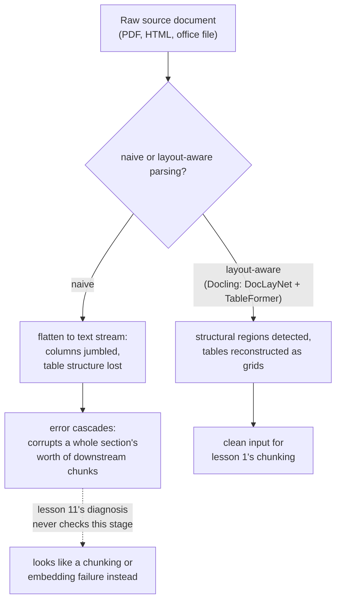

# Leçon 16. Le pipeline d'ingestion

**Lien avec la mission :** La leçon 1 a appelé le chunking « le premier choix du pipeline, dont hérite chaque étape suivante ». Cela n'était vrai qu'une fois le document déjà présent sous forme de texte propre et structuré. Les vrais corpus arrivent sous forme de PDF, de HTML et de documents bureautiques, et les transformer en un texte avec lequel le chunking peut réellement travailler est une vraie étape que cet espace de travail n'avait jamais nommée, une étape dont les erreurs corrompent tout l'aval d'une façon que la procédure de diagnostic de la leçon 11 n'a jamais été conçue pour détecter.
**Source primaire :** [Article : "Docling Technical Report", Auer et al., 2024](https://arxiv.org/abs/2408.09869)
**Prérequis :** [Leçon 1](0001-chunking.md), [Leçon 11](0011-diagnosing-the-pipeline.md)

## Échauffement

1. ▢ Pourquoi un symptôme comme « contexte récupéré faux » demande-t-il un diagnostic étape par étape plutôt que d'être corrigé en devinant une cause probable ?

Vérifier

La faute peut se trouver dans l'une de plusieurs étapes (chunking, embedding, indexation, pondération hybride, reranking), et en modifier plusieurs à la fois fait perdre du temps sans révéler laquelle était réellement en cause ; vérifier chaque étape dans un ordre qui isole la faute est ce qui trouve réellement la cause.

2. ▢ Pourquoi un chunk trop grand, qui mélange plusieurs sujets, dilue-t-il son propre embedding ?

Vérifier

Un modèle d'embedding produit un seul vecteur pour tout le contenu d'un chunk ; un chunk qui couvre plusieurs sujets sans rapport reçoit un embedding qui est une moyenne de tous, pas une représentation précise d'un seul, ce qui rend plus difficile pour une requête sur un seul de ces sujets d'y correspondre correctement.

## À savoir

### L'ingestion est l'étape avant la première étape

L'**ingestion** consiste à transformer un vrai document source, un PDF, une page HTML, un fichier Word ou PowerPoint, en texte propre et structuré sur lequel le chunking (leçon 1) opère réellement. La leçon 1 traitait le chunking comme le point de départ du pipeline parce qu'elle supposait que ce texte propre existait déjà ; l'ingestion est l'endroit d'où il vient réellement, et c'est une véritable étape du pipeline avec sa propre façon de mal tourner, pas un détail de prétraitement qui échapperait à l'attention du pipeline.

### L'extraction naïve aplatit exactement la structure qui donne son sens à un document

La façon la plus simple d'extraire le texte d'un PDF consiste à sortir chaque caractère dans l'ordre où la représentation interne du fichier les stocke, en écartant la mise en page, la structure en colonnes et la distinction entre un titre, un paragraphe de corps de texte et une cellule de tableau. Cela fonctionne de façon acceptable pour un document simple à une seule colonne, mais une mise en page à plusieurs colonnes peut entrelacer le texte de deux colonnes sans rapport en un flux brouillé et incohérent, et les lignes et colonnes d'un tableau, aplaties en texte linéaire, perdent les relations ligne-colonne qui donnaient au départ son sens au nombre de chaque cellule.

### L'analyse tenant compte de la mise en page traite la structure comme quelque chose à détecter, pas à écarter

L'approche de Docling consiste à exécuter des modèles dédiés à exactement la structure que l'extraction naïve jette : un modèle d'analyse de la mise en page (DocLayNet) identifie les régions structurelles d'une page (titres, paragraphes, tableaux, figures) avant d'en extraire le moindre texte, et un modèle de reconnaissance de la structure des tableaux (TableFormer) reconstruit précisément la vraie grille de lignes et de colonnes d'un tableau au lieu de le lire comme un flux indifférencié de mots. Le propos n'est pas que ce soit strictement nécessaire pour chaque document ; un fichier texte propre à une seule colonne n'en a besoin d'aucun. C'est que les documents plus difficiles d'un vrai corpus, des mises en page denses à plusieurs colonnes, des tableaux financiers aux cellules fusionnées, ont besoin de cette détection structurelle pour produire un texte qui veut encore dire ce que voulait dire le document d'origine.

### Une erreur d'ingestion se propage en cascade, corrompant toute une section et pas une seule phrase

Une erreur à l'étape de détection de la mise en page ne reste pas limitée à ce qu'elle touche directement : si un titre est pris à tort pour du corps de texte, ou si deux colonnes sont fusionnées dans le mauvais ordre, chaque étape en aval, l'extraction du texte proprement dit, la reconnaissance de la structure d'un tableau, tout ce que le chunking découpera plus tard, hérite de cette erreur. Une seule erreur précoce peut corrompre tous les chunks d'une section entière, pas seulement l'élément que le modèle de mise en page a mal compris, parce que chaque étape suivante opère sur la structure déjà corrompue qu'on lui a transmise plutôt que sur le document d'origine.

### C'est exactement la défaillance que la procédure de diagnostic de la leçon 11 n'a jamais été conçue pour voir

La leçon 11 commence son diagnostic au chunking, en vérifiant si l'information correcte existe de façon cohérente à l'intérieur d'un chunk. Une mauvaise analyse signifie que la réponse à cette première vérification est déjà « non », mais pour une raison pour laquelle la leçon 11 n'a aucune branche : pas une mauvaise *stratégie* de chunking, mais une mauvaise *entrée* du chunking, un texte déjà brouillé ou structurellement désorganisé avant même que le chunking ne s'exécute. Chaque étape ultérieure que vérifie la leçon 11, l'embedding, l'index, la pondération hybride, le reranking, peut fonctionner exactement comme prévu et pourtant faire remonter un contexte faux, parce qu'elles traitent toutes fidèlement un contenu qui était cassé avant que l'une d'elles n'y touche.

## Pratique

1. ▢ Une page de PDF à deux colonnes est analysée avec un extracteur de texte naïf, et le texte obtenu entrelace des phrases des deux colonnes en un flux incohérent. Qu'est-ce qui a réellement mal tourné, et à quelle étape ?

Indice

Réfléchissez à ce que l'extraction naïve écarte comme information sur l'endroit où le texte se trouve dans la page.

Vérifier

L'étape d'ingestion, pas le chunking, est en cause : l'extraction naïve a écarté la mise en colonnes de la page, en lisant le texte dans l'ordre brut où le fichier l'a stocké plutôt qu'en respectant l'ordre de lecture visuel qu'un humain suivrait. Aucune stratégie de chunking ne peut récupérer un texte cohérent à partir d'une entrée déjà brouillée avant l'exécution du chunking.

2. ▢ Pourquoi Docling utilise-t-il un modèle dédié à la structure des tableaux (TableFormer) plutôt que de traiter un tableau comme du texte courant ?

Vérifier

Le sens d'un tableau dépend de la ligne et de la colonne auxquelles appartient chaque valeur ; l'aplatir en texte linéaire à la manière dont on lit des paragraphes ordinaires perd ces relations, et transforme une grille structurée de nombres en un flux indifférencié qui ne transmet plus à quoi chaque valeur se rapportait.

3. ▢ Un modèle de mise en page prend à tort le titre de section d'un document pour du corps de texte. Pourquoi cette seule erreur peut-elle corrompre bien plus que ce titre ?

Vérifier

Chaque étape en aval, extraction du texte, chunking, travaille sur la structure que l'étape de mise en page lui a transmise ; si cette structure est déjà fausse, les étapes suivantes traitent fidèlement l'erreur au lieu de la corriger, donc un seul titre mal identifié peut désaligner ou corrompre tous les chunks d'une section entière, pas seulement le titre lui-même.

4. ▢ Une équipe exécute la procédure de diagnostic de la leçon 11 sur un symptôme de mauvaise récupération, confirme que le chunking, l'embedding, l'indexation, la pondération hybride et le reranking se comportent tous correctement, et ne parvient toujours pas à expliquer le mauvais résultat. Qu'est-ce que la procédure de la leçon 11 n'a pas vérifié ?

Vérifier

L'étape d'ingestion : si le texte que le chunking a réellement reçu était une représentation propre et structurellement fidèle du document source. Chaque étape que vérifie la leçon 11 peut fonctionner exactement comme prévu tout en traitant une entrée déjà corrompue par une mauvaise analyse plus en amont.

5. ▢ Laquelle de ces affirmations décrit correctement la relation entre l'ingestion et les étapes du pipeline que cet espace de travail a déjà couvertes ?

    - a) L'ingestion est un détail de prétraitement sans mode de défaillance propre, puisque le chunking est la vraie première étape
    - b) L'ingestion transforme un document source brut en texte structuré dont dépend le chunking, et une erreur à ce niveau (comme écarter la mise en colonnes ou la structure d'un tableau) se propage en aval d'une façon que la procédure de diagnostic de la leçon 11, qui commence au chunking, n'a jamais été conçue pour vérifier
    - c) Un extracteur de texte naïf et un analyseur tenant compte de la mise en page comme Docling produisent des résultats équivalents pour n'importe quel document, quelle que soit la complexité de sa mise en page
    - d) Une erreur d'ingestion n'affecte jamais que l'élément unique (un titre, un tableau) où l'erreur s'est produite

Vérifier

**b)** C'est la relation précise qu'établit cette leçon. (a) est fausse : l'ingestion est une véritable étape avec ses propres modes de défaillance distincts, en amont de tout ce que couvrent déjà les leçons 1 à 11. (c) est fausse : l'extraction naïve et l'analyse tenant compte de la mise en page divergent fortement sur les documents à plusieurs colonnes ou riches en tableaux en particulier. (d) est fausse : une erreur d'ingestion se propage en cascade, en corrompant tout le contenu en aval d'une section entière, pas seulement l'élément directement mal identifié.

## Exercices en situation réelle

- [ ] Pour un document de votre propre corpus (ou auquel vous avez accès) avec une mise en page à plusieurs colonnes ou un tableau dense, extrayez son texte avec un extracteur naïf et comparez le résultat à ce que produit un outil tenant compte de la mise en page (comme Docling) pour le même document.
- [ ] Choisissez un document ingéré et suivez un tableau à travers le pipeline : sa structure de lignes et de colonnes survit-elle jusque dans le chunk dont l'embedding sera finalement calculé, ou a-t-elle été aplatie en texte non structuré ?
- [ ] Demain : lisez en entier la description par l'article sur Docling de ses modèles d'analyse de la mise en page et de la structure des tableaux, et notez sur quel type de données d'entraînement (DocLayNet, jeux de données de type PubTables-1M) chacun a été construit.

## Pour aller plus loin

- [Article : "Docling Technical Report", Auer et al., 2024](https://arxiv.org/abs/2408.09869)
- [Ressources](../RESOURCES.md)

---

Ça ne passe pas ? Relisez la source primaire en haut de page, car cette leçon la condense et c'est dans la condensation que la compréhension s'échappe. Consultez le [glossaire](../GLOSSARY.md) pour tout terme qui vous a paru glissant.

Si c'est la leçon elle-même qui n'est pas claire plutôt que la matière, c'est un défaut : [ouvrez une issue](https://github.com/TokenCemetery/teach/issues).
