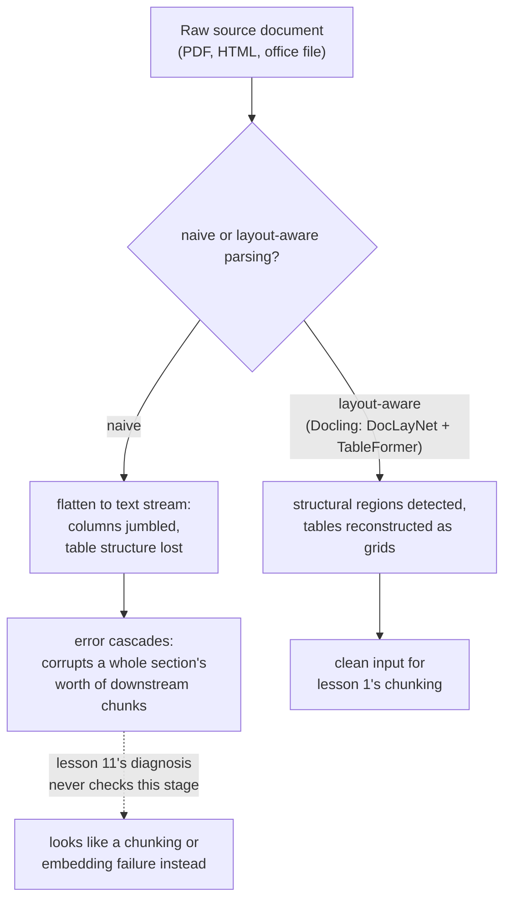

# पाठ 16. Ingestion Pipeline

**मिशन से संबंध:** पाठ 1 ने chunking को "पहला pipeline चुनाव, और वह जो हर बाद का चरण विरासत में पाता है" कहा था। यह तभी सच था जब document पहले से साफ़, संरचित text के रूप में मौजूद हो। असली corpora PDFs, HTML और office documents के रूप में आते हैं, और उन्हें ऐसे text में बदलना जिस पर chunking असल में काम कर सके, एक असली चरण है जिसे इस workspace ने कभी नाम नहीं दिया, ऐसा चरण जिसकी ग़लतियाँ आगे की हर चीज़ को उस तरह बिगाड़ती हैं जिसे पकड़ने के लिए पाठ 11 की diagnosis प्रक्रिया कभी बनी ही नहीं थी।
**मुख्य स्रोत:** [पेपर: "Docling Technical Report", Auer et al., 2024](https://arxiv.org/abs/2408.09869)
**पूर्व-आवश्यकताएँ:** [पाठ 1](0001-chunking.md), [पाठ 11](0011-diagnosing-the-pipeline.md)

## वार्म-अप

1. ▢ "ग़लत context retrieve हुआ" जैसे लक्षण को एक संभावित कारण का अंदाज़ा लगाकर ठीक करने की जगह चरण-दर-चरण diagnosis क्यों चाहिए?

जाँचें

दोष कई चरणों (chunking, embedding, indexing, hybrid weighting, reranking) में से किसी में हो सकता है, और कई को एक साथ बदलना मेहनत बर्बाद करता है बिना यह बताए कि असल में कौन-सा टूटा था; हर चरण को ऐसे क्रम में जाँचना जो दोष को अलग कर दे, वही असल में कारण खोजता है।

2. ▢ बहुत बड़ा chunk, जो कई विषय मिलाता है, अपनी ही embedding को क्यों पतला कर देता है?

जाँचें

Embedding model chunk की पूरी सामग्री के लिए एक vector बनाता है; कई असंबंधित विषयों में फैला chunk ऐसी embedding पाता है जो उन सबका औसत है, किसी एक का सटीक प्रतिनिधित्व नहीं, जिससे उनमें से सिर्फ़ एक विषय के बारे में query का उससे अच्छी तरह मेल खाना कठिन हो जाता है।

## यह जानें

### Ingestion पहले चरण से पहले का चरण है

**Ingestion** असली source document, यानी PDF, HTML page, Word या PowerPoint file, को उस साफ़, संरचित text में बदलना है जिस पर chunking (पाठ 1) असल में काम करती है। पाठ 1 ने chunking को pipeline का शुरुआती बिंदु इसलिए माना कि उसने मान लिया था कि साफ़ text पहले से मौजूद है; ingestion ही वह जगह है जहाँ से वह असल में आता है, और यह असली pipeline चरण है जिसके ग़लत होने का अपना तरीक़ा है, pipeline की नज़र से नीचे रह जाने वाला preprocessing ब्योरा नहीं।

### Naive extraction ठीक उसी संरचना को सपाट कर देता है जो document को अर्थ देती है

PDF से text निकालने का सबसे सरल तरीक़ा हर character को उसी क्रम में खींच लेता है जिसमें file का आंतरिक रूप उन्हें संयोग से store करता है, layout, column संरचना, और heading, body paragraph व table cell के बीच का फ़र्क़ फेंकते हुए। यह सरल, एक-column वाले document के लिए ठीक-ठाक चलता है, पर बहु-column layout दो असंबंधित columns के text को एक उलझी, असंगत धारा में आपस में गूँथ सकता है, और table की पंक्तियाँ और columns, रैखिक text में सपाट होकर, वे पंक्ति-से-column संबंध खो देते हैं जो हर cell की संख्या को पहली ही जगह उसका असली अर्थ देते थे।

### Layout-aware parsing संरचना को फेंकने की नहीं, पहचानने की चीज़ मानता है

Docling का अपना तरीक़ा ठीक उसी संरचना के लिए समर्पित models चलाना है जिसे naive extraction फेंक देता है: layout-analysis model (DocLayNet) page के संरचनात्मक क्षेत्रों (headings, paragraphs, tables, figures) को पहचानता है, उनसे कोई text निकालने से पहले, और table-structure-recognition model (TableFormer) ख़ास तौर पर table का असली पंक्ति-और-column ग्रिड दोबारा बनाता है, बजाय उसे शब्दों की अविभेदित धारा की तरह पढ़ने के। बात यह नहीं कि यह हर document के लिए सख़्ती से ज़रूरी है; साफ़, एक-column वाली text file को इसमें से कुछ नहीं चाहिए। बात यह है कि असली corpus के कठिन documents, घने बहु-column layouts, मिले हुए cells वाली वित्तीय tables, को ऐसा text बनाने के लिए इस संरचनात्मक पहचान की ज़रूरत है जिसका अर्थ वही रहे जो मूल document का था।

### Ingestion की ग़लती फैलती है, एक वाक्य नहीं पूरे section को बिगाड़ती है

Layout-detection चरण की ग़लती उसी तक सीमित नहीं रहती जिसे उसने सीधे छुआ: अगर heading को body text समझ लिया गया, या दो columns ग़लत क्रम में मिल गए, तो हर आगे का चरण, असल text निकालना, table की संरचना पहचानना, और वह सब जिसे chunking बाद में बाँटेगी, उस ग़लती को विरासत में पाता है। एक अकेली शुरुआती ग़लती पूरे section के बराबर के अंतिम chunks को बिगाड़ सकती है, सिर्फ़ उस एक element को नहीं जिसे layout model ने ग़लत किया, क्योंकि हर बाद का चरण मूल document पर नहीं बल्कि उस पहले से बिगड़ी संरचना पर काम करता है जो उसे सौंपी गई।

### यही वह विफलता है जिसे पाठ 11 की diagnosis प्रक्रिया कभी देखने के लिए बनी नहीं थी

पाठ 11 अपना diagnosis chunking से शुरू करता है, यह जाँचते हुए कि सही जानकारी एक chunk के भीतर सुसंगत रूप से मौजूद है या नहीं। ख़राब parse का मतलब है कि उस पहली जाँच का उत्तर पहले से "नहीं" है, पर ऐसे कारण से जिसके लिए पाठ 11 में कोई शाखा नहीं: ख़राब chunking *रणनीति* नहीं, बल्कि ख़राब chunking *input*, text जो chunking चलने से पहले ही उलझा या संरचनात्मक रूप से बिगड़ा हुआ था। पाठ 11 के हर बाद के चरण, embedding, index, hybrid weighting, reranking, ठीक डिज़ाइन के अनुसार काम करते हुए भी ग़लत context सामने ला सकते हैं, क्योंकि वे सब उस सामग्री को वफ़ादारी से प्रोसेस कर रहे हैं जो उनमें से किसी के छूने से पहले ही टूटी हुई थी।

## अभ्यास

1. ▢ दो-column वाले PDF page को naive text extractor से parse किया जाता है, और नतीजे का text दोनों columns के वाक्यों को एक असंगत धारा में गूँथ देता है। असल में क्या ग़लत हुआ है, और किस चरण पर?

संकेत

विचार करें कि naive extraction page पर text कहाँ बैठा है इसकी कौन-सी जानकारी फेंक देता है।

जाँचें

Ingestion चरण दोषी है, chunking नहीं: naive extraction ने page की column layout फेंक दी, text को उसी कच्चे क्रम में पढ़ते हुए जिसमें file ने उसे store किया था, बजाय उस दृश्य पढ़ने के क्रम का सम्मान करने के जो कोई इंसान अपनाता। कोई chunking रणनीति ऐसे input से सुसंगत text वापस नहीं पा सकती जो chunking चलने से पहले ही उलझा हुआ था।

2. ▢ Docling table को सामान्य बहते text की तरह मानने के बजाय समर्पित table-structure model (TableFormer) क्यों इस्तेमाल करता है?

जाँचें

Table का अर्थ इस पर निर्भर करता है कि हर मान किस पंक्ति और column का है; उसे रैखिक text में सपाट करना, जैसे साधारण paragraphs पढ़े जाते हैं, उन संबंधों को खो देता है, संख्याओं के संरचित ग्रिड को अविभेदित धारा बना देता है जो अब नहीं बताती कि हर मान असल में किस ओर इशारा करता था।

3. ▢ एक layout model document की section heading को साधारण body text समझ लेता है। यह एक ग़लती सिर्फ़ उस heading से कहीं ज़्यादा को संभावित रूप से क्यों बिगाड़ती है?

जाँचें

हर आगे का चरण, text extraction, chunking, उस संरचना पर काम करता है जो layout चरण ने उसे सौंपी; अगर वह संरचना पहले से ग़लत है, तो बाद के चरण उस ग़लती को सुधारने के बजाय वफ़ादारी से प्रोसेस करते हैं, इसलिए एक ग़लत पहचानी heading पूरे section के बराबर के अंतिम chunks को बेमेल या ख़राब कर सकती है, सिर्फ़ heading को नहीं।

4. ▢ एक टीम ग़लत-retrieval लक्षण पर पाठ 11 की diagnosis प्रक्रिया चलाती है, पुष्टि करती है कि chunking, embedding, indexing, hybrid weighting और reranking सब सही बर्ताव कर रहे हैं, और फिर भी ख़राब नतीजे की व्याख्या नहीं कर पाती। पाठ 11 की प्रक्रिया ने क्या नहीं जाँचा?

जाँचें

Ingestion चरण: क्या chunking को असल में मिला text source document का साफ़, संरचनात्मक रूप से वफ़ादार प्रतिनिधित्व था भी। पाठ 11 जिन हर चरण को जाँचता है वे ठीक डिज़ाइन के अनुसार काम कर सकते हैं जबकि कहीं ऊपर के ख़राब parse से आए पहले से बिगड़े input को प्रोसेस कर रहे हों।

5. ▢ कौन-सा दावा ingestion और इस workspace में पहले आए pipeline चरणों के रिश्ते को सही बताता है?

    - a) Ingestion एक preprocessing ब्योरा है जिसकी अपनी कोई असली विफलता नहीं, क्योंकि chunking ही असली पहला चरण है
    - b) Ingestion कच्चे source document को उस संरचित text में बदलता है जिस पर chunking निर्भर है, और वहाँ की ग़लती (जैसे column layout या table संरचना फेंक देना) आगे ऐसे फैलती है जिसे पाठ 11 की diagnosis प्रक्रिया, जो chunking से शुरू होती है, जाँचने के लिए कभी बनी ही नहीं थी
    - c) Naive text extractor और Docling जैसा layout-aware parser किसी भी document के लिए बराबर नतीजे देते हैं, उसकी layout की जटिलता चाहे जो हो
    - d) Ingestion की ग़लती हमेशा उसी एक element (heading, table) को प्रभावित करती है जहाँ ग़लती हुई

जाँचें

**b)** यही वह ठीक रिश्ता है जो यह पाठ स्थापित करता है। (a) ग़लत है: ingestion अपनी अलग विफलताओं वाला असली चरण है, पाठ 1 से 11 जो कुछ पहले कवर कर चुके हैं उन सबसे ऊपर की धारा में। (c) ग़लत है: naive extraction और layout-aware parsing ख़ास तौर पर बहु-column या table-भारी documents पर तेज़ी से अलग हो जाते हैं। (d) ग़लत है: ingestion की ग़लती फैलती है, पूरे section के बराबर की आगे की सामग्री को बिगाड़ती है, सिर्फ़ सीधे ग़लत पहचाने element को नहीं।

## असली दुनिया का अभ्यास

- [ ] अपने corpus के (या जिस तक आपकी पहुँच है) ऐसे document के लिए जिसमें बहु-column layout या घनी table हो, उसका text naive extractor से निकालें और नतीजे की तुलना उससे करें जो layout-aware tool (जैसे Docling) उसी document के लिए बनाता है।
- [ ] एक ingest किया हुआ document चुनें और एक table को pipeline से गुज़रते हुए खोजें: क्या उसकी पंक्ति/column संरचना उस chunk तक बची रहती है जो आख़िर में embed होता है, या वह असंरचित text में सपाट हो चुकी है?
- [ ] कल: Docling पेपर का उसके layout-analysis और table-structure models का वर्णन पूरा पढ़ें, और नोट करें कि हर एक किस तरह के training data (DocLayNet, PubTables-1M-शैली के datasets) पर बना था।

## आगे बढ़ने के लिए

- [पेपर: "Docling Technical Report", Auer et al., 2024](https://arxiv.org/abs/2408.09869)
- [संसाधन](../RESOURCES.md)

---

बात नहीं बन रही? ऊपर दिए primary source को दोबारा पढ़ें, क्योंकि यह पाठ उसे संक्षिप्त करता है और समझ संक्षेप में ही रिसती है। जो शब्द फिसलन भरा लगे, उसके लिए [शब्दावली](../GLOSSARY.md) देखें।

अगर दिक़्क़त सामग्री की नहीं बल्कि पाठ की ही है, तो वह एक खोट है: [issue खोलें](https://github.com/TokenCemetery/teach/issues)।
