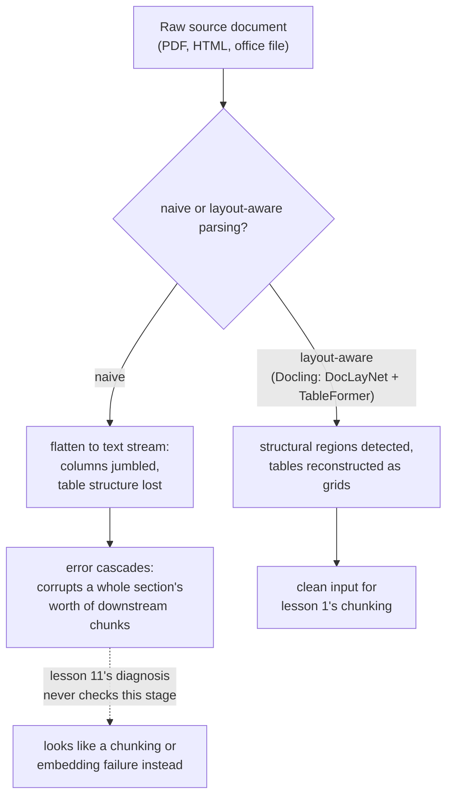

# Lição 16. O pipeline de ingestão

**Ligação com a missão:** A lição 1 chamou o chunking de "a primeira escolha do pipeline, e a que toda etapa posterior herda". Isso só era verdade depois que um documento já existe como texto limpo e estruturado. Corpora reais chegam como PDFs, HTML e documentos de escritório, e transformá-los em texto com o qual o chunking de fato consiga trabalhar é uma etapa real que este workspace nunca nomeou, uma cujos erros corrompem tudo a jusante de um jeito que o procedimento de diagnóstico da lição 11 nunca foi construído para pegar.
**Fonte principal:** [Artigo científico: "Docling Technical Report", Auer et al., 2024](https://arxiv.org/abs/2408.09869)
**Pré-requisitos:** [Lição 1](0001-chunking.md), [Lição 11](0011-diagnosing-the-pipeline.md)

## Aquecimento

1. ▢ Por que um sintoma como "contexto errado recuperado" precisa de um diagnóstico etapa por etapa em vez de ser corrigido chutando uma causa provável?

Verificação

O defeito pode estar em qualquer uma de várias etapas (chunking, embedding, indexação, ponderação híbrida, reranking), e mudar várias ao mesmo tempo desperdiça esforço sem revelar qual delas estava de fato quebrada; verificar cada etapa em uma ordem que isole o defeito é o que de fato encontra a causa.

2. ▢ Por que um chunk grande demais, que mistura vários assuntos, dilui o próprio embedding?

Verificação

Um modelo de embedding produz um vetor para todo o conteúdo de um chunk; um chunk que abrange vários assuntos sem relação recebe um embedding que é uma média de todos eles, e não uma representação precisa de nenhum deles isoladamente, o que dificulta que uma consulta sobre apenas um desses assuntos corresponda bem a ele.

## Saiba isto

### A ingestão é a etapa anterior à primeira etapa

A **ingestão** é transformar um documento-fonte real, um PDF, uma página HTML, um arquivo do Word ou do PowerPoint, no texto limpo e estruturado sobre o qual o chunking (lição 1) de fato opera. A lição 1 tratou o chunking como o ponto de partida do pipeline porque pressupunha que esse texto limpo já existia; a ingestão é de onde ele de fato vem, e é uma etapa genuína do pipeline, com seu próprio jeito de dar errado, e não um detalhe de pré-processamento abaixo da atenção do pipeline.

### A extração ingênua achata exatamente a estrutura que dá significado ao documento

O modo mais simples de tirar texto de um PDF puxa cada caractere na ordem em que a representação interna do arquivo por acaso os armazena, descartando o layout, a estrutura de colunas e a distinção entre um título, um parágrafo de corpo e uma célula de tabela. Isso funciona de forma aceitável para um documento simples, de coluna única, mas um layout de várias colunas pode intercalar o texto de duas colunas sem relação em um fluxo único, embaralhado e incoerente, e as linhas e colunas de uma tabela, achatadas em texto linear, perdem as relações entre linha e coluna que davam a cada número de célula seu significado desde o início.

### O parsing ciente do layout trata a estrutura como algo a detectar, não a descartar

A própria abordagem do Docling é executar modelos dedicados para exatamente a estrutura que a extração ingênua joga fora: um modelo de análise de layout (DocLayNet) identifica as regiões estruturais de uma página (títulos, parágrafos, tabelas, figuras) antes de qualquer texto ser extraído delas, e um modelo de reconhecimento de estrutura de tabelas (TableFormer) reconstrói especificamente a grade real de linhas e colunas de uma tabela, em vez de lê-la como um fluxo indiferenciado de palavras. O ponto não é que isso seja estritamente necessário para todo documento; um arquivo de texto limpo, de coluna única, não precisa de nada disso. É que os documentos mais difíceis de um corpus real, layouts densos de várias colunas, tabelas financeiras com células mescladas, precisam dessa detecção estrutural para produzir um texto que ainda signifique o que o documento original significava.

### Um erro de ingestão se propaga em cascata, corrompendo uma seção inteira e não uma frase

Um erro na etapa de detecção de layout não fica contido no que ele toca diretamente: se um título é identificado como texto de corpo, ou duas colunas são mescladas na ordem errada, todo passo a jusante, extrair o texto real, reconhecer a estrutura de uma tabela, tudo o que o chunking dividirá depois, herda esse erro. Um único erro inicial pode corromper os chunks de uma seção inteira, e não apenas o único elemento que o modelo de layout errou, porque todo passo posterior opera sobre a estrutura já corrompida que recebeu, e não sobre o documento original.

### Esta é exatamente a falha que o procedimento de diagnóstico da lição 11 nunca foi construído para enxergar

A lição 11 começa seu diagnóstico no chunking, verificando se a informação correta existe de forma coerente dentro de um chunk. Um parsing ruim significa que a resposta a essa primeira verificação já é "não", mas por um motivo para o qual a lição 11 não tem ramificação: não uma má *estratégia* de chunking, e sim má *entrada* de chunking, texto que já estava embaralhado ou estruturalmente confuso antes de o chunking rodar. Toda etapa posterior que a lição 11 verifica, o embedding, o índice, a ponderação híbrida, o reranking, pode estar funcionando exatamente como projetada e ainda assim trazer à tona o contexto errado, porque todas elas processam fielmente um conteúdo que já estava quebrado antes de qualquer uma delas tocá-lo.

## Prática

1. ▢ Uma página de PDF de duas colunas é processada com um extrator de texto ingênuo, e o texto resultante intercala frases das duas colunas em um fluxo incoerente. O que de fato deu errado, e em qual etapa?

Dica

Considere que informação a extração ingênua descarta sobre onde o texto fica na página.

Verificação

A etapa de ingestão, e não o chunking, está com defeito: a extração ingênua descartou o layout de colunas da página, lendo o texto na ordem bruta em que o arquivo o armazenou, em vez de respeitar a ordem visual de leitura que uma pessoa seguiria. Nenhuma estratégia de chunking consegue recuperar texto coerente de uma entrada que já estava embaralhada antes de o chunking rodar.

2. ▢ Por que o Docling usa um modelo dedicado de estrutura de tabelas (TableFormer) em vez de tratar uma tabela como texto corrido comum?

Verificação

O significado de uma tabela depende de a qual linha e coluna cada valor pertence; achatá-la em texto linear do jeito que parágrafos comuns são lidos perde essas relações, transformando uma grade estruturada de números em um fluxo indiferenciado que não transmite mais a que cada valor se referia.

3. ▢ Um modelo de layout identifica o título de seção de um documento como texto de corpo comum. Por que esse único erro pode corromper muito mais do que apenas aquele título?

Verificação

Todo passo a jusante, extração de texto, chunking, trabalha sobre a estrutura que a etapa de layout lhe entregou; se essa estrutura já está errada, os passos posteriores processam fielmente o erro em vez de corrigi-lo, então um único título identificado de forma errada pode desalinhar ou corromper os chunks de uma seção inteira, e não apenas o título em si.

4. ▢ Uma equipe executa o procedimento de diagnóstico da lição 11 em um sintoma de recuperação errada, confirma que chunking, embedding, indexação, ponderação híbrida e reranking estão todos se comportando corretamente e ainda assim não consegue explicar o mau resultado. O que o procedimento da lição 11 não verificou?

Verificação

A etapa de ingestão: se o texto que o chunking de fato recebeu era uma representação limpa e estruturalmente fiel do documento-fonte. Toda etapa que a lição 11 verifica pode estar funcionando exatamente como projetada e ainda assim processar uma entrada já corrompida por um parsing ruim mais a montante.

5. ▢ Qual afirmação descreve corretamente a relação entre a ingestão e as etapas do pipeline que este workspace já cobriu?

    - a) A ingestão é um detalhe de pré-processamento sem modo de falha real próprio, já que o chunking é a verdadeira primeira etapa
    - b) A ingestão transforma um documento-fonte bruto no texto estruturado de que o chunking depende, e um erro ali (como descartar o layout de colunas ou a estrutura de tabelas) se propaga em cascata a jusante de um jeito que o procedimento de diagnóstico da lição 11, que começa no chunking, nunca foi construído para verificar
    - c) Um extrator de texto ingênuo e um parser ciente do layout como o Docling produzem resultados equivalentes para qualquer documento, independentemente da complexidade do layout
    - d) Um erro de ingestão só afeta o único elemento (um título, uma tabela) em que o erro ocorreu

Verificação

**b)** Essa é a relação precisa que esta lição estabelece. (a) é falsa: a ingestão é uma etapa genuína, com seus próprios modos de falha distintos, a montante de tudo o que as lições 1 a 11 já cobrem. (c) é falsa: a extração ingênua e o parsing ciente do layout divergem muito especificamente em documentos de várias colunas ou carregados de tabelas. (d) é falsa: um erro de ingestão se propaga em cascata, corrompendo o conteúdo de uma seção inteira a jusante, e não apenas o elemento identificado diretamente de forma errada.

## Prática no mundo real

- [ ] Para um documento do seu próprio corpus (ou de um a que você tenha acesso) com layout de várias colunas ou uma tabela densa, extraia o texto com um extrator ingênuo e compare o resultado com o que uma ferramenta ciente do layout (como o Docling) produz para o mesmo documento.
- [ ] Escolha um documento ingerido e acompanhe uma tabela pelo pipeline: a estrutura de linhas e colunas dela sobrevive até o chunk que acaba recebendo embedding, ou foi achatada em texto não estruturado?
- [ ] Amanhã: leia por inteiro a descrição dos modelos de análise de layout e de estrutura de tabelas no artigo do Docling e anote em que tipo de dados de treinamento (DocLayNet, conjuntos no estilo PubTables-1M) cada um foi construído.

## Para ir além

- [Artigo científico: "Docling Technical Report", Auer et al., 2024](https://arxiv.org/abs/2408.09869)
- [Recursos](../RESOURCES.md)

---

Não ficou claro? Releia a fonte principal no topo, já que esta lição a comprime e é na compressão que o entendimento escapa. Consulte o [glossário](../GLOSSARY.md) para qualquer termo que pareceu escorregadio.

Se o problema é a lição em si, e não o material, isso é um defeito: [abra uma issue](https://github.com/TokenCemetery/teach/issues).
