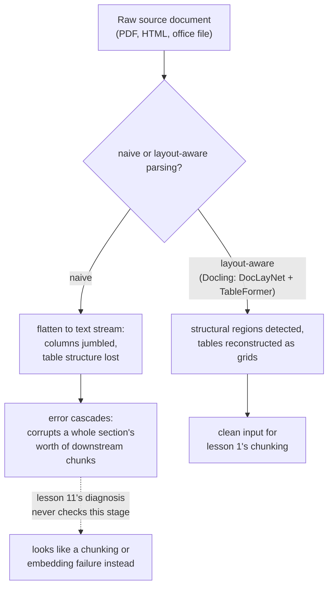

# Урок 16. Конвейер ингестии

**Связь с целью курса:** Урок 1 назвал чанкинг «первым выбором в конвейере, который наследует каждый следующий этап». Это было верно, только когда документ уже существует как чистый структурированный текст. Реальные корпуса приходят в виде PDF, HTML и офисных документов, и превращение их в текст, с которым чанкинг может на самом деле работать, это настоящий этап, которого эта рабочая область не называла, и его ошибки портят всё ниже по конвейеру так, как процедура диагностики урока 11 ловить не умела.
**Первоисточник:** [Научная статья: "Docling Technical Report", Auer et al., 2024](https://arxiv.org/abs/2408.09869)
**Предварительные требования:** [Урок 1](0001-chunking.md), [Урок 11](0011-diagnosing-the-pipeline.md)

## Разминка

1. ▢ Почему симптому вроде «найден неверный контекст» нужна поэтапная диагностика, а не исправление угадыванием одной вероятной причины?

Проверка

Неисправность может сидеть в любом из нескольких этапов (чанкинг, эмбеддинг, индексация, веса гибридного поиска, реранкинг), а изменение сразу нескольких тратит усилия, не выясняя, какой из них действительно был сломан; причину на самом деле находит проверка каждого этапа в порядке, изолирующем неисправность.

2. ▢ Почему слишком большой чанк, смешивающий несколько тем, размывает собственный эмбеддинг?

Проверка

Модель эмбеддингов выдаёт один вектор на всё содержимое чанка; чанк, охватывающий несколько не связанных тем, получает эмбеддинг, который есть среднее всех них, а не точное представление какой-то одной, и запросу всего об одной из этих тем сложнее хорошо с ним совпасть.

## Что нужно знать

### Ингестия это этап перед первым этапом

**Ингестия (ingestion)** это превращение реального исходного документа, PDF, HTML-страницы, файла Word или PowerPoint, в чистый структурированный текст, с которым на самом деле работает чанкинг (урок 1). Урок 1 считал чанкинг отправной точкой конвейера, потому что предполагал, что чистый текст уже существует; ингестия это то, откуда он на самом деле берётся, и это полноценный этап конвейера со своим способом ломаться, а не мелкая деталь предобработки, лежащая ниже внимания конвейера.

### Наивное извлечение сплющивает именно ту структуру, которая даёт документу смысл

Простейший способ достать текст из PDF просто вытаскивает каждый символ в том порядке, в каком его случайно хранит внутреннее представление файла, отбрасывая разметку, структуру колонок и различие между заголовком, абзацем основного текста и ячейкой таблицы. Для простого одноколоночного документа это работает приемлемо, но многоколоночная вёрстка может перемешать текст двух не связанных колонок в один сумбурный, бессвязный поток, а строки и столбцы таблицы, сплющенные в линейный текст, теряют связи строки со столбцом, которые и давали числу каждой ячейки настоящий смысл.

### Разбор с учётом разметки считает структуру тем, что нужно обнаруживать, а не отбрасывать

Подход самого Docling состоит в запуске специализированных моделей именно для той структуры, которую наивное извлечение выбрасывает: модель анализа разметки (DocLayNet) выделяет структурные области страницы (заголовки, абзацы, таблицы, рисунки) до того, как из них извлекается какой-либо текст, а модель распознавания структуры таблиц (TableFormer) специально восстанавливает настоящую сетку строк и столбцов таблицы, а не читает её как неразличимый поток слов. Смысл не в том, что это строго необходимо для каждого документа; чистому одноколоночному текстовому файлу ничего из этого не нужно. Смысл в том, что более трудным документам реального корпуса, плотным многоколоночным вёрсткам, финансовым таблицам с объединёнными ячейками, это структурное обнаружение нужно, чтобы получить текст, который всё ещё значит то, что значил исходный документ.

### Ошибка ингестии распространяется каскадом, портя целый раздел, а не одно предложение

Ошибка на этапе обнаружения разметки не остаётся ограниченной тем, чего касается напрямую: если заголовок распознан как основной текст или две колонки слиты в неверном порядке, каждый шаг ниже по конвейеру, извлечение самого текста, распознавание структуры таблицы, всё, что чанкинг потом будет резать, наследует эту ошибку. Одна ранняя ошибка может испортить целый раздел будущих чанков, а не только тот единственный элемент, в котором ошиблась модель разметки, потому что каждый последующий шаг работает с уже испорченной структурой, которую ему передали, а не с исходным документом.

### Это ровно тот сбой, который процедура диагностики урока 11 никогда не умела видеть

Урок 11 начинает диагностику с чанкинга, проверяя, существует ли нужная информация связно внутри одного чанка. Плохой разбор означает, что ответ на эту первую проверку уже «нет», но по причине, для которой в уроке 11 нет ветки: не плохая *стратегия* чанкинга, а плохой *вход* чанкинга, текст, который уже был перемешан или структурно искажён до того, как чанкинг вообще запустился. Каждый последующий этап, который проверяет урок 11, эмбеддинг, индекс, веса гибридного поиска, реранкинг, может работать ровно так, как задумано, и всё равно выводить неверный контекст, потому что все они добросовестно обрабатывают содержимое, сломанное до того, как любой из них к нему прикоснулся.

## Практика

1. ▢ Страница PDF в две колонки разобрана наивным извлекателем текста, и получившийся текст перемешивает предложения обеих колонок в один бессвязный поток. Что на самом деле пошло не так и на каком этапе?

Подсказка

Подумайте, какую информацию о том, где текст стоит на странице, наивное извлечение отбрасывает.

Проверка

Виноват этап ингестии, а не чанкинга: наивное извлечение отбросило колоночную вёрстку страницы, читая текст в том сыром порядке, в каком его хранил файл, а не следуя зрительному порядку чтения, которому следовал бы человек. Никакая стратегия чанкинга не может восстановить связный текст из входа, который был перемешан ещё до запуска чанкинга.

2. ▢ Почему Docling использует специализированную модель структуры таблиц (TableFormer), а не считает таблицу обычным текучим текстом?

Проверка

Смысл таблицы зависит от того, какой строке и столбцу принадлежит каждое значение; сплющивание её в линейный текст, как читаются обычные абзацы, теряет эти связи, превращая структурированную сетку чисел в неразличимый поток, который больше не передаёт, к чему на самом деле относилось каждое значение.

3. ▢ Модель разметки распознаёт заголовок раздела документа как обычный основной текст. Почему эта одна ошибка потенциально портит гораздо больше, чем только этот заголовок?

Проверка

Каждый шаг ниже по конвейеру, извлечение текста, чанкинг, работает со структурой, которую передал ему этап разметки; если эта структура уже неверна, последующие шаги добросовестно обрабатывают ошибку, а не исправляют её, поэтому один неверно распознанный заголовок может сместить или испортить целый раздел будущих чанков, а не только сам заголовок.

4. ▢ Команда запускает процедуру диагностики урока 11 на симптом неверного поиска, подтверждает, что чанкинг, эмбеддинг, индексация, веса гибридного поиска и реранкинг все ведут себя верно, и всё равно не может объяснить плохой результат. Что процедура урока 11 не проверила?

Проверка

Этап ингестии: был ли текст, который на самом деле получил чанкинг, вообще чистым, структурно верным представлением исходного документа. Каждый этап, который проверяет урок 11, может работать ровно как задумано, обрабатывая при этом уже испорченный вход от плохого разбора выше по конвейеру.

5. ▢ Какое утверждение верно описывает отношение между ингестией и этапами конвейера, которые эта рабочая область уже охватила?

    - a) Ингестия это деталь предобработки без собственного вида сбоя, поскольку чанкинг настоящий первый этап
    - b) Ингестия превращает исходный документ в структурированный текст, от которого зависит чанкинг, и ошибка там (например, отбрасывание колоночной вёрстки или структуры таблиц) каскадом распространяется ниже по конвейеру так, как процедура диагностики урока 11, начинающаяся с чанкинга, проверять не умела
    - c) Наивный извлекатель текста и разбор с учётом разметки вроде Docling дают равнозначные результаты для любого документа независимо от сложности его вёрстки
    - d) Ошибка ингестии затрагивает только тот единственный элемент (заголовок, таблицу), где произошла ошибка

Проверка

**b)** Это точное отношение, которое устанавливает этот урок. (a) неверно: ингестия это полноценный этап со своими особыми видами сбоев, стоящий выше всего, что уже охватывают уроки с 1 по 11. (c) неверно: наивное извлечение и разбор с учётом разметки резко расходятся именно на многоколоночных или насыщенных таблицами документах. (d) неверно: ошибка ингестии распространяется каскадом, портя целый раздел содержимого ниже по конвейеру, а не только напрямую неверно распознанный элемент.

## Практика в реальной работе

- [ ] Для документа из вашего собственного корпуса (или доступного вам) с многоколоночной вёрсткой или плотной таблицей извлеките его текст наивным извлекателем и сравните результат с тем, что даёт для того же документа инструмент с учётом разметки (например Docling).
- [ ] Выберите один загруженный документ и проследите одну таблицу по конвейеру: переживает ли её структура строк и столбцов путь до чанка, который в итоге эмбеддится, или она сплющена в неструктурированный текст?
- [ ] Завтра: прочитайте целиком описание моделей анализа разметки и структуры таблиц в статье о Docling и отметьте, на каких обучающих данных (DocLayNet, наборы данных в духе PubTables-1M) построена каждая.

## Что почитать дальше

- [Научная статья: "Docling Technical Report", Auer et al., 2024](https://arxiv.org/abs/2408.09869)
- [Ресурсы](../RESOURCES.md)

---

Не доходит? Перечитайте первоисточник в начале: этот урок его сжимает, а при сжатии понимание как раз и теряется. Загляните в [глоссарий](../GLOSSARY.md), если какой-то термин показался скользким.

Если неясен сам урок, а не материал, это дефект: [откройте issue](https://github.com/TokenCemetery/teach/issues).
