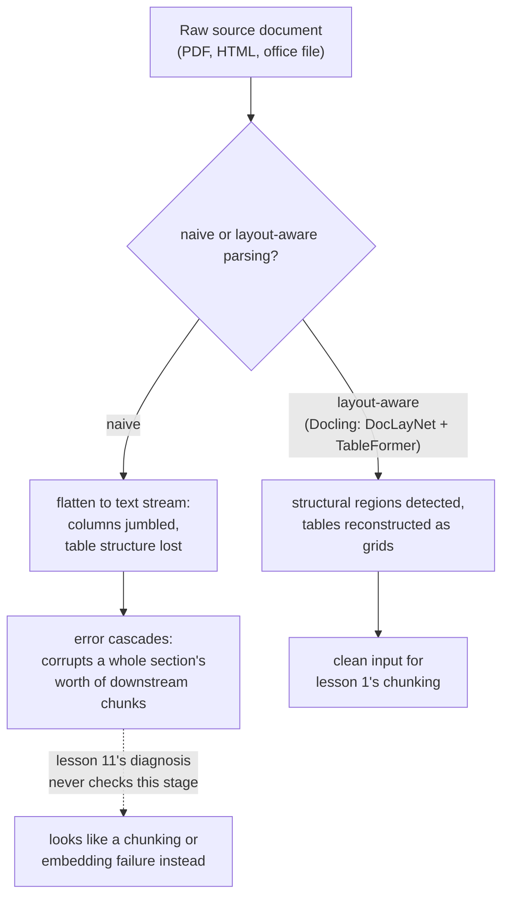

# 第 16 课：摄取流水线

**使命关联:** 第 1 课把分块称为“第一个流水线选择，也是之后每个阶段都会继承的选择”。只有在文档已经以干净、有结构的文本形式存在之后，这话才成立。真实的语料库是以 PDF、HTML 和办公文档的形式到来的，把它们变成分块真正能处理的文本，是本工作区从未点名的一个真实阶段，它的错误会以第 11 课的诊断流程从未设计去捕捉的方式，破坏下游的一切。
**主要来源:** [论文：“Docling Technical Report”，Auer 等，2024](https://arxiv.org/abs/2408.09869)
**前置知识:** [第 1 课](0001-chunking.md)、[第 11 课](0011-diagnosing-the-pipeline.md)

## 热身

1. ▢ 为什么“检索到了错误的上下文”这样的症状，需要逐阶段诊断，而不是靠猜一个可能的原因来修复？

检查

问题可能出在好几个阶段中的任何一个（分块、嵌入、索引、混合权重、重排序），同时改动好几处既浪费精力，又看不出到底是哪一处坏了；按能隔离出故障的顺序逐个阶段检查，才能真正找到原因。

2. ▢ 为什么一个太大、混杂了多个主题的文本块，会稀释它自己的嵌入？

检查

嵌入模型为一个文本块的全部内容产生一个向量；一个跨越几个不相关主题的文本块，得到的嵌入是它们所有主题的平均，而不是对其中任何单个主题的精确表示，这使得只针对其中一个主题的查询，更难与它很好地匹配。

## 要点

### 摄取是第一个阶段之前的阶段

**摄取**是把真实的来源文档（PDF、HTML 页面、Word 或 PowerPoint 文件）变成分块（第 1 课）真正处理的那份干净、有结构的文本。第 1 课把分块当作流水线的起点，是因为它假定干净的文本已经存在；摄取才是这份文本真正的来源，它是一个真正的流水线阶段，有自己出错的方式，而不是流水线可以忽略的底层预处理细节。

### 朴素提取恰恰把赋予文档含义的结构压平了

从 PDF 中取出文本最简单的办法，是按文件内部表示碰巧存储字符的任何顺序，把每个字符都抽出来，丢掉版面、栏结构，以及标题、正文段落和表格单元格之间的区别。对简单的单栏文档来说，这样做还说得过去，但多栏版面可能把两个不相关的栏的文本交织成一团杂乱、不连贯的流，而表格的行和列被压平成线性文本之后，就丢掉了让每个单元格里的数字最初具有意义的行与列之间的关系。

### 版面感知解析把结构当作需要检测的东西，而不是丢弃的东西

Docling 自己的做法，是针对朴素提取所丢掉的那些结构，专门运行相应的模型：版面分析模型（DocLayNet）在从页面各区域提取任何文本之前，先识别出页面的结构区域（标题、段落、表格、图），而表格结构识别模型（TableFormer）则专门重建表格实际的行列网格，而不是把它当作一股没有区分的词流来读。重点不在于每份文档都严格需要这样做；干净的单栏文本文件一样都不需要。重点在于，真实语料库中比较难的文档，也就是密集的多栏版面、带合并单元格的财务表格，需要这种结构检测，才能产生仍然与原文档含义一致的文本。

### 摄取错误会级联，破坏的是一整节，而不是一个句子

版面检测阶段的错误，不会只局限于它直接触及的东西：如果一个标题被误认作正文，或者两栏被按错误的顺序合并，那么每个下游步骤，包括提取实际文本、识别表格结构、以及分块之后要切分的一切，都会继承这个错误。一个早期的错误，可能破坏一整节内容最终生成的所有文本块，而不只是版面模型出错的那一个元素，因为之后的每一步处理的，都是交到它手里的、已经被破坏的结构，而不是原始文档。

### 这正是第 11 课的诊断流程从未设计去发现的失败

第 11 课的诊断从分块开始，检查正确的信息是否连贯地存在于某一个文本块之内。一次糟糕的解析意味着，对这第一项检查的回答已经是“否”，但原因是第 11 课没有对应分支的：不是糟糕的分块*策略*，而是糟糕的分块*输入*，也就是在分块运行之前就已经杂乱或结构被打乱的文本。第 11 课检查的后面每个阶段，包括嵌入、索引、混合权重、重排序，都可能完全按设计工作，却仍然浮现出错误的上下文，因为它们都在忠实地处理在它们任何一个接触之前就已经损坏的内容。

## 练习

1. ▢ 一页双栏的 PDF 用朴素的文本提取器解析，得到的文本把两栏的句子交织成了一股不连贯的流。究竟出了什么问题，在哪个阶段？

提示

想一想，朴素提取丢掉了关于文本在页面上位置的哪些信息。

检查

出问题的是摄取阶段，而不是分块：朴素提取丢掉了页面的分栏版面，按文件存储的原始顺序来读文本，而没有遵循人类会依循的视觉阅读顺序。没有任何分块策略，能从一份在分块运行之前就已经杂乱的输入中恢复出连贯的文本。

2. ▢ Docling 为什么使用专门的表格结构模型（TableFormer），而不是把表格当作普通的连续文本？

检查

表格的含义取决于每个值属于哪一行、哪一列；像读普通段落那样把它压平成线性文本，就丢掉了这些关系，把一个结构化的数字网格变成一股没有区分的流，不再能传达每个值实际指的是什么。

3. ▢ 版面模型把文档的章节标题误认作普通正文。为什么这一个错误，可能破坏的远不止那个标题？

检查

每个下游步骤，包括文本提取和分块，处理的都是版面阶段交给它的结构；如果这个结构已经错了，后面的步骤会忠实地处理这个错误，而不会去纠正它，所以一个被误认的标题，可能让一整节内容最终生成的所有文本块错位或损坏，而不只是标题本身。

4. ▢ 某团队对一个错误检索的症状运行了第 11 课的诊断流程，确认分块、嵌入、索引、混合权重和重排序都表现正确，却仍然无法解释这个糟糕的结果。第 11 课的流程没有检查什么？

检查

摄取阶段：分块实际收到的文本，到底是不是来源文档的一份干净的、结构上忠实的表示。第 11 课检查的每个阶段，都可能完全按设计工作，却仍然在处理来自更上游糟糕解析的、已经被破坏的输入。

5. ▢ 下列哪项说法正确地描述了摄取与本工作区已经涵盖的各流水线阶段之间的关系？

    - a) 摄取是一个本身没有真正失败模式的预处理细节，因为分块才是真正的第一个阶段
    - b) 摄取把原始来源文档变成分块所依赖的结构化文本，那里的错误（比如丢掉分栏版面或表格结构）会向下游级联，而从分块开始的第 11 课诊断流程，从未设计去检查这种情况
    - c) 无论版面多复杂，朴素的文本提取器和 Docling 这样的版面感知解析器，对任何文档产生的结果都等价
    - d) 摄取错误只会影响错误发生的那一个元素（一个标题、一张表格）

检查

**b)** 这正是本课确立的精确关系。（a）错误：摄取是一个真正的阶段，有自己独特的失败模式，位于第 1 到 11 课已涵盖的一切之上游。（c）错误：朴素提取和版面感知解析，尤其在多栏或表格密集的文档上差异悬殊。（d）错误：摄取错误会级联，破坏一整节下游内容，而不只是被直接误认的那个元素。

## 实战练习

- [ ] 对你自己语料库中（或你能访问的）某份多栏版面或带密集表格的文档，用朴素提取器提取它的文本，并与版面感知工具（如 Docling）对同一份文档产生的结果做比较。
- [ ] 挑一份已摄取的文档，沿着流水线追踪其中的一张表格：它的行列结构，是否保留到了最终被嵌入的文本块里，还是已经被压平成了无结构的文本？
- [ ] 明天：通读 Docling 论文对其版面分析模型和表格结构模型的描述，并记下两者各是基于哪类训练数据（DocLayNet、PubTables-1M 类的数据集）构建的。

## 延伸阅读

- [论文：“Docling Technical Report”，Auer 等，2024](https://arxiv.org/abs/2408.09869)
- [资源](../RESOURCES.md)

---

没学明白？请重读顶部的主要来源，因为本课是对它的压缩，而理解正是在压缩中流失的。如果有哪个术语觉得含糊，可以查看[术语表](../GLOSSARY.md)。

如果问题出在课程本身，而不是学习材料，那就是一个缺陷：[提交 issue](https://github.com/TokenCemetery/teach/issues)。
