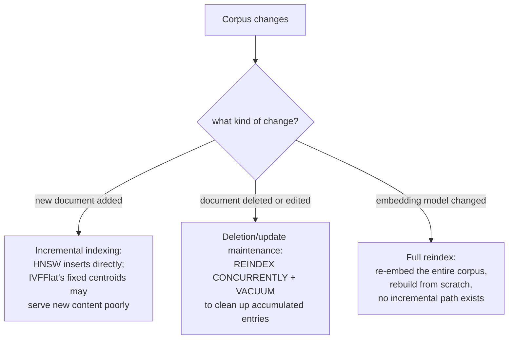

# Lección 17. Frescura

**Vínculo con la misión:** La lección 4 comparó HNSW e IVFFlat como dos formas de cambiar exactitud por velocidad, como si un índice se construyera una vez y se consultara para siempre después. Un corpus real no deja de cambiar: se añaden, editan y eliminan documentos, y tarde o temprano alguien decide cambiar el propio modelo de embeddings. Cada uno de estos cambios rompe una suposición distinta bajo la que se construyó el índice, y cada uno necesita una solución genuinamente distinta.
**Fuente principal:** [Repo: pgvector, pgvector](https://github.com/pgvector/pgvector)
**Requisitos previos:** [Lección 4](0004-ann-indexes.md), [Lección 2](0002-embedding-models-and-similarity.md)

## Calentamiento

1. ▢ ¿Cuál es la diferencia estructural clave entre cómo se construyen HNSW e IVFFlat, según la lección 4?

Comprobación

IVFFlat tiene un paso de entrenamiento: divide los vectores en listas usando centroides de clúster calculados a partir de los datos presentes cuando se construye el índice. HNSW no tiene ningún paso de entrenamiento; construye directamente un grafo multicapa, que puede crearse incluso antes de que exista dato alguno en la tabla.

2. ▢ ¿Por qué la métrica de similitud de un bi-encoder tiene que coincidir con cómo se entrenó realmente el modelo?

Comprobación

El modelo se optimizó para colocar cerca los elementos semánticamente similares bajo una función de distancia concreta; usar una métrica distinta en el momento de la consulta compara distancias que el modelo nunca se entrenó para que tuvieran significado, de modo que las puntuaciones de similitud dejan de reflejar una cercanía semántica genuina.

## Qué debes saber

### Añadir documentos nuevos no afecta igual a todos los tipos de índice

La **indexación incremental** consiste en añadir vectores nuevos a un índice ya construido sin reconstruirlo desde cero. HNSW lo maneja de forma nativa: como no tiene paso de entrenamiento, un vector nuevo simplemente se inserta directamente en el grafo, y la propia documentación de pgvector señala que un índice HNSW puede incluso crearse antes de que exista dato alguno. IVFFlat es estructuralmente distinto: sus centroides de clúster (las "listas" a las que se acota una búsqueda vectorial) se calculan una sola vez, con los datos que existían cuando se construyó el índice, y un vector nuevo añadido después se asigna al centroide existente más cercano sin que esos centroides se recalculen nunca. Si el contenido del corpus cambia de forma significativa tras construir el índice, los vectores recién añadidos pueden acabar mal agrupados, ya que los centroides nunca se entrenaron con nada parecido a ellos, lo que degrada el recall específicamente para el contenido más nuevo y no para el corpus en su conjunto.

### Los borrados y las actualizaciones dejan un índice basado en grafos en un estado que necesita limpieza

Eliminar o cambiar un chunk (un documento fuente se editó o se retiró) no es gratis ni siquiera para un índice construido para soportar la inserción incremental. La propia guía operativa de pgvector lo señala directamente: hacer vacuum de un índice HNSW tras borrados o actualizaciones puede tardar un buen rato, y reindexar primero lo acelera, `REINDEX INDEX CONCURRENTLY` seguido de `VACUUM`. Esto refleja un costo estructural real: un índice basado en grafos no extirpa limpiamente un nodo sin arriesgar la navegabilidad del grafo, así que las entradas borradas u obsoletas tienden a acumularse hasta que una pasada de mantenimiento las limpia, en lugar de desaparecer en el instante en que se borra una fila. Un sistema de producción tiene que planificar esta cadencia de mantenimiento, no asumir que los borrados son instantáneos y gratuitos.

### Cambiar el modelo de embeddings no es en absoluto una actualización de frescura, es una reconstrucción completa

Todo lo anterior asume que el modelo de embeddings se mantiene igual mientras cambia el *contenido* del corpus. Cambiar el propio modelo de embeddings es un problema completamente distinto: cada vector que ya está en el índice lo produjo el modelo antiguo, colocado en el espacio vectorial específico de ese modelo, y una consulta con embedding del modelo nuevo no tiene ninguna relación significativa con las distancias del espacio del modelo antiguo (la misma razón por la que la lección 2 exige que una métrica de similitud coincida con cómo se entrenó realmente un modelo, extendida a decir que dos modelos distintos ni siquiera comparten un espacio comparable). No hay una solución incremental para esto; cada vector del corpus tiene que volver a generarse con el modelo nuevo y el índice reconstruirse desde cero, ya que una mezcla de vectores del modelo antiguo y del nuevo en un mismo índice compararía distancias que nunca se entrenaron para significar algo entre sí.

### Tres problemas distintos, tres planes operativos distintos

La indexación incremental (documentos nuevos), el mantenimiento de borrados y actualizaciones (documentos eliminados o editados) y una reindexación completa impulsada por el modelo (un modelo de embeddings cambiado) no son tres nombres para la misma preocupación de frescura; son operaciones genuinamente distintas, con costos distintos, frecuencias distintas y sensibilidades distintas según el tipo de índice. Planificar solo para la más barata de las tres (las altas incrementales rutinarias) y tratar una reindexación completa como una ocurrencia tardía es exactamente como una actualización de modelo se convierte en una reconstrucción de todo el corpus no planificada y costosa en lugar de una programada.

## Práctica

1. ▢ El contenido de un corpus cambia de forma significativa de tema con el tiempo (una línea de productos en crecimiento, por ejemplo), y se añaden documentos nuevos a un índice IVFFlat construido sobre el corpus original, más estrecho. ¿Por qué podría resentirse específicamente la calidad de la recuperación para los documentos más nuevos?

Pista

Considera con qué se calcularon realmente los centroides de clúster de IVFFlat y si se actualizan a medida que llegan datos nuevos.

Comprobación

Los centroides de IVFFlat se calcularon una sola vez, con los datos presentes en el momento de la construcción, y nunca se recalculan al añadir vectores nuevos; si el contenido de los documentos nuevos difiere de forma significativa de aquello con lo que se entrenaron los centroides, esos vectores nuevos se asignan a clústeres que no los representan bien, lo que degrada el recall específicamente para el contenido más nuevo.

2. ▢ ¿Por qué la propia documentación de pgvector recomienda `REINDEX INDEX CONCURRENTLY` antes de `VACUUM` para un índice HNSW que ha tenido muchos borrados?

Comprobación

Las entradas borradas u obsoletas de un índice basado en grafos se acumulan en lugar de eliminarse limpiamente en el instante en que se borra una fila, ya que quitar un nodo sin cuidado arriesga la navegabilidad del grafo; reindexar primero reconstruye el grafo de forma limpia, lo que acelera la pasada de vacuum posterior frente a hacer vacuum directamente sobre la estructura original con entradas acumuladas.

3. ▢ Un equipo cambia el modelo de embeddings de su pipeline de recuperación e intenta añadir de forma incremental al índice existente solo los embeddings del modelo nuevo de los documentos recién cambiados, y deja los embeddings del modelo antiguo para todo lo demás. ¿Qué falla en este plan?

Comprobación

Los embeddings del modelo antiguo y los del nuevo no comparten en absoluto un espacio vectorial comparable; una consulta con embedding del modelo nuevo no tiene una relación de distancia significativa con los vectores del modelo antiguo que están en el mismo índice. Todo el corpus tiene que volver a generarse con el modelo nuevo y el índice reconstruirse desde cero; no hay un camino incremental o parcial que mezcle correctamente los vectores de ambos modelos.

4. ▢ ¿Por qué insiste esta lección en que la indexación incremental, el mantenimiento de borrados y actualizaciones y una reindexación impulsada por el modelo son tres problemas genuinamente distintos y no tres grados de la misma preocupación de "frescura"?

Comprobación

Cada uno rompe una suposición distinta en la que se apoya el índice: la indexación incremental asume que la estructura del índice puede absorber vectores nuevos (cierto para HNSW, complicado por los centroides fijos de IVFFlat); el mantenimiento de borrados y actualizaciones asume que las entradas obsoletas pueden limpiarse periódicamente sin romper el grafo; un cambio de modelo asume que todo el índice comparte un único espacio vectorial comparable, lo que deja de cumplirse por completo cuando cambia el modelo, y exige una reconstrucción completa y no una operación incremental.

5. ▢ ¿Qué afirmación describe correctamente cómo afectan estos tres tipos de cambio del corpus a un índice vectorial?

    - a) Los tres pueden manejarse del mismo modo: actualizar de forma incremental los vectores afectados y seguir adelante
    - b) La indexación incremental está bien soportada por HNSW pero puede degradarse en los centroides fijos de IVFFlat; los borrados y las actualizaciones requieren mantenimiento periódico de reindexación y vacuum en lugar de ser instantáneos; un modelo de embeddings cambiado requiere volver a generar los embeddings de todo el corpus y reconstruir, ya que los vectores del modelo antiguo y del nuevo no comparten un espacio comparable
    - c) IVFFlat maneja mejor que HNSW el contenido nuevo fuera de distribución, ya que recalcula los centroides automáticamente
    - d) Cambiar el modelo de embeddings puede manejarse de forma incremental volviendo a generar los embeddings solo de los documentos añadidos desde el último cambio de modelo

Comprobación

**b)** Esa es la distinción precisa, en tres vías, que establece esta lección. (a) es falsa: un cambio de modelo en concreto no puede manejarse de forma incremental en absoluto. (c) es falsa: los centroides de IVFFlat quedan fijados al construir el índice y no se recalculan al llegar datos nuevos; esa es exactamente su debilidad frente a HNSW aquí. (d) es falsa: cada vector que ya está en el índice, no solo los recién añadidos, lo produjo el modelo antiguo y es incompatible con el espacio del modelo nuevo.

## Prácticas en el mundo real

- [ ] Para un índice vectorial que mantengas (o al que tengas acceso), comprueba si usa HNSW o IVFFlat y si tiene programado algún mantenimiento de reindexación o vacuum para manejar borrados y actualizaciones.
- [ ] Si el corpus detrás de ese índice ha crecido o ha cambiado de tema desde que se construyó el índice por primera vez, comprueba si el recall del contenido más nuevo parece peor que el del corpus original, sobre todo si el índice es IVFFlat.
- [ ] Mañana: lee completa la documentación de pgvector sobre mantenimiento de índices y anota qué recomienda sobre con qué frecuencia ejecutar `REINDEX` frente a confiar solo en el autovacuum.

## Para profundizar

- [Repo: pgvector, pgvector](https://github.com/pgvector/pgvector)
- [Recursos](../RESOURCES.md)

---

¿No termina de quedar claro? Vuelve a leer la fuente principal de arriba, ya que esta lección la comprime y en la compresión es donde se escapa la comprensión. Consulta el [glosario](../GLOSSARY.md) por si algún término te resultó resbaladizo.

Si lo poco claro es la propia lección y no el material, eso es un defecto: [abre un issue](https://github.com/TokenCemetery/teach/issues).
