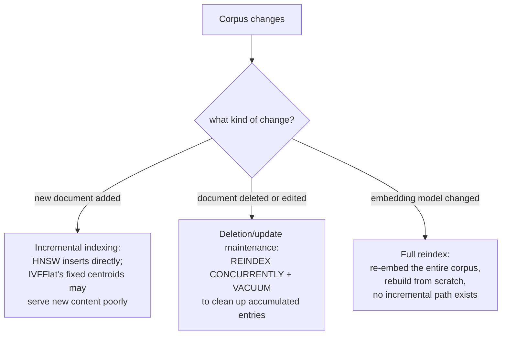

# Leçon 17. Fraîcheur

**Lien avec la mission :** La leçon 4 a comparé HNSW et IVFFlat comme deux façons d'échanger de l'exactitude contre de la vitesse, comme si un index était construit une fois puis interrogé pour toujours. Un vrai corpus ne cesse de changer : des documents sont ajoutés, modifiés et retirés, et quelqu'un finit par décider de changer le modèle d'embedding lui-même. Chacun de ces changements remet en cause une hypothèse différente sous laquelle l'index a été construit, et chacun demande une correction réellement différente.
**Source primaire :** [Dépôt : pgvector, pgvector](https://github.com/pgvector/pgvector)
**Prérequis :** [Leçon 4](0004-ann-indexes.md), [Leçon 2](0002-embedding-models-and-similarity.md)

## Échauffement

1. ▢ Quelle est la différence structurelle essentielle entre la façon dont HNSW et IVFFlat sont construits, d'après la leçon 4 ?

Vérifier

IVFFlat a une étape d'entraînement : il répartit les vecteurs en listes à partir de centroïdes de clusters calculés sur les données présentes au moment de la construction de l'index. HNSW n'a aucune étape d'entraînement ; il construit directement un graphe multicouche, qui peut même être créé avant qu'il existe la moindre donnée dans la table.

2. ▢ Pourquoi la métrique de similarité d'un bi-encoder doit-elle correspondre à la façon dont le modèle a réellement été entraîné ?

Vérifier

Le modèle a été optimisé pour placer proches les éléments sémantiquement similaires selon une fonction de distance précise ; utiliser une autre métrique au moment de la requête compare des distances que le modèle n'a jamais été entraîné à rendre significatives, de sorte que les scores de similarité cessent de refléter une véritable proximité sémantique.

## À savoir

### Ajouter de nouveaux documents n'affecte pas tous les types d'index de la même façon

L'**indexation incrémentale** consiste à ajouter de nouveaux vecteurs à un index déjà construit sans le reconstruire à partir de zéro. HNSW la gère nativement : n'ayant pas d'étape d'entraînement, un nouveau vecteur est simplement inséré directement dans le graphe, et la documentation de pgvector note qu'un index HNSW peut même être créé avant qu'il existe la moindre donnée. IVFFlat est structurellement différent : ses centroïdes de clusters (les « listes » auxquelles une recherche vectorielle se restreint) sont calculés une fois, à partir des données qui existaient au moment de la construction de l'index, et un nouveau vecteur ajouté ensuite est affecté au centroïde existant le plus proche sans que ces centroïdes soient jamais recalculés. Si le contenu du corpus évolue sensiblement après la construction de l'index, les vecteurs nouvellement ajoutés peuvent se retrouver mal regroupés, puisque les centroïdes n'ont jamais été entraînés sur rien qui leur ressemble, ce qui dégrade le recall spécifiquement pour le contenu le plus récent plutôt que pour le corpus dans son ensemble.

### Les suppressions et les mises à jour laissent un index à base de graphe dans un état qui demande un nettoyage

Retirer ou modifier un chunk (un document source a été édité ou retiré) n'est pas gratuit, même pour un index conçu pour l'insertion incrémentale. Les consignes d'exploitation de pgvector le nomment directement : lancer le vacuum d'un index HNSW après des suppressions ou des mises à jour peut prendre du temps, et réindexer d'abord l'accélère, `REINDEX INDEX CONCURRENTLY` suivi de `VACUUM`. Cela reflète un vrai coût structurel : un index à base de graphe n'excise pas proprement un nœud sans risquer la navigabilité du graphe, donc les entrées supprimées ou périmées tendent à s'accumuler jusqu'à ce qu'une passe de maintenance les nettoie, au lieu de disparaître à l'instant où une ligne est supprimée. Un système de production doit prévoir ce rythme de maintenance, et non supposer que les suppressions sont instantanées et gratuites.

### Changer de modèle d'embedding n'est pas du tout une mise à jour de fraîcheur, c'est une reconstruction complète

Tout ce qui précède suppose que le modèle d'embedding reste le même alors que le *contenu* du corpus change. Changer le modèle d'embedding lui-même est un problème entièrement différent : chaque vecteur déjà présent dans l'index a été produit par l'ancien modèle, placé dans l'espace vectoriel propre à ce modèle, et une requête dont l'embedding est calculé avec un nouveau modèle n'a aucune relation significative avec les distances dans l'espace de l'ancien modèle (la même raison pour laquelle la leçon 2 exige qu'une métrique de similarité corresponde à la façon dont un modèle a réellement été entraîné, étendue pour dire que deux modèles différents ne partagent pas d'espace comparable au départ). Il n'existe pas de correction incrémentale ; chaque vecteur du corpus doit être recalculé avec le nouveau modèle et l'index reconstruit à partir de zéro, puisqu'un mélange de vecteurs de l'ancien et du nouveau modèle dans un même index compareraient des distances qui n'ont jamais été entraînées à signifier quoi que ce soit les unes par rapport aux autres.

### Trois problèmes différents, trois plans d'exploitation différents

L'indexation incrémentale (nouveaux documents), la maintenance des suppressions et des mises à jour (documents retirés ou modifiés) et une réindexation complète liée au modèle (un modèle d'embedding changé) ne sont pas trois noms d'une même préoccupation de fraîcheur ; ce sont des opérations réellement différentes, avec des coûts différents, des fréquences différentes et des sensibilités différentes selon le type d'index. Ne planifier que la moins coûteuse des trois (les ajouts incrémentaux courants) en traitant une réindexation complète comme une réflexion après coup, c'est exactement ainsi qu'une mise à niveau de modèle devient une reconstruction imprévue, coûteuse, de tout le corpus au lieu d'une reconstruction planifiée.

## Pratique

1. ▢ Le contenu d'un corpus évolue sensiblement dans le temps quant aux sujets (une gamme de produits qui s'étoffe, par exemple), et de nouveaux documents sont ajoutés à un index IVFFlat construit sur le corpus d'origine, plus étroit. Pourquoi la qualité de la récupération pourrait-elle pâtir spécifiquement pour les documents les plus récents ?

Indice

Réfléchissez à ce à partir de quoi les centroïdes de clusters d'IVFFlat ont réellement été calculés, et s'ils sont mis à jour à mesure que de nouvelles données arrivent.

Vérifier

Les centroïdes d'IVFFlat ont été calculés une seule fois, à partir des données présentes à la construction, et ne sont jamais recalculés à mesure que de nouveaux vecteurs sont ajoutés ; si le contenu des nouveaux documents diffère sensiblement de ce sur quoi les centroïdes ont été entraînés, ces nouveaux vecteurs sont affectés à des clusters qui ne les représentent pas vraiment bien, ce qui dégrade le recall spécifiquement pour le contenu le plus récent.

2. ▢ Pourquoi la documentation de pgvector recommande-t-elle `REINDEX INDEX CONCURRENTLY` avant `VACUUM` pour un index HNSW qui a subi de nombreuses suppressions ?

Vérifier

Les entrées supprimées ou périmées d'un index à base de graphe s'accumulent au lieu d'être proprement retirées à l'instant où une ligne est supprimée, puisque retirer un nœud sans précaution risque la navigabilité du graphe ; réindexer d'abord reconstruit proprement le graphe, ce qui accélère la passe de vacuum qui suit par rapport à un vacuum direct de la structure d'origine où les entrées se sont accumulées.

3. ▢ Une équipe change le modèle d'embedding de son pipeline de récupération et essaie d'ajouter de façon incrémentale à l'index existant seulement les embeddings du nouveau modèle pour les documents récemment modifiés, en laissant en place les embeddings de l'ancien modèle pour tout le reste. Qu'est-ce qui ne va pas dans ce plan ?

Vérifier

Les embeddings de l'ancien et du nouveau modèle ne partagent pas du tout d'espace vectoriel comparable ; une requête dont l'embedding est calculé avec le nouveau modèle n'a aucune relation de distance significative avec les vecteurs de l'ancien modèle présents dans le même index. Tout le corpus doit être recalculé avec le nouveau modèle et l'index reconstruit à partir de zéro ; il n'existe aucune voie incrémentale ou partielle qui mélange correctement les vecteurs des deux modèles.

4. ▢ Pourquoi cette leçon insiste-t-elle sur le fait que l'indexation incrémentale, la maintenance des suppressions et des mises à jour, et une réindexation liée au modèle sont trois problèmes réellement différents plutôt que trois degrés d'une même préoccupation de « fraîcheur » ?

Vérifier

Chacun remet en cause une hypothèse différente sur laquelle repose l'index : l'indexation incrémentale suppose que la structure de l'index peut absorber de nouveaux vecteurs (vrai pour HNSW, compliqué pour les centroïdes fixes d'IVFFlat) ; la maintenance des suppressions et des mises à jour suppose que les entrées périmées peuvent être nettoyées périodiquement sans casser le graphe ; un changement de modèle suppose que tout l'index partage un seul espace vectoriel comparable, ce qui ne tient plus du tout dès que le modèle change, ce qui exige une reconstruction complète plutôt que toute opération incrémentale.

5. ▢ Laquelle de ces affirmations décrit correctement comment ces trois types de changement du corpus affectent un index vectoriel ?

    - a) Les trois peuvent être traités de la même façon : mettre à jour de façon incrémentale les vecteurs concernés et passer à autre chose
    - b) L'indexation incrémentale est bien prise en charge par HNSW mais peut se dégrader avec les centroïdes fixes d'IVFFlat ; les suppressions et mises à jour exigent une maintenance périodique de réindexation et de vacuum plutôt que d'être instantanées ; un modèle d'embedding changé exige un nouveau calcul des embeddings de tout le corpus et une reconstruction, puisque les vecteurs de l'ancien et du nouveau modèle ne partagent aucun espace comparable
    - c) IVFFlat gère mieux que HNSW le nouveau contenu hors distribution, puisqu'il recalcule automatiquement les centroïdes
    - d) Changer de modèle d'embedding peut se traiter de façon incrémentale en recalculant seulement les embeddings des documents ajoutés depuis le dernier changement de modèle

Vérifier

**b)** C'est la distinction précise en trois volets qu'établit cette leçon. (a) est fausse : un changement de modèle en particulier ne peut pas du tout être traité de façon incrémentale. (c) est fausse : les centroïdes d'IVFFlat sont fixés à la construction et ne sont pas recalculés à mesure que de nouvelles données arrivent ; c'est exactement sa faiblesse par rapport à HNSW ici. (d) est fausse : chaque vecteur déjà présent dans l'index, pas seulement les vecteurs récemment ajoutés, a été produit par l'ancien modèle et est incompatible avec l'espace du nouveau modèle.

## Exercices en situation réelle

- [ ] Pour un index vectoriel que vous maintenez (ou auquel vous avez accès), vérifiez s'il utilise HNSW ou IVFFlat, et s'il a une maintenance planifiée de réindexation ou de vacuum pour gérer les suppressions et les mises à jour.
- [ ] Si le corpus derrière cet index a grossi ou évolué quant aux sujets depuis la première construction de l'index, vérifiez si le recall pour le contenu le plus récent semble moins bon que pour le corpus d'origine, surtout si l'index est IVFFlat.
- [ ] Demain : lisez en entier la documentation de pgvector sur la maintenance des index, et notez ce qu'elle recommande quant à la fréquence d'exécution de `REINDEX` par rapport au seul recours à l'autovacuum.

## Pour aller plus loin

- [Dépôt : pgvector, pgvector](https://github.com/pgvector/pgvector)
- [Ressources](../RESOURCES.md)

---

Ça ne passe pas ? Relisez la source primaire en haut de page, car cette leçon la condense et c'est dans la condensation que la compréhension s'échappe. Consultez le [glossaire](../GLOSSARY.md) pour tout terme qui vous a paru glissant.

Si c'est la leçon elle-même qui n'est pas claire plutôt que la matière, c'est un défaut : [ouvrez une issue](https://github.com/TokenCemetery/teach/issues).
