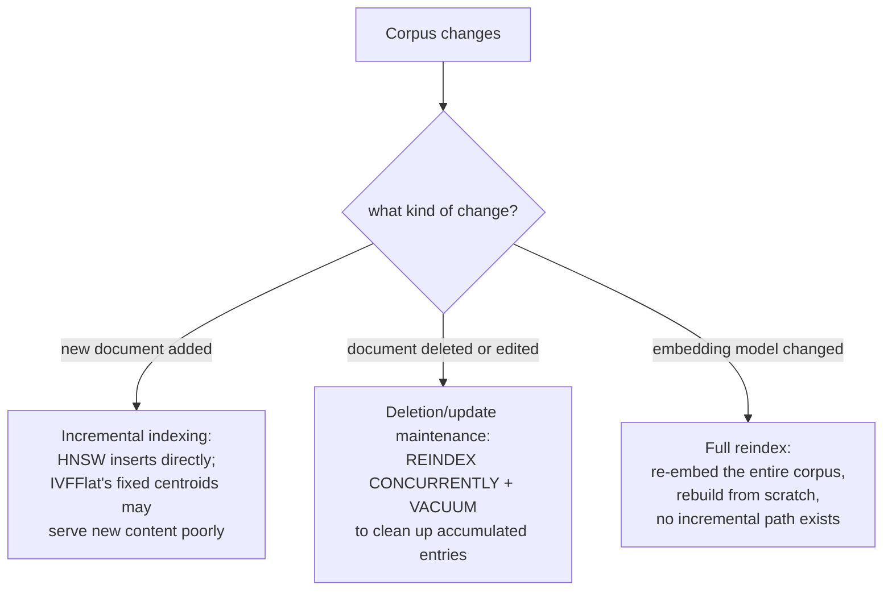

# पाठ 17. Freshness

**मिशन से संबंध:** पाठ 4 ने HNSW और IVFFlat की तुलना सटीकता के बदले रफ़्तार लेने के दो तरीक़ों के रूप में की, मानो index एक बार बनता हो और उसके बाद हमेशा query होता रहे। असली corpus बदलता रहता है: documents जुड़ते हैं, संपादित होते हैं, हटते हैं, और आख़िरकार कोई embedding model ही बदलने का फ़ैसला करता है। इनमें से हर एक उस अलग मान्यता को तोड़ता है जिसके तहत index बना था, और हर एक को सचमुच अलग इलाज चाहिए।
**मुख्य स्रोत:** [Repo: pgvector, pgvector](https://github.com/pgvector/pgvector)
**पूर्व-आवश्यकताएँ:** [पाठ 4](0004-ann-indexes.md), [पाठ 2](0002-embedding-models-and-similarity.md)

## वार्म-अप

1. ▢ पाठ 4 के अनुसार, HNSW और IVFFlat के बनने के तरीक़े में मुख्य संरचनात्मक फ़र्क़ क्या है?

जाँचें

IVFFlat में training चरण है: वह index बनते समय मौजूद data से निकाले cluster centroids का इस्तेमाल करके vectors को lists में बाँटता है। HNSW में कोई training चरण है ही नहीं; वह सीधे बहु-परत graph बनाता है, जो table में कोई data होने से पहले भी बनाया जा सकता है।

2. ▢ Bi-encoder की similarity metric को उसी से मेल क्यों खाना चाहिए जैसे model असल में train हुआ था?

जाँचें

Model को एक ख़ास distance function के तहत semantic रूप से मिलते-जुलते items को पास-पास रखने के लिए optimize किया गया था; query के समय अलग metric इस्तेमाल करना ऐसी दूरियों की तुलना करता है जिन्हें अर्थपूर्ण बनाने के लिए model को कभी train नहीं किया गया, इसलिए similarity scores असली semantic निकटता को दर्शाना बंद कर देते हैं।

## यह जानें

### नए documents जोड़ना हर index प्रकार को एक जैसा प्रभावित नहीं करता

**Incremental indexing** पहले से बने index में उसे शुरू से दोबारा बनाए बिना नए vectors जोड़ना है। HNSW इसे स्वाभाविक रूप से संभालता है: चूँकि उसमें training चरण नहीं है, नया vector सीधे graph में डाल दिया जाता है, और pgvector का अपना दस्तावेज़ बताता है कि HNSW index ऐसे भी बनाया जा सकता है जब कोई data मौजूद ही न हो। IVFFlat संरचनात्मक रूप से अलग है: उसके cluster centroids (वे "lists" जिन तक vector search सिकुड़ता है) एक बार, index बनते समय जो data मौजूद था उससे निकलते हैं, और बाद में जुड़ा नया vector उन centroids को दोबारा निकाले बिना सबसे नज़दीकी मौजूदा centroid को सौंप दिया जाता है। अगर index बनने के बाद corpus की सामग्री सार्थक रूप से बदल जाए, तो नए जोड़े vectors ठीक से cluster नहीं हो पाते, क्योंकि centroids कभी उनसे मिलती-जुलती किसी चीज़ पर train नहीं हुए, जिससे ख़ास तौर पर सबसे नई सामग्री की recall बिगड़ती है, पूरे corpus की नहीं।

### Deletes और updates graph-आधारित index को ऐसी स्थिति में छोड़ते हैं जिसे सफ़ाई चाहिए

किसी chunk को हटाना या बदलना (source document संपादित या वापस ले लिया गया) मुफ़्त नहीं है, उस index के लिए भी नहीं जो incremental insertion के लिए बना है। pgvector का अपना संचालन-संबंधी मार्गदर्शन इसे सीधे बताता है: deletes या updates के बाद HNSW index को vacuum करने में समय लग सकता है, और पहले reindex करने से यह तेज़ होता है, `REINDEX INDEX CONCURRENTLY` और फिर `VACUUM`। यह असली संरचनात्मक लागत को दर्शाता है: graph-आधारित index graph की navigability को जोखिम में डाले बिना node को साफ़ तौर पर नहीं निकाल सकता, इसलिए हटाई गई या पुरानी प्रविष्टियाँ तब तक जमा होती रहती हैं जब तक रखरखाव का पास उन्हें साफ़ न कर दे, row हटाते ही ग़ायब नहीं हो जातीं। Production system को इस रखरखाव की आवृत्ति की योजना बनानी पड़ती है, यह मानकर नहीं चलना कि deletes तुरंत और मुफ़्त हैं।

### Embedding model बदलना freshness का update है ही नहीं, यह पूरा rebuild है

ऊपर की हर बात मानती है कि embedding model वही रहता है जबकि corpus की *सामग्री* बदलती है। Embedding model ही बदलना बिल्कुल अलग समस्या है: index में पहले से मौजूद हर vector पुराने model से बना था, उस model की अपनी ख़ास vector space में रखा गया था, और नए model से embed की गई query का पुराने model की space की दूरियों से कोई अर्थपूर्ण रिश्ता है ही नहीं (वही कारण जिससे पाठ 2 similarity metric को उसी से मेल खाने को कहता है जैसे model असल में train हुआ था, यह कहने तक बढ़ाया गया कि दो अलग models पहली ही जगह तुलनीय space साझा नहीं करते)। इसका कोई incremental इलाज नहीं है; corpus के हर vector को नए model से दोबारा embed करना और index को शुरू से दोबारा बनाना पड़ता है, क्योंकि एक index में पुराने और नए model के vectors का मिश्रण ऐसी दूरियों की तुलना करता जिन्हें एक-दूसरे के सापेक्ष कोई अर्थ देने के लिए कभी train नहीं किया गया।

### तीन अलग समस्याएँ, तीन अलग संचालन योजनाएँ

Incremental indexing (नए documents), deletion और update का रखरखाव (हटाए या संपादित documents), और model-प्रेरित पूरा reindex (बदला embedding model) एक ही freshness चिंता के तीन नाम नहीं हैं; वे सचमुच अलग ऑपरेशन हैं जिनकी लागत, आवृत्ति और index-प्रकार की संवेदनशीलता अलग है। तीनों में सबसे सस्ते (नियमित incremental जोड़) के लिए ही योजना बनाना और पूरे reindex को बाद की बात मानना ठीक वही तरीक़ा है जिससे model upgrade निर्धारित की जगह अनियोजित, महँगे, corpus-व्यापी rebuild में बदल जाता है।

## अभ्यास

1. ▢ Corpus की सामग्री समय के साथ विषय में सार्थक रूप से बदलती है (मान लें बढ़ती product line), और नए documents ऐसे IVFFlat index में जोड़े जाते हैं जो मूल, ज़्यादा संकरे corpus पर बना था। ख़ास तौर पर सबसे नए documents की retrieval गुणवत्ता क्यों बिगड़ सकती है?

संकेत

विचार करें कि IVFFlat के cluster centroids असल में किस चीज़ से निकले थे, और नया data आने पर वे अपडेट होते हैं या नहीं।

जाँचें

IVFFlat के centroids एक बार, build के समय मौजूद data से निकले थे, और नए vectors जुड़ने पर दोबारा कभी नहीं निकाले जाते; अगर नए documents की सामग्री उससे सार्थक रूप से अलग है जिस पर centroids train हुए थे, तो वे नए vectors ऐसे clusters को सौंपे जाते हैं जो उन्हें ठीक से दर्शाते नहीं, जिससे ख़ास तौर पर सबसे नई सामग्री की recall बिगड़ती है।

2. ▢ pgvector का अपना दस्तावेज़ ऐसे HNSW index के लिए, जिसमें बहुत deletes हुए हों, `VACUUM` से पहले `REINDEX INDEX CONCURRENTLY` क्यों सुझाता है?

जाँचें

Graph-आधारित index में हटाई गई या पुरानी प्रविष्टियाँ row हटते ही साफ़ तौर पर निकलने के बजाय जमा होती रहती हैं, क्योंकि node को बिना सावधानी निकालना graph की navigability को जोखिम में डालता है; पहले reindex करना graph को साफ़ ढंग से दोबारा बनाता है, जो उसके बाद के vacuum पास को मूल, प्रविष्टियाँ-जमा संरचना को सीधे vacuum करने से तेज़ करता है।

3. ▢ एक टीम अपने retrieval pipeline का embedding model बदलती है और बाक़ी सब के लिए पुराने-model की embeddings को जगह पर छोड़कर, सिर्फ़ नए बदले documents के नए-model embeddings को मौजूदा index में incremental रूप से जोड़ने की कोशिश करती है। इस योजना में क्या ग़लत है?

जाँचें

पुराने-model और नए-model की embeddings तुलनीय vector space साझा करती ही नहीं; नए model से embed की गई query का उसी index में बैठे पुराने-model के vectors से कोई अर्थपूर्ण दूरी का रिश्ता नहीं है। पूरे corpus को नए model से दोबारा embed करना और index को शुरू से दोबारा बनाना पड़ता है; ऐसा कोई incremental या आंशिक रास्ता नहीं जो दोनों models के vectors को सही ढंग से मिला सके।

4. ▢ यह पाठ क्यों ज़ोर देता है कि incremental indexing, deletion/update का रखरखाव और model-प्रेरित reindex तीन सचमुच अलग समस्याएँ हैं, एक ही "freshness" चिंता की तीन डिग्रियाँ नहीं?

जाँचें

हर एक उस अलग मान्यता को तोड़ता है जिस पर index टिका है: incremental indexing मानता है कि index संरचना नए vectors को सोख सकती है (HNSW के लिए सच, IVFFlat के तय centroids के लिए पेचीदा); deletion/update का रखरखाव मानता है कि पुरानी प्रविष्टियाँ graph को तोड़े बिना समय-समय पर साफ़ की जा सकती हैं; model बदलना मानता है कि पूरा index एक तुलनीय vector space साझा करता है, जो model बदलते ही बिल्कुल नहीं टिकता, और किसी भी incremental ऑपरेशन की जगह पूरा rebuild माँगता है।

5. ▢ कौन-सा दावा सही बताता है कि corpus के ये तीन तरह के बदलाव vector index को कैसे प्रभावित करते हैं?

    - a) तीनों को एक ही तरह संभाला जा सकता है: प्रभावित vectors को incremental रूप से अपडेट करें और आगे बढ़ें
    - b) Incremental indexing HNSW में अच्छी तरह समर्थित है पर IVFFlat के तय centroids के लिए बिगड़ सकता है; deletes और updates को तुरंत होने के बजाय नियमित reindex/vacuum रखरखाव चाहिए; बदले embedding model को पूरे corpus का दोबारा embed और rebuild चाहिए, क्योंकि पुराने और नए model के vectors तुलनीय space साझा नहीं करते
    - c) IVFFlat नए जोड़े, distribution से बाहर की सामग्री को HNSW से बेहतर संभालता है, क्योंकि वह centroids अपने-आप दोबारा निकालता है
    - d) Embedding model बदलना सिर्फ़ पिछले model बदलाव के बाद जोड़े गए documents को दोबारा embed करके incremental रूप से संभाला जा सकता है

जाँचें

**b)** यही वह ठीक, तीन-तरफ़ा अंतर है जो यह पाठ स्थापित करता है। (a) ग़लत है: model बदलना ख़ास तौर पर बिल्कुल भी incremental रूप से नहीं संभाला जा सकता। (c) ग़लत है: IVFFlat के centroids build के समय तय हो जाते हैं और नया data आने पर दोबारा नहीं निकाले जाते; यहाँ HNSW के मुक़ाबले यही उसकी कमज़ोरी है। (d) ग़लत है: index में पहले से मौजूद हर vector, सिर्फ़ नए जोड़े हुए नहीं, पुराने model से बना था और नए model की space के साथ असंगत है।

## असली दुनिया का अभ्यास

- [ ] जिस vector index को आप सँभालते हैं (या जिस तक आपकी पहुँच है) उसके लिए जाँचें कि वह HNSW इस्तेमाल करता है या IVFFlat, और deletes व updates को संभालने के लिए उसके पास कोई निर्धारित reindex या vacuum रखरखाव है या नहीं।
- [ ] अगर उस index के पीछे का corpus index के पहली बार बनने के बाद बढ़ा है या विषय में बदला है, तो जाँचें कि सबसे नई सामग्री की recall मूल corpus से ख़राब लगती है या नहीं, ख़ासकर अगर index IVFFlat है।
- [ ] कल: pgvector का अपना index रखरखाव का दस्तावेज़ पूरा पढ़ें, और नोट करें कि वह `REINDEX` कितनी बार चलाने बनाम अकेले autovacuum पर निर्भर रहने के बारे में क्या सुझाता है।

## आगे बढ़ने के लिए

- [Repo: pgvector, pgvector](https://github.com/pgvector/pgvector)
- [संसाधन](../RESOURCES.md)

---

बात नहीं बन रही? ऊपर दिए primary source को दोबारा पढ़ें, क्योंकि यह पाठ उसे संक्षिप्त करता है और समझ संक्षेप में ही रिसती है। जो शब्द फिसलन भरा लगे, उसके लिए [शब्दावली](../GLOSSARY.md) देखें।

अगर दिक़्क़त सामग्री की नहीं बल्कि पाठ की ही है, तो वह एक खोट है: [issue खोलें](https://github.com/TokenCemetery/teach/issues)।
