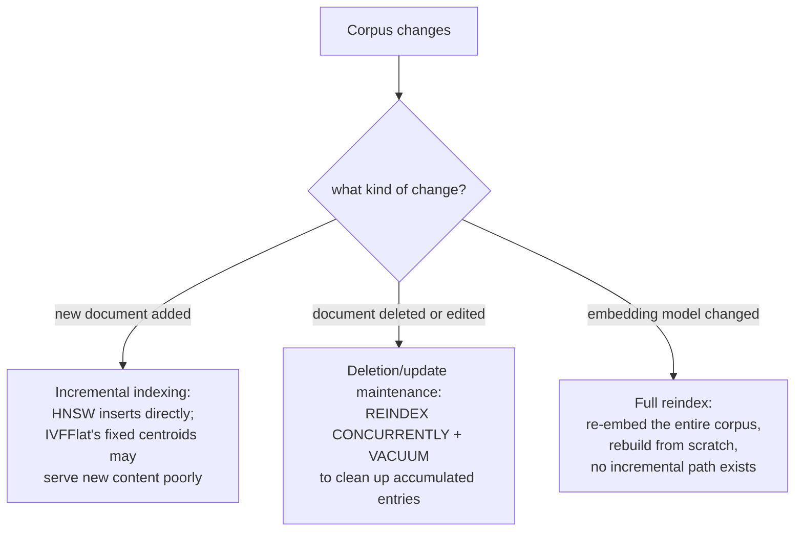

# Lição 17. Atualidade

**Ligação com a missão:** A lição 4 comparou HNSW e IVFFlat como duas formas de trocar exatidão por velocidade, como se um índice fosse construído uma vez e consultado para sempre depois. Um corpus real não para de mudar: documentos são adicionados, editados e removidos, e eventualmente alguém decide trocar o próprio modelo de embedding. Cada um desses eventos quebra uma suposição diferente sob a qual o índice foi construído, e cada um precisa de uma correção genuinamente diferente.
**Fonte principal:** [Repositório: pgvector, pgvector](https://github.com/pgvector/pgvector)
**Pré-requisitos:** [Lição 4](0004-ann-indexes.md), [Lição 2](0002-embedding-models-and-similarity.md)

## Aquecimento

1. ▢ Qual é a diferença estrutural central entre como o HNSW e o IVFFlat são construídos, segundo a lição 4?

Verificação

O IVFFlat tem uma etapa de treinamento: ele divide os vetores em listas usando centroides de cluster calculados a partir dos dados presentes quando o índice é construído. O HNSW não tem nenhuma etapa de treinamento; ele constrói um grafo multicamada diretamente, o que pode até ser criado antes de existir qualquer dado na tabela.

2. ▢ Por que a métrica de similaridade de um bi-encoder precisa corresponder a como o modelo foi de fato treinado?

Verificação

O modelo foi otimizado para colocar itens semanticamente similares próximos sob uma função de distância específica; usar uma métrica diferente na hora da consulta compara distâncias que o modelo nunca foi treinado para tornar significativas, então as pontuações de similaridade deixam de refletir a proximidade semântica genuína.

## Saiba isto

### Adicionar novos documentos não afeta todo tipo de índice do mesmo jeito

A **indexação incremental** é adicionar novos vetores a um índice já construído sem reconstruí-lo do zero. O HNSW trata isso de forma nativa: como não tem etapa de treinamento, um novo vetor é simplesmente inserido diretamente no grafo, e a própria documentação do pgvector observa que um índice HNSW pode até ser criado antes de existir qualquer dado. O IVFFlat é estruturalmente diferente: seus centroides de cluster (as "listas" para as quais uma busca vetorial se restringe) são calculados uma vez, a partir dos dados que existiam quando o índice foi construído, e um novo vetor adicionado depois é atribuído ao centroide existente mais próximo sem que esses centroides sejam recalculados. Se o conteúdo do corpus muda de forma significativa depois de o índice ser construído, os vetores recém-adicionados podem acabar mal agrupados, já que os centroides nunca foram treinados em nada que se parecesse com eles, degradando o recall especificamente para o conteúdo mais novo e não para o corpus como um todo.

### Exclusões e atualizações deixam um índice baseado em grafo em um estado que precisa de limpeza

Remover ou alterar um chunk (um documento-fonte foi editado ou retratado) não é de graça nem para um índice construído para suportar inserção incremental. A própria orientação operacional do pgvector nomeia isso diretamente: fazer vacuum em um índice HNSW depois de exclusões ou atualizações pode demorar, e reindexar primeiro acelera o processo, `REINDEX INDEX CONCURRENTLY` seguido de `VACUUM`. Isso reflete um custo estrutural real: um índice baseado em grafo não extirpa um nó de forma limpa sem arriscar a navegabilidade do grafo, então entradas excluídas ou obsoletas tendem a se acumular até que uma passada de manutenção as limpe, em vez de sumir no instante em que uma linha é excluída. Um sistema de produção precisa planejar essa cadência de manutenção, e não presumir que as exclusões são instantâneas e gratuitas.

### Trocar o modelo de embedding não é uma atualização de atualidade de forma alguma, é uma reconstrução completa

Tudo o que foi dito acima pressupõe que o modelo de embedding continua o mesmo enquanto o *conteúdo* do corpus muda. Trocar o próprio modelo de embedding é um problema totalmente diferente: todo vetor já presente no índice foi produzido pelo modelo antigo, colocado no espaço vetorial específico daquele modelo, e uma consulta que recebeu embedding com um modelo novo não tem nenhuma relação significativa com as distâncias no espaço do modelo antigo (a mesma razão pela qual a lição 2 exige que uma métrica de similaridade corresponda a como um modelo foi de fato treinado, estendida para dizer que dois modelos diferentes sequer compartilham um espaço comparável). Não há correção incremental para isso; todo vetor do corpus precisa ter o embedding gerado novamente com o modelo novo e o índice reconstruído do zero, já que uma mistura de vetores do modelo antigo e do novo em um único índice compararia distâncias que nunca foram treinadas para significar algo umas em relação às outras.

### Três problemas diferentes, três planos operacionais diferentes

A indexação incremental (documentos novos), a manutenção de exclusões e atualizações (documentos removidos ou editados) e uma reindexação completa motivada por mudança de modelo (um modelo de embedding alterado) não são três nomes para a mesma preocupação de atualidade; são operações genuinamente diferentes, com custos diferentes, frequências diferentes e sensibilidades diferentes ao tipo de índice. Planejar apenas para a mais barata das três (as adições incrementais de rotina) enquanto se trata a reindexação completa como um detalhe posterior é exatamente como uma atualização de modelo se transforma em uma reconstrução não planejada, cara e de corpus inteiro, em vez de uma agendada.

## Prática

1. ▢ O conteúdo de um corpus muda de forma significativa em assunto ao longo do tempo (uma linha de produtos crescente, por exemplo), e novos documentos são adicionados a um índice IVFFlat construído sobre o corpus original, mais estreito. Por que a qualidade da recuperação para os documentos mais novos especificamente poderia sofrer?

Dica

Considere a partir de que os centroides de cluster do IVFFlat foram de fato calculados e se eles são atualizados conforme novos dados chegam.

Verificação

Os centroides do IVFFlat foram calculados uma vez, a partir dos dados presentes na construção, e nunca são recalculados conforme novos vetores são adicionados; se o conteúdo dos documentos novos difere de forma significativa daquilo em que os centroides foram treinados, esses vetores novos são atribuídos a clusters que de fato não os representam bem, degradando o recall especificamente para o conteúdo mais novo.

2. ▢ Por que a própria documentação do pgvector recomenda `REINDEX INDEX CONCURRENTLY` antes de `VACUUM` para um índice HNSW que teve muitas exclusões?

Verificação

Entradas excluídas ou obsoletas em um índice baseado em grafo se acumulam em vez de serem removidas de forma limpa no instante em que uma linha é excluída, já que remover um nó sem cuidado arrisca a navegabilidade do grafo; reindexar primeiro reconstrói o grafo de forma limpa, o que acelera a passada de vacuum seguinte em comparação com fazer vacuum diretamente na estrutura original, com entradas acumuladas.

3. ▢ Uma equipe troca o modelo de embedding do seu pipeline de recuperação e tenta adicionar de forma incremental ao índice existente apenas os embeddings do modelo novo dos documentos recém-alterados, deixando no lugar os embeddings do modelo antigo para todo o resto. O que há de errado com esse plano?

Verificação

Os embeddings do modelo antigo e do novo não compartilham um espaço vetorial comparável; uma consulta que recebeu embedding com o modelo novo não tem relação de distância significativa com vetores do modelo antigo no mesmo índice. O corpus inteiro precisa ter o embedding gerado novamente com o modelo novo e o índice ser reconstruído do zero; não há caminho incremental ou parcial que misture corretamente os vetores dos dois modelos.

4. ▢ Por que esta lição insiste que a indexação incremental, a manutenção de exclusões/atualizações e uma reindexação motivada por mudança de modelo são três problemas genuinamente diferentes, e não três graus da mesma preocupação de "atualidade"?

Verificação

Cada um quebra uma suposição diferente em que o índice se apoia: a indexação incremental pressupõe que a estrutura do índice consegue absorver novos vetores (verdade para o HNSW, complicado para os centroides fixos do IVFFlat); a manutenção de exclusões/atualizações pressupõe que entradas obsoletas podem ser limpas periodicamente sem quebrar o grafo; uma mudança de modelo pressupõe que o índice inteiro compartilha um único espaço vetorial comparável, o que deixa de valer por completo quando o modelo muda, exigindo uma reconstrução completa e não qualquer operação incremental.

5. ▢ Qual afirmação descreve corretamente como esses três tipos de mudança no corpus afetam um índice vetorial?

    - a) Os três podem ser tratados do mesmo jeito: atualizar de forma incremental os vetores afetados e seguir em frente
    - b) A indexação incremental é bem suportada pelo HNSW mas pode degradar nos centroides fixos do IVFFlat; exclusões e atualizações exigem manutenção periódica de reindex/vacuum em vez de serem instantâneas; um modelo de embedding alterado exige gerar novamente os embeddings de todo o corpus e reconstruir, já que os vetores do modelo antigo e do novo não compartilham um espaço comparável
    - c) O IVFFlat trata conteúdo recém-adicionado e fora da distribuição melhor que o HNSW, já que recalcula os centroides automaticamente
    - d) Trocar o modelo de embedding pode ser tratado de forma incremental gerando novamente os embeddings apenas dos documentos adicionados desde a última mudança de modelo

Verificação

**b)** Essa é a distinção precisa, em três vias, que esta lição estabelece. (a) é falsa: uma mudança de modelo especificamente não pode ser tratada de forma incremental. (c) é falsa: os centroides do IVFFlat são fixados na construção e não são recalculados conforme novos dados chegam; é exatamente a fraqueza dele em relação ao HNSW aqui. (d) é falsa: todo vetor já presente no índice, e não apenas os recém-adicionados, foi produzido pelo modelo antigo e é incompatível com o espaço do modelo novo.

## Prática no mundo real

- [ ] Para um índice vetorial que você mantém (ou ao qual tem acesso), verifique se ele usa HNSW ou IVFFlat e se há alguma manutenção agendada de reindex ou vacuum para tratar exclusões e atualizações.
- [ ] Se o corpus por trás desse índice cresceu ou mudou de assunto desde que o índice foi construído, verifique se o recall para o conteúdo mais novo parece pior que o do corpus original, especialmente se o índice for IVFFlat.
- [ ] Amanhã: leia por inteiro a documentação do próprio pgvector sobre manutenção de índices e anote o que ela recomenda sobre com que frequência executar `REINDEX` em vez de contar apenas com o autovacuum.

## Para ir além

- [Repositório: pgvector, pgvector](https://github.com/pgvector/pgvector)
- [Recursos](../RESOURCES.md)

---

Não ficou claro? Releia a fonte principal no topo, já que esta lição a comprime e é na compressão que o entendimento escapa. Consulte o [glossário](../GLOSSARY.md) para qualquer termo que pareceu escorregadio.

Se o problema é a lição em si, e não o material, isso é um defeito: [abra uma issue](https://github.com/TokenCemetery/teach/issues).
