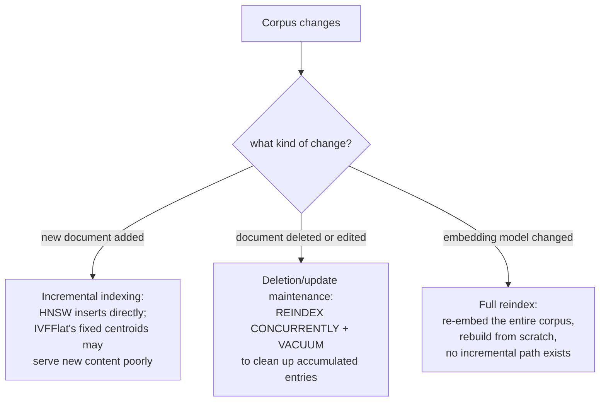

# Урок 17. Свежесть данных

**Связь с целью курса:** Урок 4 сравнил HNSW и IVFFlat как два способа менять точность на скорость, словно индекс строится один раз и дальше вечно запрашивается. Реальный корпус постоянно меняется: документы добавляют, правят и удаляют, а в конце концов кто-то решает заменить саму модель эмбеддингов. Каждое из этих изменений нарушает своё допущение, при котором строился индекс, и каждому нужно по-настоящему своё исправление.
**Первоисточник:** [Репозиторий: pgvector, pgvector](https://github.com/pgvector/pgvector)
**Предварительные требования:** [Урок 4](0004-ann-indexes.md), [Урок 2](0002-embedding-models-and-similarity.md)

## Разминка

1. ▢ В чём ключевое структурное различие между тем, как построены HNSW и IVFFlat, согласно уроку 4?

Проверка

У IVFFlat есть шаг обучения: он делит векторы на списки по центроидам кластеров, вычисленным по данным, которые были при построении индекса. У HNSW шага обучения нет вовсе; он строит многослойный граф напрямую, и его можно даже создать до того, как в таблице появятся какие-либо данные.

2. ▢ Почему метрика сходства би-энкодера должна соответствовать тому, как модель на самом деле обучалась?

Проверка

Модель оптимизировали так, чтобы семантически близкие объекты оказывались рядом при одной конкретной функции расстояния; использование другой метрики во время запроса сравнивает расстояния, которым модель никогда не учили быть осмысленными, и оценки сходства перестают отражать настоящую семантическую близость.

## Что нужно знать

### Добавление новых документов влияет на разные типы индексов по-разному

**Инкрементальная индексация (incremental indexing)** это добавление новых векторов в уже построенный индекс без его перестройки с нуля. HNSW справляется с этим нативно: поскольку у него нет шага обучения, новый вектор просто вставляется прямо в граф, и в собственной документации pgvector отмечено, что индекс HNSW можно создать даже до появления каких-либо данных. IVFFlat устроен структурно иначе: его центроиды кластеров (те «списки», до которых сужается векторный поиск) вычисляются один раз по тем данным, которые были при построении индекса, и новый вектор, добавленный позже, относится к ближайшему из существующих центроидов, причём сами центроиды никогда не пересчитываются. Если содержимое корпуса заметно сместилось после построения индекса, новые добавленные векторы могут оказаться плохо кластеризованы, поскольку центроиды никогда не обучались ни на чём, на них похожем, и это ухудшает полноту именно для самого нового содержимого, а не для корпуса в целом.

### Удаления и обновления оставляют графовый индекс в состоянии, требующем уборки

Удаление или изменение чанка (исходный документ отредактировали или отозвали) не бесплатно даже для индекса, построенного с расчётом на инкрементальную вставку. В собственных эксплуатационных рекомендациях pgvector это названо прямо: очистка (vacuum) индекса HNSW после удалений или обновлений может занять время, а если сначала выполнить переиндексацию, она ускоряется: `REINDEX INDEX CONCURRENTLY`, затем `VACUUM`. Это отражает реальную структурную цену: графовый индекс не вырезает узел чисто, не рискуя навигируемостью графа, поэтому удалённые или устаревшие записи имеют свойство накапливаться, пока обслуживающий проход их не уберёт, а не исчезать в тот же миг, как удалена строка. Продакшен-система должна планировать эту периодичность обслуживания, а не считать удаления мгновенными и бесплатными.

### Замена модели эмбеддингов это вовсе не обновление свежести, а полная перестройка

Всё сказанное выше предполагает, что модель эмбеддингов остаётся прежней, а меняется *содержимое* корпуса. Замена самой модели эмбеддингов это совсем другая проблема: каждый вектор, уже лежащий в индексе, получен старой моделью и помещён в её собственное конкретное векторное пространство, а запрос, заэмбеддённый новой моделью, не имеет никакого осмысленного отношения к расстояниям в пространстве старой модели (та же причина, по которой урок 2 требует, чтобы метрика сходства соответствовала тому, как модель на самом деле обучалась, расширенная до утверждения, что две разные модели вообще не делят сопоставимого пространства). Инкрементального исправления для этого нет; каждый вектор корпуса нужно заэмбеддить заново новой моделью, а индекс построить с нуля, поскольку смесь векторов старой и новой модели в одном индексе сравнивала бы расстояния, которым никогда не учили что-либо значить друг относительно друга.

### Три разные проблемы, три разных эксплуатационных плана

Инкрементальная индексация (новые документы), обслуживание удалений и обновлений (удалённые или отредактированные документы) и полная переиндексация из-за модели (изменённая модель эмбеддингов) это не три названия одной заботы о свежести; это по-настоящему разные операции с разной ценой, разной частотой и разной чувствительностью к типу индекса. Планировать только самую дешёвую из трёх (рутинные инкрементальные добавления), а полную переиндексацию считать мелочью на потом, это ровно то, как обновление модели превращается в незапланированную, дорогую перестройку всего корпуса вместо запланированной.

## Практика

1. ▢ Содержимое корпуса со временем заметно смещается по теме (скажем, растёт линейка продуктов), и новые документы добавляются в индекс IVFFlat, построенный на исходном, более узком корпусе. Почему качество поиска именно для самых новых документов может страдать?

Подсказка

Подумайте, по чему на самом деле вычислены центроиды кластеров IVFFlat и обновляются ли они по мере поступления новых данных.

Проверка

Центроиды IVFFlat вычислены один раз по данным, бывшим при построении, и не пересчитываются при добавлении новых векторов; если содержимое новых документов заметно отличается от того, на чём обучались центроиды, эти новые векторы попадают в кластеры, которые их на самом деле плохо представляют, и это ухудшает полноту именно для самого нового содержимого.

2. ▢ Почему собственная документация pgvector рекомендует `REINDEX INDEX CONCURRENTLY` перед `VACUUM` для индекса HNSW, в котором было много удалений?

Проверка

Удалённые или устаревшие записи в графовом индексе накапливаются, а не удаляются чисто в тот же миг, как удалена строка, поскольку удаление узла без осторожности рискует навигируемостью графа; предварительная переиндексация чисто перестраивает граф, что ускоряет последующий проход очистки по сравнению с очисткой исходной структуры с накопившимися записями напрямую.

3. ▢ Команда заменяет модель эмбеддингов своего конвейера поиска и пытается инкрементально добавить в существующий индекс только эмбеддинги новой модели для недавно изменённых документов, оставив эмбеддинги старой модели на месте для всего остального. Что не так с этим планом?

Проверка

Эмбеддинги старой и новой модели не делят сопоставимого векторного пространства вообще; запрос, заэмбеддённый новой моделью, не имеет осмысленного отношения по расстоянию к векторам старой модели, лежащим в том же индексе. Весь корпус нужно заэмбеддить заново новой моделью и построить индекс с нуля; нет ни инкрементального, ни частичного пути, который смешивал бы векторы двух моделей верно.

4. ▢ Почему этот урок настаивает, что инкрементальная индексация, обслуживание удалений и обновлений и переиндексация из-за модели это три по-настоящему разные проблемы, а не три степени одной заботы о «свежести»?

Проверка

Каждая нарушает своё допущение, на которое опирается индекс: инкрементальная индексация предполагает, что структура индекса может поглощать новые векторы (верно для HNSW, осложнено для фиксированных центроидов IVFFlat); обслуживание удалений и обновлений предполагает, что устаревшие записи можно периодически убирать, не ломая граф; смена модели нарушает допущение, что весь индекс делит одно сопоставимое векторное пространство, которое с изменением модели больше вовсе не выполняется, и требует полной перестройки, а не какой-либо инкрементальной операции.

5. ▢ Какое утверждение верно описывает, как эти три вида изменения корпуса влияют на векторный индекс?

    - a) Все три можно обработать одинаково: инкрементально обновить затронутые векторы и идти дальше
    - b) Инкрементальная индексация хорошо поддерживается в HNSW, но может ухудшаться для фиксированных центроидов IVFFlat; удаления и обновления требуют периодического обслуживания переиндексацией и очисткой, а не происходят мгновенно; изменённая модель эмбеддингов требует полного повторного эмбеддинга корпуса и перестройки, поскольку векторы старой и новой модели не делят сопоставимого пространства
    - c) IVFFlat лучше, чем HNSW, обрабатывает недавно добавленное содержимое вне исходного распределения, поскольку автоматически пересчитывает центроиды
    - d) Замену модели эмбеддингов можно обработать инкрементально, заново заэмбеддив только документы, добавленные с последней смены модели

Проверка

**b)** Это точное трёхстороннее различие, которое устанавливает этот урок. (a) неверно: смену модели инкрементально обработать нельзя вовсе. (c) неверно: центроиды IVFFlat фиксируются при построении и не пересчитываются при поступлении новых данных; это ровно его слабость относительно HNSW здесь. (d) неверно: каждый вектор, уже лежащий в индексе, а не только добавленные недавно, получен старой моделью и несовместим с пространством новой модели.

## Практика в реальной работе

- [ ] Для векторного индекса, который вы обслуживаете (или к которому у вас есть доступ), проверьте, использует ли он HNSW или IVFFlat и есть ли у него какое-либо плановое обслуживание переиндексацией или очисткой для обработки удалений и обновлений.
- [ ] Если корпус за этим индексом вырос или сместился по теме с момента первого построения индекса, проверьте, не кажется ли полнота для самого нового содержимого хуже, чем для исходного корпуса, особенно если индекс IVFFlat.
- [ ] Завтра: прочитайте целиком документацию pgvector по обслуживанию индексов и отметьте, что она рекомендует насчёт того, как часто выполнять `REINDEX`, а не полагаться только на autovacuum.

## Что почитать дальше

- [Репозиторий: pgvector, pgvector](https://github.com/pgvector/pgvector)
- [Ресурсы](../RESOURCES.md)

---

Не доходит? Перечитайте первоисточник в начале: этот урок его сжимает, а при сжатии понимание как раз и теряется. Загляните в [глоссарий](../GLOSSARY.md), если какой-то термин показался скользким.

Если неясен сам урок, а не материал, это дефект: [откройте issue](https://github.com/TokenCemetery/teach/issues).
