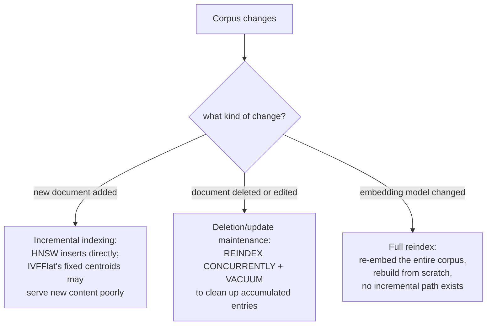

# 第 17 课：数据新鲜度

**使命关联:** 第 4 课把 HNSW 和 IVFFlat 比较为用精确性换速度的两种方式，仿佛索引只需构建一次，之后就永远只用来查询。真实的语料库会不断变化：文档被添加、编辑和删除，最终还会有人决定更换嵌入模型本身。这几种情况，每一种都打破了索引当初构建时依据的一项不同的假设，每一种都需要真正不同的修复办法。
**主要来源:** [仓库：pgvector，pgvector](https://github.com/pgvector/pgvector)
**前置知识:** [第 4 课](0004-ann-indexes.md)、[第 2 课](0002-embedding-models-and-similarity.md)

## 热身

1. ▢ 根据第 4 课，HNSW 和 IVFFlat 在构建方式上，关键的结构性区别是什么？

检查

IVFFlat 有一个训练步骤：它利用构建索引时已有的数据算出的簇中心，把向量划分到各个列表中。HNSW 完全没有训练步骤；它直接构建多层图，甚至可以在表中还没有任何数据时就创建。

2. ▢ 为什么双编码器的相似度度量，必须与模型实际的训练方式相匹配？

检查

模型是被优化成在某一个特定的距离函数下，把语义相似的条目放得彼此靠近；查询时使用不同的度量，比较的是模型从未被训练成有意义的距离，所以相似度分数就不再反映真正的语义接近程度。

## 要点

### 新增文档对各种索引类型的影响并不相同

**增量索引**是向已经建好的索引中添加新向量，而不必从头重建。HNSW 原生就能处理这一点：因为它没有训练步骤，新向量只是直接插入图中，pgvector 自己的文档还指出，HNSW 索引甚至可以在完全没有任何数据之前就创建。IVFFlat 在结构上则不同：它的簇中心（向量搜索所收窄到的“列表”）只算一次，依据的是构建索引时已有的数据，之后添加的新向量被分配给最近的现有簇中心，而这些簇中心不会被重新计算。如果语料库的内容在索引构建之后发生了显著变化，新添加的向量可能聚类得很差，因为簇中心从未在任何与它们相似的数据上训练过，这会专门损害最新内容的召回率，而不是整个语料库的召回率。

### 删除和更新会让基于图的索引处于需要清理的状态

删除或修改一个文本块（来源文档被编辑或撤回），即使对于一个为支持增量插入而建的索引，也不是免费的。pgvector 自己的运维指南直接点明了这一点：在删除或更新之后，对 HNSW 索引做 vacuum 可能要花不少时间，先重建索引（reindex）能让它更快，也就是 `REINDEX INDEX CONCURRENTLY` 之后再 `VACUUM`。这反映的是一种真实的结构性成本：基于图的索引无法在不冒着损害图的可导航性的风险下，干净地切除一个节点，所以被删除的或过时的条目往往会不断累积，直到一次维护把它们清理掉，而不是在行被删除的那一刻就消失。生产系统必须规划这种维护节奏，而不能假定删除是瞬时且免费的。

### 更换嵌入模型根本不是一次新鲜度更新，而是完整的重建

上面的一切都假定，嵌入模型保持不变，而语料库的*内容*在变。更换嵌入模型本身，则是一个完全不同的问题：索引中已有的每个向量，都是由旧模型产生的，被放在那个模型自己特定的向量空间里，而用新模型嵌入的查询，与旧模型空间中的距离根本没有有意义的关系（这与第 2 课要求相似度度量必须与模型实际的训练方式相匹配是同一个原因，只是扩展为：两个不同的模型，从一开始就不共享一个可比较的空间）。对此没有增量式的修复办法；语料库中的每个向量，都必须用新模型重新嵌入，索引也要从头重建，因为一个索引里混着旧模型和新模型的向量，比较的是彼此之间从未被训练成有任何意义的距离。

### 三个不同的问题，三套不同的运维方案

增量索引（新文档）、删除和更新的维护（被移除或编辑的文档），以及由模型变更驱动的完整重建索引（嵌入模型改变），并不是同一个新鲜度问题的三个名称；它们是真正不同的操作，成本不同，频率不同，对索引类型的敏感度也不同。只为三者中最便宜的那个（日常的增量添加）做规划，而把完整的重建索引当作事后才想到的事，恰恰就是一次模型升级会变成一场计划之外的、昂贵的、覆盖整个语料库的重建，而不是一次有计划的重建的原因。

## 练习

1. ▢ 某个语料库的内容在主题上随时间发生了显著变化（比如产品线在增长），而新文档被添加到了一个基于原来较窄语料库构建的 IVFFlat 索引中。为什么最新文档的检索质量可能会受损？

提示

想一想，IVFFlat 的簇中心究竟是根据什么算出来的，以及它们是否会随着新数据的到来而更新。

检查

IVFFlat 的簇中心是依据构建时已有的数据只算一次的，不会随新向量的添加而重新计算；如果新文档的内容与簇中心所训练的数据有显著差异，这些新向量就会被分配到并不能很好代表它们的簇里，专门损害最新内容的召回率。

2. ▢ 对于经历了许多次删除的 HNSW 索引，为什么 pgvector 自己的文档建议先 `REINDEX INDEX CONCURRENTLY`，再 `VACUUM`？

检查

基于图的索引中被删除的或过时的条目会不断累积，而不是在行被删除的那一刻就被干净地移除，因为不小心地移除一个节点会冒着损害图的可导航性的风险；先重建索引会把图干净地重建出来，与直接对原来累积了条目的结构做 vacuum 相比，这会加快随后的 vacuum 过程。

3. ▢ 某团队更换了检索流水线的嵌入模型，并试图只把新近变更文档的新模型嵌入，增量地加入现有索引，其他一切仍保留旧模型的嵌入。这个计划有什么问题？

检查

旧模型和新模型的嵌入根本不共享一个可比较的向量空间；用新模型嵌入的查询，与同一个索引中的旧模型向量，没有任何有意义的距离关系。整个语料库都必须用新模型重新嵌入，索引也要从头重建；不存在能正确地混用两个模型向量的增量或部分办法。

4. ▢ 为什么本课坚持认为，增量索引、删除和更新的维护、以及由模型驱动的重建索引，是三个真正不同的问题，而不是同一个“新鲜度”问题的三种程度？

检查

每一种都打破了索引所依赖的一项不同的假设：增量索引假定索引结构能够吸收新向量（对 HNSW 成立，对 IVFFlat 的固定簇中心则很复杂）；删除和更新的维护假定过时的条目可以定期清理，而不破坏图；模型变更则假定整个索引共享一个可比较的向量空间，而一旦模型改变，这就完全不再成立，要求的是完整的重建，而不是任何增量操作。

5. ▢ 下列哪项说法正确地描述了这三种语料库变化对向量索引的影响？

    - a) 三种都可以用同样的方式处理：增量更新受影响的向量，然后继续
    - b) 增量索引对 HNSW 支持良好，但对 IVFFlat 的固定簇中心可能会退化；删除和更新需要定期重建索引或 vacuum 维护，而不是瞬时完成；更换嵌入模型需要对整个语料库重新嵌入并重建，因为新旧模型的向量不共享可比较的空间
    - c) IVFFlat 处理新增的、分布之外的内容比 HNSW 更好，因为它会自动重新计算簇中心
    - d) 更换嵌入模型可以增量处理，只对上一次模型变更以来新增的文档重新嵌入

检查

**b)** 这正是本课确立的精确的三方区分。（a）错误：模型变更尤其根本无法增量处理。（c）错误：IVFFlat 的簇中心在构建时就固定了，不会随新数据的到来而重新计算；这正是它在这方面相对 HNSW 的弱点。（d）错误：索引中已有的每个向量，而不只是新添加的，都是由旧模型产生的，与新模型的空间不兼容。

## 实战练习

- [ ] 针对你维护（或能访问）的某个向量索引，检查它用的是 HNSW 还是 IVFFlat，以及它是否为处理删除和更新，安排了任何定期的重建索引或 vacuum 维护。
- [ ] 如果该索引背后的语料库，自索引最初构建以来在规模或主题上有所增长或变化，检查最新内容的召回率是否似乎比原始语料库更差，尤其是当索引是 IVFFlat 时。
- [ ] 明天：通读 pgvector 自己关于索引维护的文档，并记下它建议多久运行一次 `REINDEX`，相对于只依赖 autovacuum。

## 延伸阅读

- [仓库：pgvector，pgvector](https://github.com/pgvector/pgvector)
- [资源](../RESOURCES.md)

---

没学明白？请重读顶部的主要来源，因为本课是对它的压缩，而理解正是在压缩中流失的。如果有哪个术语觉得含糊，可以查看[术语表](../GLOSSARY.md)。

如果问题出在课程本身，而不是学习材料，那就是一个缺陷：[提交 issue](https://github.com/TokenCemetery/teach/issues)。
