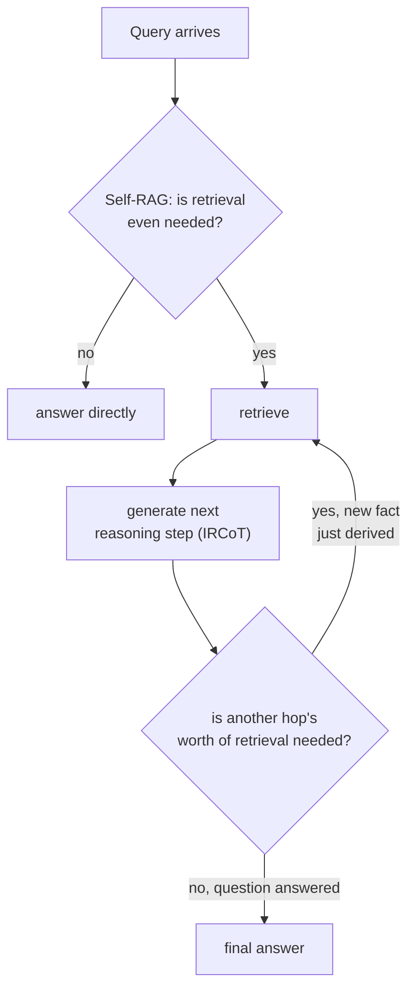

# Lección 18. Recuperación multi-hop y agéntica

**Vínculo con la misión:** La lección 14 resolvió una pregunta compuesta dividiéndola en subpreguntas y recuperando para cada una, todo a la vez, antes de que empezara la generación. Eso solo funciona cuando todas las subpreguntas ya son visibles en el texto original. Algunas preguntas tienen una segunda subpregunta que todavía no existe, de ninguna forma, hasta que vuelve la respuesta de la primera. Esta lección cubre la recuperación como un bucle que ejecuta el sistema, en lugar de una única pasada que se da una sola vez.
**Fuente principal:** [Paper: "Interleaving Retrieval with Chain-of-Thought Reasoning for Knowledge-Intensive Multi-Step Questions" (IRCoT), Trivedi et al., 2022](https://arxiv.org/abs/2212.10509)
**Requisitos previos:** [Lección 14](0014-query-side-transformation.md), [Lección 11](0011-diagnosing-the-pipeline.md)

## Calentamiento

1. ▢ ¿Por qué generar el embedding de una pregunta compuesta entera como un solo vector no sirve bien a ninguna de sus dos partes?

Comprobación

Un único embedding de una pregunta compuesta queda en algún punto entre las regiones del corpus que responderían cada parte por separado, cerca de ninguna; descomponer la pregunta en sus subpreguntas separadas y recuperar para cada una de forma independiente da a cada parte su propia oportunidad de caer cerca del pasaje concreto que realmente la responde.

2. ▢ ¿Cuál es la diferencia estructural clave entre cómo manejan HNSW e IVFFlat un vector añadido después de construir el índice?

Comprobación

HNSW no tiene paso de entrenamiento, así que un vector nuevo se inserta directamente en el grafo. Los centroides de clúster de IVFFlat quedan fijados al construir el índice y nunca se recalculan, así que un vector recién añadido se asigna al centroide existente más cercano sin que ese centroide se adapte nunca para representarlo.

## Qué debes saber

### Algunas subpreguntas no existen hasta que se responde la primera

La descomposición de la lección 14 asume que todas las subpreguntas ya son visibles en el propio texto de la pregunta compuesta: "what's the refund policy, and does it differ for annual subscriptions" contiene ambas partes desde el principio. Una pregunta genuinamente **multi-hop** no: "who directed the film that won Best Picture the year the reigning monarch was born" no puede dividirse de antemano en sus dos subpreguntas, porque la segunda (qué película ganó Best Picture en el año X) ni siquiera puede formularse hasta que se ha respondido realmente la primera (en qué año nació el monarca). El propio planteamiento del paper lo enuncia con precisión: **qué recuperar depende de lo que ya se ha derivado, que a su vez puede depender de lo que se recuperó antes**, una cadena de dependencias genuina, no una división que pudiera haberse hecho de antemano con un prompt más ingenioso.

### IRCoT: alternar un paso de razonamiento y un paso de recuperación

**IRCoT (Interleaving Retrieval with Chain-of-Thought)** aborda esto alternando dos acciones en lugar de ejecutar la recuperación una sola vez: genera el siguiente paso de razonamiento (una oración de chain-of-thought) usando lo que se haya recuperado hasta el momento, y luego usa ese nuevo paso de razonamiento como base para otra recuperación, y repite. Cada recuperación está informada por el razonamiento derivado de la recuperación anterior, que es exactamente lo que una única pasada de recuperación inicial, incluso una descompuesta, no puede hacer: la consulta del salto dos no existía hasta que la respuesta del salto uno la produjo.

### Self-RAG: decidir si recuperar siquiera, no solo cuántas veces

Una pregunta distinta y complementaria es si la recuperación debería ocurrir siquiera, y si lo que volvió era realmente lo bastante bueno como para usarse. El RAG ordinario recupera un número fijo de pasajes cada vez, sea o no la recuperación realmente necesaria para esa consulta concreta, y sean o no genuinamente relevantes los pasajes recuperados, lo que el propio planteamiento del paper de **Self-RAG** identifica como un costo real: la recuperación indiscriminada puede disminuir la versatilidad de un modelo o producir una respuesta poco útil cuando los pasajes recuperados no ayudan en realidad. Self-RAG, en cambio, entrena un modelo para decidir, por consulta, si hace falta recuperar, y para criticar los pasajes recuperados y su propio borrador de salida en cuanto a relevancia y respaldo, en lugar de tratar la recuperación como un paso incondicional, siempre activo y aplicado de forma idéntica a toda consulta, sin importar si alguna vez fue necesario.

### Recuperación agéntica: el sistema, no una forma fija de pipeline, decide qué ocurre después

En conjunto, esto es lo que convierte la recuperación de un pipeline (etapas fijas, ejecutadas una vez, en orden) en algo más cercano a la decisión de un agente en cada paso: ¿necesita esta consulta recuperación siquiera?, ¿es suficiente lo que volvió para responder?, o ¿responder la pregunta exige derivar un dato intermedio y volver a buscar a partir de él? Es una forma estructuralmente distinta de la de todas las lecciones anteriores de este espacio de trabajo, que asumían una pasada de recuperación (posiblemente contra varias subconsultas, según la lección 14) seguida de un paso de generación; la recuperación multi-hop y agéntica, en cambio, hace un bucle entre recuperar y razonar un número ilimitado y dependiente de la consulta de veces.

## Práctica

1. ▢ Una pregunta exige conocer el dato A antes de que la consulta del dato B pueda siquiera formularse. ¿Por qué la técnica de descomposición de la lección 14 no puede manejar esto del mismo modo que maneja una pregunta compuesta explícita?

Pista

Considera qué necesita ya tener la descomposición, en el texto de la pregunta original, antes de poder dividir nada.

Comprobación

La descomposición divide subpreguntas que ya son visibles en el texto de la pregunta compuesta original; aquí, la segunda subpregunta no existe de ninguna forma formulable hasta que vuelve la respuesta del dato A, así que no hay nada que una división inicial pueda extraer de la pregunta original.

2. ▢ ¿Entre qué alterna IRCoT, y por qué cada paso de recuperación depende del anterior en lugar de decidirse todos al principio?

Comprobación

Alterna entre generar un paso de razonamiento chain-of-thought (usando lo que se haya recuperado hasta el momento) y volver a recuperar a partir de ese nuevo paso de razonamiento. Cada recuperación depende de la anterior porque el razonamiento que determina qué buscar después se produce a partir de la recuperación previa y no puede conocerse de antemano.

3. ▢ ¿Por qué el propio planteamiento de Self-RAG describe la recuperación indiscriminada de número fijo como un costo real y no solo como una ineficiencia ocasional?

Comprobación

Recuperar un número fijo de pasajes sin importar si la recuperación era siquiera necesaria, o si los pasajes son relevantes, puede disminuir la versatilidad del modelo o llevar a una respuesta poco útil cuando el contenido recuperado no ayuda en realidad; el paper lo trata como un costo genuino de calidad, no como un caso límite raro.

4. ▢ ¿En qué se diferencia estructuralmente la "recuperación agéntica" de todos los diseños de recuperación anteriores de este espacio de trabajo?

Comprobación

Todos los diseños anteriores asumían una pasada de recuperación (contra una consulta, o contra varias subconsultas decididas de antemano) seguida de un paso de generación. La recuperación agéntica, en cambio, hace un bucle: el sistema decide, por paso, si hace falta recuperar siquiera, evalúa si lo que volvió es suficiente y puede volver a recuperar a partir de algo recién derivado, un número ilimitado y dependiente de la consulta de veces en lugar de una forma fija de pipeline.

5. ▢ ¿Qué afirmación distingue correctamente a IRCoT de Self-RAG?

    - a) Ambos abordan exactamente el mismo problema: decidir si recuperar siquiera antes de responder
    - b) IRCoT entrelaza pasos de razonamiento con recuperación para que la consulta de cada salto pueda depender de lo que se acaba de derivar; Self-RAG, en cambio, decide si hace falta recuperar siquiera y critica lo que vuelve, una pregunta complementaria pero distinta de cuántos saltos hacen falta
    - c) IRCoT y la descomposición de la lección 14 resuelven el mismo problema, solo con terminología distinta
    - d) Self-RAG siempre recupera el mismo número fijo de pasajes, solo que elegido con más cuidado

Comprobación

**b)** Esa es la distinción precisa y complementaria que traza esta lección. (a) es falsa: IRCoT aborda la dependencia multi-hop entre pasos de recuperación, no si recuperar siquiera. (c) es falsa: la descomposición divide subpreguntas ya visibles en el texto original; IRCoT maneja subpreguntas que no existen hasta que la respuesta de un salto previo las produce. (d) es falsa: todo el sentido de Self-RAG es decidir si la recuperación ocurre siquiera, y cuánto confiar en ella, no fijar el número con más precisión.

## Prácticas en el mundo real

- [ ] Escribe una pregunta genuinamente multi-hop para un dominio que conozcas (donde el segundo dato necesario no pueda identificarse hasta que se resuelva el primero) y traza a mano qué secuencia de recuperación, razonamiento, recuperación, razonamiento la respondería realmente.
- [ ] Para un sistema RAG al que tengas acceso, comprueba si siempre recupera el mismo número fijo de pasajes sin importar la consulta, o si tiene algún mecanismo para decidir que la recuperación no hacía falta o no fue suficiente.
- [ ] Mañana: lee completa la sección de resultados del paper de IRCoT y anota cuánto mejoró la precisión de QA multi-hop frente a una línea base de recuperar y leer en una sola pasada en los conjuntos de datos que probó.

## Para profundizar

- [Paper: "Interleaving Retrieval with Chain-of-Thought Reasoning for Knowledge-Intensive Multi-Step Questions" (IRCoT), Trivedi et al., 2022](https://arxiv.org/abs/2212.10509)
- [Paper: "Self-RAG: Learning to Retrieve, Generate, and Critique through Self-Reflection", Asai et al., 2023](https://arxiv.org/abs/2310.11511)
- [Recursos](../RESOURCES.md)

---

¿No termina de quedar claro? Vuelve a leer la fuente principal de arriba, ya que esta lección la comprime y en la compresión es donde se escapa la comprensión. Consulta el [glosario](../GLOSSARY.md) por si algún término te resultó resbaladizo.

Si lo poco claro es la propia lección y no el material, eso es un defecto: [abre un issue](https://github.com/TokenCemetery/teach/issues).
