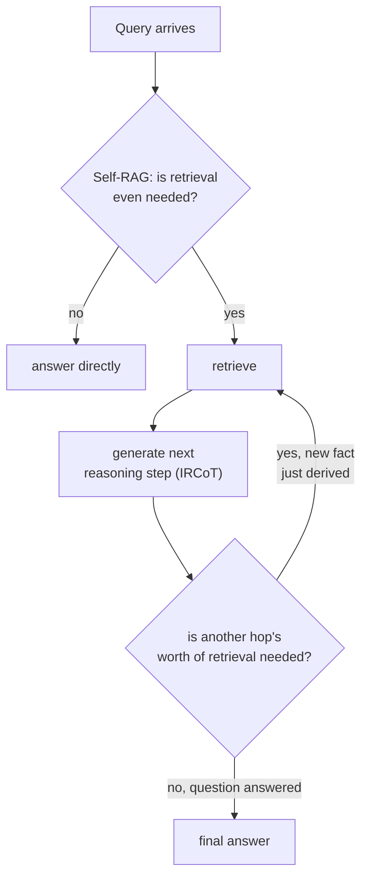

# Leçon 18. Récupération multi-hop et agentique

**Lien avec la mission :** La leçon 14 a corrigé une question composée en la découpant en sous-questions et en récupérant pour chacune, le tout en une fois, avant même que la génération ne commence. Cela ne fonctionne que lorsque chaque sous-question est déjà visible dans le texte d'origine. Certaines questions ont une seconde sous-question qui n'existe pas encore, sous aucune forme, tant que la réponse à la première n'est pas revenue. Cette leçon traite de la récupération comme d'une boucle que le système exécute, plutôt que d'un passage unique qu'il effectue une fois.
**Source primaire :** [Article : "Interleaving Retrieval with Chain-of-Thought Reasoning for Knowledge-Intensive Multi-Step Questions" (IRCoT), Trivedi et al., 2022](https://arxiv.org/abs/2212.10509)
**Prérequis :** [Leçon 14](0014-query-side-transformation.md), [Leçon 11](0011-diagnosing-the-pipeline.md)

## Échauffement

1. ▢ Pourquoi calculer l'embedding d'une question composée entière comme un seul vecteur ne sert-il bien aucune de ses deux parties ?

Vérifier

Un embedding unique d'une question composée se situe quelque part entre les régions du corpus qui répondraient à chaque partie séparément, proche d'aucune ; décomposer la question en ses sous-questions distinctes et récupérer pour chacune indépendamment donne à chaque partie sa propre chance de tomber près du passage précis qui y répond réellement.

2. ▢ Quelle est la différence structurelle essentielle entre la façon dont HNSW et IVFFlat gèrent un vecteur ajouté après la construction de l'index ?

Vérifier

HNSW n'a pas d'étape d'entraînement, donc un nouveau vecteur s'insère directement dans le graphe. Les centroïdes de clusters d'IVFFlat sont fixés à la construction et jamais recalculés, donc un vecteur nouvellement ajouté est affecté au centroïde existant le plus proche sans que ce centroïde ne s'adapte jamais pour le représenter.

## À savoir

### Certaines sous-questions n'existent pas tant que la première n'a pas reçu de réponse

La décomposition de la leçon 14 suppose que chaque sous-question est déjà visible dans le texte de la question composée : « quelle est la politique de remboursement, et diffère-t-elle pour les abonnements annuels » contient d'emblée les deux parties. Une question réellement **multi-hop** ne le permet pas : « qui a réalisé le film qui a remporté l'Oscar du meilleur film l'année de naissance du monarque actuel » ne peut pas être découpée à l'avance en ses deux sous-questions, parce que la seconde sous-question (quel film a remporté l'Oscar du meilleur film l'année X) ne peut même pas être formulée avant que la première (en quelle année le monarque est-il né) ait réellement reçu une réponse. Le cadrage de l'article lui-même l'énonce précisément : **ce qu'il faut récupérer dépend de ce qui a déjà été déduit, ce qui peut à son tour dépendre de ce qui a été récupéré auparavant**, une vraie chaîne de dépendances, pas un découpage qui aurait pu se faire d'emblée avec un prompt plus astucieux.

### IRCoT : alterner une étape de raisonnement et une étape de récupération

**IRCoT (Interleaving Retrieval with Chain-of-Thought)** y répond en alternant deux actions au lieu d'exécuter la récupération une seule fois : générer l'étape de raisonnement suivante (une phrase de chain-of-thought) à partir de ce qui a été récupéré jusque-là, puis utiliser cette nouvelle étape de raisonnement elle-même comme base d'une nouvelle récupération, et recommencer. Chaque récupération est éclairée par le raisonnement déduit de la récupération précédente, ce qu'un passage de récupération unique initial, même décomposé, ne peut pas faire : la requête du saut deux n'existait pas avant que la réponse du saut un ne la produise.

### Self-RAG : décider s'il faut récupérer tout court, pas seulement combien de fois

Une question différente et complémentaire est de savoir si la récupération doit avoir lieu tout court, et si ce qui est revenu était réellement assez bon pour être utilisé. Le RAG ordinaire récupère à chaque fois un nombre fixe de passages, que la récupération ait été réellement nécessaire ou non pour cette requête précise, et que les passages récupérés aient été réellement pertinents ou non, ce que le cadrage de l'article **Self-RAG** identifie comme un vrai coût : une récupération sans discernement peut diminuer la polyvalence d'un modèle ou produire une réponse peu utile quand les passages récupérés n'aident pas réellement. Self-RAG entraîne au contraire un modèle à décider, pour chaque requête, si la récupération est nécessaire, et à critiquer les passages récupérés et son propre brouillon de sortie quant à leur pertinence et à leur support, au lieu de traiter la récupération comme une étape inconditionnelle, toujours active, appliquée à l'identique à chaque requête qu'elle ait été nécessaire ou non.

### Récupération agentique : c'est le système, pas une forme de pipeline fixe, qui décide de la suite

Ensemble, ces éléments font passer la récupération d'un pipeline (des étapes fixes, exécutées une fois, dans l'ordre) à quelque chose de plus proche d'une décision d'agent à chaque étape : cette requête a-t-elle besoin de récupération tout court, ce qui est revenu suffit-il pour répondre, ou répondre à la question exige-t-il de déduire un fait intermédiaire et de chercher à nouveau à partir de lui. C'est une forme structurellement différente de toutes les leçons précédentes de cet espace de travail, qui supposaient un passage de récupération (éventuellement sur plusieurs sous-requêtes, d'après la leçon 14) suivi d'une étape de génération ; la récupération multi-hop et agentique boucle au contraire entre récupérer et raisonner un nombre non borné de fois, qui dépend de la requête.

## Pratique

1. ▢ Une question exige de connaître le fait A avant même que la requête pour le fait B puisse être formulée. Pourquoi la technique de décomposition de la leçon 14 ne peut-elle pas la traiter comme elle traite une question composée explicite ?

Indice

Réfléchissez à ce que la décomposition doit déjà avoir, dans le texte de la question d'origine, avant de pouvoir découper quoi que ce soit.

Vérifier

La décomposition découpe des sous-questions déjà visibles dans le texte de la question composée d'origine ; ici, la seconde sous-question n'existe sous aucune forme formulable tant que la réponse au fait A n'est pas revenue, donc il n'y a rien qu'un découpage initial puisse extraire de la question d'origine.

2. ▢ Entre quoi IRCoT alterne-t-il, et pourquoi chaque étape de récupération dépend-elle de la précédente au lieu que tout soit décidé au départ ?

Vérifier

Il alterne la génération d'une étape de raisonnement chain-of-thought (à partir de ce qui a été récupéré jusque-là) et une nouvelle récupération fondée sur cette nouvelle étape de raisonnement. Chaque récupération dépend de la précédente parce que le raisonnement qui détermine ce qu'il faut chercher ensuite est lui-même produit à partir de la récupération antérieure, et n'est pas connaissable à l'avance.

3. ▢ Pourquoi le cadrage de Self-RAG décrit-il la récupération sans discernement et à nombre fixe comme un vrai coût, et pas seulement comme une inefficacité occasionnelle ?

Vérifier

Récupérer un nombre fixe de passages, que la récupération ait été nécessaire ou non, et que les passages soient pertinents ou non, peut diminuer la polyvalence du modèle ou mener à une réponse peu utile quand le contenu récupéré n'aide pas réellement ; l'article y voit un véritable coût de qualité, pas un cas limite rare.

4. ▢ En quoi la « récupération agentique » diffère-t-elle structurellement de toutes les conceptions de récupération précédentes de cet espace de travail ?

Vérifier

Toutes les conceptions précédentes supposaient un passage de récupération (sur une requête, ou sur plusieurs sous-requêtes décidées d'avance) suivi d'une étape de génération. La récupération agentique boucle au contraire : le système décide, à chaque étape, si la récupération est nécessaire tout court, évalue si ce qui est revenu suffit, et peut récupérer à nouveau à partir de ce qui vient d'être déduit, un nombre non borné de fois, qui dépend de la requête, plutôt qu'une forme de pipeline fixe.

5. ▢ Laquelle de ces affirmations distingue correctement IRCoT et Self-RAG ?

    - a) Les deux traitent exactement le même problème : décider s'il faut récupérer tout court avant de répondre
    - b) IRCoT entrelace des étapes de raisonnement avec la récupération pour que la requête de chaque saut puisse dépendre de ce qui vient d'être déduit ; Self-RAG décide plutôt si la récupération est nécessaire tout court et critique ce qui revient, une question complémentaire mais distincte de celle du nombre de sauts nécessaires
    - c) IRCoT et la décomposition de la leçon 14 résolvent le problème identique, avec seulement une terminologie différente
    - d) Self-RAG récupère toujours le même nombre fixe de passages, simplement choisi avec plus de soin

Vérifier

**b)** C'est la distinction précise et complémentaire que trace cette leçon. (a) est fausse : IRCoT traite la dépendance multi-hop entre étapes de récupération, pas la question de savoir s'il faut récupérer tout court. (c) est fausse : la décomposition découpe des sous-questions déjà visibles dans le texte d'origine ; IRCoT gère des sous-questions qui n'existent pas tant que la réponse d'un saut précédent ne les a pas produites. (d) est fausse : tout l'objet de Self-RAG est de décider si la récupération a lieu tout court, et dans quelle mesure lui faire confiance, pas de fixer le nombre plus précisément.

## Exercices en situation réelle

- [ ] Écrivez une question réellement multi-hop pour un domaine que vous connaissez (où le second fait nécessaire ne peut pas être identifié avant que le premier soit résolu), et tracez à la main quelle séquence récupération, raisonnement, récupération, raisonnement y répondrait réellement.
- [ ] Pour un système RAG auquel vous avez accès, vérifiez s'il récupère toujours le même nombre fixe de passages quelle que soit la requête, ou s'il a un mécanisme pour décider que la récupération n'est pas nécessaire ou n'a pas suffi.
- [ ] Demain : lisez en entier la section des résultats de l'article sur IRCoT, et notez de combien la précision des questions-réponses multi-hop s'est améliorée par rapport à une référence de récupération et lecture en un seul passage sur les jeux de données testés.

## Pour aller plus loin

- [Article : "Interleaving Retrieval with Chain-of-Thought Reasoning for Knowledge-Intensive Multi-Step Questions" (IRCoT), Trivedi et al., 2022](https://arxiv.org/abs/2212.10509)
- [Article : "Self-RAG: Learning to Retrieve, Generate, and Critique through Self-Reflection", Asai et al., 2023](https://arxiv.org/abs/2310.11511)
- [Ressources](../RESOURCES.md)

---

Ça ne passe pas ? Relisez la source primaire en haut de page, car cette leçon la condense et c'est dans la condensation que la compréhension s'échappe. Consultez le [glossaire](../GLOSSARY.md) pour tout terme qui vous a paru glissant.

Si c'est la leçon elle-même qui n'est pas claire plutôt que la matière, c'est un défaut : [ouvrez une issue](https://github.com/TokenCemetery/teach/issues).
