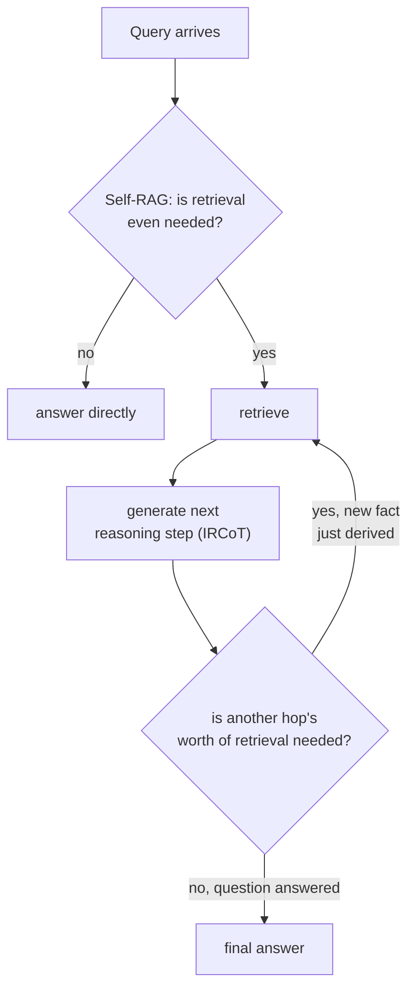

# पाठ 18. Multi-Hop और Agentic Retrieval

**मिशन से संबंध:** पाठ 14 ने मिले-जुले सवाल को उप-सवालों में बाँटकर और हर एक के लिए retrieve करके, सब एक साथ, generation शुरू होने से पहले ही ठीक किया। यह तभी चलता है जब हर उप-सवाल मूल text में पहले से दिख रहा हो। कुछ सवालों का दूसरा उप-सवाल अभी किसी भी रूप में मौजूद ही नहीं होता, जब तक पहले का उत्तर न लौट आए। यह पाठ retrieval को ऐसे loop के रूप में कवर करता है जिसे system चलाता है, ऐसे एक पास के रूप में नहीं जिसे वह एक बार लेता है।
**मुख्य स्रोत:** [पेपर: "Interleaving Retrieval with Chain-of-Thought Reasoning for Knowledge-Intensive Multi-Step Questions" (IRCoT), Trivedi et al., 2022](https://arxiv.org/abs/2212.10509)
**पूर्व-आवश्यकताएँ:** [पाठ 14](0014-query-side-transformation.md), [पाठ 11](0011-diagnosing-the-pipeline.md)

## वार्म-अप

1. ▢ पूरे मिले-जुले सवाल को एक vector के रूप में embed करना उसके दोनों हिस्सों में से किसी का भला क्यों नहीं करता?

जाँचें

मिले-जुले सवाल की एक अकेली embedding corpus के उन क्षेत्रों के बीच कहीं बैठती है जो हर हिस्से का उत्तर अलग से देते, किसी के भी पास नहीं; सवाल को उसके अलग उप-सवालों में तोड़ना और हर एक के लिए स्वतंत्र रूप से retrieve करना हर हिस्से को उस ख़ास passage के पास आने का अपना मौक़ा देता है जो असल में उसका उत्तर देता है।

2. ▢ Index बनने के बाद जोड़े गए vector को HNSW और IVFFlat कैसे संभालते हैं, इसमें मुख्य संरचनात्मक फ़र्क़ क्या है?

जाँचें

HNSW में training चरण नहीं है, इसलिए नया vector सीधे graph में डाला जाता है। IVFFlat के cluster centroids build के समय तय हो जाते हैं और दोबारा कभी नहीं निकाले जाते, इसलिए नया जोड़ा vector सबसे नज़दीकी मौजूदा centroid को सौंप दिया जाता है, बिना उस centroid के उसे दर्शाने के लिए कभी ढले।

## यह जानें

### कुछ उप-सवाल तब तक मौजूद ही नहीं होते जब तक पहले का उत्तर न मिल जाए

पाठ 14 का decomposition मानता है कि हर उप-सवाल मिले-जुले सवाल के अपने text में पहले से दिखता है: "refund policy क्या है, और क्या वह annual subscriptions के लिए अलग है" में दोनों हिस्से शुरू से मौजूद हैं। सचमुच **multi-hop** सवाल में ऐसा नहीं होता: "उस film का निर्देशक कौन था जिसने उस साल Best Picture जीता जब मौजूदा राजा का जन्म हुआ" को पहले से उसके दो उप-सवालों में नहीं बाँटा जा सकता, क्योंकि दूसरा उप-सवाल (साल X में कौन-सी film ने Best Picture जीता) तब तक पूछा भी नहीं जा सकता जब तक पहले का (राजा का जन्म किस साल हुआ) असल में उत्तर न मिल जाए। पेपर का अपना तर्क इसे ठीक बताता है: **क्या retrieve करना है यह इस पर निर्भर है कि अब तक क्या निकाला जा चुका है, जो बदले में इस पर निर्भर हो सकता है कि पहले क्या retrieve हुआ था**, यानी सचमुच की निर्भरता की कड़ी, ऐसा बँटवारा नहीं जो ज़्यादा चतुर prompt से शुरू में ही किया जा सकता था।

### IRCoT: reasoning चरण और retrieval चरण को बारी-बारी चलाएँ

**IRCoT (Interleaving Retrieval with Chain-of-Thought)** retrieval को एक बार चलाने के बजाय दो क्रियाओं को बारी-बारी चलाकर इसे संबोधित करता है: अब तक जो retrieve हुआ उसके आधार पर अगला reasoning चरण generate करें (chain-of-thought का एक वाक्य), फिर उसी नए reasoning चरण को एक और retrieval का आधार बनाएँ, और दोहराएँ। हर retrieval पिछले retrieval से निकली reasoning से सूचित होता है, और यही वह चीज़ है जो अकेला शुरू का retrieval पास, चाहे वह decomposed भी हो, नहीं कर सकता: hop दो की query तब तक अस्तित्व में ही नहीं थी जब तक hop एक के उत्तर ने उसे पैदा न किया।

### Self-RAG: retrieve करना भी है या नहीं, यह तय करना, सिर्फ़ कितनी बार नहीं

एक अलग, पूरक सवाल यह है कि retrieval होना भी चाहिए या नहीं, और जो लौटा वह इस्तेमाल करने लायक अच्छा था या नहीं। साधारण RAG हर बार passages की तय संख्या retrieve करता है, चाहे उस ख़ास query के लिए retrieval सचमुच ज़रूरी था या नहीं, और चाहे retrieved passages सचमुच प्रासंगिक थे या नहीं, जिसे **Self-RAG** पेपर का अपना तर्क असली लागत बताता है: अंधाधुंध retrieval model की बहुमुखी प्रतिभा घटा सकता है या बेकार उत्तर दे सकता है जब retrieved passages असल में मदद नहीं करते। Self-RAG इसकी जगह model को प्रति query यह तय करना सिखाता है कि retrieval चाहिए या नहीं, और retrieved passages और अपने ही मसौदा output की प्रासंगिकता व समर्थन के लिए आलोचना करना, बजाय retrieval को बिना शर्त, हमेशा चालू चरण मानने के जो हर query पर एक-सा लगाया जाता है चाहे उसकी कभी ज़रूरत थी या नहीं।

### Agentic retrieval: आगे क्या होगा यह system तय करता है, pipeline का कोई तय आकार नहीं

मिलाकर देखें तो यही retrieval को pipeline (तय चरण, एक बार, क्रम में चले) से हर चरण पर agent के निर्णय के क़रीब की चीज़ में बदलते हैं: क्या इस query को retrieval चाहिए भी, क्या जो लौटा वह उत्तर देने को काफ़ी है, या सवाल का उत्तर देने के लिए बीच का तथ्य निकालना और उसके आधार पर दोबारा search करना ज़रूरी है। यह इस workspace के हर पहले के पाठ से संरचनात्मक रूप से अलग आकार है, जिसने एक retrieval पास (संभवतः कई उप-queries पर, पाठ 14 के अनुसार) और उसके बाद एक generation चरण मान रखा था; multi-hop और agentic retrieval इसकी जगह retrieving और reasoning के बीच असीमित, query पर निर्भर संख्या में बार-बार घूमते हैं।

## अभ्यास

1. ▢ किसी सवाल के लिए तथ्य B की query पूछे जाने से पहले तथ्य A जानना ज़रूरी है। पाठ 14 की decomposition तकनीक इसे वैसे क्यों नहीं संभाल सकती जैसे स्पष्ट मिले-जुले सवाल को संभालती है?

संकेत

विचार करें कि कुछ भी बाँटने से पहले decomposition को मूल सवाल के text में पहले से क्या चाहिए।

जाँचें

Decomposition उन उप-सवालों को बाँटता है जो मूल मिले-जुले सवाल के text में पहले से दिखते हैं; यहाँ दूसरा उप-सवाल तब तक किसी पूछे जा सकने वाले रूप में मौजूद ही नहीं है जब तक तथ्य A का उत्तर न लौट आए, इसलिए शुरू में किए जाने वाले बँटवारे के लिए मूल सवाल से निकालने को कुछ है ही नहीं।

2. ▢ IRCoT किन दो चीज़ों के बीच बारी-बारी चलता है, और हर retrieval चरण पिछले पर क्यों निर्भर है, सब कुछ शुरू में तय क्यों नहीं हो जाता?

जाँचें

वह chain-of-thought reasoning चरण generate करने (अब तक जो retrieve हुआ उसके आधार पर) और उस नए reasoning चरण के आधार पर फिर retrieve करने के बीच बारी-बारी चलता है। हर retrieval पिछले पर इसलिए निर्भर है कि अगला क्या खोजना है यह तय करने वाली reasoning ख़ुद पिछले retrieval से बनती है, पहले से जानी नहीं जा सकती।

3. ▢ Self-RAG का अपना तर्क अंधाधुंध, तय-संख्या वाले retrieval को सिर्फ़ कभी-कभार की अक्षमता नहीं बल्कि असली लागत क्यों बताता है?

जाँचें

Passages की तय संख्या retrieve करना, चाहे retrieval सचमुच ज़रूरी था या नहीं, या passages प्रासंगिक हैं या नहीं, model की बहुमुखी प्रतिभा घटा सकता है या बेकार उत्तर दे सकता है जब retrieved सामग्री असल में मदद नहीं करती; पेपर इसे असली गुणवत्ता लागत मानता है, दुर्लभ अपवाद नहीं।

4. ▢ "Agentic retrieval" इस workspace के हर पहले के retrieval डिज़ाइन से संरचनात्मक रूप से कैसे अलग है?

जाँचें

हर पहले के डिज़ाइन ने एक retrieval पास (एक query पर, या शुरू में तय कई उप-queries पर) और उसके बाद एक generation चरण मान रखा था। Agentic retrieval इसकी जगह loop चलाता है: system हर चरण पर तय करता है कि retrieval चाहिए भी या नहीं, परखता है कि जो लौटा वह काफ़ी है या नहीं, और अभी-अभी निकली किसी बात के आधार पर दोबारा retrieve कर सकता है, pipeline के तय आकार की जगह असीमित, query पर निर्भर संख्या में।

5. ▢ कौन-सा दावा IRCoT और Self-RAG को सही ढंग से अलग करता है?

    - a) दोनों ठीक एक ही समस्या संबोधित करते हैं: उत्तर देने से पहले retrieve करना भी है या नहीं यह तय करना
    - b) IRCoT reasoning चरणों को retrieval के साथ गूँथता है ताकि हर hop की query इस पर निर्भर हो सके कि अभी क्या निकला; Self-RAG इसकी जगह तय करता है कि retrieval चाहिए भी या नहीं और जो लौटे उसकी आलोचना करता है, जो इस सवाल से पूरक पर अलग है कि कितने hops चाहिए
    - c) IRCoT और पाठ 14 का decomposition बिल्कुल एक ही समस्या सुलझाते हैं, बस शब्दावली अलग है
    - d) Self-RAG हमेशा passages की वही तय संख्या retrieve करता है, बस ज़्यादा सावधानी से चुनी हुई

जाँचें

**b)** यही वह ठीक, पूरक अंतर है जो यह पाठ खींचता है। (a) ग़लत है: IRCoT retrieval चरणों के बीच की multi-hop निर्भरता संबोधित करता है, retrieve करना भी है या नहीं यह नहीं। (c) ग़लत है: decomposition मूल text में पहले से दिखते उप-सवालों को बाँटता है; IRCoT उन उप-सवालों को संभालता है जो तब तक मौजूद ही नहीं जब तक पिछले hop का उत्तर उन्हें पैदा न करे। (d) ग़लत है: Self-RAG का पूरा मक़सद यह तय करना है कि retrieval होता भी है या नहीं, और उसका कितना भरोसा करना है, संख्या को ज़्यादा सटीक तय करना नहीं।

## असली दुनिया का अभ्यास

- [ ] अपनी जानी हुई किसी domain के लिए एक सचमुच multi-hop सवाल लिखें (जहाँ ज़रूरी दूसरा तथ्य तब तक पहचाना नहीं जा सकता जब तक पहला तथ्य सुलझ न जाए), और हाथ से खोजें कि retrieval, reasoning, retrieval, reasoning का कौन-सा क्रम असल में उसका उत्तर देगा।
- [ ] जिस RAG system तक आपकी पहुँच है, उसके लिए जाँचें कि वह query की परवाह किए बिना हमेशा passages की वही तय संख्या retrieve करता है या उसके पास यह तय करने की कोई व्यवस्था है कि retrieval ज़रूरी नहीं था या काफ़ी नहीं था।
- [ ] कल: IRCoT पेपर का नतीजों वाला खंड पूरा पढ़ें, और नोट करें कि उसने जिन datasets पर परखा उन पर single-pass retrieve-and-read baseline की तुलना में multi-hop QA की सटीकता कितनी सुधरी।

## आगे बढ़ने के लिए

- [पेपर: "Interleaving Retrieval with Chain-of-Thought Reasoning for Knowledge-Intensive Multi-Step Questions" (IRCoT), Trivedi et al., 2022](https://arxiv.org/abs/2212.10509)
- [पेपर: "Self-RAG: Learning to Retrieve, Generate, and Critique through Self-Reflection", Asai et al., 2023](https://arxiv.org/abs/2310.11511)
- [संसाधन](../RESOURCES.md)

---

बात नहीं बन रही? ऊपर दिए primary source को दोबारा पढ़ें, क्योंकि यह पाठ उसे संक्षिप्त करता है और समझ संक्षेप में ही रिसती है। जो शब्द फिसलन भरा लगे, उसके लिए [शब्दावली](../GLOSSARY.md) देखें।

अगर दिक़्क़त सामग्री की नहीं बल्कि पाठ की ही है, तो वह एक खोट है: [issue खोलें](https://github.com/TokenCemetery/teach/issues)।
