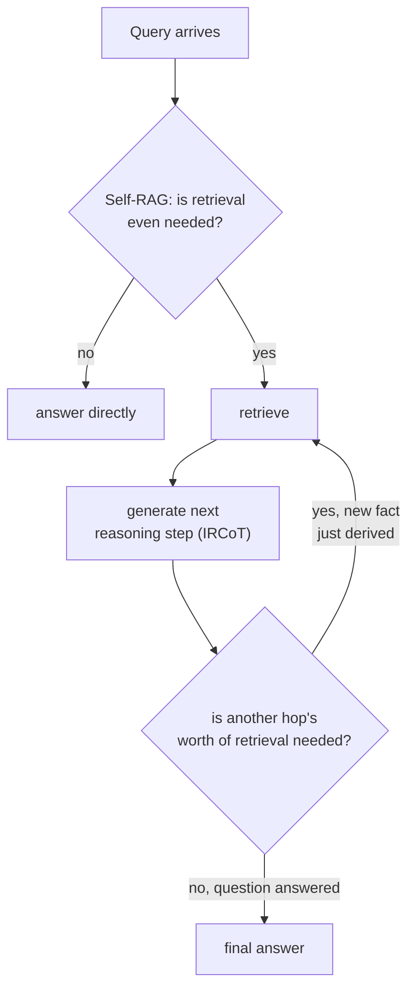

# Lição 18. Recuperação multi-hop e agêntica

**Ligação com a missão:** A lição 14 resolveu uma pergunta composta dividindo-a em subperguntas e recuperando para cada uma, tudo de uma vez, antes de a geração sequer começar. Isso só funciona quando toda subpergunta já está visível no texto original. Algumas perguntas têm uma segunda subpergunta que ainda não existe, em forma alguma, até que a resposta da primeira volte. Esta lição cobre a recuperação como um loop que o sistema executa, e não como uma única passada que ele faz uma vez.
**Fonte principal:** [Artigo científico: "Interleaving Retrieval with Chain-of-Thought Reasoning for Knowledge-Intensive Multi-Step Questions" (IRCoT), Trivedi et al., 2022](https://arxiv.org/abs/2212.10509)
**Pré-requisitos:** [Lição 14](0014-query-side-transformation.md), [Lição 11](0011-diagnosing-the-pipeline.md)

## Aquecimento

1. ▢ Por que gerar o embedding de uma pergunta composta inteira como um único vetor não serve bem a nenhuma de suas duas partes?

Verificação

Um único embedding de uma pergunta composta fica em algum ponto entre as regiões do corpus que responderiam a cada parte separadamente, perto de nenhuma; decompor a pergunta em suas subperguntas separadas e recuperar para cada uma de forma independente dá a cada parte sua própria chance de cair perto da passagem específica que de fato a responde.

2. ▢ Qual é a diferença estrutural central entre como o HNSW e o IVFFlat tratam um vetor adicionado depois de o índice ser construído?

Verificação

O HNSW não tem etapa de treinamento, então um novo vetor é inserido diretamente no grafo. Os centroides de cluster do IVFFlat são fixados na construção e nunca recalculados, então um vetor recém-adicionado é atribuído ao centroide existente mais próximo sem que esse centroide jamais se adapte para representá-lo.

## Saiba isto

### Algumas subperguntas não existem até que a primeira seja respondida

A decomposição da lição 14 pressupõe que toda subpergunta já está visível no próprio texto da pergunta composta: "qual é a política de reembolso, e ela difere para assinaturas anuais" contém as duas partes de antemão. Uma pergunta genuinamente **multi-hop** não contém: "quem dirigiu o filme que ganhou o prêmio de Melhor Filme no ano em que o monarca atual nasceu" não pode ser dividida em suas duas subperguntas de antemão, porque a segunda subpergunta (qual filme ganhou Melhor Filme no ano X) sequer pode ser formulada até que a primeira (em que ano o monarca nasceu) tenha de fato sido respondida. O próprio enquadramento do artigo afirma isso com precisão: **o que recuperar depende do que já foi derivado, o que por sua vez pode depender do que foi recuperado antes**, uma cadeia de dependência genuína, e não uma divisão que poderia ter sido feita de antemão com um prompt mais esperto.

### IRCoT: alterne um passo de raciocínio e um passo de recuperação

O **IRCoT (Interleaving Retrieval with Chain-of-Thought)** trata isso alternando duas ações em vez de executar a recuperação uma vez: gerar o próximo passo de raciocínio (uma frase de chain-of-thought) usando o que já foi recuperado até então, e depois usar esse novo passo de raciocínio como base para outra recuperação, e repetir. Cada recuperação é informada pelo raciocínio derivado da recuperação anterior, que é exatamente o que uma única passada de recuperação inicial, mesmo decomposta, não consegue fazer: a consulta do hop dois não existia até que a resposta do hop um a produzisse.

### Self-RAG: decidir se se deve recuperar, e não apenas quantas vezes

Uma pergunta diferente e complementar é se a recuperação deve ocorrer e se o que voltou era bom o bastante para usar. O RAG comum recupera um número fixo de passagens toda vez, quer a recuperação fosse de fato necessária para aquela consulta específica, quer as passagens recuperadas fossem genuinamente relevantes, o que o próprio enquadramento do artigo do **Self-RAG** identifica como um custo real: a recuperação indiscriminada pode diminuir a versatilidade de um modelo ou produzir uma resposta inútil quando as passagens recuperadas não ajudam de fato. O Self-RAG, em vez disso, treina um modelo para decidir, por consulta, se a recuperação é necessária, e para criticar as passagens recuperadas e seu próprio rascunho de saída quanto a relevância e sustentação, em vez de tratar a recuperação como uma etapa incondicional, sempre ligada, aplicada de forma idêntica a toda consulta, quer ela fosse necessária ou não.

### Recuperação agêntica: o sistema, e não um formato fixo de pipeline, decide o que acontece em seguida

Juntas, essas ideias transformam a recuperação de um pipeline (etapas fixas, executadas uma vez, em ordem) em algo mais próximo de uma decisão de agente a cada passo: esta consulta precisa de recuperação, o que voltou é suficiente para responder, ou responder à pergunta exige derivar um fato intermediário e buscar de novo com base nele. É um formato estruturalmente diferente de toda lição anterior deste workspace, que pressupunha uma passada de recuperação (possivelmente contra várias subconsultas, conforme a lição 14) seguida de uma etapa de geração; a recuperação multi-hop e agêntica, em vez disso, faz um loop entre recuperar e raciocinar um número ilimitado e dependente da consulta de vezes.

## Prática

1. ▢ Uma pergunta exige conhecer o fato A antes que a consulta pelo fato B possa sequer ser formulada. Por que a técnica de decomposição da lição 14 não consegue tratar isso do mesmo jeito que trata uma pergunta composta explícita?

Dica

Considere o que a decomposição precisa já ter, no texto da pergunta original, antes de poder dividir qualquer coisa.

Verificação

A decomposição divide subperguntas que já estão visíveis no texto da pergunta composta original; aqui, a segunda subpergunta não existe em nenhuma forma formulável até que a resposta ao fato A volte, então não há nada que uma divisão inicial possa extrair da pergunta original.

2. ▢ Entre o que o IRCoT alterna, e por que cada passo de recuperação depende do anterior em vez de todos serem decididos no início?

Verificação

Ele alterna gerar um passo de raciocínio de chain-of-thought (usando o que já foi recuperado até então) e recuperar de novo com base nesse novo passo de raciocínio. Cada recuperação depende da anterior porque o raciocínio que determina o que buscar em seguida é ele mesmo produzido a partir da recuperação anterior, e não pode ser conhecido de antemão.

3. ▢ Por que o próprio enquadramento do Self-RAG descreve a recuperação indiscriminada e de contagem fixa como um custo real, e não apenas uma ineficiência ocasional?

Verificação

Recuperar um número fixo de passagens independentemente de a recuperação sequer ser necessária, ou de as passagens serem relevantes, pode diminuir a versatilidade do modelo ou levar a uma resposta inútil quando o conteúdo recuperado não ajuda de fato; o artigo trata isso como um custo genuíno de qualidade, e não como um caso extremo raro.

4. ▢ Como a "recuperação agêntica" difere estruturalmente de todo design de recuperação anterior neste workspace?

Verificação

Todo design anterior pressupunha uma passada de recuperação (contra uma consulta, ou várias subconsultas decididas de antemão) seguida de uma etapa de geração. A recuperação agêntica, em vez disso, faz um loop: o sistema decide, a cada passo, se a recuperação é necessária, avalia se o que voltou é suficiente e pode recuperar de novo com base em algo recém-derivado, um número ilimitado e dependente da consulta de vezes, e não um formato fixo de pipeline.

5. ▢ Qual afirmação distingue corretamente o IRCoT do Self-RAG?

    - a) Os dois tratam exatamente do mesmo problema: decidir se se deve recuperar antes de responder
    - b) O IRCoT intercala passos de raciocínio com a recuperação para que a consulta de cada hop possa depender do que acabou de ser derivado; o Self-RAG, em vez disso, decide se a recuperação é necessária e critica o que volta, uma pergunta complementar mas distinta de quantos hops são necessários
    - c) O IRCoT e a decomposição da lição 14 resolvem o problema idêntico, apenas com terminologia diferente
    - d) O Self-RAG sempre recupera o mesmo número fixo de passagens, apenas escolhido com mais cuidado

Verificação

**b)** Essa é a distinção precisa e complementar que esta lição traça. (a) é falsa: o IRCoT trata da dependência multi-hop entre passos de recuperação, e não de se deve recuperar. (c) é falsa: a decomposição divide subperguntas já visíveis no texto original; o IRCoT trata subperguntas que não existem até que a resposta de um hop anterior as produza. (d) é falsa: todo o ponto do Self-RAG é decidir se a recuperação acontece e em quanto dela confiar, e não fixar a contagem com mais precisão.

## Prática no mundo real

- [ ] Escreva uma pergunta genuinamente multi-hop para um domínio que você conhece (em que o segundo fato necessário não pode ser identificado até que o primeiro seja resolvido) e trace à mão qual sequência de recuperação, raciocínio, recuperação, raciocínio de fato a responderia.
- [ ] Para um sistema RAG ao qual você tem acesso, verifique se ele sempre recupera o mesmo número fixo de passagens independentemente da consulta, ou se tem algum mecanismo para decidir que a recuperação não é necessária ou não foi suficiente.
- [ ] Amanhã: leia por inteiro a seção de resultados do artigo do IRCoT e anote quanto a acurácia em perguntas e respostas multi-hop melhorou em relação a uma baseline de recuperar e ler em uma única passada nos conjuntos de dados que ele testou.

## Para ir além

- [Artigo científico: "Interleaving Retrieval with Chain-of-Thought Reasoning for Knowledge-Intensive Multi-Step Questions" (IRCoT), Trivedi et al., 2022](https://arxiv.org/abs/2212.10509)
- [Artigo científico: "Self-RAG: Learning to Retrieve, Generate, and Critique through Self-Reflection", Asai et al., 2023](https://arxiv.org/abs/2310.11511)
- [Recursos](../RESOURCES.md)

---

Não ficou claro? Releia a fonte principal no topo, já que esta lição a comprime e é na compressão que o entendimento escapa. Consulte o [glossário](../GLOSSARY.md) para qualquer termo que pareceu escorregadio.

Se o problema é a lição em si, e não o material, isso é um defeito: [abra uma issue](https://github.com/TokenCemetery/teach/issues).
