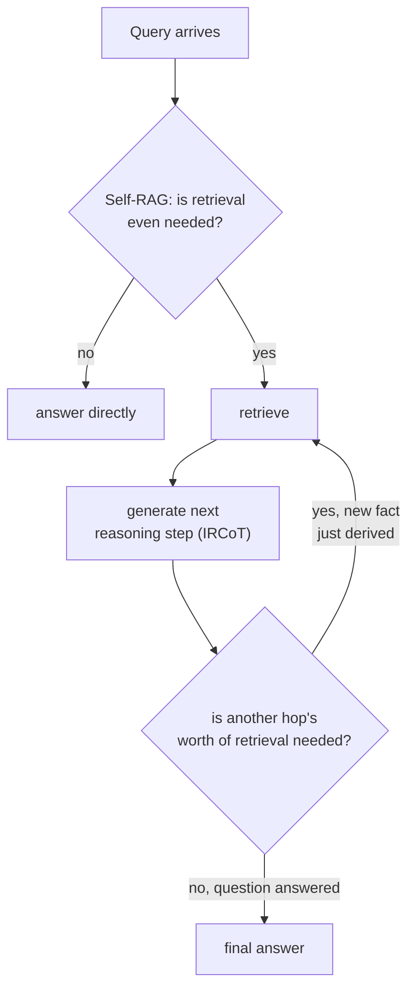

# Урок 18. Многошаговый и агентный поиск

**Связь с целью курса:** Урок 14 исправлял составной вопрос, разбивая его на подвопросы и ища по каждому, всё сразу, до начала генерации. Это работает, только когда каждый подвопрос уже виден в исходном тексте. У некоторых вопросов второй подвопрос пока не существует ни в какой форме, пока не вернётся ответ на первый. Этот урок о поиске как о цикле, который система прокручивает, а не об одном проходе, который она делает однократно.
**Первоисточник:** [Научная статья: "Interleaving Retrieval with Chain-of-Thought Reasoning for Knowledge-Intensive Multi-Step Questions" (IRCoT), Trivedi et al., 2022](https://arxiv.org/abs/2212.10509)
**Предварительные требования:** [Урок 14](0014-query-side-transformation.md), [Урок 11](0011-diagnosing-the-pipeline.md)

## Разминка

1. ▢ Почему эмбеддинг всего составного вопроса одним вектором не служит хорошо ни одной из двух его частей?

Проверка

Один эмбеддинг составного вопроса оказывается где-то между областями корпуса, которые ответили бы на каждую часть отдельно, и близок ни к одной; разбиение вопроса на отдельные подвопросы и независимый поиск по каждому даёт каждой части собственный шанс оказаться рядом с конкретным пассажем, который на неё действительно отвечает.

2. ▢ В чём ключевое структурное различие между тем, как HNSW и IVFFlat обрабатывают вектор, добавленный после построения индекса?

Проверка

У HNSW нет шага обучения, поэтому новый вектор вставляется прямо в граф. Центроиды кластеров IVFFlat фиксируются при построении и никогда не пересчитываются, поэтому новый добавленный вектор относится к ближайшему из существующих центроидов, а сам центроид никогда не подстраивается, чтобы его представлять.

## Что нужно знать

### Некоторые подвопросы не существуют, пока не получен ответ на первый

Декомпозиция из урока 14 предполагает, что каждый подвопрос уже виден в тексте самого составного вопроса: «какова политика возврата и отличается ли она для годовых подписок» содержит обе части сразу. По-настоящему **многошаговый (multi-hop)** вопрос так не устроен: «кто снял фильм, получивший приз за лучший фильм в год рождения правящего монарха» нельзя заранее разбить на два подвопроса, потому что второй подвопрос (какой фильм получил приз за лучший фильм в год X) нельзя даже сформулировать, пока на первый (в каком году родился монарх) не получен ответ. Формулировка самой статьи точна: **что искать, зависит от того, что уже выведено, а это, в свою очередь, может зависеть от того, что было найдено ранее**, то есть настоящая цепочка зависимостей, а не разбиение, которое можно было сделать заранее более хитрым промптом.

### IRCoT: чередовать шаг рассуждения и шаг поиска

**IRCoT (Interleaving Retrieval with Chain-of-Thought, чередование поиска и цепочки рассуждений)** решает это, чередуя два действия вместо однократного поиска: сгенерировать следующий шаг рассуждения (предложение цепочки рассуждений), используя всё найденное к этому моменту, затем использовать сам этот новый шаг рассуждения как основу для очередного поиска и повторять. Каждый поиск опирается на рассуждение, выведенное из предыдущего поиска, а именно этого один заранее выполненный проход поиска, даже декомпозированный, сделать не может: запрос для второго шага не существовал, пока ответ первого шага его не породил.

### Self-RAG: решать, искать ли вообще, а не только сколько раз

Другой, дополняющий вопрос: нужно ли поиск выполнять вообще и было ли найденное на самом деле достаточно хорошо, чтобы им пользоваться. Обычный RAG каждый раз ищет фиксированное число пассажей, независимо от того, был ли поиск вообще нужен для этого запроса и были ли найденные пассажи действительно релевантны, что формулировка статьи о **Self-RAG** называет настоящей ценой: неразборчивый поиск может уменьшить универсальность модели или дать бесполезный ответ, когда найденные пассажи на деле не помогают. Self-RAG вместо этого обучает модель решать для каждого запроса, нужен ли поиск, и критиковать найденные пассажи и собственный черновой вывод по релевантности и подтверждённости, вместо того чтобы считать поиск безусловным, всегда включённым шагом, одинаково применяемым к каждому запросу независимо от того, был ли он когда-либо нужен.

### Агентный поиск: система, а не фиксированная форма конвейера, решает, что происходит дальше

Вместе это превращает поиск из конвейера (фиксированные этапы, один проход, по порядку) в нечто более близкое к решению агента на каждом шаге: нужен ли этому запросу поиск вообще, достаточно ли вернувшегося, чтобы ответить, или для ответа на вопрос нужно вывести промежуточный факт и искать снова на его основе. Это структурно иная форма, чем в любом предыдущем уроке этой рабочей области, где предполагался один проход поиска (возможно, по нескольким подзапросам, как в уроке 14) и один шаг генерации; многошаговый и агентный поиск вместо этого ходят по циклу между поиском и рассуждением неограниченное, зависящее от запроса число раз.

## Практика

1. ▢ Вопрос требует знать факт A, прежде чем запрос о факте B вообще можно сформулировать. Почему приём декомпозиции из урока 14 не справляется с этим так же, как справляется с явным составным вопросом?

Подсказка

Подумайте, что декомпозиции нужно иметь в тексте исходного вопроса, прежде чем она сможет что-либо разбить.

Проверка

Декомпозиция делит подвопросы, которые уже видны в тексте исходного составного вопроса; здесь второй подвопрос не существует ни в какой формулируемой форме, пока не вернётся ответ на факт A, поэтому заранее выполненному разбиению вообще нечего извлечь из исходного вопроса.

2. ▢ Между чем чередуется IRCoT и почему каждый шаг поиска зависит от предыдущего, а не всё решается в начале?

Проверка

Он чередует генерацию шага цепочки рассуждений (с использованием всего найденного к этому моменту) и новый поиск на основе этого нового шага рассуждения. Каждый поиск зависит от предыдущего, потому что рассуждение, определяющее, что искать дальше, само порождается предыдущим поиском и заранее неизвестно.

3. ▢ Почему формулировка самого Self-RAG называет неразборчивый поиск фиксированного числа пассажей настоящей ценой, а не просто редкой неэффективностью?

Проверка

Поиск фиксированного числа пассажей независимо от того, был ли поиск вообще нужен и релевантны ли пассажи, может уменьшить универсальность модели или привести к бесполезному ответу, когда найденное содержимое на деле не помогает; статья считает это настоящей ценой в качестве, а не редким крайним случаем.

4. ▢ Чем «агентный поиск» структурно отличается от любого предыдущего проекта поиска в этой рабочей области?

Проверка

Каждый прежний проект предполагал один проход поиска (по одному запросу или по нескольким подзапросам, определённым заранее) и один шаг генерации. Агентный поиск вместо этого ходит по циклу: система на каждом шаге решает, нужен ли поиск вообще, оценивает, достаточно ли вернувшегося, и может искать снова на основе только что выведенного, неограниченное, зависящее от запроса число раз, а не по фиксированной форме конвейера.

5. ▢ Какое утверждение верно различает IRCoT и Self-RAG?

    - a) Оба решают одну и ту же задачу: решить, нужно ли искать вообще, прежде чем отвечать
    - b) IRCoT чередует шаги рассуждения с поиском, чтобы запрос каждого шага мог зависеть от только что выведенного; Self-RAG вместо этого решает, нужен ли поиск вообще, и критикует то, что вернулось, то есть вопрос дополняющий, но отдельный от того, сколько шагов нужно
    - c) IRCoT и декомпозиция из урока 14 решают одну и ту же задачу, лишь с разной терминологией
    - d) Self-RAG всегда ищет одно и то же фиксированное число пассажей, просто выбранное тщательнее

Проверка

**b)** Это точное, дополняющее различие, которое проводит этот урок. (a) неверно: IRCoT решает многошаговую зависимость между шагами поиска, а не вопрос, искать ли вообще. (c) неверно: декомпозиция делит подвопросы, уже видные в исходном тексте; IRCoT обрабатывает подвопросы, которых не существует, пока ответ предыдущего шага их не породит. (d) неверно: весь смысл Self-RAG в решении, выполнять ли поиск вообще и сколько ему доверять, а не в более точной фиксации числа.

## Практика в реальной работе

- [ ] Напишите один по-настоящему многошаговый вопрос для знакомой вам области (где второй нужный факт нельзя определить, пока не выяснен первый) и вручную проследите, какая последовательность «поиск, рассуждение, поиск, рассуждение» на него на самом деле ответила бы.
- [ ] Для RAG-системы, к которой у вас есть доступ, проверьте, всегда ли она ищет одно и то же фиксированное число пассажей независимо от запроса или есть ли у неё какой-либо механизм решения, что поиск не нужен или оказался недостаточным.
- [ ] Завтра: прочитайте целиком раздел с результатами в статье об IRCoT и отметьте, насколько точность многошаговых вопросов и ответов улучшилась по сравнению с однопроходной базовой линией «найти и прочитать» на проверенных наборах данных.

## Что почитать дальше

- [Научная статья: "Interleaving Retrieval with Chain-of-Thought Reasoning for Knowledge-Intensive Multi-Step Questions" (IRCoT), Trivedi et al., 2022](https://arxiv.org/abs/2212.10509)
- [Научная статья: "Self-RAG: Learning to Retrieve, Generate, and Critique through Self-Reflection", Asai et al., 2023](https://arxiv.org/abs/2310.11511)
- [Ресурсы](../RESOURCES.md)

---

Не доходит? Перечитайте первоисточник в начале: этот урок его сжимает, а при сжатии понимание как раз и теряется. Загляните в [глоссарий](../GLOSSARY.md), если какой-то термин показался скользким.

Если неясен сам урок, а не материал, это дефект: [откройте issue](https://github.com/TokenCemetery/teach/issues).
