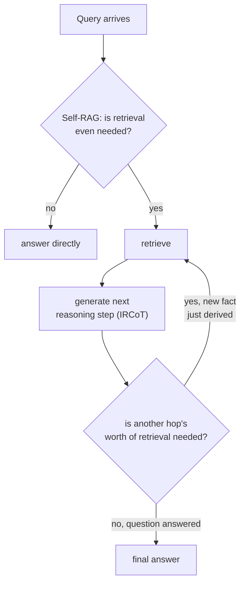

# 第 18 课：多跳检索与智能体式检索

**使命关联:** 第 14 课通过把复合问题拆成子问题，并对每个子问题检索，来修复复合问题，这一切都在生成开始之前一次完成。这只有在每个子问题都已经在原文中可见时才行得通。有些问题的第二个子问题，在第一个问题的答案回来之前，以任何形式都还不存在。本课讲的是把检索当作系统运行的循环，而不是只走一遍的单次处理。
**主要来源:** [论文：“Interleaving Retrieval with Chain-of-Thought Reasoning for Knowledge-Intensive Multi-Step Questions”（IRCoT），Trivedi 等，2022](https://arxiv.org/abs/2212.10509)
**前置知识:** [第 14 课](0014-query-side-transformation.md)、[第 11 课](0011-diagnosing-the-pipeline.md)

## 热身

1. ▢ 为什么把整个复合问题嵌入成一个向量，对它的两个部分都服务不好？

检查

复合问题的单个嵌入，落在能分别回答各个部分的语料库区域之间的某个位置，与哪一个都不近；把问题分解成各自独立的子问题，并对每个子问题分别检索，让每个部分都有自己的机会，落到真正回答它的那个具体段落附近。

2. ▢ 对于索引建好之后才添加的向量，HNSW 和 IVFFlat 的处理方式在结构上的关键区别是什么？

检查

HNSW 没有训练步骤，所以新向量直接插入图中。IVFFlat 的簇中心在构建时就固定了，之后不会重新计算，所以新添加的向量被分配给最近的现有簇中心，而这个簇中心从不会调整自己去代表它。

## 要点

### 有些子问题要等第一个问题回答之后才存在

第 14 课的分解假定，每个子问题都已经在复合问题自己的文字中可见：“退款政策是什么，年度订阅的政策有不同吗”，两个部分一开始就都包含在里面。真正的**多跳**问题则不是这样：“在当今在位君主出生那一年获得最佳影片奖的那部电影，是谁导演的”，无法事先拆成它的两个子问题，因为第二个子问题（X 年哪部电影获得了最佳影片奖），要等第一个问题（君主是哪一年出生的）真正得到回答之后，才能被表述出来。论文自己的解释准确地说明了这一点：**该检索什么，取决于已经推导出了什么，而这又可能取决于之前检索到了什么**，这是一条真正的依赖链，而不是用更巧妙的提示词就能事先完成的拆分。

### IRCoT：让推理步骤与检索步骤交替进行

**IRCoT**（Interleaving Retrieval with Chain-of-Thought，把检索与思维链交错进行）用两个动作交替进行，而不是只运行一次检索：利用到目前为止检索到的内容，生成下一步推理（一句思维链），然后把这一步新的推理本身作为再一次检索的依据，如此重复。每次检索都以前一次检索推导出的推理为依据，这恰恰是单次的事先检索（哪怕是分解过的）做不到的：第二跳的查询，要等第一跳的答案产生了它，才存在。

### Self-RAG：决定是否检索，而不只是检索几次

另一个与之互补的问题是，检索是否应该发生，以及返回的内容是否真的好到可以使用。普通的 RAG 每一次都检索固定数量的段落，不管这个具体的查询其实是否需要检索，也不管检索到的段落是否真的相关，而 **Self-RAG** 论文自己的解释将此指认为一项真实的代价：不加区分的检索，可能削弱模型的通用性，或者在检索到的段落其实没有帮助时，产生一个没有用的回复。Self-RAG 则训练模型针对每个查询，决定是否需要检索，并对检索到的段落以及它自己的草稿输出，就相关性和依据情况做出评判，而不是把检索当作一个无条件的、始终开启的步骤，不管是否真的需要，都对每个查询一视同仁地执行。

### 智能体式检索：由系统，而不是固定的流水线形态，决定下一步

把这些合起来，就让检索从一条流水线（固定的阶段，只运行一次，按顺序执行）变成了更接近智能体在每一步所做的决定：这个查询是否根本需要检索，返回的内容是否足以回答，还是回答这个问题需要先推导出一个中间事实，再据此重新搜索。这与本工作区之前每一课所假定的形态在结构上都不同，之前都假定一遍检索（可能针对几个子查询，见第 14 课），后接一个生成步骤；而多跳检索和智能体式检索则在检索与推理之间循环，次数不设上限，取决于具体的查询。

## 练习

1. ▢ 某个问题需要先知道事实 A，才能表述出针对事实 B 的查询。为什么第 14 课的分解技术，无法像处理明确的复合问题那样处理它？

提示

想一想，分解在原问题的文字中，需要事先有什么，才能拆分出任何东西。

检查

分解拆分的，是原复合问题文字中已经可见的子问题；这里的第二个子问题，要等事实 A 的答案回来之前，都不以任何能表述的形式存在，所以事先的拆分，根本没有什么东西可以从原问题中提取出来。

2. ▢ IRCoT 在哪两者之间交替进行？为什么每一步检索都取决于前一步，而不是在一开始就全部决定好？

检查

它在生成一步思维链推理（利用到目前为止检索到的内容）与基于这步新推理再次检索之间交替进行。每次检索都取决于前一次，是因为决定接下来该搜索什么的那步推理，本身就是由上一次检索产生的，无法事先得知。

3. ▢ 为什么 Self-RAG 自己的解释，把不加区分、固定数量的检索，描述为一项真实的代价，而不只是偶尔的低效？

检查

不管检索是否真的必要，也不管段落是否相关，都检索固定数量的段落，可能削弱模型的通用性，或者在检索到的内容其实没有帮助时，导致一个没有用的回复；论文把这视为一项真实的质量代价，而不是罕见的边界情况。

4. ▢ “智能体式检索”与本工作区之前的每一种检索设计，在结构上有什么不同？

检查

之前的每一种设计，都假定一遍检索（针对一个查询，或事先确定的几个子查询），后接一个生成步骤。智能体式检索则是循环的：系统在每一步判断是否根本需要检索，评估返回的内容是否足够，并能根据刚刚推导出的内容再次检索，次数不设上限，取决于具体的查询，而不是固定的流水线形态。

5. ▢ 下列哪项说法正确地区分了 IRCoT 和 Self-RAG？

    - a) 两者解决的完全是同一个问题：在回答之前决定是否要检索
    - b) IRCoT 把推理步骤与检索交错进行，使每一跳的查询都可以依赖刚刚推导出的内容；Self-RAG 则是决定是否需要检索，并评判返回的内容，这与需要几跳是互补但不同的问题
    - c) IRCoT 和第 14 课的分解解决的是同一个问题，只是术语不同
    - d) Self-RAG 总是检索相同的固定数量的段落，只是挑选得更仔细

检查

**b)** 这正是本课所划分的精确的、互补的区别。（a）错误：IRCoT 处理的是检索步骤之间的多跳依赖，而不是是否要检索。（c）错误：分解拆分的是原文中已经可见的子问题；IRCoT 处理的是在前一跳的答案产生它们之前并不存在的子问题。（d）错误：Self-RAG 的全部要点，是决定检索是否发生，以及对它的结果该信任多少，而不是更精确地固定数量。

## 实战练习

- [ ] 针对你熟悉的某个领域，写一个真正的多跳问题（所需的第二个事实，要等第一个事实解决之后才能确定），并手工追踪，怎样的检索、推理、检索、推理的序列，才能真正回答它。
- [ ] 针对你能访问的某个 RAG 系统，检查它是否不管查询是什么，总是检索相同的固定数量的段落，还是有某种机制来判断不需要检索，或检索得还不够。
- [ ] 明天：通读 IRCoT 论文的结果部分，并记下在它测试的数据集上，多跳问答的准确率相比单遍的先检索后阅读基线提高了多少。

## 延伸阅读

- [论文：“Interleaving Retrieval with Chain-of-Thought Reasoning for Knowledge-Intensive Multi-Step Questions”（IRCoT），Trivedi 等，2022](https://arxiv.org/abs/2212.10509)
- [论文：“Self-RAG: Learning to Retrieve, Generate, and Critique through Self-Reflection”，Asai 等，2023](https://arxiv.org/abs/2310.11511)
- [资源](../RESOURCES.md)

---

没学明白？请重读顶部的主要来源，因为本课是对它的压缩，而理解正是在压缩中流失的。如果有哪个术语觉得含糊，可以查看[术语表](../GLOSSARY.md)。

如果问题出在课程本身，而不是学习材料，那就是一个缺陷：[提交 issue](https://github.com/TokenCemetery/teach/issues)。
