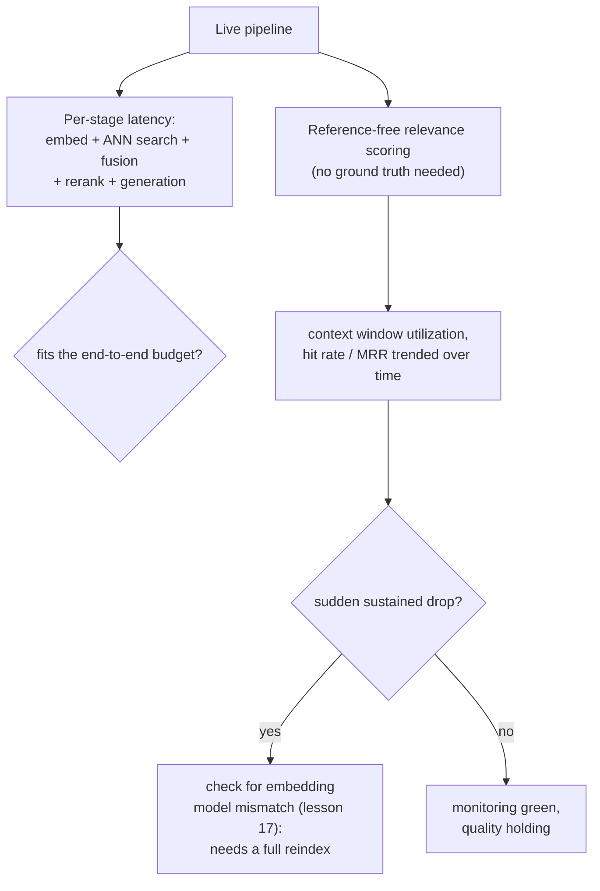

# Lección 19. Costo, latencia y monitorización en producción

**Vínculo con la misión:** La lección 9 midió si una etapa, el reranking, justifica su latencia añadida para una carga de trabajo dada. Esta lección extiende esa misma disciplina al costo y la latencia acumulados de todo el pipeline, y luego cubre lo que la medición offline de la lección 9 no puede: una vez que el pipeline está en producción, la monitorización ordinaria de infraestructura puede seguir en verde mientras la calidad de la recuperación se degrada en silencio por debajo.
**Fuente principal:** [Guide: "RAG Observability: How Coralogix Helps You Trace Retrieval-to-Generation Quality", Coralogix, 2026](https://coralogix.com/guides/rag-observability/)
**Requisitos previos:** [Lección 9](0009-when-reranking-earns-its-cost.md), [Lección 17](0017-freshness.md)

## Calentamiento

1. ▢ ¿Cómo debería decidir un equipo si el reranking justifica su costo para su carga de trabajo concreta?

Comprobación

Medir la calidad de la recuperación tanto sin reranking como con él sobre el mismo conjunto de consultas representativo, medir por separado la latencia añadida real con el tamaño de conjunto de candidatos en uso y comparar ambas con el presupuesto de latencia y el listón de calidad reales de la carga de trabajo, en lugar de suponer que el reranking siempre o nunca ayuda.

2. ▢ ¿Por qué cambiar el modelo de embeddings requiere una reindexación completa y no una actualización incremental?

Comprobación

Cada vector que ya está en el índice lo produjo el espacio vectorial propio del modelo antiguo, y una consulta con embedding del modelo nuevo no tiene una relación de distancia significativa con esos vectores antiguos; todo el corpus tiene que volver a generarse y el índice reconstruirse desde cero, ya que no hay forma de mezclar correctamente los vectores de los dos modelos.

## Qué debes saber

### El presupuesto de todo el pipeline es más que el costo de cualquier etapa

La lección 9 midió la latencia añadida del reranking de forma aislada. Una petición real paga el costo de cada etapa en secuencia: la ingesta ocurrió antes y fuera de la ruta crítica, pero el embedding de la consulta, la búsqueda ANN, la fusión híbrida, el reranking (si se usa) y la generación añaden cada uno su propia latencia a una petición en vivo, y el presupuesto real del pipeline es lo que queda después de que cada una de esas etapas ha tomado su parte. Una etapa de reranking que cabe sin problema en un presupuesto de 5 segundos de forma aislada puede aun así reventar ese presupuesto si las etapas anteriores, o el paso de generación posterior, ya consumieron la mayor parte; la pregunta del presupuesto siempre hay que hacerla sobre toda la cadena, no etapa por etapa de forma aislada.

### La monitorización ordinaria de infraestructura puede seguir en verde mientras la respuesta ya es errónea

El propio planteamiento de la fuente principal es directo sobre la brecha: un pipeline RAG puede devolver una respuesta rápida y segura mientras pasa por alto en silencio el documento que debería haberla anclado, y la monitorización tradicional de aplicaciones, latencia, throughput, tasa de errores, no tiene nada que decir sobre esto, ya que nada en la petición lanzó realmente un error. Un caso concreto lo precisa: el **truncamiento duro** puede descartar un chunk correctamente recuperado cuando el prompt ensamblado supera la ventana de contexto del modelo (la propia preocupación de presupuesto de la lección 12), en silencio, sin que se lance ninguna excepción en ningún sitio; el recuperador hizo su trabajo, el chunk simplemente nunca llegó al modelo. La monitorización ordinaria de infraestructura informa de esta petición como un éxito completo.

### Utilización de la ventana de contexto: una métrica de si los tokens recuperados se ganaron realmente su lugar

La **utilización de la ventana de contexto**, la proporción entre los chunks realmente citados en la respuesta generada y los chunks que se recuperaron y se colocaron en el prompt, da una señal concreta que las métricas ordinarias de latencia y tasa de errores no pueden dar. Una utilización baja significa que se están gastando tokens (y el dinero invertido en recuperarlos y procesarlos) en contexto que el modelo nunca usó; pero el propio punto de la fuente también apunta en el otro sentido: una utilización constantemente *alta* es en sí misma una señal de alarma, ya que puede indicar que material crítico se está truncando antes de que tenga siquiera oportunidad de citarse.

### La puntuación sin referencia es lo que usa la monitorización en producción en lugar del ground truth

El recall@k y el MRR de la lección 10 necesitan un conjunto de consultas etiquetado o sintético para poder calcularse. El tráfico real de producción no tiene esas etiquetas para la mayoría de las consultas, así que la monitorización en producción se apoya en cambio en la **puntuación sin referencia**, una puntuación de relevancia evaluada por un LLM, calculada por cada chunk recuperado sin necesitar una respuesta correcta conocida y agregada en una ventana de tiempo como tasa de aciertos o relevancia promedio. Una caída sostenida de este agregado es exactamente el tipo de señal que nunca aparecería en un panel de infraestructura, ya que nada en el propio pipeline de peticiones falló.

### Una caída repentina en una métrica de recuperación es como notarías realmente el problema de cambio de modelo de la lección 17

La lección 17 estableció que cambiar el modelo de embeddings requiere una reindexación completa, no una corrección incremental. Esta lección cierra el círculo sobre cómo notaría un equipo, en producción, que esto ha ocurrido, o que una reindexación parcial dejó mezclados vectores antiguos y nuevos: una caída repentina y sostenida del MRR o de la tasa de aciertos, seguida a lo largo del tiempo, es la señal concreta de producción que apunta específicamente a un desajuste del modelo de embeddings y no a una fluctuación de calidad ordinaria, y significa que la solución es la reindexación completa de la lección 17, no otra ronda de ajustes.

## Práctica

1. ▢ Una etapa de reranking medida de forma aislada cuesta 150 ms, muy dentro de un presupuesto de 5 segundos. ¿Por qué podría valer la pena comprobar igualmente la latencia acumulada de todo el pipeline antes de decidir que es asequible?

Pista

Considera qué más ocurre en la misma petición además del propio paso de reranking.

Comprobación

La pregunta del presupuesto es sobre toda la cadena, no sobre una etapa aislada: el embedding de la consulta, la búsqueda ANN, la fusión híbrida y la generación añaden cada uno su propia latencia a la misma petición, y si esas etapas ya consumen la mayor parte del presupuesto, un costo de reranking asequible por sí solo puede aun así hacer que el total supere el límite.

2. ▢ Un chunk se recupera correctamente y se ordena alto, pero el prompt ensamblado supera la ventana de contexto del modelo y el chunk se trunca antes de la generación. ¿Aparece esto como un error en la monitorización ordinaria de infraestructura?

Comprobación

No. El truncamiento duro descarta el chunk en silencio, sin que se lance ninguna excepción en ningún sitio; la petición se completa con éxito desde el punto de vista de la infraestructura, aunque el modelo nunca llegó a ver el chunk que necesitaba. Este es exactamente el tipo de fallo sobre el que la monitorización ordinaria de latencia y tasa de errores no tiene nada que decir.

3. ▢ ¿Por qué una utilización de la ventana de contexto constantemente *alta* se trata como una señal de alarma y no simplemente como algo bueno?

Comprobación

Una utilización muy alta puede indicar que material crítico se está truncando antes de la generación, ya que una ventana de contexto muy utilizada está más cerca de su límite; una métrica pensada para detectar tokens desperdiciados puede, en el extremo opuesto, ser también una señal temprana del propio problema de truncamiento.

4. ▢ El tráfico de producción no tiene etiquetas de ground truth para la mayoría de las consultas. ¿Qué permite medir a un equipo la puntuación sin referencia, y por qué el recall@k y el MRR de la lección 10 no pueden calcularse del mismo modo en producción?

Comprobación

La puntuación sin referencia usa un LLM juez para puntuar la relevancia de cada chunk recuperado sin necesitar una respuesta correcta conocida, agregada como tasa de aciertos o relevancia promedio a lo largo del tiempo. El recall@k y el MRR de la lección 10 requieren ambos saber qué resultado era realmente correcto para una consulta dada, algo que un conjunto de consultas etiquetado o sintético proporciona offline pero que el tráfico real de producción en su mayoría no tiene.

5. ▢ ¿Qué afirmación describe correctamente cómo se relaciona el enfoque de monitorización de esta lección con el problema de frescura de la lección 17?

    - a) La monitorización y la reindexación abordan preocupaciones sin relación y sin conexión práctica
    - b) Una caída repentina y sostenida de una métrica seguida en el tiempo, como el MRR o la tasa de aciertos, es la señal de producción que apunta específicamente a un desajuste del modelo de embeddings, e indica a un equipo que hace falta la reindexación completa de la lección 17 y no otra ronda de ajustes
    - c) La puntuación sin referencia hace innecesaria la reindexación, ya que puede corregir automáticamente un índice obsoleto
    - d) La utilización de la ventana de contexto y el desajuste del modelo de embeddings son el mismo problema subyacente medido de dos formas distintas

Comprobación

**b)** Ese es el vínculo preciso que traza esta lección entre la monitorización y el material anterior de la lección 17. (a) es falsa: la monitorización es justo lo que permite a un equipo notar, en producción, que el escenario de reindexación de la lección 17 ha ocurrido realmente. (c) es falsa: la puntuación sin referencia solo mide relevancia, no arregla un espacio vectorial incompatible; un desajuste real de modelo sigue necesitando la reindexación completa de la lección 17. (d) es falsa: la utilización de la ventana de contexto trata del truncamiento y del gasto de tokens, una preocupación aparte de un desajuste del modelo de embeddings que aparece como una caída de una métrica de recuperación.

## Prácticas en el mundo real

- [ ] Para un pipeline RAG al que tengas acceso, suma la latencia típica de cada etapa (dejando aparte la ingesta, ya que está fuera de la ruta crítica) y comprueba si el total cabe en tu presupuesto real de extremo a extremo, no solo en una etapa medida por separado.
- [ ] Comprueba si tu propio pipeline registra algo como la utilización de la ventana de contexto, o si ahora mismo no tendrías forma de notar que un chunk se truncó en silencio.
- [ ] Mañana: lee completa la sección de la fuente principal sobre la monitorización de la salud de la base de datos vectorial y anota qué métricas concretas recomienda seguir en el tiempo para detectar un desajuste del modelo de embeddings antes de que los usuarios noten respuestas degradadas.

## Para profundizar

- [Guide: "RAG Observability: How Coralogix Helps You Trace Retrieval-to-Generation Quality", Coralogix, 2026](https://coralogix.com/guides/rag-observability/)
- [Paper: "RAGAS: Automated Evaluation of Retrieval Augmented Generation", Es et al., 2023](https://arxiv.org/abs/2309.15217)
- [Recursos](../RESOURCES.md)

---

¿No termina de quedar claro? Vuelve a leer la fuente principal de arriba, ya que esta lección la comprime y en la compresión es donde se escapa la comprensión. Consulta el [glosario](../GLOSSARY.md) por si algún término te resultó resbaladizo.

Si lo poco claro es la propia lección y no el material, eso es un defecto: [abre un issue](https://github.com/TokenCemetery/teach/issues).
