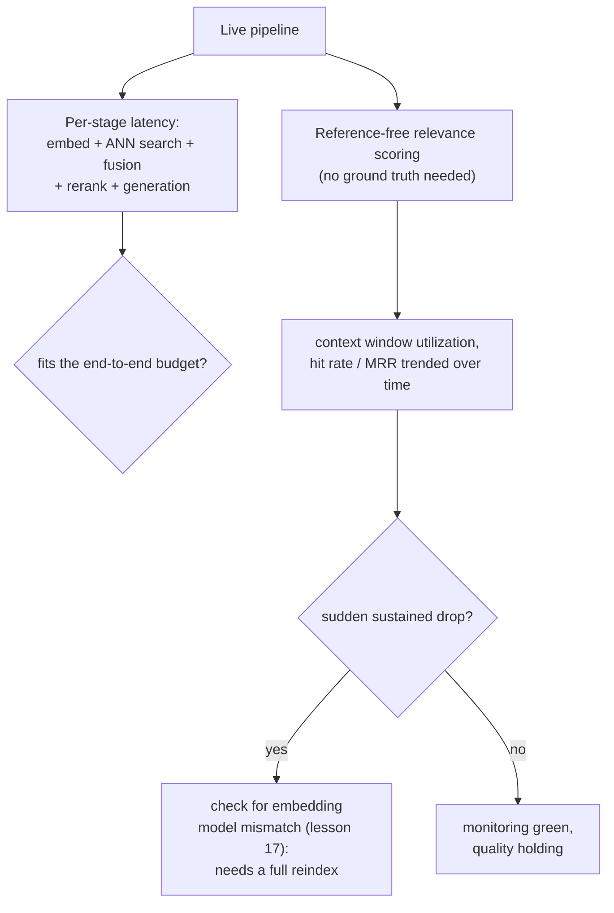

# Leçon 19. Coût, latence et surveillance en production

**Lien avec la mission :** La leçon 9 a mesuré si une seule étape, le reranking, justifie sa latence ajoutée pour une charge de travail donnée. Cette leçon étend cette même discipline au coût et à la latence cumulés du pipeline entier, puis couvre ce que la mesure hors ligne de la leçon 9 ne peut pas voir : une fois le pipeline en production, la surveillance d'infrastructure ordinaire peut rester au vert pendant que la qualité de la récupération se dégrade silencieusement en dessous.
**Source primaire :** [Guide : "RAG Observability: How Coralogix Helps You Trace Retrieval-to-Generation Quality", Coralogix, 2026](https://coralogix.com/guides/rag-observability/)
**Prérequis :** [Leçon 9](0009-when-reranking-earns-its-cost.md), [Leçon 17](0017-freshness.md)

## Échauffement

1. ▢ Comment une équipe doit-elle décider si le reranking justifie son coût pour sa charge de travail précise ?

Vérifier

Mesurer la qualité de la récupération sans puis avec reranking sur le même jeu de requêtes représentatif, mesurer séparément la latence ajoutée réelle à la taille d'ensemble de candidats utilisée, et comparer les deux au budget de latence et au seuil de qualité réels de la charge de travail, plutôt que de supposer que le reranking aide toujours ou jamais.

2. ▢ Pourquoi changer de modèle d'embedding exige-t-il une réindexation complète plutôt qu'une mise à jour incrémentale ?

Vérifier

Chaque vecteur déjà présent dans l'index a été produit dans l'espace vectoriel propre à l'ancien modèle, et une requête dont l'embedding est calculé avec un nouveau modèle n'a aucune relation de distance significative avec ces anciens vecteurs ; tout le corpus doit être recalculé et l'index reconstruit à partir de zéro, puisqu'il n'y a aucun moyen de mélanger correctement les vecteurs des deux modèles.

## À savoir

### Le budget du pipeline entier dépasse le coût de n'importe quelle étape

La leçon 9 a mesuré la latence ajoutée du reranking isolément. Une vraie requête paie le coût de chaque étape en séquence : l'ingestion a eu lieu plus tôt et hors du chemin critique, mais le calcul de l'embedding de la requête, la recherche ANN, la fusion hybride, le reranking (s'il est utilisé) et la génération ajoutent chacun leur propre latence à une requête en direct, et le budget réel du pipeline est ce qui reste après que chacune de ces étapes a pris sa part. Une étape de reranking qui tient sans peine dans un budget de 5 secondes isolément peut quand même le faire exploser si les étapes qui la précèdent, ou la génération qui la suit, en ont déjà consommé l'essentiel ; la question du budget doit toujours être posée sur toute la chaîne, pas étape par étape isolément.

### La surveillance d'infrastructure ordinaire peut rester au vert alors que la réponse est déjà fausse

Le cadrage de la source primaire est direct sur cet écart : un pipeline RAG peut renvoyer une réponse rapide et assurée tout en ratant discrètement le document qui aurait dû l'ancrer, et la surveillance applicative traditionnelle, latence, débit, taux d'erreur, n'a rien à dire là-dessus, puisque rien dans la requête n'a levé d'erreur. Un cas concret le rend précis : la **troncature brutale** peut écarter un chunk correctement récupéré dès que le prompt assemblé dépasse la fenêtre de contexte du modèle (le souci de budget de la leçon 12 elle-même), silencieusement, sans qu'aucune exception soit levée nulle part ; le retriever a fait son travail, le chunk n'a simplement jamais atteint le modèle. La surveillance d'infrastructure ordinaire signale cette requête comme un succès complet.

### Utilisation de la fenêtre de contexte : une métrique pour savoir si les tokens récupérés ont mérité leur place

L'**utilisation de la fenêtre de contexte**, le rapport entre le nombre de chunks effectivement cités dans la réponse générée et le nombre de chunks récupérés et placés dans le prompt, donne un signal concret que les métriques ordinaires de latence et de taux d'erreur ne peuvent pas donner. Une utilisation faible signifie que des tokens (et l'argent dépensé à les récupérer et à les traiter) sont dépensés pour un contexte que le modèle n'a jamais utilisé ; mais le propos de la source va aussi dans l'autre sens : une utilisation constamment *élevée* est elle-même un signal d'alerte, puisqu'elle peut indiquer que du contenu critique est tronqué avant même d'avoir une chance d'être cité.

### Le score sans référence est ce que la surveillance en production utilise à la place de la vérité terrain

Le recall@k et le MRR de la leçon 10 ont besoin d'un jeu de requêtes étiqueté ou synthétique pour être calculés. Le trafic réel en production n'a pas de telles étiquettes pour la plupart des requêtes, donc la surveillance en production s'appuie plutôt sur le **score sans référence**, un score de pertinence jugé par un LLM, calculé pour chaque chunk récupéré sans avoir besoin d'une réponse correcte connue, puis agrégé sur une fenêtre de temps sous forme de taux de réussite ou de pertinence moyenne. Une baisse soutenue de cet agrégat est exactement le genre de signal qui n'apparaîtrait jamais sur un tableau de bord d'infrastructure, puisque rien dans le pipeline de requêtes lui-même n'a échoué.

### Une chute soudaine d'une métrique de récupération est la façon dont on remarquerait réellement le problème de changement de modèle de la leçon 17

La leçon 17 a établi que changer de modèle d'embedding exige une réindexation complète, pas une correction incrémentale. Cette leçon boucle la boucle sur la façon dont une équipe remarquerait réellement, en production, que cela s'est produit, ou qu'une réindexation partielle a laissé des vecteurs anciens et nouveaux mélangés : une chute soudaine et soutenue du MRR ou du taux de réussite, suivie dans le temps, est le signal concret de production qui désigne précisément un décalage de modèle d'embedding plutôt qu'une fluctuation de qualité ordinaire, et cela signifie que la solution est la réindexation complète de la leçon 17, pas une nouvelle série de réglages.

## Pratique

1. ▢ Une étape de reranking mesurée isolément coûte 150 ms, bien en dessous d'un budget de 5 secondes. Pourquoi pourrait-il quand même valoir la peine de vérifier la latence cumulée du pipeline complet avant de décider qu'elle est abordable ?

Indice

Réfléchissez à ce qui se passe d'autre dans la même requête en plus de l'étape de reranking elle-même.

Vérifier

La question du budget porte sur toute la chaîne, pas sur une étape isolée : le calcul de l'embedding de la requête, la recherche ANN, la fusion hybride et la génération ajoutent chacun leur propre latence à la même requête, et si ces étapes consomment déjà l'essentiel du budget, un coût de reranking abordable pris individuellement peut quand même faire dépasser la limite au total.

2. ▢ Un chunk est correctement récupéré et bien classé, mais le prompt assemblé dépasse la fenêtre de contexte du modèle et le chunk est tronqué avant la génération. Cela apparaît-il comme une erreur dans la surveillance d'infrastructure ordinaire ?

Vérifier

Non. La troncature brutale écarte le chunk silencieusement, sans qu'aucune exception soit levée nulle part ; la requête se termine avec succès du point de vue de l'infrastructure, alors que le modèle n'a jamais vu le chunk dont il avait besoin. C'est exactement le genre de défaillance dont la surveillance ordinaire de latence et de taux d'erreur n'a rien à dire.

3. ▢ Pourquoi une utilisation de la fenêtre de contexte constamment *élevée* est-elle traitée comme un signal d'alerte, plutôt que simplement comme une bonne chose ?

Vérifier

Une utilisation très élevée peut indiquer que du contenu critique est tronqué avant la génération, puisqu'une fenêtre de contexte fortement utilisée est plus proche de sa limite ; une métrique censée détecter les tokens gaspillés peut, à l'extrême opposé, être aussi un signal précoce du problème de troncature lui-même.

4. ▢ Le trafic de production n'a pas d'étiquettes de vérité terrain pour la plupart des requêtes. Que permet quand même de mesurer le score sans référence à une équipe, et pourquoi recall@k et MRR de la leçon 10 ne peuvent-ils pas être calculés de la même façon en production ?

Vérifier

Le score sans référence utilise un juge LLM pour noter la pertinence de chaque chunk récupéré sans avoir besoin d'une réponse correcte connue, agrégée sous forme de taux de réussite ou de pertinence moyenne dans le temps. Recall@k et MRR de la leçon 10 exigent tous deux de savoir quel résultat était réellement correct pour une requête donnée, ce qu'un jeu de requêtes étiqueté ou synthétique fournit hors ligne mais que le trafic réel en production n'a pour l'essentiel pas.

5. ▢ Laquelle de ces affirmations décrit correctement le rapport entre l'approche de surveillance de cette leçon et le problème de fraîcheur de la leçon 17 ?

    - a) La surveillance et la réindexation traitent des préoccupations sans rapport et sans lien pratique
    - b) Une chute soudaine et soutenue d'une métrique suivie dans le temps comme le MRR ou le taux de réussite est le signal de production qui désigne précisément un décalage de modèle d'embedding, et indique à une équipe que la réindexation complète de la leçon 17 est nécessaire plutôt qu'une nouvelle série de réglages
    - c) Le score sans référence rend la réindexation inutile, puisqu'il peut corriger automatiquement un index périmé
    - d) L'utilisation de la fenêtre de contexte et le décalage de modèle d'embedding sont le même problème sous-jacent mesuré de deux façons différentes

Vérifier

**b)** C'est le lien précis que trace cette leçon entre la surveillance et la matière antérieure de la leçon 17. (a) est fausse : la surveillance est précisément ce qui permet à une équipe de remarquer, en production, que le scénario de réindexation de la leçon 17 s'est réellement produit. (c) est fausse : le score sans référence ne mesure que la pertinence, il ne corrige pas un espace vectoriel incompatible ; un vrai décalage de modèle exige toujours la réindexation complète de la leçon 17. (d) est fausse : l'utilisation de la fenêtre de contexte concerne la troncature et la dépense en tokens, une préoccupation distincte d'un décalage de modèle d'embedding qui se manifeste par une chute de métrique de récupération.

## Exercices en situation réelle

- [ ] Pour un pipeline RAG auquel vous avez accès, additionnez la latence typique de chaque étape (l'ingestion mise à part, puisqu'elle est hors du chemin critique) et vérifiez si le total tient dans votre budget de bout en bout réel, et pas seulement dans celui d'une étape mesurée seule.
- [ ] Vérifiez si votre propre pipeline journalise quelque chose comme l'utilisation de la fenêtre de contexte, ou si vous n'auriez actuellement aucun moyen de remarquer qu'un chunk a été silencieusement tronqué.
- [ ] Demain : lisez en entier la section de la source primaire sur la surveillance de l'état de santé de la base vectorielle, et notez quelles métriques précises elle recommande de suivre dans le temps pour détecter un décalage de modèle d'embedding avant que les utilisateurs ne remarquent des réponses dégradées.

## Pour aller plus loin

- [Guide : "RAG Observability: How Coralogix Helps You Trace Retrieval-to-Generation Quality", Coralogix, 2026](https://coralogix.com/guides/rag-observability/)
- [Article : "RAGAS: Automated Evaluation of Retrieval Augmented Generation", Es et al., 2023](https://arxiv.org/abs/2309.15217)
- [Ressources](../RESOURCES.md)

---

Ça ne passe pas ? Relisez la source primaire en haut de page, car cette leçon la condense et c'est dans la condensation que la compréhension s'échappe. Consultez le [glossaire](../GLOSSARY.md) pour tout terme qui vous a paru glissant.

Si c'est la leçon elle-même qui n'est pas claire plutôt que la matière, c'est un défaut : [ouvrez une issue](https://github.com/TokenCemetery/teach/issues).
