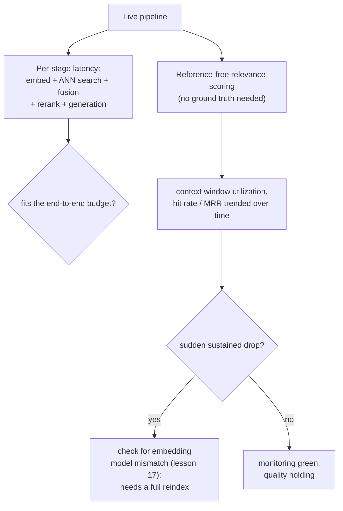

# पाठ 19. Cost, Latency और Production Monitoring

**मिशन से संबंध:** पाठ 9 ने मापा कि एक चरण, reranking, किसी दिए workload के लिए अपनी जोड़ी हुई latency कमाता है या नहीं। यह पाठ उसी अनुशासन को पूरे pipeline की संचित लागत और latency तक बढ़ाता है, और फिर वह हिस्सा कवर करता है जो पाठ 9 की offline माप नहीं कर सकती: pipeline के live होने के बाद, आम infrastructure monitoring हरी रह सकती है जबकि उसके नीचे retrieval की गुणवत्ता चुपचाप बिगड़ती रहे।
**मुख्य स्रोत:** [गाइड: "RAG Observability: How Coralogix Helps You Trace Retrieval-to-Generation Quality", Coralogix, 2026](https://coralogix.com/guides/rag-observability/)
**पूर्व-आवश्यकताएँ:** [पाठ 9](0009-when-reranking-earns-its-cost.md), [पाठ 17](0017-freshness.md)

## वार्म-अप

1. ▢ टीम को अपने ख़ास workload के लिए कैसे तय करना चाहिए कि reranking अपनी क़ीमत कमाता है या नहीं?

जाँचें

Retrieval की गुणवत्ता reranking के बिना और उसके साथ, उसी प्रतिनिधि query सेट पर मापें, इस्तेमाल हो रहे candidate-सेट आकार पर असली जुड़ी latency अलग से मापें, और दोनों की तुलना workload के असली latency budget और गुणवत्ता की कसौटी से करें, बजाय यह मान लेने के कि reranking हमेशा या कभी मदद नहीं करता।

2. ▢ Embedding model बदलने के लिए incremental update की जगह पूरा reindex क्यों चाहिए?

जाँचें

Index में पहले से मौजूद हर vector पुराने model की अपनी vector space से बना था, और नए model से embed की गई query का उन पुराने vectors से कोई अर्थपूर्ण दूरी का रिश्ता नहीं है; पूरे corpus को दोबारा embed करना और index को शुरू से दोबारा बनाना पड़ता है, क्योंकि दोनों models के vectors को सही ढंग से मिलाने का कोई तरीक़ा नहीं है।

## यह जानें

### पूरे pipeline का budget किसी भी एक चरण की लागत से ज़्यादा है

पाठ 9 ने reranking की जोड़ी हुई latency को अलग से मापा। असली request हर चरण की लागत क्रम से चुकाती है: ingestion पहले और critical path से बाहर हो चुका था, पर query embedding, ANN search, hybrid fusion, reranking (अगर इस्तेमाल हो) और generation, सब एक live request में अपनी latency जोड़ते हैं, और pipeline का असली budget वही है जो उन सब चरणों के अपना हिस्सा ले लेने के बाद बचे। 5-सेकंड के budget में अलग से आसानी से समाने वाला reranking चरण फिर भी उस budget को उड़ा सकता है अगर उससे पहले के चरण, या उसके बाद का generation चरण, पहले ही ज़्यादातर budget खा चुके हों; budget का सवाल हमेशा पूरी कड़ी के बारे में पूछना पड़ता है, चरण-दर-चरण अलग-अलग नहीं।

### आम infrastructure monitoring हरी रह सकती है जबकि उत्तर पहले से ग़लत हो

मुख्य स्रोत का अपना तर्क इस अंतर के बारे में सीधा है: RAG pipeline तेज़, आत्मविश्वासी उत्तर लौटा सकता है जबकि चुपचाप उस document को चूक रहा हो जिसे उसे आधार बनाना चाहिए था, और पारंपरिक application monitoring, latency, throughput, error rates, इस बारे में कुछ नहीं कहती, क्योंकि request में कहीं कोई error फेंका ही नहीं गया। एक ठोस मामला इसे ठीक बनाता है: **hard truncation** सही retrieve किए गए chunk को गिरा सकता है जब जोड़ा गया prompt model की context window से बड़ा हो जाए (पाठ 12 की अपनी budget चिंता), चुपचाप, कहीं कोई exception उठे बिना; retriever ने अपना काम किया, chunk बस model तक कभी पहुँचा ही नहीं। आम infrastructure monitoring इस request को पूर्ण सफलता बताती है।

### Context window utilization: यह देखने की metric कि retrieved tokens ने अपनी जगह कमाई या नहीं

**Context window utilization**, यानी generate किए उत्तर में असल में cite किए गए chunks और retrieve करके prompt में रखे गए chunks का अनुपात, ऐसा ठोस संकेत देता है जो आम latency और error-rate metrics नहीं दे सकतीं। कम utilization का मतलब है कि tokens (और उन्हें retrieve व प्रोसेस करने में ख़र्च हुआ पैसा) ऐसे context पर जा रहे हैं जिसे model ने कभी इस्तेमाल नहीं किया; पर स्रोत की अपनी बात दूसरी तरफ़ भी काटती है: लगातार *ऊँचा* utilization ख़ुद एक चेतावनी का संकेत है, क्योंकि वह इशारा कर सकता है कि ज़रूरी सामग्री cite होने का मौक़ा पाने से पहले ही कटकर बाहर हो रही है।

### Reference-free scoring वह है जो production monitoring ground truth की जगह इस्तेमाल करती है

पाठ 10 के recall@k और MRR को निकालने के लिए ही labeled या synthetic query सेट चाहिए। Live production traffic के पास ज़्यादातर queries के लिए ऐसे labels नहीं होते, इसलिए production monitoring इसकी जगह **reference-free scoring** पर निर्भर करती है, यानी हर retrieved chunk के लिए LLM से कराया गया relevance score, जो सही उत्तर पहले से जाने बिना निकलता है, और किसी समय-खिड़की में hit rate या औसत relevance के रूप में जोड़ा जाता है। इस जोड़ में लगातार गिरावट ठीक उसी तरह का संकेत है जो infrastructure dashboard में कभी नहीं दिखेगा, क्योंकि request pipeline में ख़ुद कुछ विफल नहीं हुआ।

### Retrieval metric में अचानक गिरावट से ही आप असल में पाठ 17 की model-बदलाव वाली समस्या को घटते हुए नोटिस करेंगे

पाठ 17 ने स्थापित किया कि embedding model बदलने के लिए पूरा reindex चाहिए, incremental सुधार नहीं। यह पाठ इस कड़ी को पूरा करता है कि टीम production में असल में कैसे नोटिस करेगी कि ऐसा हो गया है, या कि आंशिक reindex ने पुराने और नए vectors मिला दिए: समय के साथ ट्रैक की गई MRR या hit rate में अचानक, लगातार गिरावट ठोस production संकेत है जो ख़ास तौर पर embedding-model बेमेल की ओर इशारा करता है, आम गुणवत्ता के उतार-चढ़ाव की ओर नहीं, और इसका मतलब है कि इलाज पाठ 17 का पूरा reindex है, tuning का एक और दौर नहीं।

## अभ्यास

1. ▢ अलग से मापा गया reranking चरण 150 ms लेता है, जो 5-सेकंड के budget के काफ़ी भीतर है। उसे वहन करने लायक मानने से पहले पूरे pipeline की संचित latency जाँचना फिर भी क्यों सार्थक हो सकता है?

संकेत

विचार करें कि उसी request में reranking चरण के अलावा और क्या होता है।

जाँचें

Budget का सवाल पूरी कड़ी के बारे में है, अलग से एक चरण के बारे में नहीं: query embedding, ANN search, hybrid fusion और generation, सब उसी request में अपनी latency जोड़ते हैं, और अगर वे चरण पहले ही ज़्यादातर budget खा चुके हों, तो अकेले वहन करने लायक reranking लागत भी कुल को सीमा के पार धकेल सकती है।

2. ▢ एक chunk सही retrieve हुआ और ऊँचा rank हुआ, पर जोड़ा गया prompt model की context window से बड़ा हो जाता है और chunk generation से पहले कट जाता है। क्या यह आम infrastructure monitoring में error के रूप में दिखता है?

जाँचें

नहीं। Hard truncation chunk को चुपचाप गिरा देता है, कहीं कोई exception उठे बिना; request infrastructure के नज़रिए से सफलतापूर्वक पूरी होती है, भले ही model ने वह chunk असल में कभी देखा ही नहीं जो उसे चाहिए था। यह ठीक उसी तरह की विफलता है जिसके बारे में आम latency/error-rate monitoring के पास कहने को कुछ नहीं।

3. ▢ लगातार *ऊँचे* context window utilization को सिर्फ़ अच्छी चीज़ मानने की जगह चेतावनी का संकेत क्यों माना जाता है?

जाँचें

बहुत ऊँचा utilization इशारा कर सकता है कि ज़रूरी सामग्री generation से पहले ही कटकर बाहर हो रही है, क्योंकि भारी इस्तेमाल हुई context window अपनी सीमा के ज़्यादा क़रीब होती है; बर्बाद tokens पकड़ने के लिए बनी metric, उलटे छोर पर, ख़ुद truncation की समस्या का शुरुआती संकेत भी हो सकती है।

4. ▢ Production traffic के पास ज़्यादातर queries के लिए ground-truth labels नहीं होते। Reference-free scoring फिर भी टीम को क्या मापने देती है, और पाठ 10 के recall@k और MRR production में उसी तरह क्यों नहीं निकाले जा सकते?

जाँचें

Reference-free scoring LLM judge से हर retrieved chunk की relevance को सही उत्तर पहले से जाने बिना score कराती है, और समय पर hit rate या औसत relevance के रूप में जोड़ती है। पाठ 10 के recall@k और MRR दोनों को यह जानना ज़रूरी है कि किसी query के लिए असल में कौन-सा नतीजा सही था, जो labeled या synthetic query सेट offline देता है पर live production traffic ज़्यादातर नहीं देता।

5. ▢ कौन-सा दावा सही बताता है कि इस पाठ का monitoring तरीक़ा पाठ 17 की freshness समस्या से कैसे जुड़ता है?

    - a) Monitoring और reindexing असंबंधित चिंताएँ हैं जिनका कोई व्यावहारिक जुड़ाव नहीं
    - b) MRR या hit rate जैसी ट्रैक की गई metric में अचानक, लगातार गिरावट वह production संकेत है जो ख़ास तौर पर embedding-model बेमेल की ओर इशारा करता है, टीम को बताता है कि tuning का एक और दौर नहीं बल्कि पाठ 17 का पूरा reindex चाहिए
    - c) Reference-free scoring reindexing को अनावश्यक बना देती है, क्योंकि वह पुराने index की भरपाई अपने-आप कर सकती है
    - d) Context window utilization और embedding-model बेमेल एक ही अंतर्निहित समस्या हैं जो दो अलग तरीक़ों से मापी जाती है

जाँचें

**b)** यही वह ठीक कड़ी है जो यह पाठ monitoring और पाठ 17 की पहले की सामग्री के बीच खींचता है। (a) ग़लत है: monitoring ही वह चीज़ है जो टीम को production में नोटिस करने देती है कि पाठ 17 का reindex परिदृश्य असल में घट चुका है। (c) ग़लत है: reference-free scoring सिर्फ़ relevance मापती है, असंगत vector space को ठीक नहीं करती; सचमुच का model बेमेल अब भी पाठ 17 का पूरा reindex माँगता है। (d) ग़लत है: context window utilization truncation और token ख़र्च के बारे में है, जो retrieval-metric की गिरावट के रूप में दिखने वाले embedding-model बेमेल से अलग चिंता है।

## असली दुनिया का अभ्यास

- [ ] जिस RAG pipeline तक आपकी पहुँच है, उसके लिए हर चरण की आम latency जोड़ें (ingestion को छोड़कर, क्योंकि वह critical path से बाहर है) और जाँचें कि कुल आपके असली end-to-end budget में समाता है या नहीं, सिर्फ़ किसी एक चरण को अकेले मापकर नहीं।
- [ ] जाँचें कि आपका अपना pipeline context window utilization जैसा कुछ log करता है या नहीं, या फ़िलहाल आपके पास यह नोटिस करने का कोई तरीक़ा नहीं होगा कि कोई chunk चुपचाप कट गया।
- [ ] कल: मुख्य स्रोत का vector database health monitoring वाला खंड पूरा पढ़ें, और नोट करें कि उपयोगकर्ताओं के बिगड़े उत्तर नोटिस करने से पहले embedding-model बेमेल पकड़ने के लिए वह कौन-सी ख़ास metrics को समय पर ट्रैक करने का सुझाव देता है।

## आगे बढ़ने के लिए

- [गाइड: "RAG Observability: How Coralogix Helps You Trace Retrieval-to-Generation Quality", Coralogix, 2026](https://coralogix.com/guides/rag-observability/)
- [पेपर: "RAGAS: Automated Evaluation of Retrieval Augmented Generation", Es et al., 2023](https://arxiv.org/abs/2309.15217)
- [संसाधन](../RESOURCES.md)

---

बात नहीं बन रही? ऊपर दिए primary source को दोबारा पढ़ें, क्योंकि यह पाठ उसे संक्षिप्त करता है और समझ संक्षेप में ही रिसती है। जो शब्द फिसलन भरा लगे, उसके लिए [शब्दावली](../GLOSSARY.md) देखें।

अगर दिक़्क़त सामग्री की नहीं बल्कि पाठ की ही है, तो वह एक खोट है: [issue खोलें](https://github.com/TokenCemetery/teach/issues)।
