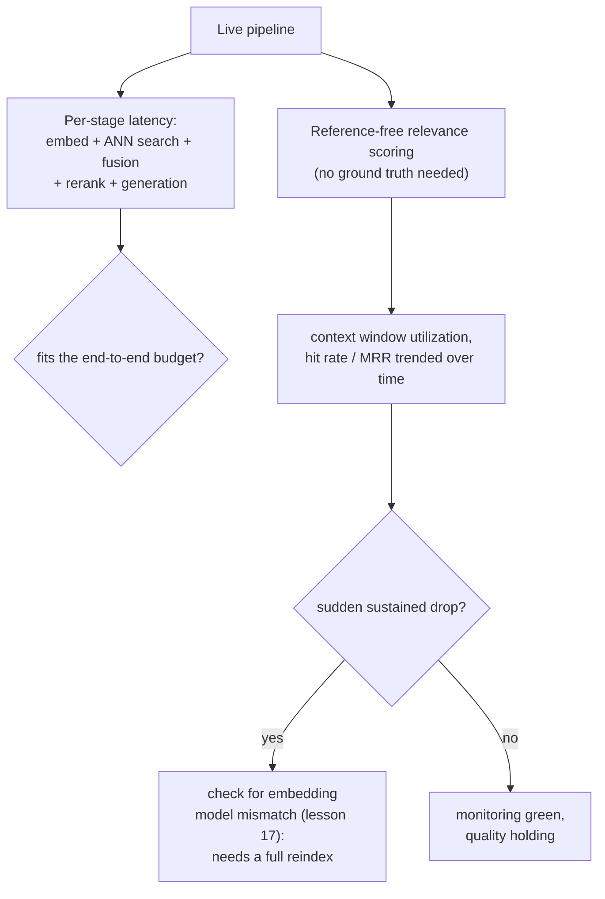

# Lição 19. Custo, latência e monitoramento em produção

**Ligação com a missão:** A lição 9 mediu se uma etapa, o reranking, compensa a latência adicional para uma dada carga de trabalho. Esta lição estende essa mesma disciplina ao custo e à latência cumulativos do pipeline inteiro, e depois cobre a parte que a medição offline da lição 9 não consegue: depois que o pipeline está no ar, o monitoramento comum de infraestrutura pode continuar verde enquanto a qualidade da recuperação se degrada em silêncio por baixo dele.
**Fonte principal:** [Guia: "RAG Observability: How Coralogix Helps You Trace Retrieval-to-Generation Quality", Coralogix, 2026](https://coralogix.com/guides/rag-observability/)
**Pré-requisitos:** [Lição 9](0009-when-reranking-earns-its-cost.md), [Lição 17](0017-freshness.md)

## Aquecimento

1. ▢ Como uma equipe deve decidir se o reranking compensa o custo para a sua carga de trabalho específica?

Verificação

Medir a qualidade da recuperação sem e com reranking sobre o mesmo conjunto representativo de consultas, medir separadamente a latência adicional real no tamanho de conjunto de candidatos em uso e comparar ambos com o orçamento de latência e o nível de qualidade reais da carga de trabalho, em vez de presumir que o reranking sempre ou nunca ajuda.

2. ▢ Por que trocar o modelo de embedding exige uma reindexação completa em vez de uma atualização incremental?

Verificação

Todo vetor já presente no índice foi produzido pelo espaço vetorial do modelo antigo, e uma consulta que recebeu embedding com um modelo novo não tem relação de distância significativa com esses vetores antigos; o corpus inteiro precisa ter o embedding gerado novamente e o índice reconstruído do zero, já que não há como misturar corretamente os vetores dos dois modelos.

## Saiba isto

### O orçamento do pipeline inteiro é mais do que o custo de qualquer etapa isolada

A lição 9 mediu a latência adicional do reranking de forma isolada. Uma requisição real paga o custo de cada etapa em sequência: a ingestão aconteceu antes e fora do caminho crítico, mas o embedding da consulta, a busca ANN, a fusão híbrida, o reranking (se usado) e a geração acrescentam, cada um, sua própria latência a uma única requisição ao vivo, e o orçamento real do pipeline é o que sobra depois que cada uma dessas etapas tomou sua parte. Uma etapa de reranking que cabe com facilidade em um orçamento de 5 segundos de forma isolada ainda pode estourar esse orçamento se as etapas anteriores a ela, ou a etapa de geração posterior, já tiverem consumido a maior parte dele; a pergunta sobre o orçamento sempre precisa ser feita sobre a cadeia inteira, e não etapa por etapa em isolamento.

### O monitoramento comum de infraestrutura pode continuar verde enquanto a resposta já está errada

O próprio enquadramento da fonte principal é direto sobre a lacuna: um pipeline RAG pode devolver uma resposta rápida e confiante enquanto perde em silêncio o documento que deveria tê-la ancorado, e o monitoramento tradicional de aplicações, latência, throughput, taxas de erro, não tem nada a dizer sobre isso, já que nada na requisição de fato lançou um erro. Um caso concreto torna isso preciso: o **truncamento forçado** pode descartar um chunk corretamente recuperado quando o prompt montado excede a janela de contexto do modelo (a própria preocupação de orçamento da lição 12), em silêncio, sem nenhuma exceção levantada em lugar algum; o retriever fez seu trabalho, o chunk só nunca chegou ao modelo. O monitoramento comum de infraestrutura reporta essa requisição como um sucesso completo.

### Utilização da janela de contexto: uma métrica para saber se os tokens recuperados de fato mereceram seu lugar

A **utilização da janela de contexto**, a razão entre os chunks efetivamente citados na resposta gerada e os chunks que foram recuperados e colocados no prompt, dá um sinal concreto que as métricas comuns de latência e de taxa de erro não dão. Utilização baixa significa que tokens (e o dinheiro gasto para recuperá-los e processá-los) estão sendo gastos com contexto que o modelo nunca usou; mas o ponto da própria fonte também corta para o outro lado: uma utilização consistentemente *alta* é, ela mesma, um sinal de alerta, já que pode indicar que material crítico está sendo truncado antes mesmo de ter a chance de ser citado.

### A pontuação sem referência é o que o monitoramento em produção usa no lugar da verdade de referência

O recall@k e o MRR da lição 10 precisam de um conjunto de consultas rotulado ou sintético para sequer serem calculados. O tráfego ao vivo em produção não tem esses rótulos para a maioria das consultas, então o monitoramento em produção recorre, em vez disso, à **pontuação sem referência**, uma pontuação de relevância julgada por um LLM, calculada por chunk recuperado sem precisar de uma resposta correta conhecida e agregada em uma janela de tempo como taxa de acerto ou relevância média. Uma queda sustentada nesse agregado é exatamente o tipo de sinal que nunca apareceria em um painel de infraestrutura, já que nada no próprio pipeline da requisição falhou.

### Uma queda repentina em uma métrica de recuperação é como você de fato perceberia o problema de mudança de modelo da lição 17 acontecendo

A lição 17 estabeleceu que trocar o modelo de embedding exige uma reindexação completa, e não uma correção incremental. Esta lição fecha o ciclo sobre como uma equipe de fato perceberia, em produção, que isso aconteceu, ou que uma reindexação parcial deixou vetores antigos e novos misturados: uma queda repentina e sustentada no MRR ou na taxa de acerto, acompanhada ao longo do tempo, é o sinal concreto de produção que aponta especificamente para um descompasso de modelo de embedding e não para uma flutuação comum de qualidade, e significa que a correção é a reindexação completa da lição 17, e não mais uma rodada de ajustes.

## Prática

1. ▢ Uma etapa de reranking medida de forma isolada custa 150 ms, bem dentro de um orçamento de 5 segundos. Por que ainda assim pode valer a pena verificar a latência cumulativa do pipeline inteiro antes de decidir que ela é viável?

Dica

Considere o que mais acontece na mesma requisição além da própria etapa de reranking.

Verificação

A pergunta sobre o orçamento diz respeito à cadeia inteira, e não a uma etapa isolada: o embedding da consulta, a busca ANN, a fusão híbrida e a geração acrescentam, cada um, sua própria latência à mesma requisição, e se essas etapas já consomem a maior parte do orçamento, um custo de reranking individualmente viável ainda pode empurrar o total além do limite.

2. ▢ Um chunk é recuperado corretamente e ranqueado alto, mas o prompt montado excede a janela de contexto do modelo e o chunk é truncado antes da geração. Isso aparece como um erro no monitoramento comum de infraestrutura?

Verificação

Não. O truncamento forçado descarta o chunk em silêncio, sem nenhuma exceção levantada em lugar algum; a requisição termina com sucesso do ponto de vista de infraestrutura, embora o modelo nunca tenha de fato visto o chunk de que precisava. É exatamente o tipo de falha sobre a qual o monitoramento comum de latência e de taxa de erro não tem nada a dizer.

3. ▢ Por que uma utilização da janela de contexto consistentemente *alta* é tratada como um sinal de alerta, e não simplesmente como algo bom?

Verificação

Uma utilização muito alta pode indicar que material crítico está sendo truncado antes da geração, já que uma janela de contexto muito utilizada está mais perto de seu limite; uma métrica destinada a pegar tokens desperdiçados pode, no extremo oposto, ser também um sinal precoce do próprio problema de truncamento.

4. ▢ O tráfego de produção não tem rótulos de verdade de referência para a maioria das consultas. O que a pontuação sem referência permite a uma equipe medir mesmo assim, e por que o recall@k e o MRR da lição 10 não podem ser calculados do mesmo jeito em produção?

Verificação

A pontuação sem referência usa um juiz LLM para pontuar a relevância de cada chunk recuperado sem precisar de uma resposta correta conhecida, agregada como taxa de acerto ou relevância média ao longo do tempo. O recall@k e o MRR da lição 10 exigem ambos saber qual resultado de fato era o correto para uma dada consulta, o que um conjunto de consultas rotulado ou sintético fornece offline mas o tráfego ao vivo em produção, na maior parte, não fornece.

5. ▢ Qual afirmação descreve corretamente como a abordagem de monitoramento desta lição se relaciona com o problema de atualidade da lição 17?

    - a) O monitoramento e a reindexação tratam de preocupações sem relação e sem conexão prática
    - b) Uma queda repentina e sustentada em uma métrica acompanhada ao longo do tempo, como o MRR ou a taxa de acerto, é o sinal de produção que aponta especificamente para um descompasso de modelo de embedding, dizendo à equipe que a reindexação completa da lição 17 é necessária e não mais uma rodada de ajustes
    - c) A pontuação sem referência torna a reindexação desnecessária, já que consegue corrigir um índice obsoleto automaticamente
    - d) A utilização da janela de contexto e o descompasso de modelo de embedding são o mesmo problema subjacente medido de duas formas diferentes

Verificação

**b)** Esse é o elo preciso que esta lição traça entre o monitoramento e o material anterior da lição 17. (a) é falsa: o monitoramento é exatamente o que permite a uma equipe perceber, em produção, que o cenário de reindexação da lição 17 de fato ocorreu. (c) é falsa: a pontuação sem referência apenas mede relevância, não conserta um espaço vetorial incompatível; um descompasso de modelo genuíno ainda precisa da reindexação completa da lição 17. (d) é falsa: a utilização da janela de contexto trata de truncamento e gasto de tokens, uma preocupação separada de um descompasso de modelo de embedding que aparece como queda em uma métrica de recuperação.

## Prática no mundo real

- [ ] Para um pipeline RAG ao qual você tem acesso, some a latência típica de cada etapa (a ingestão à parte, já que fica fora do caminho crítico) e verifique se o total cabe no seu orçamento real de ponta a ponta, e não apenas em qualquer etapa medida sozinha.
- [ ] Verifique se o seu próprio pipeline registra algo como a utilização da janela de contexto ou se hoje você não teria como perceber que um chunk foi truncado em silêncio.
- [ ] Amanhã: leia por inteiro a seção da fonte principal sobre o monitoramento da saúde do banco de dados vetorial e anote quais métricas específicas ela recomenda acompanhar ao longo do tempo para pegar um descompasso de modelo de embedding antes que os usuários notem respostas degradadas.

## Para ir além

- [Guia: "RAG Observability: How Coralogix Helps You Trace Retrieval-to-Generation Quality", Coralogix, 2026](https://coralogix.com/guides/rag-observability/)
- [Artigo científico: "RAGAS: Automated Evaluation of Retrieval Augmented Generation", Es et al., 2023](https://arxiv.org/abs/2309.15217)
- [Recursos](../RESOURCES.md)

---

Não ficou claro? Releia a fonte principal no topo, já que esta lição a comprime e é na compressão que o entendimento escapa. Consulte o [glossário](../GLOSSARY.md) para qualquer termo que pareceu escorregadio.

Se o problema é a lição em si, e não o material, isso é um defeito: [abra uma issue](https://github.com/TokenCemetery/teach/issues).
