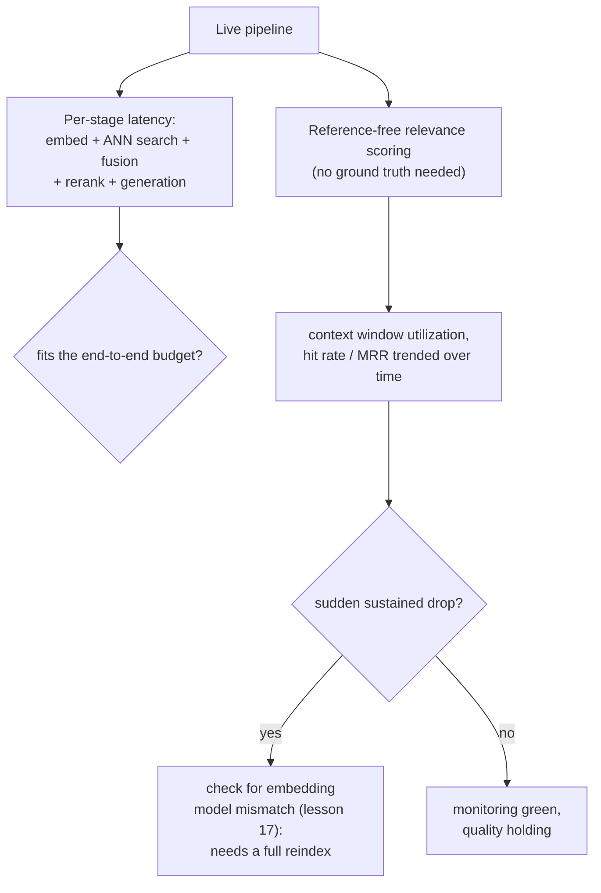

# Урок 19. Стоимость, задержка и мониторинг в продакшене

**Связь с целью курса:** Урок 9 измерял, окупает ли один этап, реранкинг, свою добавленную задержку для данной нагрузки. Этот урок распространяет ту же дисциплину на совокупные стоимость и задержку всего конвейера, а затем охватывает то, чего офлайн-измерение урока 9 не может: когда конвейер уже работает, обычный мониторинг инфраструктуры может оставаться зелёным, пока под ним тихо деградирует качество поиска.
**Первоисточник:** [Руководство: "RAG Observability: How Coralogix Helps You Trace Retrieval-to-Generation Quality", Coralogix, 2026](https://coralogix.com/guides/rag-observability/)
**Предварительные требования:** [Урок 9](0009-when-reranking-earns-its-cost.md), [Урок 17](0017-freshness.md)

## Разминка

1. ▢ Как команде решить, окупает ли реранкинг свою цену для её конкретной нагрузки?

Проверка

Измерить качество поиска и без реранкинга, и с ним на одном репрезентативном наборе запросов, отдельно измерить реальную добавленную задержку при используемом размере набора кандидатов и сверить оба с реальным бюджетом задержки и планкой качества нагрузки, вместо допущения, что реранкинг всегда или никогда не помогает.

2. ▢ Почему замена модели эмбеддингов требует полной переиндексации, а не инкрементального обновления?

Проверка

Каждый вектор, уже лежащий в индексе, получен в собственном векторном пространстве старой модели, а запрос, заэмбеддённый новой моделью, не имеет осмысленного отношения по расстоянию к этим старым векторам; весь корпус нужно заэмбеддить заново и построить индекс с нуля, поскольку верно смешать векторы двух моделей нельзя.

## Что нужно знать

### Бюджет всего конвейера это больше, чем цена любого одного этапа

Урок 9 измерял добавленную задержку реранкинга отдельно. Реальный запрос платит цену каждого этапа по очереди: ингестия произошла раньше и вне критического пути, но эмбеддинг запроса, ANN-поиск, гибридное слияние, реранкинг (если используется) и генерация, все добавляют свою задержку к одному живому запросу, и реальный бюджет конвейера это то, что остаётся после того, как каждый из этих этапов взял свою долю. Этап реранкинга, который в отдельности легко укладывается в бюджет в 5 секунд, всё равно может его взорвать, если предыдущие этапы или генерация после него уже потратили большую часть; вопрос о бюджете всегда нужно задавать о всей цепочке, а не по этапам в отдельности.

### Обычный мониторинг инфраструктуры может оставаться зелёным, пока ответ уже неверен

Формулировка самого первоисточника прямо говорит об этом разрыве: RAG-конвейер может вернуть быстрый, уверенный ответ, тихо пропустив документ, который должен был его закрепить, а традиционный мониторинг приложений, задержка, пропускная способность, доля ошибок, ничего об этом не скажет, поскольку в запросе на деле не выброшено ни одной ошибки. Конкретный случай делает это точным: **жёсткое усечение (hard truncation)** может отбросить верно найденный чанк, когда собранный промпт превышает контекстное окно модели (собственная забота урока 12 о бюджете), молча, без исключения где-либо; поиск сделал своё дело, чанк просто так и не дошёл до модели. Обычный мониторинг инфраструктуры сообщает об этом запросе как о полном успехе.

### Использование контекстного окна: метрика того, заслужили ли найденные токены своё место

**Использование контекстного окна (context window utilization)**, отношение числа чанков, фактически процитированных в сгенерированном ответе, к числу чанков, найденных и помещённых в промпт, даёт конкретный сигнал, которого не дают обычные метрики задержки и доли ошибок. Низкое использование означает, что токены (и деньги, потраченные на их поиск и обработку) расходуются на контекст, которым модель так и не воспользовалась; но мысль самого источника работает и в обратную сторону: стабильно *высокое* использование само по себе предупреждающий знак, поскольку может указывать на то, что критичный материал обрезается раньше, чем его успевают процитировать.

### Оценка без эталона это то, что продакшен-мониторинг использует вместо эталонных данных

Для вычисления recall@k и MRR из урока 10 нужен размеченный или синтетический набор запросов. У живого продакшен-трафика такой разметки для большинства запросов нет, поэтому продакшен-мониторинг опирается на **оценку без эталона (reference-free scoring)**, оценку релевантности каждого найденного чанка, выставляемую LLM-судьёй без необходимости знать правильный ответ и агрегируемую за временное окно как доля попаданий или средняя релевантность. Устойчивое падение этого агрегата это ровно тот сигнал, который никогда не появится на инфраструктурной панели, поскольку ничто в самом конвейере запроса не сбоило.

### Внезапное падение метрики поиска это то, как вы на самом деле заметили бы проблему смены модели из урока 17

Урок 17 установил, что замена модели эмбеддингов требует полной переиндексации, а не инкрементального исправления. Этот урок замыкает круг вопросом, как команда на самом деле заметила бы в продакшене, что это произошло или что частичная переиндексация оставила старые и новые векторы смешанными: внезапное, устойчивое падение MRR или доли попаданий, отслеживаемое во времени, это конкретный продакшен-сигнал, указывающий именно на несоответствие модели эмбеддингов, а не на обычное колебание качества, и он означает, что исправление это полная переиндексация из урока 17, а не очередной раунд настройки.

## Практика

1. ▢ Этап реранкинга, измеренный отдельно, стоит 150 мс, что с запасом укладывается в бюджет 5 секунд. Почему всё же может стоить проверить совокупную задержку всего конвейера, прежде чем решать, что это по карману?

Подсказка

Подумайте, что ещё происходит в том же запросе помимо самого шага реранкинга.

Проверка

Вопрос о бюджете касается всей цепочки, а не одного этапа в отдельности: эмбеддинг запроса, ANN-поиск, гибридное слияние и генерация все добавляют свою задержку к одному и тому же запросу, и если эти этапы уже расходуют большую часть бюджета, посильная по отдельности цена реранкинга всё равно может вытолкнуть итог за предел.

2. ▢ Чанк верно найден и высоко ранжирован, но собранный промпт превышает контекстное окно модели, и чанк обрезается до генерации. Проявляется ли это ошибкой в обычном мониторинге инфраструктуры?

Проверка

Нет. Жёсткое усечение отбрасывает чанк молча, без исключения где-либо; с точки зрения инфраструктуры запрос завершается успешно, хотя модель так и не увидела нужный ей чанк. Это ровно тот вид сбоя, о котором обычный мониторинг задержки и доли ошибок ничего не говорит.

3. ▢ Почему стабильно *высокое* использование контекстного окна считается предупреждающим знаком, а не просто хорошим?

Проверка

Очень высокое использование может указывать на то, что критичный материал обрезается до генерации, поскольку сильно использованное контекстное окно ближе к своему пределу; метрика, призванная ловить впустую потраченные токены, на противоположном краю может быть и ранним сигналом самой проблемы усечения.

4. ▢ У продакшен-трафика нет эталонной разметки для большинства запросов. Что оценка без эталона всё же позволяет измерить команде и почему recall@k и MRR из урока 10 нельзя вычислить так же в продакшене?

Проверка

Оценка без эталона использует LLM-судью, который оценивает релевантность каждого найденного чанка без необходимости знать правильный ответ, агрегируя её как долю попаданий или среднюю релевантность во времени. И recall@k, и MRR из урока 10 требуют знать, какой результат на самом деле был верным для данного запроса, а это даёт размеченный или синтетический набор запросов офлайн, но живой продакшен-трафик по большей части нет.

5. ▢ Какое утверждение верно описывает, как подход к мониторингу из этого урока связан с проблемой свежести из урока 17?

    - a) Мониторинг и переиндексация решают не связанные задачи без практической связи
    - b) Внезапное, устойчивое падение отслеживаемой метрики вроде MRR или доли попаданий это продакшен-сигнал, указывающий именно на несоответствие модели эмбеддингов и говорящий команде, что нужна полная переиндексация из урока 17, а не очередной раунд настройки
    - c) Оценка без эталона делает переиндексацию ненужной, поскольку может автоматически компенсировать устаревший индекс
    - d) Использование контекстного окна и несоответствие модели эмбеддингов это одна и та же проблема, измеренная двумя способами

Проверка

**b)** Это точная связь, которую этот урок проводит между мониторингом и более ранним материалом урока 17. (a) неверно: мониторинг как раз и позволяет команде заметить в продакшене, что сценарий переиндексации из урока 17 действительно наступил. (c) неверно: оценка без эталона лишь измеряет релевантность, она не исправляет несовместимое векторное пространство; настоящему несоответствию модели всё равно нужна полная переиндексация из урока 17. (d) неверно: использование контекстного окна касается усечения и расхода токенов, а это отдельная забота от несоответствия модели эмбеддингов, проявляющегося как падение метрики поиска.

## Практика в реальной работе

- [ ] Для RAG-конвейера, к которому у вас есть доступ, сложите типичную задержку каждого этапа (ингестию не считая, она вне критического пути) и проверьте, укладывается ли сумма в ваш реальный сквозной бюджет, а не только в любой один этап, измеренный отдельно.
- [ ] Проверьте, логирует ли ваш конвейер что-то вроде использования контекстного окна или у вас сейчас не было бы никакой возможности заметить, что чанк был молча обрезан.
- [ ] Завтра: прочитайте целиком раздел первоисточника о мониторинге состояния векторной базы данных и отметьте, какие конкретные метрики он рекомендует отслеживать во времени, чтобы поймать несоответствие модели эмбеддингов раньше, чем пользователи заметят ухудшение ответов.

## Что почитать дальше

- [Руководство: "RAG Observability: How Coralogix Helps You Trace Retrieval-to-Generation Quality", Coralogix, 2026](https://coralogix.com/guides/rag-observability/)
- [Научная статья: "RAGAS: Automated Evaluation of Retrieval Augmented Generation", Es et al., 2023](https://arxiv.org/abs/2309.15217)
- [Ресурсы](../RESOURCES.md)

---

Не доходит? Перечитайте первоисточник в начале: этот урок его сжимает, а при сжатии понимание как раз и теряется. Загляните в [глоссарий](../GLOSSARY.md), если какой-то термин показался скользким.

Если неясен сам урок, а не материал, это дефект: [откройте issue](https://github.com/TokenCemetery/teach/issues).
