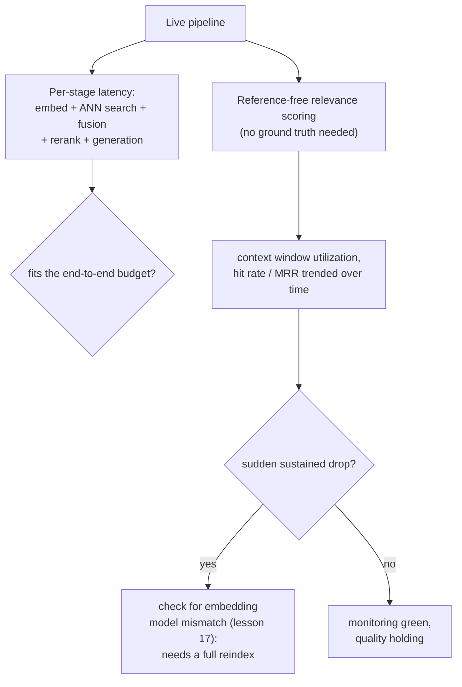

# 第 19 课：成本、延迟与生产监控

**使命关联:** 第 9 课度量了某一个阶段，也就是重排序，对给定的工作负载是否值得它增加的延迟。本课把同样的做法，扩展到整条流水线累计的成本和延迟，然后讲第 9 课的离线度量做不到的那一部分：流水线上线之后，普通的基础设施监控可能一直是绿色的，而检索质量却在它下面悄悄地退化。
**主要来源:** [指南：“RAG Observability: How Coralogix Helps You Trace Retrieval-to-Generation Quality”，Coralogix，2026](https://coralogix.com/guides/rag-observability/)
**前置知识:** [第 9 课](0009-when-reranking-earns-its-cost.md)、[第 17 课](0017-freshness.md)

## 热身

1. ▢ 团队应该如何判断，重排序对他们的具体工作负载是否值回成本？

检查

在同一个有代表性的查询集上，分别度量不加重排序和加上重排序时的检索质量，另外度量在所用候选集规模下实际增加的延迟，并把两者对照工作负载实际的延迟预算和质量线来比较，而不是假定重排序总是有用或从不有用。

2. ▢ 为什么更换嵌入模型需要完整地重建索引，而不是增量更新？

检查

索引中已有的每个向量，都是由旧模型自己的向量空间产生的，而用新模型嵌入的查询，与这些旧向量没有任何有意义的距离关系；整个语料库都必须重新嵌入，索引也要从头重建，因为没有办法正确地混用两个模型的向量。

## 要点

### 整条流水线的预算，不只是任何一个阶段的成本

第 9 课孤立地度量了重排序增加的延迟。真实的请求要依次付出每个阶段的成本：摄取发生在更早之前，不在关键路径上，但查询嵌入、ANN 搜索、混合融合、重排序（如果用的话）以及生成，都会给同一个实时请求增加各自的延迟，流水线真正的预算，是在这每个阶段各自拿走自己那一份之后所剩下的部分。一个孤立来看轻松放得进 5 秒预算的重排序阶段，如果它之前的阶段，或它之后的生成步骤，已经用掉了大部分预算，仍然可能让预算被突破；预算问题永远要针对整条链来问，而不是孤立地逐个阶段来问。

### 普通的基础设施监控可以一直是绿色的，而答案其实已经错了

主要来源自己的表述，对这个缺口说得很直接：RAG 流水线可以返回一个快速而自信的答案，同时悄悄地漏掉本该作为依据的那份文档，而传统的应用监控，包括延迟、吞吐量、错误率，对此无话可说，因为请求中没有任何环节抛出了错误。一个具体的例子可以让这一点更精确：当组装好的提示词超出模型的上下文窗口时，**硬截断**可能把一个已被正确检索到的文本块丢掉（这正是第 12 课自己的预算问题），而且是悄无声息的，任何地方都没有抛出异常；检索器完成了它的工作，文本块只是从未到达模型。普通的基础设施监控会把这个请求报告为完全成功。

### 上下文窗口利用率：衡量检索到的 token 是否配得上它们位置的指标

**上下文窗口利用率**，即生成的答案中实际引用的文本块数量，与被检索出并放入提示词的文本块数量之比，给出了一个普通的延迟和错误率指标给不出的具体信号。利用率低，说明 token（以及为检索和处理它们所花的钱）花在了模型从未用到的上下文上；但来源自己的观点在另一面也成立：持续 *很高* 的利用率本身就是一个预警信号，因为它可能表明关键材料在还没有机会被引用之前，就已经被截断出去了。

### 生产监控用无参照评分，来代替真值

第 10 课的 recall@k 和 MRR，需要带标注的或合成的查询集才能计算。线上的生产流量，对大多数查询并没有这样的标注，所以生产监控转而依靠**无参照评分**，即由 LLM 对每个检索出的文本块给出相关性分数，不需要已知的正确答案，并在一个时间窗口内汇总为命中率或平均相关性。这个汇总值的持续下降，恰恰是那种永远不会出现在基础设施仪表盘上的信号，因为请求流水线本身没有任何环节失败。

### 检索指标的突然下降，就是你实际察觉第 17 课的模型变更问题发生的方式

第 17 课确立了，更换嵌入模型需要完整的重建索引，而不是增量修复。本课把这个闭环补上，说明团队在生产中实际上如何察觉这件事已经发生，或者一次部分的重建索引让新旧向量混在了一起：MRR 或命中率随时间追踪时出现突然的、持续的下降，就是专门指向嵌入模型不匹配、而不是普通质量波动的具体生产信号，它意味着修复办法是第 17 课的完整重建索引，而不是再来一轮调优。

## 练习

1. ▢ 一个重排序阶段孤立度量的成本是 150 毫秒，远在 5 秒的预算之内。为什么在断定它负担得起之前，仍然值得检查整条流水线累计的延迟？

提示

想一想，同一个请求中，除了重排序步骤本身，还发生了什么。

检查

预算问题针对的是整条链，而不是孤立的某一个阶段：查询嵌入、ANN 搜索、混合融合和生成，都会给同一个请求增加各自的延迟，如果这些阶段已经用掉了大部分预算，那么单独看负担得起的重排序成本，仍然可能把总量推过上限。

2. ▢ 某个文本块被正确检索到并排名靠前，但组装好的提示词超出了模型的上下文窗口，该文本块在生成之前被截断了。这在普通的基础设施监控中会表现为错误吗？

检查

不会。硬截断悄无声息地丢掉了文本块，任何地方都没有抛出异常；从基础设施的角度看，请求成功完成了，尽管模型实际上从未看到它所需要的那个文本块。这正是普通的延迟和错误率监控对其无话可说的那类失败。

3. ▢ 为什么持续 *很高* 的上下文窗口利用率被视为预警信号，而不是单纯的好事？

检查

很高的利用率可能表明关键材料在生成之前就被截断了，因为利用得很满的上下文窗口，离它的上限更近；一个本来用于抓住浪费的 token 的指标，在相反的极端，也可能成为截断问题本身的早期信号。

4. ▢ 生产流量对大多数查询没有真值标注。无参照评分让团队仍然能够度量什么？为什么第 10 课的 recall@k 和 MRR 在生产中不能用同样的方式计算？

检查

无参照评分用 LLM 评判者给每个检索出的文本块的相关性打分，不需要已知的正确答案，并在一段时间内汇总为命中率或平均相关性。第 10 课的 recall@k 和 MRR，都需要知道对某个给定的查询来说哪个结果才是正确的，这在离线时由带标注的或合成的查询集提供，而线上的生产流量大多没有。

5. ▢ 下列哪项说法正确地描述了本课的监控方法与第 17 课的新鲜度问题之间的关系？

    - a) 监控和重建索引处理的是互不相关的问题，没有实际联系
    - b) 像 MRR 或命中率这样的追踪指标出现突然的、持续的下降，是专门指向嵌入模型不匹配的生产信号，告诉团队需要的是第 17 课的完整重建索引，而不是再来一轮调优
    - c) 无参照评分让重建索引变得不必要，因为它能自动纠正过时的索引
    - d) 上下文窗口利用率和嵌入模型不匹配是同一个底层问题，只是用两种不同的方式来度量

检查

**b)** 这正是本课在监控与第 17 课之前内容之间建立的精确联系。（a）错误：监控恰恰是让团队能在生产中察觉第 17 课的重建索引场景确实已经发生的东西。（c）错误：无参照评分只度量相关性，并不能修复不兼容的向量空间；真正的模型不匹配仍然需要第 17 课的完整重建索引。（d）错误：上下文窗口利用率关乎截断和 token 开销，与以检索指标下降表现出来的嵌入模型不匹配，是不同的问题。

## 实战练习

- [ ] 针对你能访问的某条 RAG 流水线，把各阶段通常的延迟加起来（摄取除外，因为它不在关键路径上），并检查总量是否放得进你实际的端到端预算，而不只是任何单独度量的某一个阶段。
- [ ] 检查你自己的流水线是否记录了类似上下文窗口利用率的东西，或者目前其实没有办法察觉某个文本块被悄悄地截断了。
- [ ] 明天：通读主要来源中关于向量数据库健康监控的部分，并记下它建议追踪哪些具体指标，以便在用户察觉答案变差之前，就抓住嵌入模型不匹配的问题。

## 延伸阅读

- [指南：“RAG Observability: How Coralogix Helps You Trace Retrieval-to-Generation Quality”，Coralogix，2026](https://coralogix.com/guides/rag-observability/)
- [论文：“RAGAS: Automated Evaluation of Retrieval Augmented Generation”，Es 等，2023](https://arxiv.org/abs/2309.15217)
- [资源](../RESOURCES.md)

---

没学明白？请重读顶部的主要来源，因为本课是对它的压缩，而理解正是在压缩中流失的。如果有哪个术语觉得含糊，可以查看[术语表](../GLOSSARY.md)。

如果问题出在课程本身，而不是学习材料，那就是一个缺陷：[提交 issue](https://github.com/TokenCemetery/teach/issues)。
