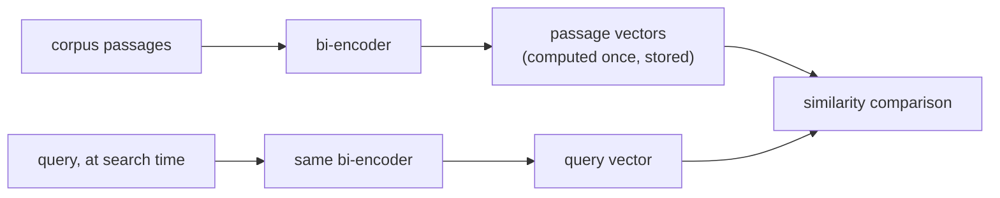

# Chunking y embeddings

Las dos primeras decisiones del pipeline, y lo que cuesta realmente cada una. Pensado para consultar al diseñar un pipeline de recuperación.

## Por qué hacer chunking

Un pasaje largo y de temas mezclados genera un único vector desdibujado, un promedio de todo lo que toca, que se recupera mal para una consulta sobre cualquier cosa concreta de su interior (y puede que ni siquiera quepa en la ventana de contexto del modelo de embeddings). El tamaño del chunk enfrenta dos modos de fallo:

| Chunks demasiado grandes | Chunks demasiado pequeños |
|---|---|
| Mezcla varios temas en un único vector promediado; la recuperación devuelve texto circundante irrelevante | Pierde el contexto circundante que hace a un chunk interpretable; una respuesta de varias piezas puede no ser respondible desde ningún chunk por separado |

No existe un tamaño correcto universal: depende del corpus y del patrón de consultas.

## Estrategias de chunking

| Estrategia | Cómo | Compromiso |
|---|---|---|
| Tamaño fijo | Dividir cada N tokens/caracteres, normalmente con solapamiento | Simple y predecible, pero ciega a la estructura: puede partir por la mitad una oración o una tabla |
| Recursiva / consciente de la estructura | Dividir por límites naturales (secciones, luego párrafos, luego oraciones) y recurrir al tamaño fijo solo cuando un fragmento sigue siendo demasiado grande | Respeta la organización propia del documento |
| Semántica | Generar el embedding de oraciones consecutivas y dividir donde la similitud entre vecinas cae bruscamente | Apunta directamente al modo de fallo real (temas mezclados); más costosa de calcular |
| Consciente de la estructura del documento | Tratar como atómicas las unidades estructurales (la sección de un encabezado, una tabla, un bloque de código) | Nunca destruye el significado de una unidad estructural al partirla |

El **solapamiento** entre chunks consecutivos cambia algo de almacenamiento y de cómputo de embeddings redundantes por no fragmentar un dato o una oración que cae en el límite de un chunk.

## Bi-encoders: un embedding una vez, comparar de forma barata

Un **bi-encoder** asigna un texto a un vector de tamaño fijo de forma independiente de cualquier otro texto; una consulta y un pasaje reciben su embedding por separado, no de forma conjunta. Cada chunk del corpus recibe su embedding una sola vez, de antemano, y se almacena; en el momento de la búsqueda solo hace falta el embedding de la consulta, que se compara de forma barata con los vectores precalculados. Un **cross-encoder** (que ejecuta el modelo de forma conjunta sobre cada par consulta-pasaje) no escala a buscar en un corpus grande en el momento de la consulta.



<a id="similarity-metrics-must-match-training"></a>

## Las métricas de similitud deben coincidir con el entrenamiento

| Métrica | Qué mide | Nota |
|---|---|---|
| Similitud coseno | Ángulo entre vectores, ignorando la magnitud | |
| Producto punto | Similitud coseno sin normalizar por la magnitud | Premia a los vectores de mayor magnitud cuando no están normalizados; ranking idéntico al del coseno solo cuando ambos vectores tienen longitud unitaria |
| Distancia euclidiana | Distancia en línea recta | |

La métrica no es una elección libre: un modelo de embeddings se entrena con una función de similitud concreta en su pérdida (los modelos al estilo Sentence-BERT suelen entrenarse para que la similitud coseno, o un producto punto normalizado, refleje la cercanía semántica). Usar una métrica distinta de aquella para la que se entrenó puede ordenar de formas que el modelo nunca se ajustó para producir, no solo "algo peor".

## Elegir un modelo: hacer coincidir el objetivo de entrenamiento con la tarea

La recuperación suele ser **búsqueda asimétrica** (una consulta corta contra pasajes largos), una configuración de entrenamiento distinta de la **búsqueda simétrica** (comparar dos textos de longitud y tipo similares). Un modelo que lidera un benchmark general (p. ej. MTEB) puede rendir igualmente por debajo de un modelo ajustado al dominio o a la tarea en un corpus especializado (legal, médico) del que un modelo entrenado con la web general vio poco. La pregunta no es "qué modelo puntúa más alto en general" sino "qué modelo se entrenó con algo cercano a este corpus y a esta forma de consulta".

## La dimensionalidad es un costo, no un botón de calidad gratuito

El almacenamiento, la memoria del índice y el cálculo de distancia por candidato crecen de forma lineal con la dimensión:

```text
bytes per vector = dimensions × 4   (float32)
```

| Dimensiones | Bytes/vector | 1M de chunks |
|---|---|---|
| 256 | 1,024 (~1 KB) | ~1 GB |
| 1536 | 6,144 (~6 KB) | ~6 GB |

## Matryoshka Representation Learning (MRL): el truncamiento como característica diseñada

Por lo común, truncar un vector de embedding estándar no es seguro: nada ordena sus dimensiones por importancia, así que recortarlo descarta información de forma impredecible. **MRL** entrena un modelo para que los prefijos del vector completo (p. ej. las primeras 256 dimensiones de un embedding de 1536 dimensiones) sean a su vez embeddings utilizables y con significado, anidados como una matrioska. Esto permite truncar después un modelo entrenado con MRL con un costo de calidad acotado y predecible, sin reentrenar ni volver a generar embeddings. Esto solo vale para modelos realmente entrenados así.

## Decidir la dimensionalidad: medir, no adivinar

La dimensionalidad correcta es la más pequeña que aún cumple el listón de calidad que necesita la carga de trabajo, medida (de forma más directa con recall@k) en cada dimensionalidad candidata sobre el corpus y el patrón de consultas reales, no supuesta a partir del mayor tamaño disponible.

## Relacionado

- [Lección 1](../lessons/0001-chunking.md), [Lección 2](../lessons/0002-embedding-models-and-similarity.md), [Lección 3](../lessons/0003-embedding-dimensionality.md)
- [Búsqueda vectorial e indexación](vector-search-and-indexing.md): qué ocurre con estos vectores una vez almacenados
