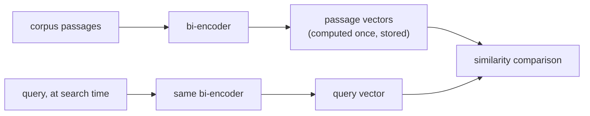

# Chunking et embeddings

Les deux premières décisions du pipeline, et ce que chacune coûte réellement. Conçu pour la consultation lors de la conception d'un pipeline de récupération.

## Pourquoi découper en chunks

Un long passage thématiquement mélangé produit un seul vecteur flou, une moyenne de tout ce qu'il touche, qui se récupère mal pour une requête portant sur un point précis qu'il contient (et il peut même ne pas tenir dans la fenêtre de contexte du modèle d'embedding). La taille des chunks fait arbitrer entre deux modes de défaillance :

| Chunks trop grands | Chunks trop petits |
|---|---|
| Mélange plusieurs sujets de façon floue dans un seul vecteur moyen ; la récupération renvoie du texte environnant non pertinent | Perd le contexte environnant qui rend un chunk interprétable ; une réponse en plusieurs morceaux peut ne pas trouver de réponse dans un seul chunk |

Il n'existe pas de taille universellement bonne : elle dépend du corpus et du type de requêtes.

## Stratégies de chunking

| Stratégie | Fonctionnement | Compromis |
|---|---|---|
| Taille fixe | Couper tous les N tokens/caractères, généralement avec chevauchement | Simple et prévisible, mais aveugle à la structure : peut couper une phrase ou un tableau en deux |
| Récursif / tenant compte de la structure | Couper aux frontières naturelles (sections, puis paragraphes, puis phrases), en ne se rabattant sur la taille fixe que lorsqu'un morceau reste trop grand | Respecte l'organisation propre du document |
| Sémantique | Calculer l'embedding de phrases consécutives, couper là où la similarité entre voisines chute nettement | Vise directement le mode de défaillance réel (sujets mélangés) ; plus coûteux à calculer |
| Tenant compte de la structure du document | Traiter comme atomiques les unités structurelles (la section d'un titre, un tableau, un bloc de code) | Ne détruit jamais le sens d'une unité structurelle en la coupant |

Le **chevauchement** entre chunks consécutifs échange un peu de stockage et de calcul d'embedding redondants contre l'absence de fragmentation d'un fait ou d'une phrase à cheval sur une frontière de chunk.

## Bi-encoders : un embedding une fois, des comparaisons peu coûteuses

Un **bi-encoder** associe un texte à un vecteur de taille fixe indépendamment de tout autre texte ; une requête et un passage ont leur embedding calculé séparément, et non conjointement. Chaque chunk du corpus voit son embedding calculé une seule fois, à l'avance, et stocké ; au moment de la recherche, seule la requête demande un embedding, comparé à peu de frais aux vecteurs précalculés. Un **cross-encoder** (qui exécute le modèle conjointement sur chaque paire requête-passage) ne passe pas à l'échelle pour chercher dans un grand corpus au moment de la requête.



<a id="similarity-metrics-must-match-training"></a>

## Les métriques de similarité doivent correspondre à l'entraînement

| Métrique | Ce qu'elle mesure | Remarque |
|---|---|---|
| Similarité cosinus | Angle entre les vecteurs, sans tenir compte de la norme | |
| Produit scalaire | Similarité cosinus sans normalisation par la norme | Récompense les vecteurs de plus grande norme quand ils ne sont pas normalisés ; classement identique à celui du cosinus seulement quand les deux vecteurs sont de longueur unité |
| Distance euclidienne | Distance en ligne droite | |

La métrique n'est pas un choix libre : un modèle d'embedding est entraîné avec une fonction de similarité précise dans sa fonction de perte (les modèles de type Sentence-BERT sont typiquement entraînés pour que la similarité cosinus, ou un produit scalaire normalisé, reflète la proximité sémantique). Utiliser une autre métrique que celle pour laquelle le modèle a été entraîné peut classer d'une façon que le modèle n'a jamais été réglé pour produire, et pas seulement « un peu moins bien ».

## Choisir un modèle : faire correspondre l'objectif d'entraînement à la tâche

La récupération est généralement une **recherche asymétrique** (une requête courte face à de longs passages), une configuration d'entraînement différente de la **recherche symétrique** (comparer deux textes de longueur et de nature similaires). Un modèle qui domine un benchmark général (par exemple MTEB) peut quand même être moins bon qu'un modèle adapté au domaine ou à la tâche sur un corpus spécialisé (juridique, médical) dont un modèle généraliste entraîné sur le web a vu peu d'exemples. La question n'est pas « quel modèle obtient le meilleur score global » mais « quel modèle a été entraîné sur quelque chose de proche de ce corpus et de cette forme de requête ».

## La dimensionnalité est un coût, pas un réglage de qualité gratuit

Le stockage, la mémoire de l'index et le calcul de distance par candidat croissent tous linéairement avec la dimension :

```text
bytes per vector = dimensions × 4   (float32)
```

| Dimensions | Octets/vecteur | 1 M de chunks |
|---|---|---|
| 256 | 1 024 (~1 Ko) | ~1 Go |
| 1536 | 6 144 (~6 Ko) | ~6 Go |

## Matryoshka Representation Learning (MRL) : la troncature comme fonctionnalité conçue

Ordinairement, tronquer un vecteur d'embedding standard n'est pas sûr : rien n'ordonne ses dimensions par importance, donc le couper écarte de l'information de façon imprévisible. **MRL** entraîne un modèle de sorte que les préfixes du vecteur complet (par exemple les 256 premières dimensions d'un embedding de 1536 dimensions) soient eux-mêmes des embeddings utilisables et significatifs, emboîtés comme des poupées russes. Cela permet de tronquer après coup un modèle entraîné avec MRL avec un coût de qualité borné et prévisible, sans réentraînement ni nouveau calcul des embeddings. Cela ne vaut que pour les modèles réellement entraînés ainsi.

## Décider de la dimensionnalité : mesurer, ne pas deviner

La bonne dimensionnalité est la plus petite qui atteint encore le seuil de qualité qu'exige la charge de travail, mesurée (le plus directement via recall@k) à chaque dimensionnalité candidate sur le corpus réel et le type de requêtes, et non supposée à partir de la plus grande taille disponible.

## Voir aussi

- [Leçon 1](../lessons/0001-chunking.md), [Leçon 2](../lessons/0002-embedding-models-and-similarity.md), [Leçon 3](../lessons/0003-embedding-dimensionality.md)
- [Recherche vectorielle et indexation](vector-search-and-indexing.md) : ce qui arrive à ces vecteurs une fois stockés
