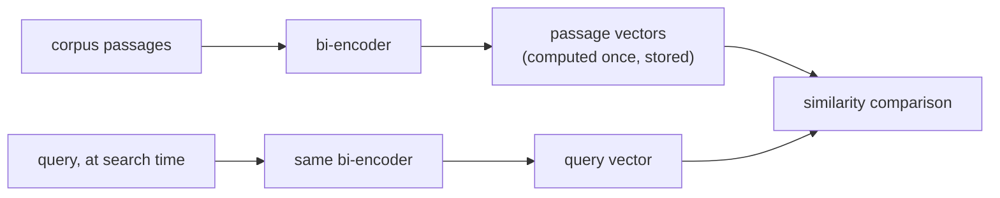

# Chunking और Embeddings

पहले दो pipeline फ़ैसले, और हर एक की असल क़ीमत क्या है। Retrieval pipeline डिज़ाइन करते समय खोजने के लिए बनाया गया।

## Chunk क्यों किया ही जाए

लंबा, कई विषयों वाला passage एक धुँधले vector के रूप में embed होता है, उन सबका औसत जिन्हें वह छूता है, जो उसके भीतर की किसी एक ख़ास चीज़ के बारे में query के लिए ख़राब retrieve होता है (और हो सकता है कि embedding model की context window में समाए भी नहीं)। Chunk का आकार दो विफलताओं को एक-दूसरे के सामने तौलता है:

| बहुत बड़े chunks | बहुत छोटे chunks |
|---|---|
| कई विषयों को एक औसत vector में धुँधला कर देता है; retrieval आसपास का अप्रासंगिक text भी लौटाता है | वह आसपास का context खो देता है जो chunk को समझने लायक बनाता है; कई टुकड़ों में फैले उत्तर का जवाब किसी एक chunk से नहीं मिल सकता |

कोई सार्वभौमिक सही आकार नहीं है: यह corpus और query पैटर्न पर निर्भर करता है।

## Chunking रणनीतियाँ

| रणनीति | कैसे | Trade-off |
|---|---|---|
| Fixed-size | हर N tokens/characters पर बाँटें, आम तौर पर overlap के साथ | सरल और अनुमान लगाने लायक, पर संरचना से अनजान: किसी वाक्य या table को बीच से काट सकता है |
| Recursive / structure-aware | स्वाभाविक सीमाओं पर बाँटें (sections, फिर paragraphs, फिर sentences), fixed-size पर तभी लौटें जब टुकड़ा अब भी बहुत बड़ा हो | Document के अपने संगठन का सम्मान करता है |
| Semantic | लगातार sentences को embed करें, वहाँ बाँटें जहाँ पड़ोसी similarity तेज़ी से गिरे | असली विफलता (मिले-जुले विषय) को सीधे निशाना बनाता है; गणना में ज़्यादा महँगा |
| Document-structure-aware | संरचनात्मक इकाइयों (heading का section, table, code block) को अविभाज्य मानें | बाँटकर किसी संरचनात्मक इकाई का अर्थ कभी नष्ट नहीं करता |

लगातार chunks के बीच **Overlap** कुछ फ़ालतू storage और embedding गणना का सौदा इसके बदले करता है कि chunk की सीमा के आर-पार पड़ने वाला तथ्य या वाक्य टूटे नहीं।

## Bi-encoders: एक बार embed करें, सस्ते में तुलना करें

**Bi-encoder** text को किसी और text से स्वतंत्र रूप से तय आकार के vector में map करता है; query और passage अलग-अलग embed होते हैं, साथ मिलाकर नहीं। Corpus का हर chunk पहले से, एक बार embed होकर store होता है; search के समय सिर्फ़ query को embed करना पड़ता है, जिसकी तुलना पहले से निकले vectors से सस्ते में होती है। **Cross-encoder** (हर query-passage जोड़ी पर model को साथ चलाना) query के समय बड़े corpus में खोजने तक scale नहीं करता।



<a id="similarity-metrics-must-match-training"></a>

## Similarity metrics को training से मेल खाना चाहिए

| Metric | क्या मापती है | टिप्पणी |
|---|---|---|
| Cosine similarity | Vectors के बीच का कोण, magnitude को अनदेखा करके | |
| Dot product | Cosine similarity, बिना magnitude से normalize किए | Normalize न हो तो बड़े-magnitude वाले vectors को इनाम देता है; cosine जैसी ही ranking सिर्फ़ तब जब दोनों vectors unit-length हों |
| Euclidean distance | सीधी दूरी | |

Metric खुला चुनाव नहीं है: embedding model अपने loss में एक ख़ास similarity function के साथ train होता है (Sentence-BERT जैसे models आम तौर पर इस तरह train होते हैं कि cosine similarity, या normalized dot product, semantic निकटता को दर्शाए)। जिस metric के लिए train हुआ उससे अलग metric इस्तेमाल करना ऐसी ranking दे सकता है जिसे बनाने के लिए model को कभी tune ही नहीं किया गया, सिर्फ़ "थोड़ा कम अच्छा" नहीं।

## Model चुनना: training objective को task से मिलाएँ

Retrieval आम तौर पर **asymmetric search** होता है (लंबे passages के विरुद्ध छोटी query), जो **symmetric search** (बराबर लंबाई और एक-सी प्रकृति के दो texts की तुलना) से अलग training setup है। जो model सामान्य benchmark (जैसे MTEB) में अव्वल है, वह किसी विशेष corpus (कानूनी, चिकित्सा) पर domain- या task-मेल वाले model से फिर भी कमज़ोर पड़ सकता है, जिसे general web पर train हुए model ने कम देखा हो। सवाल यह नहीं कि "कौन-सा model कुल मिलाकर सबसे ऊँचा score करता है" बल्कि यह कि "कौन-सा model ऐसी चीज़ पर train हुआ जो इस corpus और इस query के रूप के क़रीब है।"

## Dimensionality एक लागत है, मुफ़्त में मिलने वाला गुणवत्ता का knob नहीं

Storage, index memory और हर candidate की distance गणना, सब dimension के साथ रैखिक रूप से बढ़ते हैं:

```text
bytes per vector = dimensions × 4   (float32)
```

| Dimensions | Bytes/vector | 10 लाख chunks |
|---|---|---|
| 256 | 1,024 (~1 KB) | ~1 GB |
| 1536 | 6,144 (~6 KB) | ~6 GB |

## Matryoshka Representation Learning (MRL): truncation एक डिज़ाइन की हुई सुविधा के रूप में

आम तौर पर standard embedding vector को truncate करना असुरक्षित है: कुछ भी उसकी dimensions को अहमियत के क्रम में नहीं रखता, इसलिए उसे काटना जानकारी को अनिश्चित ढंग से फेंकता है। **MRL** model को इस तरह train करता है कि पूरे vector के prefixes (जैसे 1536-dimension embedding की पहली 256 dimensions) ख़ुद इस्तेमाल लायक, अर्थपूर्ण embeddings हों, matryoshka गुड़िया की तरह नीड़ित। इससे MRL से train हुए model को बाद में सीमित, अनुमान लगाने लायक गुणवत्ता लागत पर truncate किया जा सकता है, बिना retrain या दोबारा embed किए। यह सिर्फ़ उन्हीं models पर लागू है जो असल में इस तरह train हुए।

## Dimensionality तय करना: मापें, अंदाज़ा न लगाएँ

सही dimensionality वह सबसे छोटी है जो फिर भी workload की ज़रूरी गुणवत्ता की कसौटी पर खरी उतरे, जिसे हर candidate dimensionality पर असली corpus और query पैटर्न पर मापा जाए (सबसे सीधे recall@k से), उपलब्ध सबसे बड़े आकार से मान न लिया जाए।

## संबंधित

- [पाठ 1](../lessons/0001-chunking.md), [पाठ 2](../lessons/0002-embedding-models-and-similarity.md), [पाठ 3](../lessons/0003-embedding-dimensionality.md)
- [Vector Search और Indexing](vector-search-and-indexing.md): store होने के बाद इन vectors का क्या होता है
