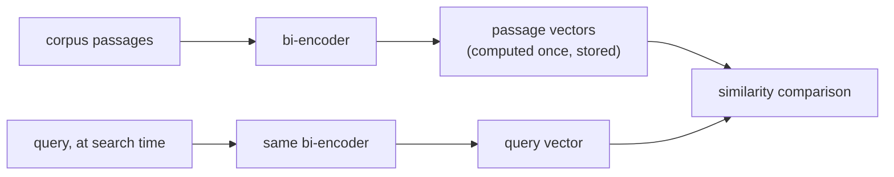

# Chunking e Embeddings

As duas primeiras decisões do pipeline, e o que cada uma de fato custa. Feito para consulta ao projetar um pipeline de recuperação.

## Por que fazer chunking

Uma passagem longa e de assuntos misturados gera um único vetor borrado, uma média de tudo o que ela toca, e isso recupera mal para uma consulta sobre qualquer coisa específica dentro dela (e pode nem caber na janela de contexto do modelo de embedding). O tamanho do chunk troca dois modos de falha:

| Chunks grandes demais | Chunks pequenos demais |
|---|---|
| Borra vários assuntos em um único vetor médio; a recuperação devolve texto ao redor irrelevante | Perde o contexto ao redor que torna um chunk interpretável; uma resposta de várias partes pode não ser respondível a partir de nenhum chunk isolado |

Não existe um tamanho universalmente certo: ele depende do corpus e do padrão de consultas.

## Estratégias de chunking

| Estratégia | Como | Trade-off |
|---|---|---|
| Tamanho fixo | Divide a cada N tokens/caracteres, geralmente com sobreposição | Simples e previsível, mas cega à estrutura: pode partir uma frase ou uma tabela ao meio |
| Recursiva / ciente da estrutura | Divide em fronteiras naturais (seções, depois parágrafos, depois frases), recorrendo ao tamanho fixo apenas quando um pedaço ainda é grande demais | Respeita a organização do próprio documento |
| Semântica | Gera o embedding de frases consecutivas e divide onde a similaridade entre vizinhas cai bruscamente | Ataca diretamente o modo de falha real (assuntos misturados); mais cara de calcular |
| Ciente da estrutura do documento | Trata unidades estruturais (a seção de um título, uma tabela, um bloco de código) como atômicas | Nunca destrói o significado de uma unidade estrutural ao dividi-la |

A **sobreposição** entre chunks consecutivos troca um pouco de armazenamento e de cálculo de embedding redundantes por não fragmentar um fato ou uma frase que atravessa a fronteira entre chunks.

## Bi-encoders: gere o embedding uma vez, compare barato

Um **bi-encoder** mapeia texto para um vetor de tamanho fixo independentemente de qualquer outro texto; uma consulta e uma passagem têm seus embeddings gerados separadamente, não em conjunto. Cada chunk do corpus tem o embedding gerado uma única vez, com antecedência, e é armazenado; na hora da busca só a consulta precisa de embedding, comparado de forma barata com os vetores pré-calculados. Um **cross-encoder** (que roda o modelo em conjunto sobre cada par consulta-passagem) não escala para buscar em um corpus grande no momento da consulta.



<a id="similarity-metrics-must-match-training"></a>

## A métrica de similaridade precisa corresponder ao treinamento

| Métrica | O que mede | Observação |
|---|---|---|
| Similaridade de cosseno | Ângulo entre vetores, ignorando a magnitude | |
| Produto escalar | Similaridade de cosseno sem normalizar pela magnitude | Recompensa vetores de maior magnitude quando não normalizado; ranking idêntico ao do cosseno apenas quando ambos os vetores têm comprimento unitário |
| Distância euclidiana | Distância em linha reta | |

A métrica não é uma escolha livre: um modelo de embedding é treinado com uma função de similaridade específica em sua loss (modelos no estilo Sentence-BERT costumam ser treinados para que a similaridade de cosseno, ou um produto escalar normalizado, reflita a proximidade semântica). Usar uma métrica diferente da usada no treinamento pode ranquear de maneiras que o modelo nunca foi ajustado para produzir, e não apenas "um pouco pior".

## Escolhendo um modelo: case o objetivo de treinamento com a tarefa

A recuperação costuma ser uma **busca assimétrica** (uma consulta curta contra passagens longas), uma configuração de treinamento diferente da **busca simétrica** (comparar dois textos de tamanho e tipo parecidos). Um modelo no topo de um benchmark geral (por exemplo, o MTEB) ainda pode ter desempenho inferior ao de um modelo adequado ao domínio ou à tarefa em um corpus especializado (jurídico, médico) que um modelo geral treinado na web viu pouco. A pergunta não é "qual modelo pontua mais no geral", e sim "qual modelo foi treinado em algo próximo deste corpus e deste formato de consulta".

## Dimensionalidade é um custo, não um botão gratuito de qualidade

Armazenamento, memória do índice e cálculo de distância por candidato escalam linearmente com a dimensão:

```text
bytes per vector = dimensions × 4   (float32)
```

| Dimensões | Bytes/vetor | 1M de chunks |
|---|---|---|
| 256 | 1,024 (~1 KB) | ~1 GB |
| 1536 | 6,144 (~6 KB) | ~6 GB |

## Matryoshka Representation Learning (MRL): o truncamento como recurso projetado

Normalmente, truncar um vetor de embedding padrão não é seguro: nada ordena suas dimensões por importância, então cortá-lo descarta informação de forma imprevisível. O **MRL** treina um modelo para que prefixos do vetor completo (por exemplo, as primeiras 256 dimensões de um embedding de 1536 dimensões) sejam, eles mesmos, embeddings utilizáveis e significativos, aninhados como uma boneca matryoshka. Isso permite truncar depois, em um modelo treinado com MRL, com um custo de qualidade limitado e previsível, sem retreinamento nem nova geração de embeddings. Isso só vale para modelos de fato treinados dessa maneira.

## Decidindo a dimensionalidade: meça, não chute

A dimensionalidade certa é a menor que ainda atinge o nível de qualidade que a carga de trabalho exige, medida (da forma mais direta, via recall@k) em cada dimensionalidade candidata sobre o corpus e o padrão de consultas reais, e não presumida a partir do maior tamanho disponível.

## Relacionado

- [Lição 1](../lessons/0001-chunking.md), [Lição 2](../lessons/0002-embedding-models-and-similarity.md), [Lição 3](../lessons/0003-embedding-dimensionality.md)
- [Busca Vetorial e Indexação](vector-search-and-indexing.md): o que acontece com esses vetores depois de armazenados
