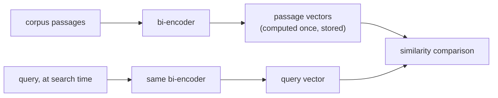

# Чанкинг и эмбеддинги

Первые два решения конвейера и то, чего каждое на самом деле стоит. Для быстрого поиска при проектировании конвейера поиска.

## Зачем вообще резать на чанки

Длинный, тематически смешанный фрагмент эмбеддится в один размытый вектор, среднее всего, чего он касается, который плохо находится по запросу о чём-то одном конкретном внутри (и может не поместиться в контекстное окно модели эмбеддингов). Размер чанка меняет один вид сбоя на другой:

| Слишком большие чанки | Слишком маленькие чанки |
|---|---|
| Смешивает несколько тем в один усреднённый вектор; поиск возвращает нерелевантный окружающий текст | Теряет окружающий контекст, делающий чанк понятным; ответ из нескольких фрагментов может не получиться дать из одного чанка |

Универсально верного размера нет: он зависит от корпуса и шаблона запросов.

## Стратегии чанкинга

| Стратегия | Как | Компромисс |
|---|---|---|
| Фиксированный размер | Резать каждые N токенов или символов, обычно с перекрытием | Просто и предсказуемо, но слепо к структуре: может разрезать пополам предложение или таблицу |
| Рекурсивная / с учётом структуры | Резать по естественным границам (разделы, затем абзацы, затем предложения), переходя к фиксированному размеру, только если фрагмент всё ещё слишком велик | Уважает собственную организацию документа |
| Семантическая | Эмбеддить подряд идущие предложения, резать там, где сходство соседей резко падает | Бьёт по настоящему виду сбоя (смешанные темы) напрямую; дороже в вычислении |
| С учётом структуры документа | Считать структурные единицы (раздел под заголовком, таблицу, блок кода) неделимыми | Никогда не разрушает смысл структурной единицы разрезанием |

**Перекрытие** соседних чанков меняет некоторое избыточное хранение и вычисление эмбеддингов на то, что факт или предложение на границе чанков не разрывается.

## Би-энкодеры: эмбеддить один раз, сравнивать дёшево

**Би-энкодер** отображает текст в вектор фиксированного размера независимо от любого другого текста; запрос и пассаж эмбеддятся по отдельности, а не совместно. Каждый чанк корпуса эмбеддится один раз, заранее, и сохраняется; во время поиска эмбеддить нужно только запрос, и его дёшево сравнивают с заранее вычисленными векторами. **Кросс-энкодер** (прогон модели совместно по каждой паре «запрос и пассаж») не масштабируется на поиск по большому корпусу во время запроса.



<a id="similarity-metrics-must-match-training"></a>

## Метрики сходства должны соответствовать обучению

| Метрика | Что измеряет | Примечание |
|---|---|---|
| Косинусное сходство | Угол между векторами, без учёта длины | |
| Скалярное произведение | Косинусное сходство без нормализации на длину | Поощряет векторы большей длины, если они не нормализованы; рейтинг совпадает с косинусным только когда оба вектора единичной длины |
| Евклидово расстояние | Прямолинейное расстояние | |

Метрика выбирается не свободно: модель эмбеддингов обучается с конкретной функцией сходства в функции потерь (модели в духе Sentence-BERT обычно обучают так, чтобы косинусное сходство или нормализованное скалярное произведение отражало семантическую близость). Использование метрики, отличной от той, под которую обучали, может ранжировать так, как модель никогда не настраивали, а не просто «чуть хуже».

## Выбор модели: сопоставить цель обучения с задачей

Поиск обычно **асимметричный** (короткий запрос против длинных пассажей), а это другая постановка обучения, чем **симметричный поиск** (сравнение двух текстов схожей длины и схожего вида). Модель, возглавляющая общий бенчмарк (например MTEB), всё равно может уступить модели, подобранной под область или задачу, на специализированном корпусе (юридическом, медицинском), которого модель, обученная на общем вебе, видела мало. Вопрос не «какая модель набрала самый высокий общий балл», а «какую модель обучали на чём-то близком к этому корпусу и к форме этих запросов».

## Размерность это цена, а не бесплатная ручка качества

Хранение, память индекса и вычисление расстояния на кандидата растут линейно с размерностью:

```text
bytes per vector = dimensions × 4   (float32)
```

| Измерений | Байтов на вектор | 1 млн чанков |
|---|---|---|
| 256 | 1,024 (~1 КБ) | ~1 ГБ |
| 1536 | 6,144 (~6 КБ) | ~6 ГБ |

## Matryoshka Representation Learning (MRL): усечение как заложенная возможность

Обычно усекать стандартный вектор эмбеддинга небезопасно: ничто не упорядочивает его измерения по важности, поэтому урезание непредсказуемо отбрасывает информацию. **MRL** обучает модель так, чтобы префиксы полного вектора (например, первые 256 измерений из 1536) сами были пригодными, осмысленными эмбеддингами, вложенными как матрёшка. Это позволяет усекать модель, обученную с MRL, постфактум с ограниченной, предсказуемой потерей качества, без переобучения и повторного эмбеддинга. Это верно только для моделей, действительно обученных таким способом.

## Выбор размерности: измерять, а не гадать

Верная размерность это наименьшая из тех, что всё ещё проходят планку качества, нужную нагрузке, измеренную (прямее всего через recall@k) при каждой размерности-кандидате на реальном корпусе и шаблоне запросов, а не предположенная от наибольшего доступного размера.

## Связанные материалы

- [Урок 1](../lessons/0001-chunking.md), [Урок 2](../lessons/0002-embedding-models-and-similarity.md), [Урок 3](../lessons/0003-embedding-dimensionality.md)
- [Векторный поиск и индексация](vector-search-and-indexing.md): что происходит с этими векторами после сохранения
