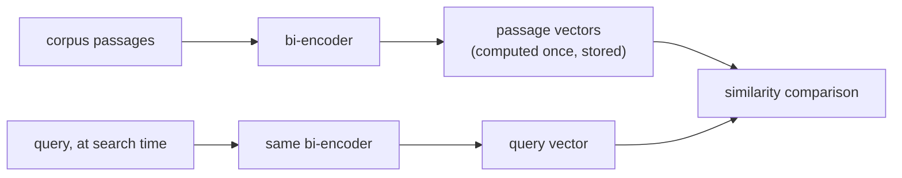

# 分块与嵌入

流水线最先要做的两个决定，以及它们各自实际要付出的代价。便于在设计检索流水线时查阅。

## 为什么要分块

一段很长、主题混杂的内容，嵌入成的是一个模糊的向量，也就是它涉及的所有内容的平均，对于只问其中某一件具体事情的查询，检索效果很差（而且它甚至可能放不进嵌入模型的上下文窗口）。文本块的大小，是在两种失败模式之间取舍：

| 文本块太大 | 文本块太小 |
|---|---|
| 把多个主题模糊成一个平均的向量；检索会返回无关的周边文字 | 丢掉让文本块得以被理解的周边上下文；需要多个片段才能回答的问题，可能无法从任何一个文本块中得到解答 |

没有放之四海而皆准的合适大小：它取决于语料库和查询模式。

## 分块策略

| 策略 | 做法 | 权衡 |
|---|---|---|
| 固定大小 | 每隔 N 个 token 或字符切一刀，通常带有重叠 | 简单、可预测，但对结构视而不见：可能把一个句子或一张表格从中间切开 |
| 递归 / 结构感知 | 先按自然边界切分（先章节，再段落，再句子），只有当某个片段仍然太大时，才退回固定大小 | 尊重文档自身的组织方式 |
| 语义 | 对相邻的句子做嵌入，在相邻句子之间的相似度骤降处切分 | 直接针对真正的失败模式（主题混杂）；计算成本更高 |
| 文档结构感知 | 把结构单元（某个标题下的章节、一张表格、一个代码块）视为不可再分 | 绝不会因为切开一个结构单元而毁掉它的含义 |

相邻文本块之间的**重叠**，是拿一些冗余的存储和嵌入计算，去换不拆碎跨在文本块边界上的事实或句子。

## 双编码器：嵌入一次，便宜地比较

**双编码器**把文本映射成固定大小的向量，与其他任何文本无关；查询和段落是分开嵌入的，而不是一起嵌入。语料库中的每个文本块都提前嵌入一次并存储起来；搜索时只需要嵌入查询，再与预先算好的向量做低成本的比较。**交叉编码器**（对每一对查询与段落，都联合运行一遍模型）无法在查询时扩展到搜索大型语料库。



<a id="similarity-metrics-must-match-training"></a>

## 相似度度量必须与训练相匹配

| 度量 | 衡量什么 | 说明 |
|---|---|---|
| 余弦相似度 | 向量之间的夹角，忽略长度 | |
| 点积 | 不按长度做归一化的余弦相似度 | 在未归一化时偏爱长度更大的向量；只有当两个向量都是单位长度时，排名才与余弦相同 |
| 欧氏距离 | 直线距离 | |

度量并不能随意选：嵌入模型是在损失函数里用某个特定的相似度函数训练出来的（Sentence-BERT 类的模型通常这样训练：让余弦相似度，或归一化的点积，反映语义上的接近程度）。使用与训练目标不同的度量，排出的顺序可能是模型从未被调教过的，而不只是“稍微差一点”。

## 选模型：让训练目标与任务相匹配

检索通常是**非对称搜索**（用短查询去搜长段落），与**对称搜索**（比较两段长度相近、种类相近的文本）是不同的训练设置。在通用基准（如 MTEB）上拔得头筹的模型，在专业语料（法律、医疗）上仍可能不如与领域或任务相匹配的模型，因为在网络通用数据上训练的模型对这类语料见得很少。问题不是“哪个模型总分最高”，而是“哪个模型训练时接触的东西，与这个语料库和这种查询形态接近”。

## 维度是一种成本，不是免费的质量旋钮

存储、索引内存和对每个候选的距离计算，都随维度线性增长：

```text
bytes per vector = dimensions × 4   (float32)
```

| 维度 | 每个向量的字节数 | 100 万个文本块 |
|---|---|---|
| 256 | 1,024（约 1 KB） | 约 1 GB |
| 1536 | 6,144（约 6 KB） | 约 6 GB |

## Matryoshka Representation Learning（MRL）：把截断做成设计好的特性

通常情况下，截断标准的嵌入向量是不安全的：没有任何东西按重要性给它的维度排序，所以截断它会不可预测地丢掉信息。**MRL** 训练模型，使完整向量的前缀（比如 1536 维嵌入的前 256 个维度）本身也是可用的、有意义的嵌入，像套娃一样层层嵌套。这让用 MRL 训练的模型可以在事后截断，质量代价有界且可预测，不需要重新训练或重新嵌入。这只对确实以这种方式训练的模型成立。

## 确定维度：靠测量，不要靠猜

合适的维度，是仍然达到工作负载所需质量线的最小那一个，要针对实际的语料库和查询模式，在每个候选维度上去测量（最直接的是用 recall@k），而不是想当然地从可用的最大规格出发。

## 相关内容

- [第 1 课](../lessons/0001-chunking.md)、[第 2 课](../lessons/0002-embedding-models-and-similarity.md)、[第 3 课](../lessons/0003-embedding-dimensionality.md)
- [向量搜索与索引](vector-search-and-indexing.md)：这些向量存储之后会发生什么
