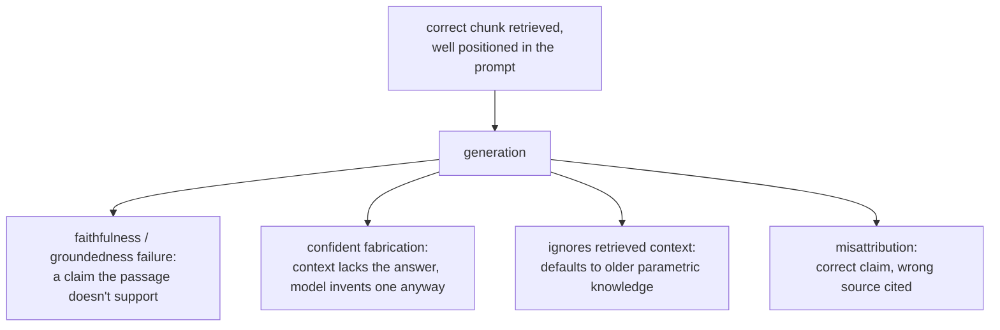

# Generación a partir de la recuperación

Lo que ocurre después de recuperar los chunks correctos. Pensado para consultar al ensamblar un prompt o al diagnosticar una respuesta final errónea que no es un fallo de recuperación.

## El presupuesto de la ventana de contexto es compartido

Los chunks recuperados son una partida de una ventana de contexto finita que se comparte con el system prompt, el historial de conversación y la pregunta del usuario. Recuperar más chunks (una k mayor) no es gratis aunque todos sean genuinamente relevantes: cada uno consume presupuesto que otra cosa podría usar.

## Lost in the middle

Estar técnicamente presente en la ventana de contexto no garantiza que un modelo lo use. Los modelos usan la información situada muy cerca del principio o del final de un contexto largo con mucha más fiabilidad que la enterrada en el medio, incluso dentro del límite de contexto declarado.

| Consecuencia | Por qué |
|---|---|
| Meter muchos chunks marginales "por si acaso" tiene un costo más allá del presupuesto de tokens | Puede enterrar un chunk genuinamente bueno en el medio y empeorar la respuesta |
| La posición de los chunks es una decisión deliberada | El chunk más relevante debería estar cerca del principio o del final del contexto ensamblado, no donde lo haya puesto el orden de concatenación |

Un chunk muy relevante enterrado en el medio produce una respuesta errónea o incompleta que parece un fallo de recuperación pero no lo es: el chunk se recuperó correctamente; no se colocó en un lugar desde el que el modelo lea de forma fiable. Es un punto de fallo distinto de [todo lo que diagnostica la etapa 6](retrieval-evaluation.md), que solo comprueba si el chunk correcto se recuperó y se ordenó lo bastante alto como para llegar siquiera al prompt.

## Fallos de la etapa de generación que sobreviven a una recuperación correcta

Incluso con el pasaje exactamente correcto recuperado y bien colocado, la propia generación introduce modos de fallo que ninguna de las etapas anteriores puede corregir ni detectar:

| Fallo | Qué ocurre |
|---|---|
| Fidelidad / anclaje | El modelo genera una afirmación que el pasaje recuperado no respalda realmente, o lo contradice de plano |
| Fabricación segura | El contexto carece genuinamente de la respuesta; el modelo produce igualmente una verosímil. El fallo más costoso, ya que la fluidez no da ninguna señal visible de que no esté anclada |
| Ignorar el contexto recuperado | El modelo recurre por defecto a su propio conocimiento paramétrico en lugar de la información recuperada, más actual (p. ej. responder una cifra de política antigua pese a que un documento recuperado indica la nueva) |
| Atribución errónea | Se usa la información correcta, pero se cita al pasaje recuperado equivocado entre varios proporcionados |

## Comprobar la fidelidad es una pregunta distinta de la evaluación de la recuperación

El procedimiento de diagnóstico de la etapa 6 comprueba si la recuperación encontró y ordenó el chunk correcto; nada de esa maquinaria comprueba si la respuesta generada se mantuvo fiel a lo recuperado. Eso se comprueba comparando cada afirmación de la respuesta generada con el contexto recuperado en el que se apoya, normalmente con un prompt de LLM-as-judge construido para esa comparación, el diseño y la disciplina de calibración que cubre `llm/evals`, aplicados aquí a una pregunta distinta de si la recuperación tuvo éxito.

## Relacionado

- [Lección 12](../lessons/0012-prompt-construction-and-context-budget.md), [Lección 13](../lessons/0013-what-generation-still-gets-wrong.md)
- [Evaluación de la recuperación](retrieval-evaluation.md): el procedimiento de diagnóstico aparte para saber si se recuperó siquiera el chunk correcto
