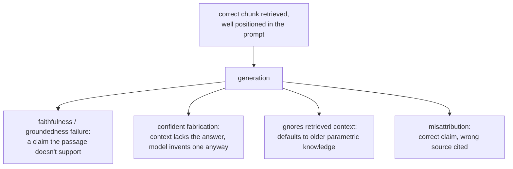

# Génération à partir de la récupération

Ce qui se passe une fois les bons chunks récupérés. Conçu pour la consultation lors de l'assemblage d'un prompt ou du diagnostic d'une mauvaise réponse finale qui n'est pas un échec de récupération.

## Le budget de la fenêtre de contexte est partagé

Les chunks récupérés sont une ligne d'une fenêtre de contexte finie, partagée avec le system prompt, l'historique de conversation et la question de l'utilisateur. Récupérer plus de chunks (un k plus grand) n'est pas gratuit, même quand chacun est réellement pertinent : chacun consomme du budget que quelque chose d'autre pourrait utiliser.

## Lost in the middle

Être techniquement présent dans la fenêtre de contexte ne garantit pas qu'un modèle l'utilise. Les modèles exploitent bien plus fiablement l'information tout près du début ou de la fin d'un long contexte que celle enfouie au milieu, même entièrement dans la limite de contexte annoncée.

| Conséquence | Pourquoi |
|---|---|
| Bourrer de nombreux chunks marginaux « par précaution » a un coût qui dépasse le budget de tokens | Cela peut enfouir un chunk réellement bon au milieu, ce qui dégrade la réponse |
| L'emplacement des chunks est un choix délibéré | Le chunk le plus pertinent doit se trouver près du début ou de la fin du contexte assemblé, et non là où l'ordre de concaténation l'a mis |

Un chunk très pertinent enfoui au milieu produit une réponse fausse ou incomplète qui ressemble à un échec de récupération mais n'en est pas un : le chunk a été correctement récupéré ; il n'était pas positionné à un endroit où le modèle lit de façon fiable. C'est un point de défaillance distinct de [tout ce que diagnostique l'étape 6](retrieval-evaluation.md), qui vérifie seulement si le bon chunk a été récupéré et classé assez haut pour atteindre le prompt.

## Défaillances de l'étape de génération qui survivent à une récupération correcte

Même avec exactement le bon passage récupéré et bien positionné, la génération introduit elle-même des modes de défaillance qu'aucune des étapes précédentes ne peut corriger ni détecter :

| Défaillance | Ce qui se passe |
|---|---|
| Fidélité / ancrage | Le modèle génère une affirmation que le passage récupéré n'étaye pas réellement, ou le contredit carrément |
| Fabrication assurée | Le contexte ne contient réellement pas la réponse ; le modèle en produit quand même une qui paraît plausible. La défaillance la plus coûteuse, puisque la fluidité ne donne aucun signal visible qu'elle n'est pas ancrée |
| Ignorer le contexte récupéré | Le modèle se rabat sur ses propres connaissances paramétriques au lieu de l'information récupérée, plus actuelle (par exemple en répondant avec un ancien chiffre de politique malgré un document récupéré qui indique le nouveau) |
| Mauvaise attribution | La bonne information est utilisée, mais citée avec le mauvais passage récupéré parmi plusieurs fournis |

## Vérifier la fidélité est une question distincte de l'évaluation de la récupération

La procédure de diagnostic de l'étape 6 vérifie si la récupération a trouvé et classé le bon chunk ; rien de cette machinerie ne vérifie si la réponse générée est restée fidèle à ce qui a été récupéré. Cela se vérifie en comparant chaque affirmation de la réponse générée au contexte récupéré sur lequel elle repose, couramment avec un prompt de LLM-as-judge construit pour cette comparaison, la conception et la discipline de calibrage que couvre `llm/evals`, appliquées ici à une autre question que celle de savoir si la récupération a réussi.

## Voir aussi

- [Leçon 12](../lessons/0012-prompt-construction-and-context-budget.md), [Leçon 13](../lessons/0013-what-generation-still-gets-wrong.md)
- [Évaluation de la récupération](retrieval-evaluation.md) : la procédure de diagnostic distincte pour savoir si le bon chunk a été récupéré tout court
