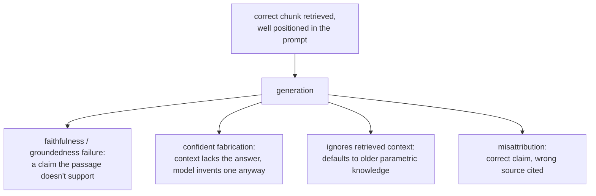

# Retrieval से Generation

सही chunks retrieve होने के बाद क्या होता है। Prompt जोड़ते समय, या ऐसे ग़लत अंतिम उत्तर को diagnose करते समय खोजने के लिए बनाया गया जो retrieval की विफलता नहीं है।

## Context-window budget साझा है

Retrieved chunks सीमित context window की एक मद हैं, जो system prompt, बातचीत के इतिहास और उपयोगकर्ता के सवाल के साथ साझा है। ज़्यादा chunks retrieve करना (बड़ा k) मुफ़्त नहीं है, भले ही हर एक सचमुच प्रासंगिक हो: हर एक वह budget खाता है जिसे कुछ और इस्तेमाल कर सकता था।

## Lost in the middle

तकनीकी रूप से context window में मौजूद होना इसकी गारंटी नहीं कि model उसे इस्तेमाल करेगा। Models लंबे context की बिल्कुल शुरुआत या अंत के पास की जानकारी को बीच में दबी जानकारी से कहीं ज़्यादा भरोसे से इस्तेमाल करते हैं, बताई गई context सीमा के पूरी तरह भीतर होने पर भी।

| नतीजा | क्यों |
|---|---|
| "सुरक्षा के लिए" कई मामूली chunks ठूँसने की क़ीमत token budget से आगे जाती है | वह किसी सचमुच अच्छे chunk को बीच में दबा सकता है, जिससे उत्तर बदतर हो जाता है |
| Chunk की जगह सोच-समझकर लिया गया चुनाव है | सबसे प्रासंगिक chunk जोड़े गए context की शुरुआत या अंत के पास बैठना चाहिए, वहाँ नहीं जहाँ concatenation का क्रम उसे डाल दे |

बीच में दबा अत्यधिक प्रासंगिक chunk ग़लत या अधूरा उत्तर बनाता है जो retrieval की विफलता जैसा दिखता है पर है नहीं: chunk सही retrieve हुआ था; उसे ऐसी जगह नहीं रखा गया था जहाँ से model भरोसे से पढ़ता है। यह [चरण 6 जो कुछ diagnose करता है](retrieval-evaluation.md) उससे अलग विफलता का बिंदु है, जो सिर्फ़ यह जाँचता है कि सही chunk retrieve हुआ और prompt तक पहुँचने लायक ऊँचा rank हुआ या नहीं।

## सही retrieval के बाद भी बचने वाली generation चरण की विफलताएँ

ठीक सही passage retrieve होने और अच्छी जगह रखे जाने के बाद भी, generation ख़ुद ऐसी विफलताएँ लाता है जिन्हें पहले का कोई चरण ठीक नहीं कर सकता या पकड़ नहीं सकता:

| विफलता | क्या होता है |
|---|---|
| Faithfulness / groundedness | Model ऐसा दावा generate करता है जिसे retrieved passage असल में समर्थित नहीं करता, या उसे सीधे खंडित करता है |
| Confident fabrication | Context में सचमुच उत्तर नहीं है; model फिर भी विश्वसनीय-सा लगने वाला उत्तर बना देता है। सबसे महँगी विफलता, क्योंकि प्रवाहशीलता कोई दिखने वाला संकेत नहीं देती कि वह टिकी नहीं है |
| Retrieved context को अनदेखा करना | Model retrieved, ज़्यादा ताज़ा जानकारी की जगह अपने parametric ज्ञान पर लौट जाता है (जैसे retrieved document में नया आँकड़ा होने पर भी पुराना policy आँकड़ा बताना) |
| Misattribution | सही जानकारी इस्तेमाल होती है, पर दिए गए कई retrieved passages में से ग़लत passage को cite किया जाता है |

## Faithfulness जाँचना retrieval मूल्यांकन से अलग सवाल है

चरण 6 की diagnostic प्रक्रिया जाँचती है कि retrieval को सही chunk मिला और उसे rank किया या नहीं; उस पूरी व्यवस्था में कुछ नहीं जाँचता कि generate किया गया उत्तर retrieve की गई चीज़ों के प्रति वफ़ादार रहा या नहीं। इसे generate किए उत्तर के हर दावे की तुलना उस retrieved context से करके जाँचा जाता है जिस पर वह टिका है, आम तौर पर ख़ास उसी तुलना के लिए बने LLM-as-judge prompt से, वह डिज़ाइन और calibration अनुशासन जो `llm/evals` कवर करता है, यहाँ उस सवाल से अलग सवाल पर लगाया गया कि retrieval सफल हुआ या नहीं।

## संबंधित

- [पाठ 12](../lessons/0012-prompt-construction-and-context-budget.md), [पाठ 13](../lessons/0013-what-generation-still-gets-wrong.md)
- [Retrieval Evaluation](retrieval-evaluation.md): इसकी अलग diagnostic प्रक्रिया कि सही chunk retrieve हुआ भी या नहीं
