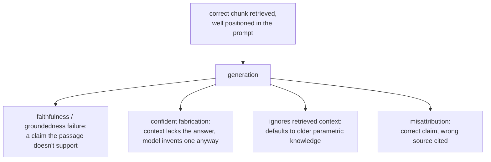

# Geração a partir da recuperação

O que acontece depois que os chunks certos são recuperados. Feito para consulta ao montar um prompt ou ao diagnosticar uma resposta final errada que não é uma falha de recuperação.

## O orçamento da janela de contexto é compartilhado

Os chunks recuperados são um item de linha em uma janela de contexto finita, compartilhada com o system prompt, o histórico da conversa e a pergunta do usuário. Recuperar mais chunks (um k maior) não é de graça, mesmo quando cada um deles é genuinamente relevante: cada um consome orçamento que outra coisa poderia usar.

## Lost in the middle

Estar tecnicamente presente na janela de contexto não garante que o modelo o use. Os modelos usam a informação perto do início ou do fim de um contexto longo de forma muito mais confiável do que a informação enterrada no meio, mesmo totalmente dentro do limite de contexto declarado.

| Consequência | Por quê |
|---|---|
| Entupir o contexto com muitos chunks marginais "por garantia" tem um custo além do orçamento de tokens | Pode enterrar no meio um chunk genuinamente bom, piorando a resposta |
| A posição do chunk é uma escolha deliberada | O chunk mais relevante deve ficar perto do início ou do fim do contexto montado, e não onde a ordem de concatenação o colocou |

Um chunk altamente relevante enterrado no meio produz uma resposta errada ou incompleta que parece uma falha de recuperação, mas não é: o chunk foi recuperado corretamente; ele só não foi posicionado em um lugar de onde o modelo lê de forma confiável. É um ponto de falha distinto de [tudo o que a etapa 6 diagnostica](retrieval-evaluation.md), que apenas verifica se o chunk correto foi recuperado e ranqueado alto o bastante para chegar ao prompt.

## Falhas da etapa de geração que sobrevivem a uma recuperação correta

Mesmo com a passagem exata recuperada e bem posicionada, a própria geração introduz modos de falha que nenhuma das etapas anteriores consegue corrigir ou detectar:

| Falha | O que acontece |
|---|---|
| Fidelidade / groundedness | O modelo gera uma afirmação que a passagem recuperada de fato não sustenta, ou a contradiz abertamente |
| Fabricação confiante | O contexto realmente não tem a resposta; o modelo produz uma de aparência plausível mesmo assim. A falha mais custosa, já que a fluência não dá nenhum sinal visível de que não há ancoragem |
| Ignorar o contexto recuperado | O modelo recorre ao próprio conhecimento paramétrico em vez da informação recuperada, mais atual (por exemplo, responder o valor de uma política antiga apesar de um documento recuperado informar o novo) |
| Atribuição incorreta | A informação certa é usada, mas citada a uma passagem recuperada errada entre as várias fornecidas |

## Verificar a fidelidade é uma questão separada da avaliação da recuperação

O procedimento de diagnóstico da etapa 6 verifica se a recuperação encontrou e ranqueou o chunk certo; nada dessa maquinaria verifica se a resposta gerada se manteve fiel ao que foi recuperado. Isso se verifica comparando cada afirmação da resposta gerada com o contexto recuperado em que ela se apoia, comumente com um prompt de LLM-as-judge feito para essa comparação, a disciplina de design e calibração que `llm/evals` cobre, aplicada aqui a uma pergunta diferente da de a recuperação ter dado certo.

## Relacionado

- [Lição 12](../lessons/0012-prompt-construction-and-context-budget.md), [Lição 13](../lessons/0013-what-generation-still-gets-wrong.md)
- [Avaliação de Recuperação](retrieval-evaluation.md): o procedimento de diagnóstico separado para saber se o chunk certo foi recuperado
