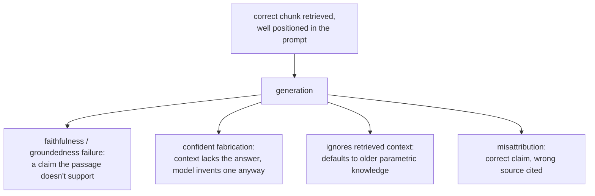

# Генерация на основе поиска

Что происходит после того, как найдены верные чанки. Для быстрого поиска при сборке промпта или диагностике неверного итогового ответа, который не является сбоем поиска.

## Бюджет контекстного окна общий

Найденные чанки это одна статья конечного контекстного окна, которое делится с системным промптом, историей разговора и вопросом пользователя. Поиск большего числа чанков (большее k) не бесплатен, даже если каждый действительно релевантен: каждый расходует бюджет, который мог бы использовать что-то другое.

## Потерянное в середине

Формальное присутствие в контекстном окне не гарантирует, что модель это использует. Модели используют информацию в самом начале или в самом конце длинного контекста заметно надёжнее, чем зарытую в середине, даже в полных пределах заявленного контекста.

| Следствие | Почему |
|---|---|
| Набивка многими маргинальными чанками «на всякий случай» стоит дороже, чем бюджет токенов | Она может погрести по-настоящему хороший чанк в середине, ухудшив ответ |
| Место чанка это осознанный выбор | Самый релевантный чанк должен стоять ближе к началу или концу собранного контекста, а не там, куда его поставил порядок конкатенации |

Очень релевантный чанк, погребённый в середине, даёт неверный или неполный ответ, который выглядит как сбой поиска, но им не является: чанк был найден верно; его не поставили туда, откуда модель читает надёжно. Это отдельная точка сбоя, не совпадающая с [всем, что диагностирует этап 6](retrieval-evaluation.md), который проверяет лишь, был ли верный чанк найден и поставлен достаточно высоко, чтобы вообще дойти до промпта.

## Сбои этапа генерации, переживающие верный поиск

Даже когда найден в точности верный пассаж и он хорошо расположен, сама генерация вносит виды сбоев, которые ни один из предыдущих этапов не может ни исправить, ни обнаружить:

| Сбой | Что происходит |
|---|---|
| Достоверность / обоснованность | Модель генерирует утверждение, которое найденный пассаж на самом деле не подтверждает, или прямо ему противоречит |
| Уверенная выдумка | В контексте действительно нет ответа; модель всё равно выдаёт правдоподобно звучащий. Самый дорогой сбой, поскольку беглость не даёт видимого сигнала, что ответ ни на чём не основан |
| Игнорирование найденного контекста | Модель по умолчанию опирается на собственные параметрические знания вместо найденной, более актуальной информации (например, называет прежнюю цифру политики, хотя найденный документ называет новую) |
| Неверное приписывание источника | Верная информация используется, но приписывается не тому найденному пассажу среди нескольких предоставленных |

## Проверка достоверности это отдельный вопрос от оценки поиска

Диагностическая процедура этапа 6 проверяет, нашёл ли и поставил ли поиск верный чанк; ничто из этого механизма не проверяет, остался ли сгенерированный ответ верен найденному. Это проверяют сопоставлением каждого утверждения сгенерированного ответа с найденным контекстом, на котором оно держится, обычно промптом LLM-судьи, построенным для такого сопоставления, то есть дисциплиной проектирования и калибровки, которую охватывает `llm/evals`, применённой здесь к другому вопросу, чем то, удался ли поиск.

## Связанные материалы

- [Урок 12](../lessons/0012-prompt-construction-and-context-budget.md), [Урок 13](../lessons/0013-what-generation-still-gets-wrong.md)
- [Оценка поиска](retrieval-evaluation.md): отдельная диагностическая процедура для вопроса, был ли верный чанк найден вообще
