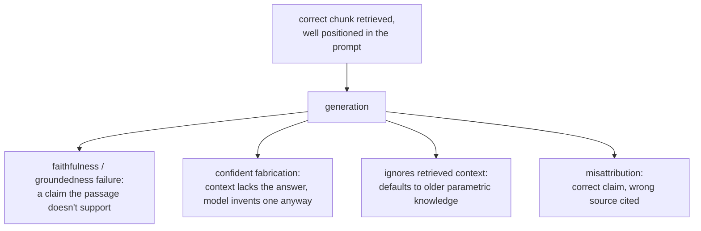

# 基于检索的生成

正确的文本块被检索到之后会发生什么。便于在组装提示词，或诊断一个并非检索失败所致的错误最终答案时查阅。

## 上下文窗口预算是共享的

检索到的文本块，只是有限的上下文窗口中的一项，这个窗口还要与系统提示词、对话历史和用户的问题共用。多检索一些文本块（更大的 k），即使每一块都确实相关，也不是免费的：每一块都会消耗本可以给别的东西用的预算。

## 迷失在中间

在技术上存在于上下文窗口之内，并不保证模型会用到它。模型对长上下文最开头或最结尾附近的信息的利用，比埋在中间的信息可靠得多，即使它完全在所声明的上下文上限之内。

| 后果 | 原因 |
|---|---|
| 为了“保险起见”塞进许多边缘的文本块，代价不止是 token 预算 | 它可能把一个真正好的文本块埋在中间，让答案变得更差 |
| 文本块的位置是一个经过考虑的选择 | 最相关的文本块应当放在组装好的上下文的开头或结尾附近，而不是拼接顺序恰好把它放在哪里就在哪里 |

一个高度相关的文本块被埋在中间，会产生一个错误或不完整的答案，看起来像检索失败，其实不是：文本块被正确检索到了，只是没有被放在模型可靠读取的位置。这是与[第 6 阶段所诊断的一切](retrieval-evaluation.md)不同的失败点，第 6 阶段只检查正确的文本块是否被检索到，并且排得足够靠前，能进入提示词。

## 在检索正确之后仍然存在的生成阶段失败

即使检索到了恰好正确的段落，位置也得当，生成本身仍会引入前面任何阶段都无法修复或察觉的失败模式：

| 失败 | 发生了什么 |
|---|---|
| 忠实性 / 有据性 | 模型生成了一条检索到的段落并不真正支持的论断，或者直接与它相矛盾 |
| 自信的编造 | 上下文确实没有答案；模型仍然给出一个听起来合理的答案。这是代价最高的失败，因为流畅并不提供任何可见的迹象，表明它没有依据 |
| 忽略检索到的上下文 | 模型转而默认使用它自己的参数化知识，而不是检索到的、更新的信息（例如，尽管检索到的文档写明了新政策，仍然回答旧政策的数字） |
| 错误归属 | 用的是正确的信息，却引用到了所提供的几个检索段落中错误的那一个 |

## 检查忠实性，与检索评估是不同的问题

第 6 阶段的诊断流程检查的是，检索有没有找到并排好正确的文本块；这套办法都不检查生成的答案是否始终忠实于检索到的内容。这要通过把生成的答案中的每条论断，与它所依据的检索上下文逐一比对来检查，通常使用专门为这种比对构建的 LLM-as-judge 提示词，也就是 `llm/evals` 所涵盖的设计与校准方法，在这里用于回答一个不同于检索是否成功的问题。

## 相关内容

- [第 12 课](../lessons/0012-prompt-construction-and-context-budget.md)、[第 13 课](../lessons/0013-what-generation-still-gets-wrong.md)
- [检索评估](retrieval-evaluation.md)：判断正确的文本块究竟有没有被检索到的、另一套独立的诊断流程
