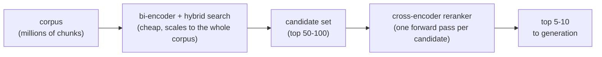
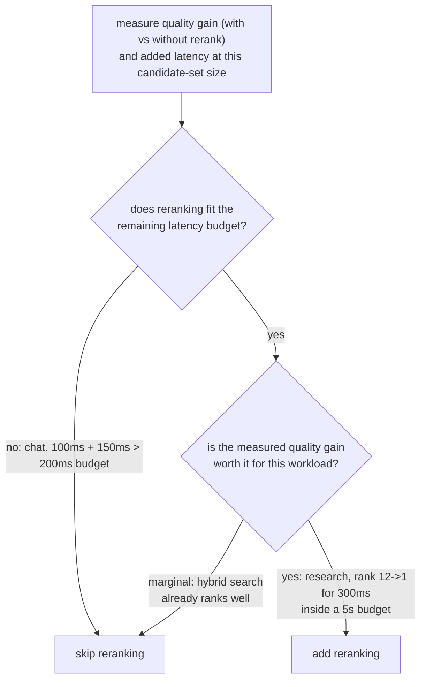

# Reranking

La etapa de segunda pasada y mayor precisión sobre un conjunto de candidatos ya reducido. Pensado para consultar al añadir o evaluar una etapa de reranking.

## Los cross-encoders ven la consulta y el pasaje juntos

| | Bi-encoder (recuperación) | Cross-encoder (reranking) |
|---|---|---|
| Entrada | Consulta y pasaje con embedding independiente | Consulta y un pasaje candidato, de forma conjunta, como una sola entrada |
| Qué captura | Similitud semántica global | Interacción fina entre consulta y pasaje (esta palabra que coincide con esta cláusula) |
| Precalculable | Sí: los vectores de pasajes se calculan una vez y se almacenan | No: una forward pass completa por cada par consulta-candidato, en cada consulta |
| Escala a un corpus completo | Sí (índice de embeddings) | No: un millón de chunks necesitaría un millón de forward passes por consulta |

## Recuperar barato, hacer reranking con precisión



La recuperación con bi-encoder (más la [búsqueda híbrida](hybrid-search.md)) reduce de forma barata el corpus a un conjunto modesto de candidatos; un cross-encoder hace entonces reranking solo de ese conjunto más pequeño, y aplica el paso costoso solo donde el corpus ya se ha reducido lo suficiente para que sea asequible.

## Lo que cuesta el reranking

```text
added latency ≈ candidates reranked × per-candidate forward-pass cost
```

Hacer reranking de 100 candidatos cuesta aproximadamente 100 veces una forward pass, de forma aditiva sobre lo que ya tardó la etapa de recuperación inicial. Nada del reranking es gratis solo porque mejore la precisión.

## Decidir si justifica su costo

La pregunta no es "¿mejora el reranking la calidad en general?" (normalmente sí) sino "¿la mejora lo suficiente, para este corpus y este patrón de consultas, como para justificar lo que cuesta aquí?". Mide la calidad de la recuperación (recall@k, MRR) tanto sin reranking como con él, sobre el mismo conjunto de consultas, y mide la latencia añadida real con el tamaño de conjunto de candidatos en uso.



**Ejemplos resueltos:**

| Carga de trabajo | Recuperación | Costo del reranking | Presupuesto | Mejora de calidad | Veredicto |
|---|---|---|---|---|---|
| Chat en tiempo real | 100 ms | +150 ms | 200 ms | n/a | Omitir: 250 ms ya supera el presupuesto |
| Asistente de investigación offline | n/a | +300 ms | 5 s | Posición 12 -> 1 | Añadir: barato en relación con el presupuesto, mejora grande |

Ni "siempre hacer reranking" ni "nunca hacer reranking" es el valor por defecto correcto: la decisión consiste en medir la mejora real de calidad y la latencia añadida real, y comprobar ambas contra el presupuesto y el listón de calidad de la carga de trabajo concreta.

## Relacionado

- [Lección 8](../lessons/0008-cross-encoder-rerankers.md), [Lección 9](../lessons/0009-when-reranking-earns-its-cost.md)
- [Búsqueda híbrida](hybrid-search.md): lo que produce el conjunto de candidatos sobre el que opera el reranking
