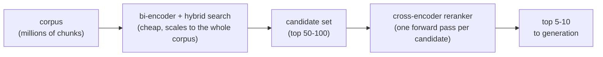
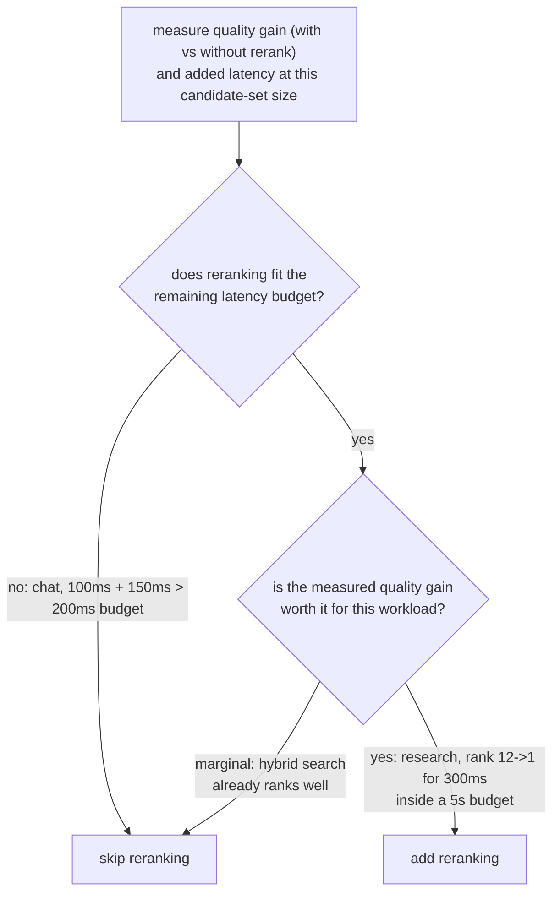

# Reranking

L'étape de seconde passe, plus précise, sur un ensemble de candidats déjà réduit. Conçu pour la consultation lors de l'ajout ou de l'évaluation d'une étape de reranking.

## Les cross-encoders voient la requête et le passage ensemble

| | Bi-encoder (récupération) | Cross-encoder (reranking) |
|---|---|---|
| Entrée | Requête et passage dont l'embedding est calculé indépendamment | Requête et un passage candidat, conjointement, comme une seule entrée |
| Ce qu'il capture | La similarité sémantique globale | L'interaction fine requête-passage (tel mot qui correspond à telle clause) |
| Précalculable | Oui : les vecteurs de passages sont calculés une fois, stockés | Non : une passe avant complète par paire requête-candidat, à chaque requête |
| Passe à l'échelle d'un corpus entier | Oui (index d'embeddings) | Non : un million de chunks demanderait un million de passes avant par requête |

## Récupérer à bas coût, reclasser avec précision



La récupération par bi-encoder (plus la [recherche hybride](hybrid-search.md)) réduit à bas coût le corpus à un ensemble de candidats modeste ; un cross-encoder reclasse alors uniquement ce petit ensemble, en n'appliquant l'étape coûteuse que là où le corpus a déjà été assez réduit pour qu'elle soit abordable.

## Ce que coûte le reranking

```text
added latency ≈ candidates reranked × per-candidate forward-pass cost
```

Reclasser 100 candidats coûte environ 100 fois une passe avant, en plus de ce que l'étape de récupération initiale a déjà pris. Rien dans le reranking n'est gratuit du seul fait qu'il améliore la précision.

## Décider s'il justifie son coût

La question n'est pas « le reranking améliore-t-il la qualité en général » (c'est généralement le cas) mais « l'améliore-t-il assez, pour ce corpus et ce type de requêtes, pour justifier ce qu'il coûte ici ». Mesurez la qualité de la récupération (recall@k, MRR) sans puis avec reranking, sur le même jeu de requêtes, et mesurez la latence ajoutée réelle à la taille d'ensemble de candidats utilisée.



**Exemples détaillés :**

| Charge de travail | Récupération | Coût du reranking | Budget | Gain de qualité | Verdict |
|---|---|---|---|---|---|
| Chat en temps réel | 100 ms | +150 ms | 200 ms | n/a | Renoncer : 250 ms dépassent déjà le budget |
| Assistant de recherche hors ligne | n/a | +300 ms | 5 s | Rang 12 -> 1 | Ajouter : peu coûteux au regard du budget, gain important |

Ni « toujours reclasser » ni « ne jamais reclasser » n'est la bonne valeur par défaut : la décision consiste à mesurer le gain de qualité réel et la latence ajoutée réelle, et à vérifier les deux face au budget et au seuil de qualité de la charge de travail précise.

## Voir aussi

- [Leçon 8](../lessons/0008-cross-encoder-rerankers.md), [Leçon 9](../lessons/0009-when-reranking-earns-its-cost.md)
- [Recherche hybride](hybrid-search.md) : ce qui produit l'ensemble de candidats sur lequel opère le reranking
