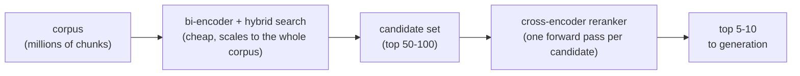
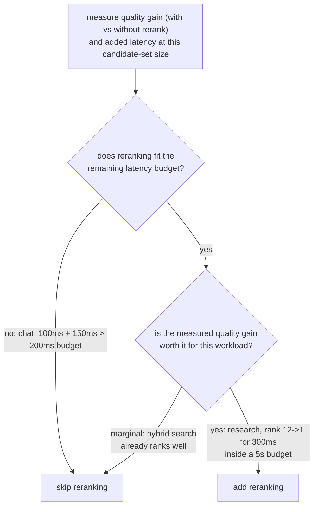

# Reranking

पहले से सिकुड़े candidate सेट पर दूसरा पास, ज़्यादा सटीकता वाला चरण। Reranking चरण जोड़ते या परखते समय खोजने के लिए बनाया गया।

## Cross-encoders query और passage को साथ-साथ देखते हैं

| | Bi-encoder (retrieval) | Cross-encoder (reranking) |
|---|---|---|
| Input | Query और passage स्वतंत्र रूप से embed होते हैं | Query और एक candidate passage, साथ मिलाकर, एक input के रूप में |
| क्या पकड़ता है | कुल semantic similarity | Query-passage का बारीक आपसी असर (यह शब्द इस उपवाक्य से मेल खाता है) |
| पहले से निकाला जा सकता है | हाँ: passage vectors एक बार निकलकर store होते हैं | नहीं: हर query-candidate जोड़ी के लिए एक पूरा forward pass, हर query पर |
| पूरे corpus तक scale करता है | हाँ (embedding index) | नहीं: दस लाख chunks को हर query पर दस लाख forward passes चाहिए |

## सस्ते में retrieve करें, सटीकता से rerank करें



Bi-encoder retrieval (और [hybrid search](hybrid-search.md)) सस्ते में corpus को एक मामूली candidate सेट तक सिकोड़ते हैं; फिर cross-encoder सिर्फ़ उस छोटे सेट को rerank करता है, महँगे चरण को वहीं लगाकर जहाँ corpus पहले ही इतना सिकुड़ चुका है कि वह वहन करने लायक है।

## Reranking की लागत क्या है

```text
added latency ≈ candidates reranked × per-candidate forward-pass cost
```

100 candidates को rerank करने की लागत एक forward pass की लगभग 100 गुना है, शुरुआती retrieval चरण के पहले से लिए समय के ऊपर जुड़ती हुई। Reranking में कुछ भी मुफ़्त नहीं है सिर्फ़ इसलिए कि वह सटीकता सुधारता है।

## तय करना कि वह अपनी क़ीमत कमाता है या नहीं

सवाल यह नहीं कि "क्या reranking आम तौर पर गुणवत्ता सुधारता है" (आम तौर पर सुधारता है) बल्कि यह कि "क्या वह इस corpus और query पैटर्न के लिए इतना सुधारता है कि यहाँ उसकी जो लागत है उसे सही ठहराए।" Retrieval की गुणवत्ता (recall@k, MRR) reranking के बिना और उसके साथ, उसी query सेट पर मापें, और इस्तेमाल हो रहे candidate-सेट आकार पर असली जुड़ी latency मापें।



**हल किए हुए उदाहरण:**

| Workload | Retrieval | Rerank लागत | Budget | गुणवत्ता लाभ | फ़ैसला |
|---|---|---|---|---|---|
| Real-time chat | 100 ms | +150 ms | 200 ms | लागू नहीं | छोड़ें: 250 ms पहले ही budget से ऊपर है |
| Offline research assistant | लागू नहीं | +300 ms | 5 s | Rank 12 -> 1 | जोड़ें: budget के सापेक्ष सस्ता, बड़ा लाभ |

न "हमेशा rerank करें" न "कभी rerank न करें" सही default है: फ़ैसला है असली गुणवत्ता लाभ और असली जुड़ी latency को मापना, और दोनों को उस ख़ास workload के budget और गुणवत्ता की कसौटी से जाँचना।

## संबंधित

- [पाठ 8](../lessons/0008-cross-encoder-rerankers.md), [पाठ 9](../lessons/0009-when-reranking-earns-its-cost.md)
- [Hybrid Search](hybrid-search.md): जो वह candidate सेट बनाता है जिस पर reranking काम करता है
