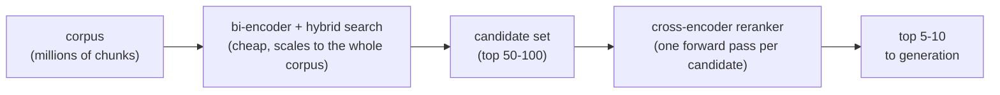
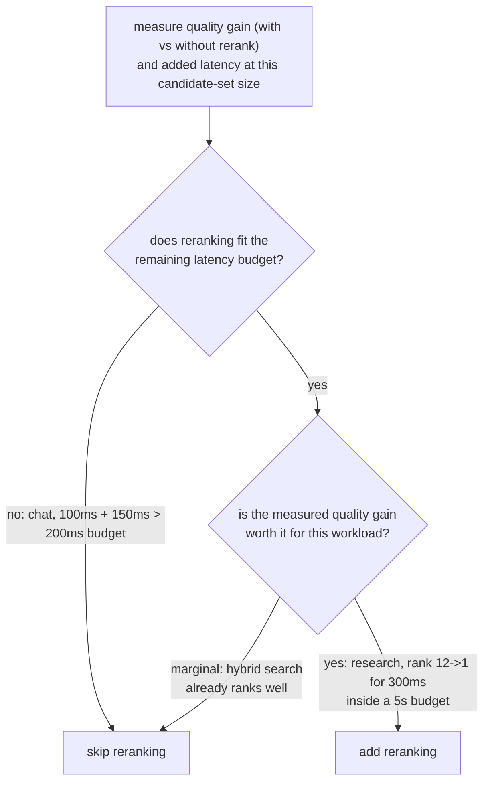

# Reranking

A etapa de segunda passada, de maior acurácia, sobre um conjunto de candidatos já reduzido. Feito para consulta ao adicionar ou avaliar uma etapa de reranking.

## Cross-encoders enxergam a consulta e a passagem juntas

| | Bi-encoder (recuperação) | Cross-encoder (reranking) |
|---|---|---|
| Entrada | Consulta e passagem com embeddings gerados de forma independente | A consulta e uma passagem candidata, em conjunto, como uma única entrada |
| O que captura | Similaridade semântica geral | Interação refinada entre consulta e passagem (esta palavra correspondendo a esta oração) |
| Pré-calculável | Sim: os vetores das passagens são calculados uma vez e armazenados | Não: uma passada completa (forward pass) por par consulta-candidato, a cada consulta |
| Escala para um corpus inteiro | Sim (índice de embeddings) | Não: um milhão de chunks exigiria um milhão de forward passes por consulta |

## Recupere barato, rerankeie com precisão



A recuperação com bi-encoder (mais a [busca híbrida](hybrid-search.md)) reduz de forma barata o corpus a um conjunto modesto de candidatos; um cross-encoder então rerankeia apenas esse conjunto menor, aplicando a etapa cara somente onde o corpus já foi reduzido o bastante para que ela seja acessível.

## O que o reranking custa

```text
added latency ≈ candidates reranked × per-candidate forward-pass cost
```

Rerankear 100 candidatos custa aproximadamente 100 vezes um forward pass, somado a tudo o que a etapa inicial de recuperação já levou. Nada no reranking é de graça só porque melhora a acurácia.

## Decidindo se ele compensa o custo

A pergunta não é "o reranking melhora a qualidade em geral" (geralmente melhora), e sim "ele melhora a qualidade o bastante, para este corpus e este padrão de consultas, para justificar o que custa aqui". Meça a qualidade da recuperação (recall@k, MRR) sem e com reranking, sobre o mesmo conjunto de consultas, e meça a latência adicional real no tamanho de conjunto de candidatos em uso.



**Exemplos resolvidos:**

| Carga de trabalho | Recuperação | Custo do rerank | Orçamento | Ganho de qualidade | Veredito |
|---|---|---|---|---|---|
| Chat em tempo real | 100 ms | +150 ms | 200 ms | n/a | Pular: 250 ms já excede o orçamento |
| Assistente de pesquisa offline | n/a | +300 ms | 5 s | Posição 12 -> 1 | Adicionar: barato em relação ao orçamento, ganho grande |

Nem "sempre rerankear" nem "nunca rerankear" é o padrão certo: a decisão é medir o ganho real de qualidade e a latência adicional real, e conferir ambos contra o orçamento e o nível de qualidade da carga de trabalho específica.

## Relacionado

- [Lição 8](../lessons/0008-cross-encoder-rerankers.md), [Lição 9](../lessons/0009-when-reranking-earns-its-cost.md)
- [Busca Híbrida](hybrid-search.md): o que produz o conjunto de candidatos sobre o qual o reranking opera
