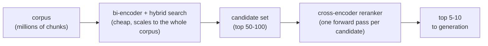
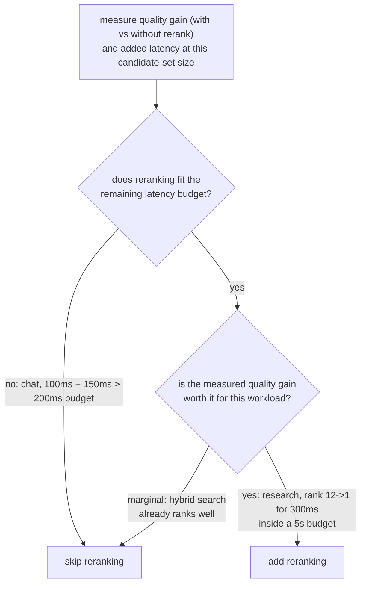

# Реранкинг

Второй проход с более высокой точностью по уже суженному набору кандидатов. Для быстрого поиска при добавлении или оценке этапа реранкинга.

## Кросс-энкодеры видят запрос и пассаж вместе

| | Би-энкодер (поиск) | Кросс-энкодер (реранкинг) |
|---|---|---|
| Вход | Запрос и пассаж эмбеддятся независимо | Запрос и один пассаж-кандидат совместно, как единый вход |
| Что улавливает | Общее семантическое сходство | Тонкое взаимодействие запроса и пассажа (это слово совпадает с этим предложением) |
| Можно ли вычислить заранее | Да: векторы пассажей вычисляются один раз и сохраняются | Нет: один полный прямой проход на каждую пару «запрос и кандидат», на каждый запрос |
| Масштабируется на весь корпус | Да (индекс эмбеддингов) | Нет: миллиону чанков потребовался бы миллион прямых проходов на запрос |

## Искать дёшево, ранжировать точно



Поиск на основе би-энкодера (плюс [гибридный поиск](hybrid-search.md)) дёшево сужает корпус до скромного набора кандидатов; затем кросс-энкодер переранжирует только этот меньший набор, применяя дорогой шаг только там, где корпус уже сужен настолько, что это по карману.

## Чего стоит реранкинг

```text
added latency ≈ candidates reranked × per-candidate forward-pass cost
```

Реранкинг 100 кандидатов стоит примерно в 100 раз больше одного прямого прохода, аддитивно поверх того, что уже заняло начальный этап поиска. Ничто в реранкинге не бесплатно лишь потому, что он повышает точность.

## Решение, окупает ли он свою цену

Вопрос не «улучшает ли реранкинг качество вообще» (обычно улучшает), а «улучшает ли он качество достаточно для этого корпуса и шаблона запросов, чтобы оправдать то, чего он стоит здесь». Измерьте качество поиска (recall@k, MRR) и без реранкинга, и с ним на одном наборе запросов и измерьте реальную добавленную задержку при используемом размере набора кандидатов.



**Разобранные примеры:**

| Нагрузка | Поиск | Цена реранкинга | Бюджет | Выигрыш в качестве | Вердикт |
|---|---|---|---|---|---|
| Чат реального времени | 100 мс | +150 мс | 200 мс | н/д | Пропустить: 250 мс уже превышает бюджет |
| Офлайн-ассистент для исследований | н/д | +300 мс | 5 с | Место 12 -> 1 | Добавить: дёшево относительно бюджета, выигрыш большой |

Ни «всегда переранжировать», ни «никогда не переранжировать» не верное значение по умолчанию: решение в том, чтобы измерить реальный выигрыш в качестве и реальную добавленную задержку и сверить оба с бюджетом и планкой качества конкретной нагрузки.

## Связанные материалы

- [Урок 8](../lessons/0008-cross-encoder-rerankers.md), [Урок 9](../lessons/0009-when-reranking-earns-its-cost.md)
- [Гибридный поиск](hybrid-search.md): что порождает набор кандидатов, с которым работает реранкинг
