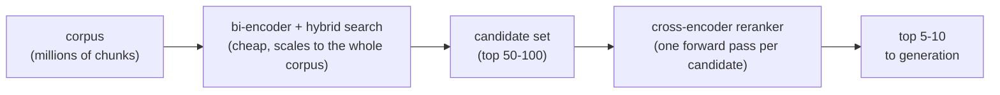
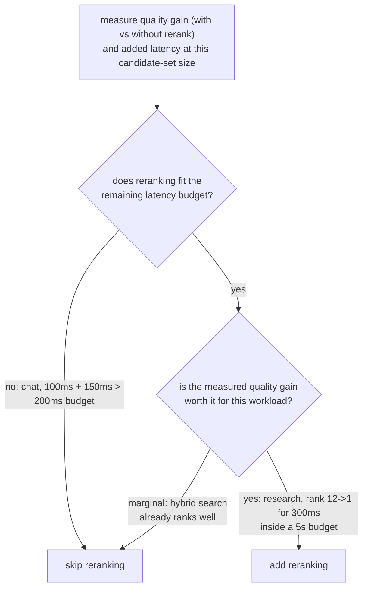

# 重排序

在已经收窄的候选集上做的第二遍、准确度更高的阶段。便于在添加或评估重排序阶段时查阅。

## 交叉编码器同时看到查询和段落

| | 双编码器（检索） | 交叉编码器（重排序） |
|---|---|---|
| 输入 | 查询和段落各自独立嵌入 | 查询与一个候选段落，作为一个输入联合处理 |
| 捕捉的内容 | 整体的语义相似性 | 查询与段落之间细粒度的交互（这个词与那个从句相匹配） |
| 能否预先计算 | 能：段落向量算一次，存起来 | 不能：每个查询与候选的组合都要一次完整的前向传播，每个查询都要重新做 |
| 能否扩展到整个语料库 | 能（嵌入索引） | 不能：一百万个文本块，每个查询就需要一百万次前向传播 |

## 廉价地检索，精确地重排序



双编码器检索（加上[混合检索](hybrid-search.md)）低成本地把语料库收窄成规模适中的候选集；然后交叉编码器只对这个较小的集合重排序，只把昂贵的那一步，用在语料库已经被收窄到足以负担得起的地方。

## 重排序的成本

```text
added latency ≈ candidates reranked × per-candidate forward-pass cost
```

对 100 个候选重排序，大约要花 100 倍于单次前向传播的成本，叠加在初始检索阶段已有耗时之上。重排序并不会因为提升了准确度就变成免费的。

## 判断它是否值回成本

问题不是“重排序总体上是否提升质量”（通常会），而是“对这个语料库和查询模式，它提升的质量，是否足以抵得上它在这里的成本”。在同一个查询集上，分别度量不加重排序和加上重排序时的检索质量（recall@k、MRR），并度量在所用候选集规模下实际增加的延迟。



**算例：**

| 工作负载 | 检索 | 重排序成本 | 预算 | 质量提升 | 结论 |
|---|---|---|---|---|---|
| 实时聊天 | 100 ms | +150 ms | 200 ms | 不适用 | 跳过：250 ms 已经超出预算 |
| 离线研究助手 | 不适用 | +300 ms | 5 s | 排名 12 -> 1 | 加入：相对预算来说成本低，收益大 |

“总是重排序”和“从不重排序”都不是正确的默认做法：决策的方法是度量实际的质量提升和实际增加的延迟，再对照具体工作负载的预算和质量线来检验两者。

## 相关内容

- [第 8 课](../lessons/0008-cross-encoder-rerankers.md)、[第 9 课](../lessons/0009-when-reranking-earns-its-cost.md)
- [混合检索](hybrid-search.md)：产生重排序所作用的候选集的东西
