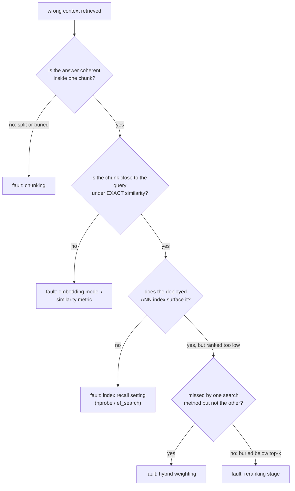

# Evaluación de la recuperación

Medir la calidad de la recuperación y diagnosticar un fallo. Pensado para consultar al evaluar o depurar un pipeline.

## Recall@k y MRR

| Métrica | Pregunta | ¿Sensible a la posición exacta? |
|---|---|---|
| Recall@k | Sobre las consultas de prueba, qué fracción tuvo un documento relevante en algún lugar de los k primeros | No: la posición 1 y la posición k cuentan ambas como un acierto |
| MRR (mean reciprocal rank) | Promedio de `1/rank` del primer resultado relevante, entre las consultas | Sí: la posición 1 aporta 1.0, la posición 10 aporta 0.1 |

Recall@k crece a medida que crece k; es una pregunta de presupuesto (si el sistema aguas abajo solo mira los k primeros, recall@k dice con qué frecuencia tuvo la oportunidad de encontrar la respuesta). MRR premia colocar la respuesta correcta lo más arriba posible, la información que recall@k descarta.

**Ejemplo resuelto**, cuatro consultas, posiciones del primer resultado relevante 1, 3, 1, 8:

```text
recall@1: ranks <= 1 are queries 1 and 3 -> 2/4 = 0.50
recall@5: ranks <= 5 are queries 1, 2, 3 (ranks 1, 3, 1); query 4 (rank 8) misses -> 3/4 = 0.75
MRR: (1/1 + 1/3 + 1/1 + 1/8) / 4 = (1.000 + 0.333 + 1.000 + 0.125) / 4 ~= 0.615
```

recall@5 dice que tres de cada cuatro consultas encontrarían su respuesta dentro de los 5 primeros. El 0.615 de MRR refleja que la mayoría de los aciertos quedaron en la posición 1, con un acierto más débil y un fallo que arrastran el promedio hacia abajo.

## Elegir k, y elegir entre las métricas

El k correcto para recall@k es el que el sistema aguas abajo usa realmente: si solo los 5 primeros chunks llegan a la generación, recall@100 mide algo que el pipeline nunca aprovecha. MRR es más informativo cuando importa mucho solo el primer resultado; recall@k es más informativo cuando varios resultados dentro de un presupuesto son todos utilizables. Reportar ambos, con el k que el pipeline usa realmente, da una imagen más completa que cualquiera de los dos por separado.

## Diagnosticar el pipeline: aislar antes de ajustar

"Se recuperó contexto erróneo" es un síntoma, no un diagnóstico. Comprueba las etapas en orden, para que el fallo de una etapa anterior no te haga desperdiciar esfuerzo ajustando una posterior:



| Comprobación | Qué aísla |
|---|---|
| Sacar el chunk que debería responder una consulta fallida conocida | Si el [chunking](chunking-and-embeddings.md) dio a la respuesta una representación coherente siquiera; ninguna etapa posterior puede arreglar una respuesta partida o enterrada |
| Similitud exacta (sin pasar por el índice ANN) | Si el modelo de embeddings o la métrica de similitud colocan el chunk correcto cerca de la consulta, con independencia del ajuste del índice |
| Índice ANN desplegado, una vez confirmado que el embedding está cerca | Si [el ajuste de recall del índice](vector-search-and-indexing.md) (`nprobe` / `ef_search`) está ajustado de forma demasiado agresiva hacia la velocidad |
| Comparar solo vectorial frente a solo BM25 frente a híbrida | Si [la mezcla híbrida](hybrid-search.md) está infraponderando el método que lo habría hecho aparecer |
| Comprobar el top-k final tras la fusión | Si se recuperó pero se ordenó demasiado abajo, si falta [reranking](reranking.md) o está mal ajustado |

## Diagnostica sobre un conjunto de consultas, no sobre una anécdota

Una sola consulta fallida puede fallar por una razón aislada (una formulación inusual) y no por un problema sistemático. Medir recall@k y MRR en cada etapa (recuperación inicial, tras la fusión híbrida, tras el reranking) sobre un conjunto pequeño de fallos conocidos y representativos revela dónde ocurre la mayor caída agregada.

## Relacionado

- [Lección 10](../lessons/0010-recall-at-k-and-mrr.md), [Lección 11](../lessons/0011-diagnosing-the-pipeline.md)
- [Chunking y embeddings](chunking-and-embeddings.md), [Búsqueda vectorial e indexación](vector-search-and-indexing.md), [Búsqueda híbrida](hybrid-search.md), [Reranking](reranking.md): las etapas entre las que aísla el procedimiento de diagnóstico de esta hoja
