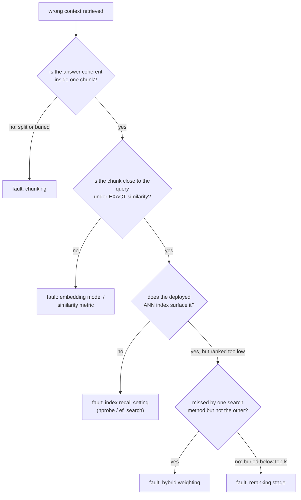

# Évaluation de la récupération

Mesurer la qualité de la récupération et diagnostiquer une défaillance. Conçu pour la consultation lors de l'évaluation ou du débogage d'un pipeline.

## Recall@k et MRR

| Métrique | Demande | Sensible au rang exact ? |
|---|---|---|
| Recall@k | Sur les requêtes de test, quelle fraction avait un document pertinent quelque part parmi les k premiers | Non : le rang 1 et le rang k comptent tous deux comme un succès |
| MRR (mean reciprocal rank) | Moyenne de `1/rank` du premier résultat pertinent, sur les requêtes | Oui : le rang 1 contribue 1,0, le rang 10 contribue 0,1 |

Recall@k augmente avec k ; c'est une question de budget (si l'aval ne regarde que les k premiers, recall@k dit à quelle fréquence il a eu la chance de trouver la réponse). MRR récompense le fait de classer la bonne réponse le plus haut possible, l'information que recall@k jette.

**Exemple détaillé**, quatre requêtes, rangs du premier résultat pertinent 1, 3, 1, 8 :

```text
recall@1: ranks <= 1 are queries 1 and 3 -> 2/4 = 0.50
recall@5: ranks <= 5 are queries 1, 2, 3 (ranks 1, 3, 1); query 4 (rank 8) misses -> 3/4 = 0.75
MRR: (1/1 + 1/3 + 1/1 + 1/8) / 4 = (1.000 + 0.333 + 1.000 + 0.125) / 4 ~= 0.615
```

recall@5 dit que trois requêtes sur quatre trouveraient leur réponse parmi les 5 premiers. Le 0,615 du MRR reflète que la plupart des succès sont arrivés au rang 1, avec un succès plus faible et un échec qui tirent la moyenne vers le bas.

## Choisir k, et choisir entre les métriques

Le bon k pour recall@k est ce que le système en aval utilise réellement : si seuls les 5 premiers chunks atteignent la génération, recall@100 mesure quelque chose que le pipeline n'exploite jamais. MRR est le plus informatif quand seul le tout premier résultat compte beaucoup ; recall@k est plus informatif quand plusieurs résultats dans un budget sont tous exploitables. Rapporter les deux, au k que le pipeline utilise réellement, donne un tableau plus complet que l'un ou l'autre seul.

## Diagnostiquer le pipeline : isoler avant de régler

« Contexte récupéré faux » est un symptôme, pas un diagnostic. Vérifiez les étapes dans l'ordre, pour que la faute d'une étape antérieure ne vous fasse pas perdre du temps à en régler une ultérieure :



| Vérification | Ce qu'elle isole |
|---|---|
| Sortir le chunk qui devrait répondre à une requête en échec connue | Si le [chunking](chunking-and-embeddings.md) a donné à la réponse une représentation cohérente tout court ; aucune étape ultérieure ne peut réparer une réponse coupée ou enfouie |
| Similarité exacte (qui contourne l'index ANN) | Si le modèle d'embedding ou la métrique de similarité place le bon chunk près de la requête, indépendamment du réglage de l'index |
| Index ANN déployé, une fois l'embedding confirmé proche | Si [le réglage de recall de l'index](vector-search-and-indexing.md) (`nprobe` / `ef_search`) est réglé trop agressivement vers la vitesse |
| Comparer vectoriel seul, BM25 seul et hybride | Si [le mélange hybride](hybrid-search.md) sous-pondère la méthode qui l'aurait fait remonter |
| Vérifier le top-k final après fusion | S'il est récupéré mais classé trop bas, si le [reranking](reranking.md) est absent ou mal réglé |

## Diagnostiquer sur un jeu de requêtes, pas sur une anecdote

Une seule requête en échec peut échouer pour une raison ponctuelle (formulation inhabituelle) plutôt que pour un problème systémique. Mesurer recall@k et MRR à chaque étape (récupération initiale, après fusion hybride, après reranking) sur un petit ensemble d'échecs connus et représentatifs révèle où se produit la plus grosse chute globale.

## Voir aussi

- [Leçon 10](../lessons/0010-recall-at-k-and-mrr.md), [Leçon 11](../lessons/0011-diagnosing-the-pipeline.md)
- [Chunking et embeddings](chunking-and-embeddings.md), [Recherche vectorielle et indexation](vector-search-and-indexing.md), [Recherche hybride](hybrid-search.md), [Reranking](reranking.md) : les étapes entre lesquelles la procédure de diagnostic de cette fiche isole la faute
