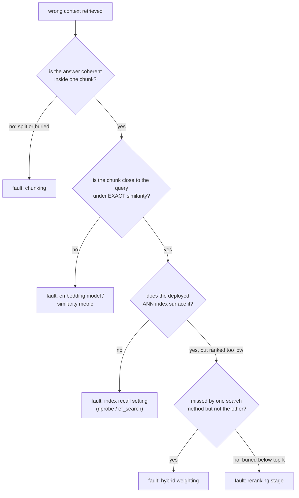

# Retrieval Evaluation

Retrieval की गुणवत्ता मापना और विफलता को diagnose करना। Pipeline को परखते या debug करते समय खोजने के लिए बनाया गया।

## Recall@k और MRR

| Metric | क्या पूछती है | क्या ठीक rank के प्रति संवेदनशील है? |
|---|---|---|
| Recall@k | Test queries में, कितने हिस्से के लिए शीर्ष k में कहीं कोई प्रासंगिक document था | नहीं: rank 1 और rank k, दोनों hit गिने जाते हैं |
| MRR (mean reciprocal rank) | Queries पर पहले प्रासंगिक नतीजे के `1/rank` का औसत | हाँ: rank 1 से 1.0 जुड़ता है, rank 10 से 0.1 |

Recall@k k बढ़ने के साथ बढ़ता है; यह budget का सवाल है (अगर आगे का हिस्सा सिर्फ़ शीर्ष k देखता है, तो recall@k बताता है कि उसे उत्तर ढूँढने का मौक़ा कितनी बार मिला)। MRR सही उत्तर को जितना हो सके उतना ऊँचा रखने को इनाम देता है, यानी वह जानकारी जो recall@k फेंक देता है।

**हल किया हुआ उदाहरण**, चार queries, पहले-प्रासंगिक-नतीजे की ranks 1, 3, 1, 8:

```text
recall@1: ranks <= 1 are queries 1 and 3 -> 2/4 = 0.50
recall@5: ranks <= 5 are queries 1, 2, 3 (ranks 1, 3, 1); query 4 (rank 8) misses -> 3/4 = 0.75
MRR: (1/1 + 1/3 + 1/1 + 1/8) / 4 = (1.000 + 0.333 + 1.000 + 0.125) / 4 ~= 0.615
```

recall@5 कहता है कि चार में से तीन queries को शीर्ष 5 के भीतर अपना उत्तर मिल जाएगा। MRR का 0.615 दिखाता है कि ज़्यादातर hits rank 1 पर आए, एक कमज़ोर hit और एक miss ने औसत को नीचे खींचा।

## k चुनना, और metrics के बीच चुनना

recall@k के लिए सही k वही है जो आगे का system असल में इस्तेमाल करता है: अगर generation तक सिर्फ़ शीर्ष 5 chunks पहुँचते हैं, तो recall@100 ऐसी चीज़ मापता है जिसका pipeline कभी फ़ायदा नहीं उठाता। MRR सबसे ज़्यादा जानकारी तब देता है जब सिर्फ़ सबसे ऊपर का नतीजा बहुत मायने रखता हो; recall@k ज़्यादा जानकारी तब देता है जब budget के भीतर कई नतीजे इस्तेमाल लायक हों। दोनों को उस k पर बताना जो pipeline असल में इस्तेमाल करता है, किसी अकेले से ज़्यादा पूरी तस्वीर देता है।

## Pipeline को diagnose करना: tune करने से पहले अलग करें

"ग़लत context retrieve हुआ" एक लक्षण है, diagnosis नहीं। चरणों को क्रम में जाँचें, ताकि किसी पहले चरण का दोष बाद वाले चरण को tune करने की मेहनत बर्बाद न करे:



| जाँच | क्या अलग करती है |
|---|---|
| ज्ञात विफल query का उत्तर देने वाला chunk निकालें | क्या [chunking](chunking-and-embeddings.md) ने उत्तर को सुसंगत प्रतिनिधित्व दिया भी; कोई बाद का चरण बँटे या दबे उत्तर को ठीक नहीं कर सकता |
| Exact similarity (ANN index को बाईपास करके) | क्या embedding model या similarity metric सही chunk को query के पास रखता है, index tuning से स्वतंत्र रूप से |
| तैनात ANN index, embedding के पास होने की पुष्टि के बाद | क्या [index की recall setting](vector-search-and-indexing.md) (`nprobe` / `ef_search`) रफ़्तार की ओर ज़रूरत से ज़्यादा tune है |
| सिर्फ़-vector बनाम सिर्फ़-BM25 बनाम hybrid की तुलना करें | क्या [hybrid मिश्रण](hybrid-search.md) उस तरीक़े को कम weight दे रहा है जो उसे सामने लाता |
| Fusion के बाद अंतिम शीर्ष-k जाँचें | अगर retrieve हुआ पर बहुत नीचे rank हुआ, तो क्या [reranking](reranking.md) ग़ायब है या कम tune है |

## किसी एक किस्से पर नहीं, query सेट पर diagnose करें

कोई एक विफल query किसी एक-बारगी कारण (असामान्य शब्दावली) से विफल हो सकती है, व्यवस्थागत समस्या से नहीं। ज्ञात, प्रतिनिधि विफलताओं के छोटे सेट पर हर चरण पर (शुरुआती retrieval, hybrid fusion के बाद, reranking के बाद) recall@k और MRR मापना दिखाता है कि कुल मिलाकर सबसे बड़ी गिरावट कहाँ होती है।

## संबंधित

- [पाठ 10](../lessons/0010-recall-at-k-and-mrr.md), [पाठ 11](../lessons/0011-diagnosing-the-pipeline.md)
- [Chunking और Embeddings](chunking-and-embeddings.md), [Vector Search और Indexing](vector-search-and-indexing.md), [Hybrid Search](hybrid-search.md), [Reranking](reranking.md): वे चरण जिनके बीच यह sheet की diagnostic प्रक्रिया अलग करती है
