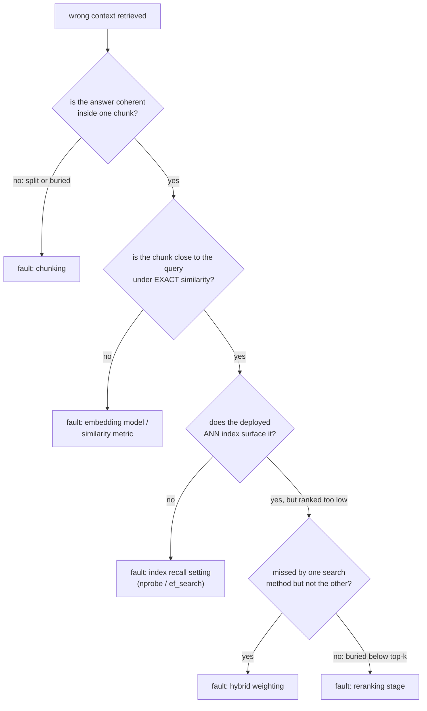

# Avaliação de Recuperação

Medir a qualidade da recuperação e diagnosticar uma falha. Feito para consulta ao avaliar ou depurar um pipeline.

## Recall@k e MRR

| Métrica | Pergunta | Sensível à posição exata? |
|---|---|---|
| Recall@k | Entre as consultas de teste, que fração teve um documento relevante em algum lugar do top k | Não: a posição 1 e a posição k contam ambas como acerto |
| MRR (mean reciprocal rank) | Média de `1/posição` do primeiro resultado relevante, entre as consultas | Sim: a posição 1 contribui com 1,0, a posição 10 contribui com 0,1 |

O recall@k cresce conforme k cresce; é uma questão de orçamento (se o sistema a jusante só olha o top k, o recall@k diz com que frequência ele teve a chance de encontrar a resposta). O MRR recompensa ranquear a resposta certa o mais alto possível, a informação que o recall@k joga fora.

**Exemplo resolvido**, quatro consultas, posições do primeiro resultado relevante 1, 3, 1, 8:

```text
recall@1: ranks <= 1 are queries 1 and 3 -> 2/4 = 0.50
recall@5: ranks <= 5 are queries 1, 2, 3 (ranks 1, 3, 1); query 4 (rank 8) misses -> 3/4 = 0.75
MRR: (1/1 + 1/3 + 1/1 + 1/8) / 4 = (1.000 + 0.333 + 1.000 + 0.125) / 4 ~= 0.615
```

O recall@5 diz que três de quatro consultas encontrariam a resposta dentro do top 5. O 0,615 do MRR reflete que a maioria dos acertos caiu na posição 1, com um acerto mais fraco e uma falha puxando a média para baixo.

## Escolhendo o k, e escolhendo entre as métricas

O k certo para o recall@k é aquele que o sistema a jusante de fato usa: se apenas os 5 primeiros chunks chegam à geração, o recall@100 mede algo que o pipeline nunca aproveita. O MRR é mais informativo quando só o resultado do topo importa muito; o recall@k é mais informativo quando vários resultados dentro de um orçamento são todos utilizáveis. Reportar os dois, no k que o pipeline de fato usa, dá um quadro mais completo do que qualquer um sozinho.

## Diagnosticando o pipeline: isole antes de ajustar

"Contexto errado recuperado" é um sintoma, não um diagnóstico. Verifique as etapas em ordem, para que o defeito de uma etapa anterior não desperdice esforço ajustando uma posterior:



| Verificação | O que isola |
|---|---|
| Buscar o chunk que deveria responder a uma consulta que sabidamente falha | Se o [chunking](chunking-and-embeddings.md) deu à resposta uma representação coerente; nenhuma etapa posterior consegue consertar uma resposta dividida ou enterrada |
| Similaridade exata (ignorando o índice ANN) | Se o modelo de embedding ou a métrica de similaridade coloca o chunk correto perto da consulta, independentemente do ajuste do índice |
| Índice ANN implantado, depois de confirmado que o embedding está próximo | Se [a configuração de recall do índice](vector-search-and-indexing.md) (`nprobe` / `ef_search`) está ajustada agressivamente demais em favor da velocidade |
| Comparar apenas vetorial contra apenas BM25 contra híbrido | Se [a mistura híbrida](hybrid-search.md) está dando peso de menos ao método que o teria trazido à tona |
| Verificar o top-k final depois da fusão | Se foi recuperado mas ranqueado baixo demais, se o [reranking](reranking.md) está ausente ou mal ajustado |

## Diagnostique em um conjunto de consultas, não em uma anedota

Uma única consulta que falha pode falhar por um motivo pontual (formulação incomum) e não por um problema sistêmico. Medir recall@k e MRR em cada etapa (recuperação inicial, depois da fusão híbrida, depois do reranking) sobre um pequeno conjunto de falhas conhecidas e representativas revela onde ocorre a maior queda agregada.

## Relacionado

- [Lição 10](../lessons/0010-recall-at-k-and-mrr.md), [Lição 11](../lessons/0011-diagnosing-the-pipeline.md)
- [Chunking e Embeddings](chunking-and-embeddings.md), [Busca Vetorial e Indexação](vector-search-and-indexing.md), [Busca Híbrida](hybrid-search.md), [Reranking](reranking.md): as etapas entre as quais o procedimento de diagnóstico desta folha isola
