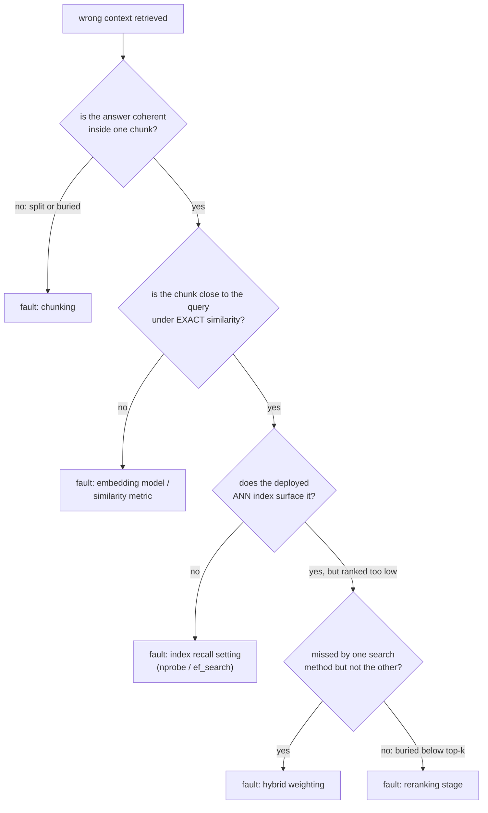

# Оценка поиска

Измерение качества поиска и диагностика сбоя. Для быстрого поиска при оценке или отладке конвейера.

## Recall@k и MRR

| Метрика | Что спрашивает | Чувствительна ли к точному рангу? |
|---|---|---|
| Recall@k | По тестовым запросам, у какой доли релевантный документ оказался где-то среди k лучших | Нет: место 1 и место k оба считаются попаданием |
| MRR (средний обратный ранг) | Среднее `1/rank` первого релевантного результата по запросам | Да: место 1 вносит 1,0, место 10 вносит 0,1 |

Recall@k растёт с ростом k; это вопрос бюджета (если нижестоящая система смотрит только на k лучших, recall@k говорит, как часто она получила шанс найти ответ). MRR вознаграждает постановку верного ответа как можно выше, то есть ту информацию, которую recall@k выбрасывает.

**Разобранный пример**, четыре запроса, места первого релевантного результата 1, 3, 1, 8:

```text
recall@1: ranks <= 1 are queries 1 and 3 -> 2/4 = 0.50
recall@5: ranks <= 5 are queries 1, 2, 3 (ranks 1, 3, 1); query 4 (rank 8) misses -> 3/4 = 0.75
MRR: (1/1 + 1/3 + 1/1 + 1/8) / 4 = (1.000 + 0.333 + 1.000 + 0.125) / 4 ~= 0.615
```

recall@5 говорит, что три запроса из четырёх нашли бы свой ответ среди 5 лучших. MRR, равный 0,615, отражает, что большинство попаданий пришлось на место 1, а одно более слабое попадание и один промах тянут среднее вниз.

## Выбор k и выбор между метриками

Верное k для recall@k это то, что на самом деле использует нижестоящая система: если на генерацию попадают только 5 лучших чанков, recall@100 измеряет то, чем конвейер никогда не пользуется. MRR наиболее информативна, когда очень важен только самый верхний результат; recall@k информативнее, когда в рамках бюджета пригодны несколько результатов. Отчёт по обеим на том k, которое конвейер на самом деле использует, даёт более полную картину, чем любая из них в одиночку.

## Диагностика конвейера: изолировать до настройки

«Найден неверный контекст» это симптом, а не диагноз. Проверяйте этапы по порядку, чтобы неисправность более раннего этапа не тратила усилия на настройку более позднего:



| Проверка | Что изолирует |
|---|---|
| Откройте чанк, который должен отвечать на известный сбойный запрос | Дал ли [чанкинг](chunking-and-embeddings.md) ответу связное представление вообще; ни один последующий этап не может исправить разрезанный или погребённый ответ |
| Точное сходство (в обход ANN-индекса) | Ставит ли модель эмбеддингов или метрика сходства верный чанк рядом с запросом независимо от настройки индекса |
| Развёрнутый ANN-индекс, когда подтверждена близость эмбеддинга | Не настроена ли [настройка полноты индекса](vector-search-and-indexing.md) (`nprobe` / `ef_search`) слишком агрессивно на скорость |
| Сравните только векторный, только BM25 и гибридный | Не занижает ли [гибридная смесь](hybrid-search.md) метод, который вывел бы его |
| Проверьте итоговые k лучших после слияния | Если найден, но стоит слишком низко, отсутствует ли [реранкинг](reranking.md) или недонастроен |

## Диагностируйте по набору запросов, а не по одному анекдоту

Один сбойный запрос может сбоить по единичной причине (необычная формулировка), а не из-за системной проблемы. Измерение recall@k и MRR на каждом этапе (начальный поиск, после гибридного слияния, после реранкинга) по небольшому набору известных, репрезентативных сбоев показывает, где происходит наибольшее суммарное падение.

## Связанные материалы

- [Урок 10](../lessons/0010-recall-at-k-and-mrr.md), [Урок 11](../lessons/0011-diagnosing-the-pipeline.md)
- [Чанкинг и эмбеддинги](chunking-and-embeddings.md), [Векторный поиск и индексация](vector-search-and-indexing.md), [Гибридный поиск](hybrid-search.md), [Реранкинг](reranking.md): этапы, между которыми диагностическая процедура этой шпаргалки проводит различие
